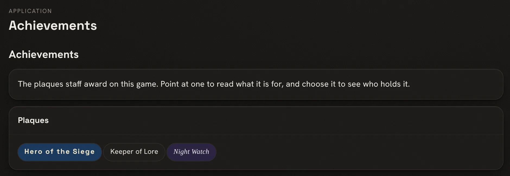
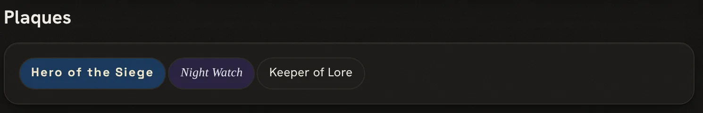

The achievements package gives staff **plaques** to award: a name on a pill of its own colours, a
few words about what it is for, and, on each award, a citation saying why. Nothing is awarded
automatically. A character holds as many as they are given and picks a few to feature.

| You want to | Read |
|---|---|
| turn it on | [Installing](#installing) |
| see your plaques or someone else's | [Reading plaques](#reading-plaques) |
| choose which plaques show beside your name | [Featuring](#featuring) |
| make a plaque and give it a look | [Making plaques](#making-plaques) |
| award one, or take it back | [Awarding](#awarding) |

The examples follow Ada, who holds two plaques, and Morgan, a staff member who awards them. The pictures show Ariel, another player.

## Installing

Install the packages from **Packages** in Build & manage:

| Package | Adds |
|---|---|
| achievements | `+achievements` and the `softcode.achievements.admin` permission |
| achievements-app | the **Achievements** page in the portal, under Community |
| achievements-profile | a character's plaques at the bottom of their profile page |
| achievements-finger | the plaques a character features, as the Plaques field on `+oocfinger`. Needs the finger package |
| achievements-help | the topics in `+help`. Needs the plus-help package |
| achievements-config | the settings in `+config`. Needs the plus-config package |

Allow `softcode.achievements.admin` to the staff who make and award plaques, on a role or for one
character:

```
> @permission/allow *Morgan=softcode.achievements.admin
Morgan: allows softcode.achievements.admin.
```

## Reading plaques

`+achievements` shows the plaques you hold, and `+achievements <player>` someone else's. Each shows
its description, the citation and when it was awarded:

```
> +achievements
=< Ada * 2 plaques >==========================================================
+===========================<  Hero of the Siege  >==========================+
| Held the north gate through the night.                                     |
+============================================================================+
| For holding the north gate                                                 |
| Awarded 23 Nov 2026                                                        |
+============================================================================+
+=============================< Keeper of Lore >=============================+
| Kept the archive through the flood.                                        |
+============================================================================+
| Awarded 23 Nov 2026                                                        |
+============================================================================+
+achievements/feature <plaque> features one * +achievements/list shows every plaque
```

`+achievements/list` lists every plaque on the game and how many hold it, and
`+achievements/view <plaque>` shows one and who holds it. A plaque is named by its number, its name,
or the start of its name when only one starts that way.

On the website, the **Achievements** page shows every plaque as a pill in its colours. Point at one
to read what it is for, and choose it to see who holds it.



## Featuring

You choose which of your plaques to feature, up to three unless the game changes that. They come
first in `+achievements` and on your profile, and `+oocfinger` shows them beside your name:

```
> +achievements/feature hero
[ACHIEVEMENTS] Done: You feature  Hero of the Siege  now.
> +achievements/feature hero
[ACHIEVEMENTS] Warning: You feature Hero of the Siege already.
```

`+achievements/unfeature <plaque>` stops featuring one. A plaque taken back stops showing at once.



## Making plaques

`+achievements/create <name>=<description>` makes a plaque. It gets a number, which never changes,
so renaming the plaque keeps every award:

```
> +achievements/create Hero of the Siege=Held the north gate through the night.
[ACHIEVEMENTS] Done: Plaque 1, Hero of the Siege, is made. +achievements/award <player>=1 awards it.
```

`+achievements/describe` changes the description, `+achievements/rename` the name, and
`+achievements/destroy` destroys a plaque. One somebody holds needs `=yes` after it, and is taken
from them. Renaming and destroying need the whole name or the number.

A plaque's look:

| Command | Sets |
|---|---|
| `+achievements/colour <plaque>=<text>/<background>` | the text and background colours, each `#rrggbb` or a name such as `+gold`. Nothing after the `=` gives the theme's colours |
| `+achievements/style <plaque>=<styles>` | any of `bold`, `italic` and `underline` |
| `+achievements/typeface <plaque>=<typeface>` | the face on the website: `title` or `mono`, the theme's own, or `serif`, `sans` or `script` |
| `+achievements/css <plaque>=<declarations>` | optional CSS for the pill on the website, such as `letter-spacing: 0.1em` |

The two colours need a contrast of 4.5:1 or more. Contrast is lightness, which every kind of colour
vision sees, so a pair that passes reads for everyone, in every portal theme. CSS cannot set colours
or the face, which have their own commands, and cannot move, hide or lay the pill over the page:

```
> +achievements/colour hero=#f5e9c8/#1b3a5c
[ACHIEVEMENTS] Done:  Hero of the Siege  is #f5e9c8 on #1b3a5c now.
> +achievements/colour hero=#777777/#888888
[ACHIEVEMENTS] Warning: Those colours are too close to read: 1.3:1, and a plaque needs 4.5:1. Make one lighter or darker.
> +achievements/css hero=color: red
[ACHIEVEMENTS] Warning: A plaque's CSS cannot set color: colours come from /colour, where their contrast is checked, the face from /typeface, and the pill stays where it is drawn.
```

The Achievements page has forms for all of this for staff holding the permission.

## Awarding

`+achievements/award <player>=<plaque>` awards a plaque, and `/<citation>` after it says why. The
player is told:

```
> +achievements/award Ada=hero/For holding the north gate
[ACHIEVEMENTS] Done: Ada holds  Hero of the Siege  now.
```

Ada sees:

```
[ACHIEVEMENTS] Done: You were awarded the plaque  Hero of the Siege . +achievements shows it.
```

`+achievements/revoke <player>=<plaque>` takes it back.

An award, who gave it and why, and the plaques a character features are kept on that character, in
`ACHIEVEMENT` attributes only wizards change, so nobody can give themselves a plaque. The plaques
themselves are kept on the Achievements Store, inside the Achievements object in the master room.
