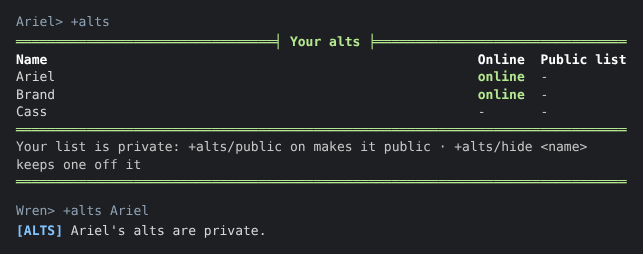
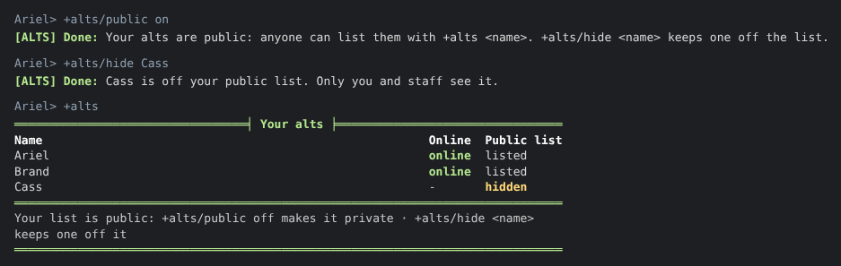
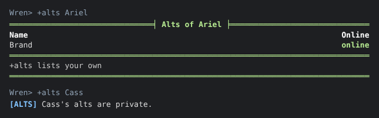
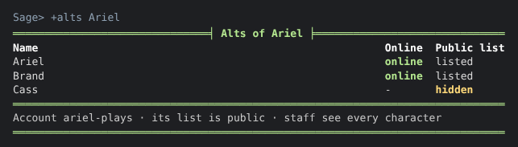

import { Aside } from '@astrojs/starlight/components';

The **alts** package adds `+alts`, which lists the characters on your account: your alts.

- `+alts` lists every character on your account, and whether each is online.
- `+alts <name>` lists someone else's, when they have chosen to let others see them.
- `+alts/public on` lets others see yours. Until you do, only you and staff can.
- `+alts/hide <name>` keeps one of your characters off the list others see.

| You are | You want to | Read |
|---|---|---|
| A player | see your own alts | [Your alts](#your-alts) |
| A player | let others see them | [Making your list public](#making-your-list-public) |
| A player | keep one alt to yourself | [Hiding an alt](#hiding-an-alt) |
| A player | see someone else's | [Someone else's alts](#someone-elses-alts) |
| Staff | see any account's characters | [For staff](#for-staff) |
| Staff | install it | [Running the package](#running-the-package) |

In the game, `+help alts` has the same commands in short form, and `+help alts staff` the staff
part.

## Your alts

`+alts` lists every character on your account, whether each is online, and whether it is on your
public list:

```
> +alts
═════════════════════════════════╡ Your alts ╞════════════════════════════════
Name                                                       Online  Public list
Ariel                                                      online  -
Brand                                                      online  -
Cass                                                       -       -
══════════════════════════════════════════════════════════════════════════════
Your list is private: +alts/public on makes it public · +alts/hide <name>
keeps one off it
══════════════════════════════════════════════════════════════════════════════
```

You see all of them, from any of your characters, whatever you have chosen to show others.
`+alts <name>` with the name of one of your own characters shows this same list.

A character shows as online only when you could already see it connected in `WHO`, so a
character that is connected but hidden from `WHO` shows `-`.

A character that is on no account has no alts, and `+alts` says so.

## Making your list public

Your list is private until you make it public. Asked about a character whose list is private,
`+alts` says only that:



`+alts/public on` lets anyone list your alts with `+alts <name>`:

```
> +alts/public on
[ALTS] Done: Your alts are public: anyone can list them with +alts <name>. +alts/hide <name> keeps one off the list.
```

`+alts/public off` makes the list private again, so only you and staff see it.
`+alts/public` on its own says which it is now.

The choice is for your whole account, not one character. You can make it from any of your
characters, and a character added to your account later is listed too. A new account's list is
private.

## Hiding an alt

`+alts/hide <name>` keeps one of your characters off your public list. The rest stay on it:



```
> +alts/hide Cass
[ALTS] Done: Cass is off your public list. Only you and staff see it.
```

`+alts/unhide <name>` puts it back. You can hide only a character on your own account.

A hidden character is never linked to your others: anyone who asks about it is told its alts
are private, exactly as if your whole list were.

When a character leaves your account, the account forgets whether it was hidden. If it ever
comes back, it is on your public list again until you hide it.

## Someone else's alts

`+alts <name>` lists another player's alts when their list is public and the character you
named is on it. The character you asked about is not listed again, and a hidden one is left out:

```
> +alts Ariel
═══════════════════════════════╡ Alts of Ariel ╞══════════════════════════════
Name                                                                    Online
Brand                                                                   online
══════════════════════════════════════════════════════════════════════════════
+alts lists your own
══════════════════════════════════════════════════════════════════════════════
> +alts Cass
[ALTS] Cass's alts are private.
```



You are given the same sentence, `<name>'s alts are private.`, when:

- that player's list is private;
- that character is hidden;
- that character is on no account.

So `+alts` never tells you how many alts someone has, whether they have any, or which of these
is the reason.

A player whose list is public but who hid every other character is said to list no other
characters.

## For staff

Staff with the `players.view` permission see every character on an account with
`+alts <name>`, whatever the account chose. Hidden characters are marked, and the footer names
the account and says whether its list is public:

```
> +alts Ariel
═══════════════════════════════╡ Alts of Ariel ╞══════════════════════════════
Name                                                       Online  Public list
Ariel                                                      online  listed
Brand                                                      online  listed
Cass                                                       -       hidden
══════════════════════════════════════════════════════════════════════════════
Account ariel-plays · its list is public · staff see every character
══════════════════════════════════════════════════════════════════════════════
```



Asked about a character on no account, staff are told so.

<Aside>
`players.view` is the permission the `account()` and `accountchars()` functions check. Wizards
hold it. See [`@permission`](/reference/sharpmush-help/permission-command/) for giving it to
another role.
</Aside>

## Running the package

### Installing

The alts package ships with the server but is not installed on a new game. An administrator
installs it from the portal:

1. Open **Packages** in the admin area and choose **Browse**.
2. Install `alts`. It needs an event handler, which is chosen in first-run setup. Its `+help` topics come with it, through the `alts-help` bridge, wherever `+help` is installed.

It adds the command `+alts` for everyone. It is a game command, which is matched before
softcode `$`-commands, so a `+alts` your game already has in softcode stops running once the
package is in. Nothing a player types after `+alts` is evaluated.

It makes one object in the master room, **Alts**, which runs the command. Inside it are the
**Alts Store**, which keeps each account's choices, and the object holding its `+help` topics.
It also adds an attribute to the event handler, so that a character leaving an account is
forgotten as hidden.

See [Softcode Packages](/guides/packages) for how installing, upgrading and rolling back work.

### Where the choices are kept

Each account's choices are kept on the Alts Store, by account, never on a character, so a
choice made from one character holds for all of them:

| Attribute | What it is |
|---|---|
| ``ACCOUNT`<key>`PUBLIC`` | `1` when the account's list is public. Unset is private. |
| ``ACCOUNT`<key>`HIDDEN`<character>`` | One for each character the account hid. |

`<key>` is the account's id, as `account()` gives it, with `/` and `:` written as `_`.
