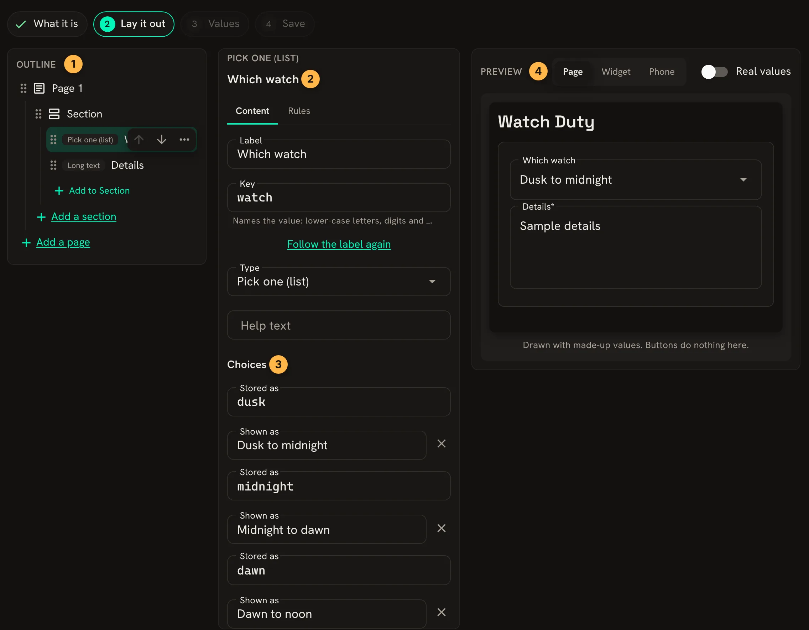
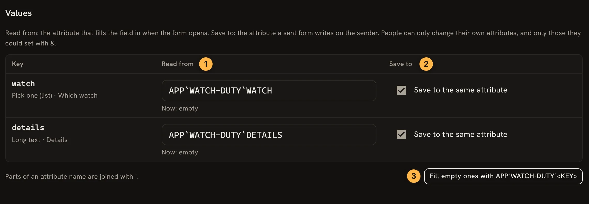
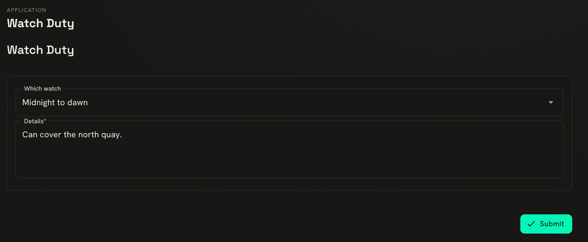

The **Application builder** makes a [portal application](/guides/applications) without any code:
a form players fill in, a sheet that shows a character's values, or a widget for other pages. It
walks through four steps and keeps the result as JSON in an attribute, which a softcoder can still
edit by hand afterwards.

The examples follow God building a Watch Duty form for the Harbour Watch, and Marrow filling it
in.

## Starting an app

Open **Build & manage**, **Application builder** (`/build/apps`). Every character can use it on an
object they control. Pick a starting point:

- **Blank**: one empty page.
- **Character sheet**: a few details, traits as chips and scores as tiles.
- **Request form**: a subject, a kind and details.
- **Profile editor**: a form that shows a character's profile values and saves their changes.

Watch Duty starts from **Request form**.

## What it is

Give it a **Name**, shown as its title and in the menu. The address name follows it, so
`Watch Duty` becomes `/apps/watch-duty`. Then say whether people read it or fill it in and send
it, and whether it is a page of its own or a widget placed on other pages.

## Laying it out



1. The outline: pages, sections and the fields in them. **Add to Section** adds a field, and the
   `...` beside one deletes or duplicates it.
2. The chosen field's label and key. The key names the value and follows the label until you
   change it.
3. A pick-one field's choices. **Stored as** is what is saved, and **Shown as** what the player
   sees.
4. The preview, at page, widget or phone width.

For Watch Duty, the Subject field is deleted and the kind field becomes **Which watch**, with the
key `watch` and three choices: `dusk`, `midnight` and `dawn`.

## Values



1. **Read from** is the attribute that fills the field in when the form opens.
2. **Save to** is the attribute a sent form writes on the sender. Ticking **Save to the same
   attribute** uses the one it reads from.
3. **Fill empty ones** names every empty attribute after the app and the key.

A form only writes attributes on the person who sends it, and only ones they could set themselves
with `&`.

## Saving

The last step checks for problems and asks for the object to keep it on. Watch Duty goes on the
Watch Office, `#55`, which God controls. The step lists the attributes it writes there,
`` DATA`APP`WATCH-DUTY `` and three beside it, and then offers:

- **Save and show** adds it to the portal at once, as a page in the Play menu or as a widget in
  the layout editor. This needs the `applications.admin` permission.
- **Only save it** keeps it on the object, for staff to show later under **Applications**
  (`/admin/applications`).

## Filling it in

Marrow opens `/apps/watch-duty`, picks a watch and sends it:



The form saves the stored value, not the words shown:

```
> think get(me/APP`WATCH-DUTY`WATCH) / [get(me/APP`WATCH-DUTY`DETAILS)]
midnight / Can cover the north quay.
```

When Marrow opens the form again, it shows what was sent last time, because each field reads from
the attribute it saves to. Staff softcode can read the same attributes to draw up the rota.

## Changing it later

**Your apps**, on the builder's first screen, lists what you have saved. Open one to change it,
or give an object and address name under **Open a saved one**. **The game's apps** lists apps from
installed packages whose layout the builder can change. A package upgrade keeps your change,
and asks which to keep when the upgrade changes the same layout.

## Next steps

- [Portal Applications](/guides/applications) for who can open an app and where it shows.
- [Building Portal Applications](/guides/building-applications) to write one in softcode, with
  routes behind its buttons.
