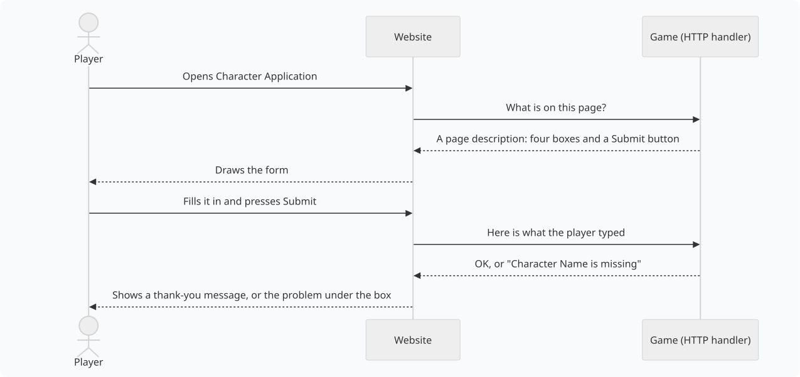

import { Aside } from '@astrojs/starlight/components';

An **application** is a page or panel on your game's website that your game builds for
itself. A character application form, the Jobs page where players ask staff for help, and
a character card on the front page can all be applications.

Nobody has to change the website to add one. Staff write the page in softcode, the same
way they write `+commands`, and the website draws whatever the game describes.

This page is for players and staff. Read the part that fits you:

| You are | You want to | Read |
|---|---|---|
| A player | find an application and fill it in | [Using applications](#using-applications) |
| Staff | add a ready-made application to your game | [Adding an application](#adding-an-application) |
| A softcoder | build an application of your own | [Building Portal Applications](/guides/building-applications) |

## Words used on this page

| Word | What it means |
|---|---|
| **Application** | A page or panel on the website that the game describes in softcode. |
| **Page application** | An application with a page of its own, at an address like `/apps/chargen`, and a link in the sidebar. |
| **Widget application** | An application shown as a panel inside another page, such as the front page. |
| **HTTP handler** | The object in your game that answers the website. It is usually `#8`; type `@config http_handler` to check. |
| **Route** | One address the HTTP handler answers, such as `/http/chargen/schema`. Each route is an attribute on the handler, such as ``GET`CHARGEN`SCHEMA``. |
| **Page description** | The text a route sends back to say what is on the page: its title, its boxes and its buttons. Developers call it a *schema*. |
| **Package** | A bundle of softcode that staff install from the admin area in one step. |

## How an application works

The website never decides what an application shows. Each time someone opens one, the
website asks the game, and the game answers.

The same steps in words:

1. A player opens an application on the website.
2. The website asks your game what belongs on that page.
3. Your game answers with a page description, and the website draws it.
4. The player fills it in and presses a button.
5. The website sends what they typed to your game.
6. Your game checks it, stores it, and says whether it worked. The website shows the answer.

Because the game does all the deciding, staff can change an application in-game and the
website shows the change the next time the page is opened.

## Using applications

**Where to find them.** Page applications appear as links in the website's sidebar. Your
game chooses which group of the sidebar each one sits in; the Jobs application, for
example, sits under *Support*. Widget applications appear as panels on other pages, such
as the front page or the play screen.

**Filling in a form.**

- Type into the boxes and pick from the lists. A box marked with `*` must be filled in.
- A form with several steps shows *Step 1 of 3* at the top, with **Next** and **Back**
  buttons. The form is not submitted until you press **Submit** on the last step.
- Some forms change as you go. Picking a class, for example, can add questions that only
  that class needs.

**After you press Submit.**

- If everything is fine, a short message appears, such as *Thank you! Staff will read your
  application soon.* Some forms then take you to another page.
- If something needs fixing, red text appears under the box it is about. What you typed is
  still there; fix it and press **Submit** again.

**Can't find an application?** Some are only for certain players: staff tools, or forms
for players who already have a character. If you think you should see one and don't, ask
your game's staff.

## Adding an application

Every application has two halves, and you need both:

1. **The softcode** lives on your HTTP handler. It describes the page and decides what
   happens when someone presses a button.
2. **The registration** is a short record in the admin area. It names the application,
   gives it an address and a sidebar link, and says who may open it.

The softcode without a registration does nothing visible. A registration without the
softcode is a link to an empty page.

### The easy way: install a package

Many applications come as a pair of packages: one with the softcode, and one ending in
`-app` that registers it. The Jobs application, for example, is the `jobs` package plus
the `jobs-app` package.

1. Open **Packages** in the admin area and choose **Browse**.
2. Install the softcode package first (`jobs`), then the `-app` package (`jobs-app`).
   The `-app` package will not install without the first one, and tells you so.
3. If the package asks who may open the application, pick a role (see
   [Who can open it](#who-can-open-it)).

The application's link appears in the sidebar straight away. Uninstalling the `-app`
package removes the link and the registration but leaves the softcode in place;
uninstall the softcode package as well to remove everything.

### By hand: register it yourself

If someone gave you the softcode, or you wrote it, register it yourself. Open
**Applications** in the admin area (`/admin/applications`) and choose **New application**.
You need to be a wizard, or to hold the `applications.admin` permission.

| Box | What to put in it | Jobs uses |
|---|---|---|
| **Slug** | A short name with no spaces. It becomes the address, `/apps/<slug>`. You can't change it later. | `jobs` |
| **Display name** | The name players see in the sidebar. | `Jobs` |
| **Kind** | **Page** for a page of its own, **Widget** for a panel inside other pages. | Page |
| **Minimum role** | The lowest role that may open it. See [Who can open it](#who-can-open-it). | Player |
| **Permission** | Optional. A permission players must also hold, such as `jobs.staff`. Leave it empty if the role is enough. | (empty) |
| **Schema URL** | The route that sends the page description. Whoever wrote the softcode will tell you. | `http/jobs/schema?at={path}` |
| **Data URL** | Optional. The route that sends the information shown on the page. | `http/jobs/data?at={path}` |
| **Submit route** | Optional. A note of where the buttons send their answers. The page description already says this, so you can leave it empty. | `http/jobs/act` |
| **Icon** | Optional. The name of a [Material icon](https://fonts.google.com/icons), such as `support_agent`. | `support_agent` |
| **Sidebar route** | Optional. A route that sends this application's own sidebar links. | `http/jobs/nav` |
| **OOB package** | Optional. Live data the game pushes, such as `weather.now`, used instead of the Data URL. | (empty) |
| **Nav placement** | The sidebar group the link goes in: `Play`, `World`, `Build` or `Manage`, or a new name of your own, which makes a new group. Leave it empty to have no link. | `Support` |
| **Order** | Where the link sits in its group. Lower numbers come first. | `40` |
| **Layout scope** | Widgets only. The kind of page the widget joins, such as `play`; see [Page or widget](#page-or-widget). | (empty) |

Press **Save**. Before it saves, the website asks your game for the page description. If
the game does not answer, or answers with something that isn't JSON, you see an error and
nothing is saved; see [When something goes wrong](#when-something-goes-wrong). The check
stops there: JSON that isn't a page description still saves, so open the application
afterwards to make sure it looks right.

### Who can open it

**Minimum role** sets the lowest role that sees the sidebar link and may open the page.
Everyone above that role can open it too.

| Minimum role | Who can open it |
|---|---|
| Guest | Everyone, including visitors who have not signed in |
| Player | Anyone signed in with a character |
| Builder | Builders and everyone above them |
| Royalty | Royalty, wizards and God |
| Wizard | Wizards and God |
| God | Only God |

**Permission** narrows it further. With `jobs.staff` there, only players whose roles give
them that permission see the link. The `@permission` and `@role` commands manage
permissions; type `help @permission` in the game.

This only controls who sees the link and the page. What each person sees *on* the page is
up to the softcode, which knows who is looking.

### Page or widget

| Kind | Where it shows |
|---|---|
| **Page** | A page of its own at `/apps/<slug>`, with a link in the sidebar if you set a nav placement. |
| **Widget** | A panel you place on other pages. Open **Layout** in the admin area, find it in the list of widgets, and drag it where you want it. **Allowed zones** limits where it may go: the top bar, either sidebar, the main column or the footer. |

A widget can also name a **scope**, the kind of page it belongs to. It then joins every page of
that kind without a layout change, below the widgets placed there, in the first of its allowed
zones that the page has. Placing it from **Layout** puts it where you drop it instead. A widget
of the `card` scope shows on the name card that opens over a character's name. The
[Relationships](/guides/relationships#in-the-portal) packages use both: one for the profile
page and one for the card.

### When something goes wrong

| What you see | Why it usually happens | What to do |
|---|---|---|
| An error when you press **Save** | The softcode isn't installed, the Schema URL has a typo, or the softcode has a mistake in it. | Check the softcode is on your HTTP handler and the Schema URL matches the route's attribute name. |
| The page opens empty or shows an error | The route answers, but not with a page description. | Open the Schema URL's route in your browser (`/http/...`) and compare what it sends with the examples in [Building Portal Applications](/guides/building-applications). |
| A player can't see the link | Their role is below the minimum role, they lack the permission, or Nav placement is empty. | Check those three boxes. |
| The page shows *Nothing to display* | The softcode sent no information that this person is allowed to see. | That can be on purpose. If not, check the Data URL route. |
| **Submit** does nothing, or shows an error | The route the button sends to is missing or has a mistake. | Check the route named in the page description exists on the HTTP handler. |
| A change to the softcode doesn't show | The page was already open. | Reload the page. |

To remove an application, open it under **Applications** and remove it. That only takes it
off the website; the softcode stays on your HTTP handler until you delete it.

To build an application of your own in softcode, see [Building Portal Applications](/guides/building-applications).
