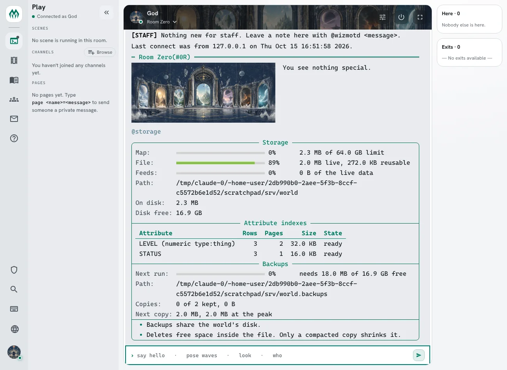

import { Aside } from '@astrojs/starlight/components';

An **attribute index** lets softcode find the objects that hold a value in an attribute without
looking at every object in the game. `lsearch()` with an `EVAL` class reads each object in turn,
which gets slow on a big game. `indexed()` reads the attribute's index instead, so its time grows
with the number of objects it finds, not with the number of objects in the game.

| You are | You want to | Read |
|---|---|---|
| Staff | put an index on an attribute | [Adding an index](#adding-an-index) |
| A softcode author | find objects by an attribute's value | [Finding objects](#finding-objects) |
| A package author | ship an index with a package | [Indexes in a package](#indexes-in-a-package) |
| Staff | see how much room the indexes take | [Storage](#storage) |

In the game, `help @attribute index` and `help indexed()` cover the same commands in short form.

## Adding an index

An index belongs to a standard attribute, one in the `@attribute` table. Make the attribute
standard with `@attribute/access` if it is not already, then index it with `@attribute/index`:

```
> @attribute/access STATUS=none
> @attribute/index STATUS
Indexing STATUS: text without case.
Index on STATUS ready: 3 copies on 20 objects indexed.
```

Output: the first line says how the index compares values. The second says it is ready, and how
many copies of STATUS it found among how many objects.

Only those with the `config.admin` permission can add or remove an index. An attribute whose
default flags include `internal` cannot be indexed, and nor can one whose name is longer than 110
bytes.

### Options

`@attribute/index <attribute>=<options>` takes these words, each optional:

| Option | What it does |
|---|---|
| `exact` | Values compare as written. Without it, `Approved` and `approved` are the same value. |
| `numeric` | Values that are numbers come first, in numeric order, so 9 comes before 10 and `05` equals `5`. Other values follow as text. |
| `split` | Each word of a value is listed on its own, so an object is found by any one of them. |
| `split:<delimiter>` | The same, splitting on the one character given, such as `split:\|`. |
| `type:<type>` | Only copies on players, rooms, things or exits. |

```
> @attribute/access LEVEL=none
> @attribute/index LEVEL=numeric type:thing
Indexing LEVEL: numbers, then text without case, things only.
Index on LEVEL ready: 0 copies on 15 objects indexed.
```

Output: LEVEL is indexed for things only, numbers in numeric order. No thing had a LEVEL yet, so
the index starts empty and fills as values are set.

### What gets indexed

- Only an object's own copy of the attribute. A value it inherits from a parent is not listed.
- An empty value is never listed, and nor is a copy flagged `internal`.
- The index keeps the first 400 bytes of a value. A longer value is still found and compared in
  full, but values that share their first 400 bytes come back in dbref order among themselves.
- Every write keeps the index up to date as it happens: setting, changing or clearing the
  attribute, and destroying the object.

### Building, restarts and removing

A new index is built in the background, a batch of objects at a time. `@attribute/index` waits for
it as long as a command may, says how far it got, and tells you when it is ready. A restart picks
the build up where it stopped. Until it is ready, `indexed()` answers `#-1 INDEX BUILDING`; it never
falls back to a slow search.

`@attribute <attribute>` shows the index and whether it is ready. `@attribute/decompile` writes the
`@attribute/index` line that makes it again on another game:

```
> @attribute LEVEL
@attribute: Information for 'LEVEL'
  Default flags: none
  Index: numbers, then text without case, things only (ready)
> @attribute/decompile LEVEL
@attribute/decompile: 1 attributes match pattern 'LEVEL'
@attribute/access LEVEL=
@attribute/index LEVEL=numeric type:thing
```

`@attribute/index <attribute>=off` takes the index off and deletes it. The values on objects stay.

```
> @attribute/index STATUS=off
Index on STATUS removed.
```

## Finding objects

`indexed(<attribute>, <operation>, <value>[, <start>, <count>])` returns the dbrefs of the objects
whose own copy of the attribute matches. With three objects whose STATUS is `approved`, `Approved`
and `pending`:

```
> think indexed(STATUS, =, approved)
#17 #18
> think indexed(STATUS, count, approved)
2
> think indexed(STATUS, prefix, pen)
#19
```

Output: the index ignores case, so both #17 and #18 match `approved`. `count` gives the number of
matches, and #19 is the only value starting with `pen`.

| Operation | Finds |
|---|---|
| `=` | values equal to `<value>` |
| `prefix` | values starting with `<value>` |
| `<`, `<=`, `>`, `>=` | values below, at or below, above, at or above `<value>` |
| `between` | values from the first to the second of the two words in `<value>`, both included |
| `first` | every value, lowest first; `<value>` is left empty |
| `last` | every value, highest first; `<value>` is left empty |
| `count` | how many values are equal to `<value>`, as a number |

The answer comes in the index's order: by value, lowest first, and objects with the same value in
dbref order. `<start>` (counting from 1) and `<count>` take a page of it. With the LEVEL index above
and levels 12, 9 and 20 on #17, #18 and #19:

```
> think indexed(LEVEL, between, 10 20)
#17 #19
> think indexed(LEVEL, last, , 1, 2)
#19 #17
```

Output: the first line lists the objects whose LEVEL is from 10 to 20, lowest first. The second
takes the two highest levels, highest first.

An attribute with no index answers `#-1 ATTRIBUTE NOT INDEXED`.


### With lsearch()

`lsearch()` and `@search` take an `INDEX` class, `<attribute>:<value>`. The search starts from the
objects the index lists under that value, and the other classes narrow it from there:

```
> think lsearch(all, type, thing, index, STATUS:approved)
#17 #18
```

Output: the things whose STATUS is `approved`, found through the STATUS index.

### What a player sees

Every match is checked the way `get()` checks an attribute. An object is listed only when you could
read its copy of the attribute, so a `mortal_dark` copy is left out for mortals, and so is a copy on
an object you cannot examine unless the attribute is `visual`. `<start>` and `<count>` count only
what you could see, and for anyone but a wizard `count` counts only the copies they could read.

<Aside>
An index tells nobody anything `get()` would not. It is safe to index an attribute that some players
may not read.
</Aside>

## Indexes in a package

A package can ship an index with its attribute entries. Add `index:` to the entry and set
`format: 1.8`:

```yaml
format: 1.8
package: casebook
version: 1.0.0
# objects: and the rest of the manifest as usual

attributes:
  CASE`STATUS:
    enum: [open, held, closed]
    index: true                 # the default: text without case, whole values, every object
  CASE`LEVEL:
    index: numeric type:thing   # the option words, as @attribute/index takes them
```

The review screen says what each index builds over:


After the install the indexes are ready to use:


- If the game already has the attribute, it must already have the same index, or the install stops
  and names the `@attribute/index` line that fixes it. The package's queries rely on the index's
  order, so it does not guess.
- An upgrade that changes `index:` changes the index. One staff changed and the new version did not
  is kept.
- Uninstalling the package deletes the entries it made, with their indexes.

In a manifest older than 1.8, `index:` is ignored with a warning.
[Package Format](/reference/package-format#attribute-indexes-format-18) has the details.

## Storage

Each index takes room in the world's file: one row for each indexed copy, or for each element of
a copy in a `split` index. A row takes about 50 bytes for a short value and more for a long one,
since the index keeps up to 400 bytes of each value, in two places. `@storage` lists every index with its rows, its pages, its size and whether it is still
building:



The same figures are on the server's metrics as
`sharpmush_storage_attribute_index_bytes{index="<attribute>"}`.
