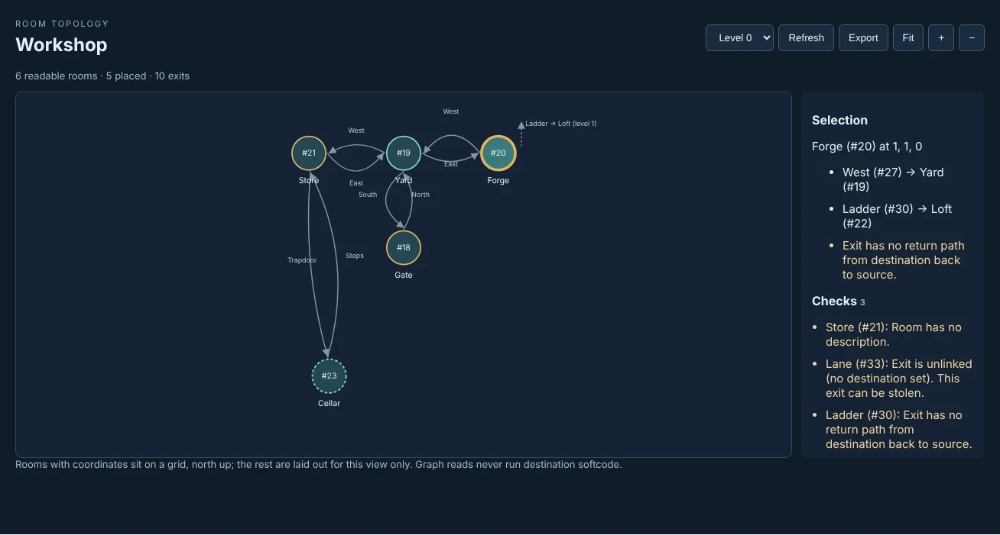
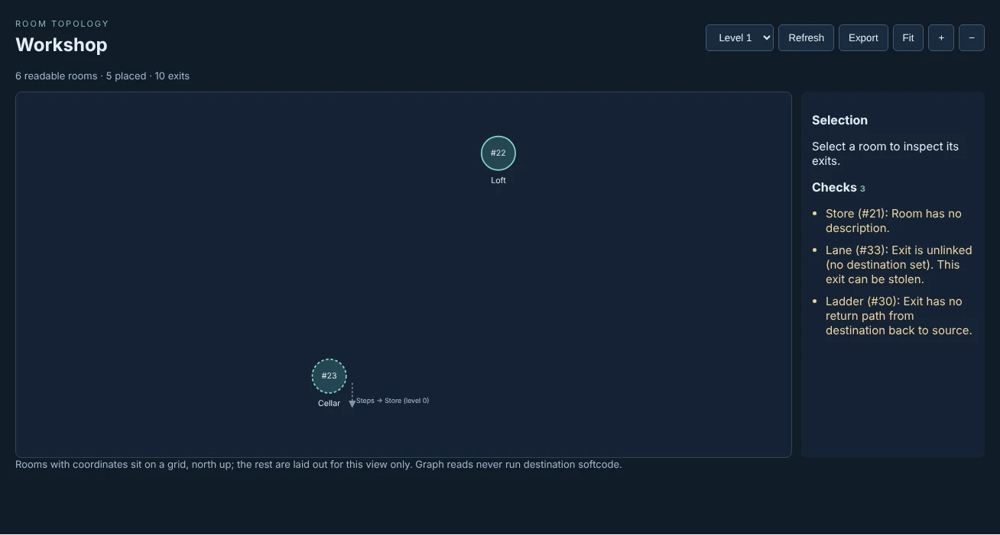
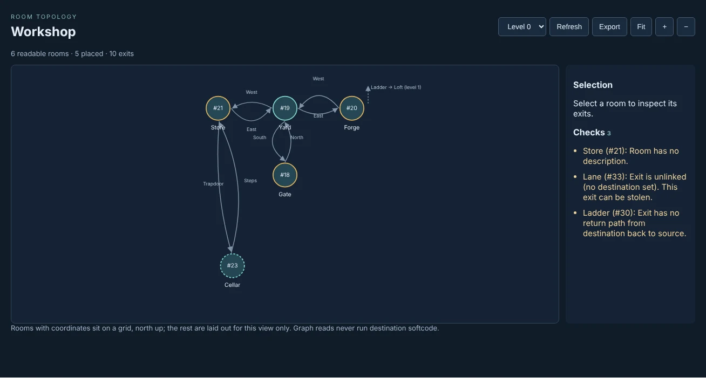

import { Aside } from '@astrojs/starlight/components';

The Builder Graph is a portal page for builders. Give it a set of rooms and it draws them: each
room as a circle, each exit as an arrow to where it leads. Rooms with coordinates sit on a grid,
north up, one level at a time. Beside the map is a list of things to fix, such as a room with no
description or an exit with no way back. **Export** saves the rooms as a file you can keep with the
rest of your notes and compare against a later copy.

This page covers:

- [Setting it up](#setting-it-up)
- [Giving rooms coordinates](#giving-rooms-coordinates)
- [The checks](#the-checks)
- [Exporting rooms](#exporting-rooms)

The examples use a small workshop: Gate (`#18`), Yard (`#19`), Forge (`#20`), Store (`#21`), Loft
(`#22`) above the Forge, and Cellar (`#23`) under the Store.

## Setting it up

The Builder Graph is the `builder-graph` package in `examples/packages/`. It is a browser page,
with no softcode and no world objects. Hosted pages only run when the `allow_browser_code` option
is on:

```
> @config/set allow_browser_code=yes
Option set.
```

1. Make a ZIP of the five files in `examples/packages/builder-graph` (`package.yaml`, `ui.json`,
   `index.html`, `graph.js` and `graph.css`), all at the top level.
2. In the portal, open **Admin**, then **Packages**, press **Upload plugin**, choose the ZIP, review
   it and apply it. This needs the packages administration permission.
3. Open **Admin**, then **Applications**, and add an application. Tick **Plain HTML/JavaScript
   package**, enter `builder-graph` as the **Installed definition ID**, `1` as the **Config
   version**, a slug such as `workshop`, and an **Instance JSON config** naming the rooms:

```json
{"title":"Workshop","rooms":[18,19,20,21,22,23]}
```

The page is then at `/apps/workshop`. Each application is its own page with its own rooms, so a
game can have one per area. The page shows only what the character you are playing may examine:
installing the package gives nobody access to rooms they could not already examine.

The config takes up to 100 rooms and two optional keys:

| Key | Default | What it does |
|---|---|---|
| `coordinates` | `["X","Y","Z"]` | The three attributes a room's position is read from |
| `warnings` | `["room-desc","exit-unlinked","exit-oneway","exit-multiple","lock-checks"]` | The checks the list shows, by their `@warnings` names |

## Giving rooms coordinates

A room's position is three numbers in attributes on the room: x to the east, y to the north and z
for the level. These are the same attributes the `gmcp-room` package sends to a MUD client's
mapper, so one set of numbers serves both.

```
> &X #20=1
> &Y #20=1
> &Z #20=0
```

A missing axis counts as 0. A room with none of the three set, or with one that is not a number,
has no coordinates. Such rooms are drawn below the grid with a dashed outline, grouped by the exits
between them.



When the rooms span more than one level, a level picker appears. An exit to a room on another level
is a short dashed stub, pointing up or down, labelled with the exit and where it goes. Choosing a
room lists its exits and its coordinates.



## The checks

The **Checks** list shows what `@wcheck` would report for the rooms and their exits, whichever
checks your own `@warnings` turn on. A room with something to fix has an amber outline, and choosing
a line selects its room.



| Check | What it finds |
|---|---|
| `room-desc` | A room with no description |
| `exit-unlinked` | An exit that leads nowhere, which anyone may take over with `@link` |
| `exit-oneway` | An exit with no exit back from where it leads |
| `exit-multiple` | An exit with more than one exit back |
| `lock-checks` | A lock that does not parse, or refers to something that is not there |
| `exit-desc` | An exit with no description (off unless named) |
| `exit-msgs` | An exit missing its SUCCESS, OSUCCESS, ODROP or FAILURE messages (off unless named) |

`exit-oneway` and `exit-multiple` only look at exits between the rooms on the page. An exit to a
room outside them is not checked for a way back. Objects set `NO_WARN`, and objects whose owner is
set `NO_WARN`, are left out, as they are for `@wcheck`.

## Exporting rooms

**Export** saves the rooms on the page as `<title>.rooms.json`. The workshop's export starts:

```json
{
  "format": "sharpmush-rooms",
  "version": 1,
  "coordinates": ["X", "Y", "Z"],
  "rooms": [
    {
      "id": "#18",
      "name": "Gate",
      "description": "Iron gates stand open onto the workshop yard.",
      "coordinates": [0, 0, 0],
      "exits": [
        {"id": "#24", "name": "North;n", "to": "#19", "description": ""},
        {"id": "#33", "name": "Lane", "to": "unlinked", "description": ""}
      ]
    },
```

Rooms and exits are in dbref order, so two exports of rooms nobody changed are the same file, and a
file compare shows only what changed. An exit's name carries its aliases after `;`, the way
`@open` takes it. `to` is where the exit leads:

| `to` | Means |
|---|---|
| `#19` | A room, by dbref |
| `home` | The exit is linked to HOME |
| `variable` | Where it leads is worked out each time someone uses it |
| `unlinked` | It leads nowhere |
| `hidden` | It leads somewhere you may not see |

Descriptions are each room's and exit's own `DESCRIBE`, as plain text. Rooms with more than 500
exits between them are too many for one export; export fewer at a time.

<Aside>
Reading the map never runs any softcode. A `variable` exit's destination is not worked out, and
nothing on the page is evaluated.
</Aside>
