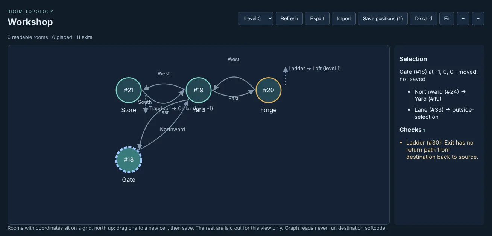
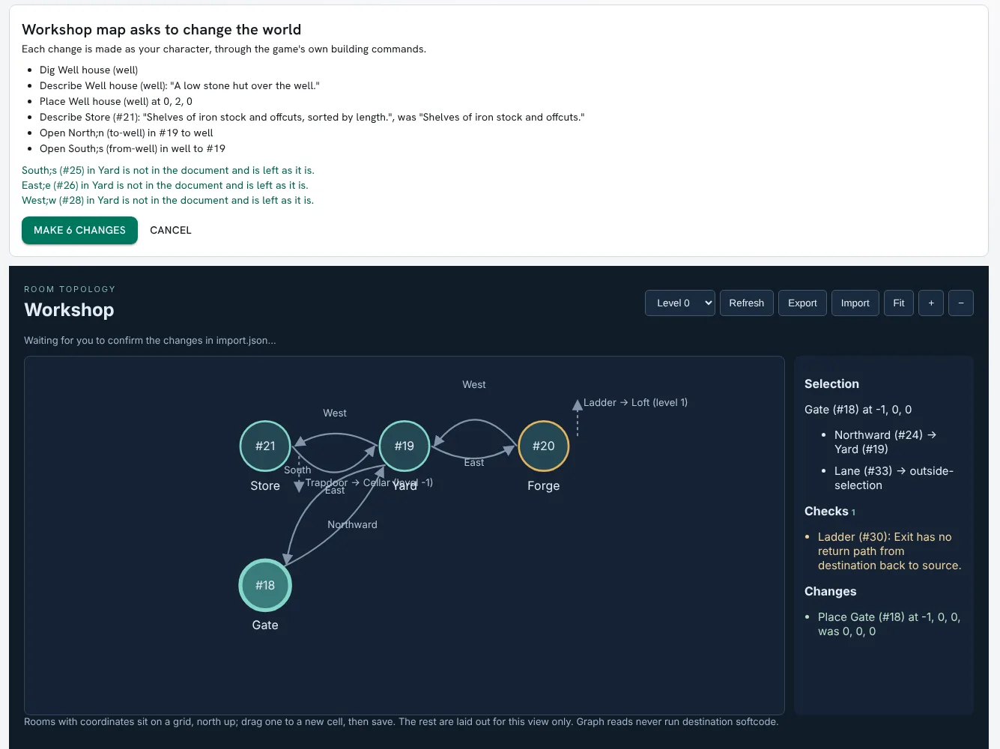

import { Aside } from '@astrojs/starlight/components';

The Builder Graph is a portal page for builders. Give it a set of rooms and it draws them: each
room as a circle, each exit as an arrow to where it leads. Rooms with coordinates sit on a grid,
north up, one level at a time. Beside the map is a list of things to fix, such as a room with no
description or an exit with no way back. **Export** saves the rooms as a file you can keep with the
rest of your notes and compare against a later copy, and **Import** builds what you change in that
file. You can also drag a room to a new place on the grid.

This page covers:

- [Setting it up](#setting-it-up)
- [Giving rooms coordinates](#giving-rooms-coordinates)
- [The checks](#the-checks)
- [Exporting rooms](#exporting-rooms)
- [Moving rooms](#moving-rooms)
- [Importing changes](#importing-changes)

The examples use a small workshop: Gate (`#18`), Yard (`#19`), Forge (`#20`), Store (`#21`), Loft
(`#22`) above the Forge, and Cellar (`#23`) under the Store.

## Setting it up

The Builder Graph is the `builder-graph` package in `examples/packages/`. It is a browser page,
with no softcode and no world objects. Hosted pages only run when the `allow_browser_code` option
is on:

```
> @config/set allow_browser_code=yes
Option set.
```

1. Make a ZIP of the five files in `examples/packages/builder-graph` (`package.yaml`, `ui.json`,
   `index.html`, `graph.js` and `graph.css`), all at the top level.
2. In the portal, open **Admin**, then **Packages**, press **Upload plugin**, choose the ZIP, review
   it and apply it. This needs the packages administration permission.
3. Open **Admin**, then **Applications**, and add an application. Tick **Plain HTML/JavaScript
   package**, enter `builder-graph` as the **Installed definition ID**, `1` as the **Config
   version**, a slug such as `workshop`, and an **Instance JSON config** naming the rooms:

```json
{"title":"Workshop","rooms":[18,19,20,21,22,23]}
```

The page is then at `/apps/workshop`. Each application is its own page with its own rooms, so a
game can have one per area. The page shows only what the character you are playing may examine:
installing the package gives nobody access to rooms they could not already examine.

The config takes up to 100 rooms and two optional keys:

| Key | Default | What it does |
|---|---|---|
| `coordinates` | `["X","Y","Z"]` | The three attributes a room's position is read from |
| `warnings` | `["room-desc","exit-unlinked","exit-oneway","exit-multiple","lock-checks"]` | The checks the list shows, by their `@warnings` names |

## Giving rooms coordinates

A room's position is three numbers in attributes on the room: x to the east, y to the north and z
for the level. These are the same attributes the `gmcp-room` package sends to a MUD client's
mapper, so one set of numbers serves both.

```
> &X #20=1
> &Y #20=1
> &Z #20=0
```

A missing axis counts as 0. A room with none of the three set, or with one that is not a number,
has no coordinates. Such rooms are drawn below the grid with a dashed outline, grouped by the exits
between them.


When the rooms span more than one level, a level picker appears. An exit to a room on another level
is a short dashed stub, pointing up or down, labelled with the exit and where it goes. Choosing a
room lists its exits and its coordinates.


## The checks

The **Checks** list shows what `@wcheck` would report for the rooms and their exits, whichever
checks your own `@warnings` turn on. A room with something to fix has an amber outline, and choosing
a line selects its room.


| Check | What it finds |
|---|---|
| `room-desc` | A room with no description |
| `exit-unlinked` | An exit that leads nowhere, which anyone may take over with `@link` |
| `exit-oneway` | An exit with no exit back from where it leads |
| `exit-multiple` | An exit with more than one exit back |
| `lock-checks` | A lock that does not parse, or refers to something that is not there |
| `exit-desc` | An exit with no description (off unless named) |
| `exit-msgs` | An exit missing its SUCCESS, OSUCCESS, ODROP or FAILURE messages (off unless named) |

`exit-oneway` and `exit-multiple` only look at exits between the rooms on the page. An exit to a
room outside them is not checked for a way back. Objects set `NO_WARN`, and objects whose owner is
set `NO_WARN`, are left out, as they are for `@wcheck`.

## Exporting rooms

**Export** saves the rooms on the page as `<title>.rooms.json`. The workshop's export starts:

```json
{
  "format": "sharpmush-rooms",
  "version": 1,
  "coordinates": ["X", "Y", "Z"],
  "rooms": [
    {
      "id": "#18",
      "name": "Gate",
      "description": "Iron gates stand open onto the workshop yard.",
      "coordinates": [0, 0, 0],
      "exits": [
        {"id": "#24", "name": "North;n", "to": "#19", "description": ""},
        {"id": "#33", "name": "Lane", "to": "unlinked", "description": ""}
      ]
    },
```

Rooms and exits are in dbref order, so two exports of rooms nobody changed are the same file, and a
file compare shows only what changed. An exit's name carries its aliases after `;`, the way
`@open` takes it. `to` is where the exit leads:

| `to` | Means |
|---|---|
| `#19` | A room, by dbref |
| `home` | The exit is linked to HOME |
| `variable` | Where it leads is worked out each time someone uses it |
| `unlinked` | It leads nowhere |
| `hidden` | It leads somewhere you may not see |

Descriptions are each room's and exit's own `DESCRIBE`, as plain text. Rooms with more than 500
exits between them are too many for one export; export fewer at a time.

<Aside>
Reading the map never runs any softcode. A `variable` exit's destination is not worked out, and
nothing on the page is evaluated.
</Aside>

## Moving rooms

Drag a room to another cell of the grid. The room moves on the page only, with a dashed blue
outline, and **Save positions** appears with the number of rooms moved. **Discard** puts them back.



**Save positions** writes the new X, Y and Z of each moved room, after you confirm, in the same way
as an import.

## Importing changes

**Import** reads a room file, works out what it would change, and shows the list above the page.
Nothing changes until you press **Make N changes**; **Cancel** leaves everything as it was.

The page cannot make or skip this confirmation: the portal draws it, outside the page. Each change
is made as the character you are playing, with `@dig`, `@open`, `@name`, `@link` and `@unlink`, so
the game's quota, locks and link rules apply, as they would if you typed the commands.

A file only has to list what it changes. This one adds a well house north of the Yard, with exits
both ways, and lengthens the Store's description:

```json
{
  "format": "sharpmush-rooms",
  "version": 1,
  "coordinates": ["X", "Y", "Z"],
  "rooms": [
    {"id": "#19", "exits": [{"id": "to-well", "name": "North;n", "to": "well"}]},
    {"id": "well", "name": "Well house", "description": "A low stone hut over the well.", "coordinates": [0, 2, 0],
     "exits": [{"id": "from-well", "name": "South;s", "to": "#19"}]},
    {"id": "#21", "description": "Shelves of iron stock and offcuts, sorted by length."}
  ]
}
```



Once the changes are made, the page says what each new room and exit became:

```
Made 6 changes. well is #39, to-well is #40, from-well is #41; export again before editing the file further.
```

How a file is read:

| In the file | Means |
|---|---|
| An `id` that is a dbref, `#19` | A room or exit that is there now |
| An `id` of your own, `well` | A new room or exit, dug or opened by the import |
| A field left out | Left as it is |
| `"description": ""` | Clear the description |
| `"coordinates": []` | Remove the coordinates |
| `"to"` | A dbref, `home`, `unlinked`, or the `id` of a new room in the same file. `variable` and `hidden` leave the link as it is |

An import never destroys anything. A room or exit the file leaves out stays, and the confirmation
lists any exit of a listed room that the file does not mention. An exit stays in the room it is in.
You need to control each room and exit the import changes, and to be able to see each room an exit
is linked to.

An import that lists problems, such as a destination that is not there or a room you do not control,
makes no changes at all. If the rooms change between the confirmation and the import, for example
because another builder renamed one, the import is refused and you are asked to look again. When the
game refuses one change, such as a `@dig` over your quota, the import stops there; the changes before
it stay made and the page lists them.

<Aside>
New rooms are not on the page until you add their dbrefs to the application's `rooms`. Export again
after an import, so the file has the new dbrefs instead of your own names: importing the same file a
second time would dig the rooms again.
</Aside>
