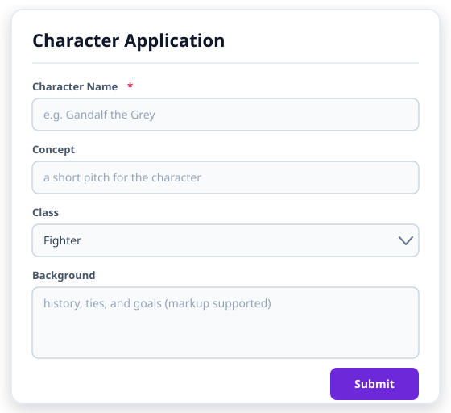
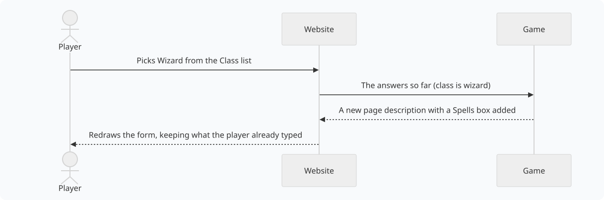

import { Aside } from '@astrojs/starlight/components';

This page is for softcoders. It assumes you know how to set attributes and use functions like `u()`. It builds the Character Application form from start to
finish, then lists everything a page description can hold.

<Aside>
This form is a teaching example. For real character applications, with drafts, staff comments,
rounds and a waitlist, install the `chargen` and `chargen-app` packages: see
[Character Applications](/guides/character-applications). The packages use the same slug and
routes as this example (`chargen`, ``GET`CHARGEN`SCHEMA``), so build it on a game that does not have
them installed.
</Aside>

## What a page description looks like

A page description is written in JSON, a common way of writing nested lists of named
values. It is built like an outline:



- The **form** has a title and a list of **steps**. Most forms have one step; a form with
  several shows **Next** and **Back** buttons.
- Each step has **sections**. A section is a titled card on the page.
- Each section has **elements**: boxes to type in, lists to pick from, text, pictures,
  tables and buttons.
- The form also names its **actions**: what each button does.

Here is a small form with one box and a Submit button:

```json
{
  "kind": "form",
  "title": "Character Application",
  "pages": [
    { "sections": [
      { "name": "About you",
        "elements": [
          { "kind": "field", "key": "charname", "label": "Character Name", "type": "text" }
        ] }
    ] }
  ],
  "actions": {
    "submit": { "route": "/http/chargen/submit" }
  }
}
```

- `"kind": "form"` makes it a form. Use `"view"` for a page that only shows information.
- `"key": "charname"` is the name the box's answer is sent under. `"label"` is what the
  player reads.
- An action named `submit` puts a **Submit** button at the bottom. Its `route` is where
  the answers go.

## Step 1: write the page description in softcode

You build JSON in softcode with the `json()` function. `json(string,Hello)` makes a piece
of text, and `json(object,name,value,...)` makes a group of named values. Building every
box by hand gets long, so start with two small helper attributes on your HTTP handler:

```sharp
&FN`FIELD #8=json(object,kind,json(string,field),key,json(string,%0),label,json(string,%1),type,json(string,%2))
&FN`CHOICE #8=json(object,value,json(string,%0),label,json(string,%1))
```

- ``FN`FIELD`` makes one box. Give it the key, the label and the type:
  ``u(FN`FIELD,concept,Concept,text)``.
- ``FN`CHOICE`` makes one choice in a list: ``u(FN`CHOICE,fighter,Fighter)``.

Now the page description itself. A website request for `/http/chargen/schema` runs the
attribute ``GET`CHARGEN`SCHEMA``:

```sharp
&GET`CHARGEN`SCHEMA #8=@respond/type application/json; think json(object,
  kind,json(string,form),
  title,json(string,Character Application),
  pages,json(array,json(object,
    sections,json(array,json(object,
      name,json(string,About you),
      elements,json(array,
        u(FN`FIELD,charname,Character Name,text),
        u(FN`FIELD,concept,Concept,text),
        json(object,kind,json(string,field),key,json(string,class),label,json(string,Class),type,json(string,select),
          options,json(array,
            u(FN`CHOICE,fighter,Fighter),
            u(FN`CHOICE,wizard,Wizard),
            u(FN`CHOICE,rogue,Rogue))),
        u(FN`FIELD,background,Background,textarea)))))),
  actions,json(object,
    submit,json(object,route,json(string,/http/chargen/submit))))
```

<Aside title="Typing it in">
The code is spread over several lines to make it easier to read. Every line ends just after a
comma or an opening bracket, so to enter it, delete the line breaks and the spaces at the start of
each line, and send it as one line.
</Aside>

- `@respond/type application/json` tells the website the answer is JSON.
- `think` sends the page description back to the website.
- The Class list is written out in full because it needs `options`, the list of choices.

## Step 2: answer the Submit button

When the player presses **Submit**, the website sends their answers to
`/http/chargen/submit`, which runs ``POST`CHARGEN`SUBMIT``. The answers arrive in `%0`,
and `json_query(%0,extract,$.charname)` reads the one typed into the Character Name box.

The attribute must answer with `ok` set to true or false:

```sharp
&POST`CHARGEN`SUBMIT #8=@respond/type application/json; think if(strlen(trim(json_query(%0,extract,$.charname))),
  json(object,ok,json(boolean,true),message,json(string,Thank you! Staff will read your application soon.)),
  json(object,ok,json(boolean,false),errors,json(object,charname,json(string,Please give your character a name.))))
```

- If the name is filled in, the player sees *Thank you! Staff will read your application
  soon.*
- If it is empty, the player sees *Please give your character a name.* under the
  Character Name box. The text goes under that box because the error is filed under
  `charname`, the box's key.

This example only checks the answers. A real form would also store them, for example with
`@mail` to staff or by setting attributes on the player.

## Step 3: register it and try it

Register it as in [By hand: register it yourself](/guides/applications/#by-hand-register-it-yourself): slug
`chargen`, kind **Page**, minimum role **Player**, Schema URL `http/chargen/schema`, nav
placement `Play`. Open `/apps/chargen` and you see:



## Changing the form as the player goes

The website never decides on its own to show or hide a box. When the form should change,
the game sends a new page description, and the website draws that one instead.



To set this up:

1. On the Class box, add `"triggers_action": "class_changed"`. The website then runs that
   action whenever the choice changes.
2. Add a `class_changed` action whose route points at a new attribute.
3. In that attribute, read `class` from `%0` and answer with `ok` true and a `schema`: the
   whole page description again, with the extra box when the class is `wizard`.

You can do the same with a button instead: a `button` element names the action it runs.

## Showing information instead of asking for it

A `view` shows information and has no boxes to fill in. A character card, a list of
upcoming scenes and a faction roster are all views. A view's information comes from a
second route, the **Data URL**, which answers like this:

```json
{
  "fields": {
    "name":    { "value": "Ada" },
    "concept": { "value": "Sky pirate with a secret" },
    "notes":   { "value": "Owes the guild money" }
  }
}
```

The page description lists what to show, in order, using the same keys:

```json
{
  "kind": "view",
  "title": "Character card",
  "pages": [ { "sections": [ { "elements": [
    { "kind": "field", "key": "name",    "label": "Name" },
    { "kind": "field", "key": "concept", "label": "Concept" },
    { "kind": "field", "key": "notes",   "label": "Staff notes" }
  ] } ] } ]
}
```

A value that is left out, or marked `"visible": false`, is not shown. To show staff notes
only to staff, leave `notes` out of the answer for everyone else. Don't send it with
`"visible": false` instead: that only stops the page from showing it, and anyone can still
read it in what their browser received.

On a form, the Data URL fills in boxes before the player starts typing, which is useful
for an "edit your profile" page.

## Knowing who is looking

Every route can tell who is using the website: `%<viewer>` holds the objid of the
character the person is signed in as, or is empty for a visitor who is not signed in. So
`name(%<viewer>)` is their character's name. Use it to decide what each person sees,
and to check they are allowed to do what a button asks. The minimum role only hides the
link; your softcode is what actually protects your data.

`%<viewer>` is a [named argument](/guides/named-arguments): `@include` passes it on to
the route's steps, but a `u()` function does not see it, so hand it to one as an argument,
as in ``u(me/FN`CAN`EDIT,%<viewer>)``.

## Reference

### Box types

Each `field` element has a `type`:

| `type` | What the player sees |
|---|---|
| `text` | A one-line box. This is the type when none is given. |
| `textarea` | A box several lines tall. |
| `mstring` | A box several lines tall that keeps colour and other markup. |
| `number` | A box for a number, with up and down arrows. |
| `slider` | A slider. Set its ends with `min` and `max` in `validation`. |
| `boolean` | An on/off switch. |
| `select` | A list to pick one choice from. Needs `options`. |
| `multiselect` | A list to pick several choices from. Needs `options`. |
| `radio` | A set of round buttons to pick one choice from. Needs `options`. |
| `date` | A calendar to pick a date from. |
| `hidden` | Nothing. It carries a value along with the answers without showing it. |

A `field` can also have:

| Setting | What it does |
|---|---|
| `help` | A short hint shown under the box. |
| `default` | The value the box starts with. |
| `options` | The choices for `select`, `multiselect` and `radio`: a list of `{ "value": "...", "label": "..." }`. |
| `validation` | Quick checks the website makes before anything is sent: `required` (true or false), `min` and `max` for numbers, `max_length` for text, and `pattern`. Your softcode should still check everything itself. |
| `triggers_action` | An action to run whenever the value changes. |
| `span` | How many columns the box takes when its section has several. |

### Other elements

| `kind` | What it shows | What it needs |
|---|---|---|
| `markdown` | Formatted text, written in Markdown: bold, lists, links and headings. | `value`: the text. `"format": "mstring"` draws `value` as colour markup instead. |
| `image` | A picture. | `src_field`: the data key holding the picture's address; `alt`: a description of it. |
| `table` | A table. | `rows_field`: the data key holding the rows; `columns`: a list of `{ "key": "...", "label": "..." }`. A column can also have `link`, an address with `{key}` filled from the row; `type` `chip`, to show the cell as a chip; and `color_key`, the row key holding the chip's colour. `empty` is shown when there are no rows. |
| `keyvalue` | A list of names and values. A value sent as `{ "text": "...", "link": "..." }` shows as a link. | `fields`: the data keys to show. |
| `graph` | People or things joined by labelled lines, drawn around one in the middle. | `src_field`: the data key holding `{ "nodes": [...], "edges": [...] }`. A node has an `id`, a `label`, an optional `image`, and `focus` on the one in the middle. An edge has `from`, `to`, a `label`, a `tone` for its colour, and `directed` for an arrow. `link` makes each node a link, with `{label}` or any other node key filled in; `empty` is shown when there are no edges. |
| `timeline` | A list of dated entries, like comments on a job. | `rows_field`: the data key holding the entries. |
| `divider` | A line across the section. | Nothing. |
| `button` | A button. | `label`: its text; `action`: the action it runs. `confirm` asks a question first. `values` adds values to the answers it sends; `color` and `variant` style it. |

A section can set `"columns": 2` (or more) to put its elements side by side. On a phone
they stack in one column.

### Actions

An action needs only a `route`. It can also have:

| Setting | What it does |
|---|---|
| `on_success` | `toast`: a message to show when it works. `navigate`: an address to go to afterwards. `merge_fields`: fill boxes with the `fields` the game sends back. `reset_fields`: empty every box first. |
| `on_error` | `bind_field_errors`: show errors under their boxes (on unless set to false). |

### What a button's route answers

| Setting | What it does |
|---|---|
| `ok` | `true` if it worked, `false` if not. Always include it. |
| `message` | A short message to show. |
| `errors` | Problems to show. Each one is filed under a box's key, or under `_global` for a problem with the whole form. |
| `fields` | Values to put back into boxes. |
| `schema` | A whole new page description to draw instead. |
| `data` | New information for the page's tables and lists. |
| `redirect` | An address to go to, such as `/apps/chargen/done`. |

### Longer addresses

An application answers every address under its slug, so `/apps/jobs/12` still opens the
Jobs application. Put `{path}` in the Schema URL or Data URL to pass the rest along:
with `http/jobs/data?at={path}`, opening `/apps/jobs/12` asks for
`http/jobs/data?at=12`. Anything after a `?` in the website address is passed along too.
