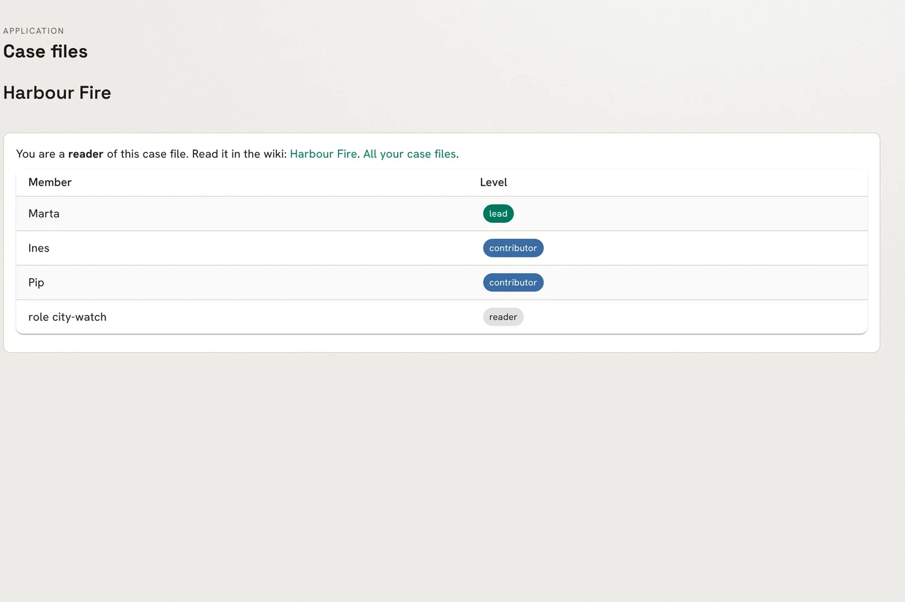

A casefile is a private part of the wiki built around one plot. It has a **briefing**, which a
newcomer reads first, **files**, which are ordinary wiki pages filed in it, and a **developments**
log, which records what happened, newest first. Only its members, and staff with the wiki.admin
permission, can read any of it. Everyone else finds nothing: it is not listed, searched or shown
anywhere.

| You want to | Read |
|---|---|
| open a casefile for a plot | [Opening a casefile](#opening-a-casefile) |
| let people in, or take them out | [Members](#members) |
| write files and post what happened | [Files and developments](#files-and-developments) |
| catch up on a plot | [Reading a casefile](#reading-a-casefile) |
| do the same in the game | [In the game](#in-the-game) |

The examples follow **Harbour Fire**, a plot about a warehouse fire. Marta runs it, Ines writes in
it, and everyone with the City Watch role may read it.

## Opening a casefile

In the portal, open **Wiki**, then **Casefiles**, and press **Open a casefile**. Give it a title and
a briefing. You become its **lead**.


Opening one needs the wiki.create permission, which approved characters hold. A casefile is a wiki
category with members, and its briefing is that category's page. Turning a category that already
has pages into a casefile needs wiki.admin, so nobody can hide pages someone else wrote.

## Members

A member is a character or a role. Adding a role lets in every character who holds it, now and
later, so a casefile needs no role or permission of its own. Each member has a level:

| Level | May |
|---|---|
| reader | read the briefing, files and developments |
| contributor | also write files, edit the briefing and post developments |
| lead | also let people in and out, and change levels |

A lead sees a level list and a remove button beside each member, and a box under them. Type a
character's name, or `role:` and a role, such as `role:city-watch`, pick a level and press
**Let in**. A casefile always keeps at least one lead.


Membership never lets anyone do more than the wiki's own permissions allow. A contributor who lacks
wiki.edit reads the casefile like a reader and sees no **Post a development** or **Add file**.

## Files and developments

Type a title under **Files** and press **Add file**. The wiki editor opens with the casefile already
set as the page's category. Any page filed in the casefile's category is one of its files, and the
wiki's history, links and editor all work on it as usual.

To record what happened, press **Post a development**, write what happened, and tick the files it
concerns. The entry goes to the top of the log with the date, your name and links to those files.


The log is a wiki page of its own, so **History** beside it shows every post: who wrote it and
when.

## Reading a casefile

Readers see the same page without the controls: the briefing first, then the developments, then the
files and who else is in it.



Someone outside the casefile who follows a link to it is told there is no such casefile, and a link
to one of its files finds no page. If they try to create a page or a casefile with a title one of
its pages already uses, they are told only that the title is taken.


Staff with wiki.admin see every casefile and act as a lead in each.

## In the game

`@casefile` does the same in the game:

```
> @casefile
+=============================< Your casefiles >=============================+
| Casefile      You are  Files  Updated                                      |
| -------------------------------------------------------------------------- |
| Harbour Fire  lead         1  2026-11-21                                   |
+============================================================================+
> @casefile/add Harbour Fire=Ines/contributor
CASEFILE: Ines is now a contributor of Harbour Fire.
> @casefile/add Harbour Fire=role:city-watch
CASEFILE: Everyone with the city-watch role is now a reader of Harbour Fire.
> @casefile/post Harbour Fire=Night watch orders/The patrol was moved to the east quay at nine.
CASEFILE: Posted to Harbour Fire developments.
```

`@casefile <casefile>` shows one casefile, and `@wiki` reads its pages. A reader who tries to post,
or a contributor who tries to let someone in, is refused:

```
> @casefile/post Harbour Fire=Saw it/I was there.
CASEFILE: Permission denied. Posting a development needs a contributor or lead of the casefile.
```

See `help @casefile` in the game for every switch.
