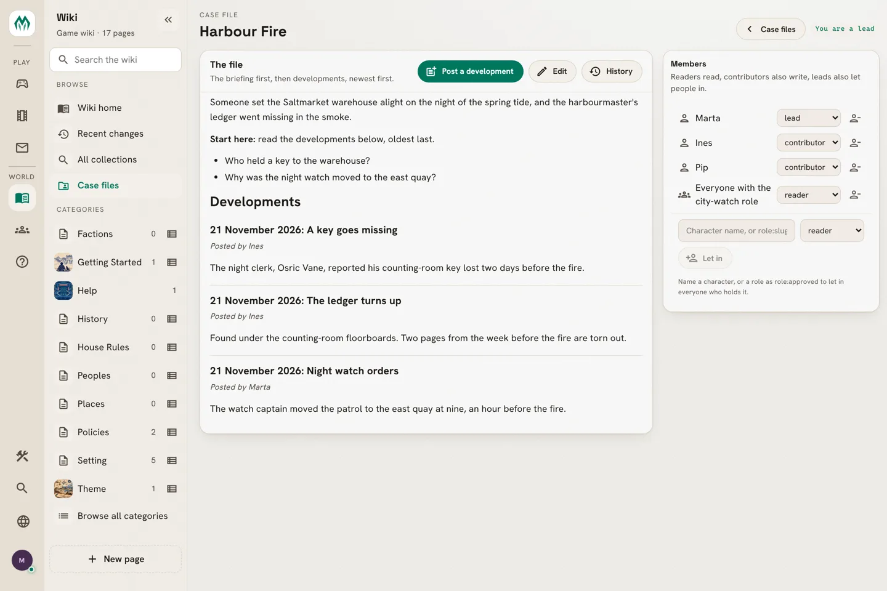
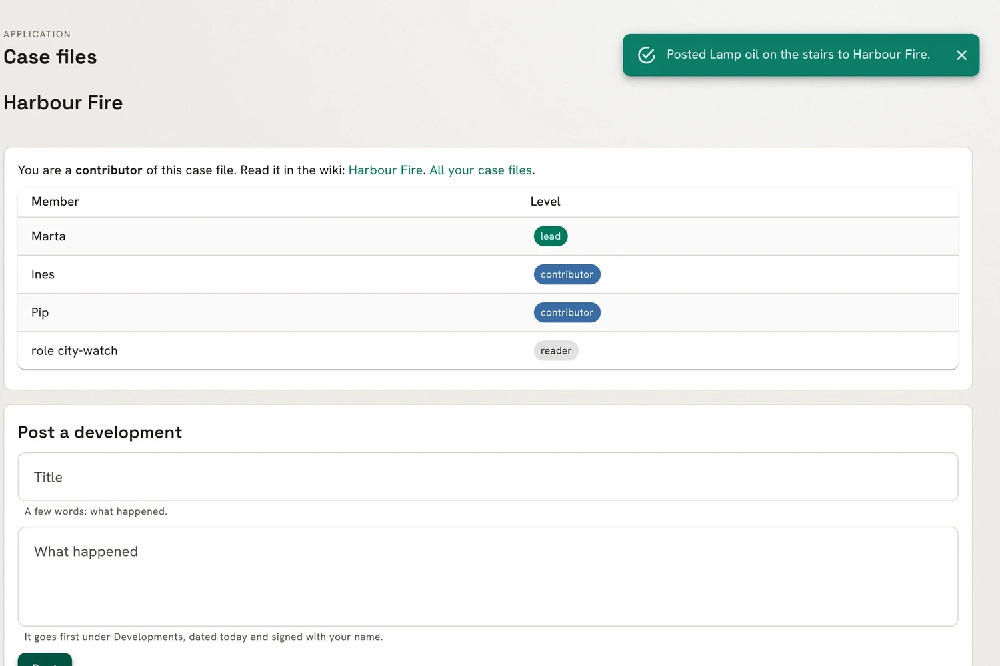
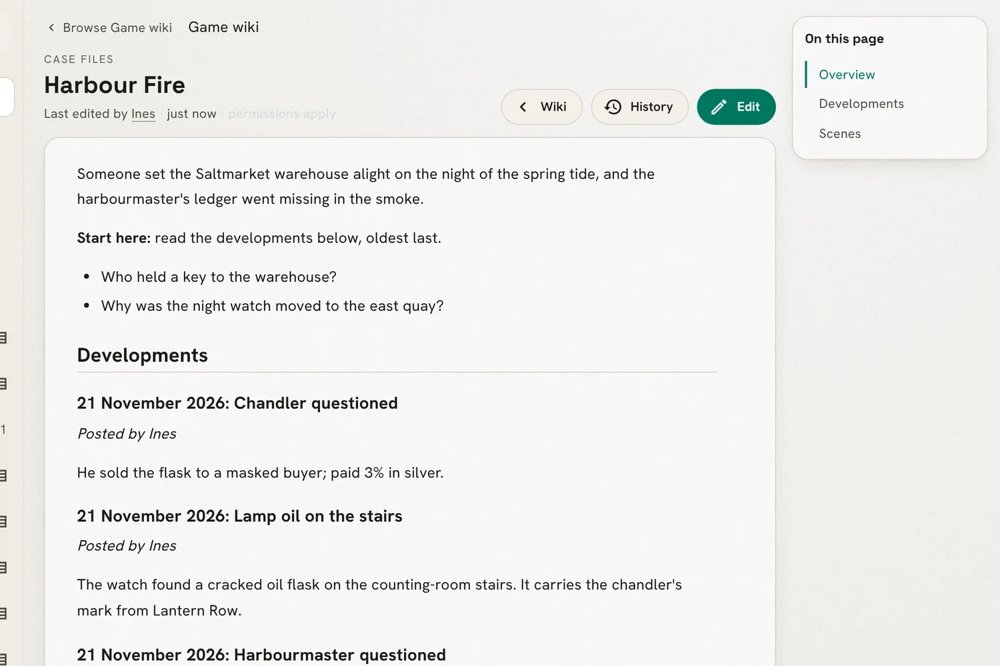
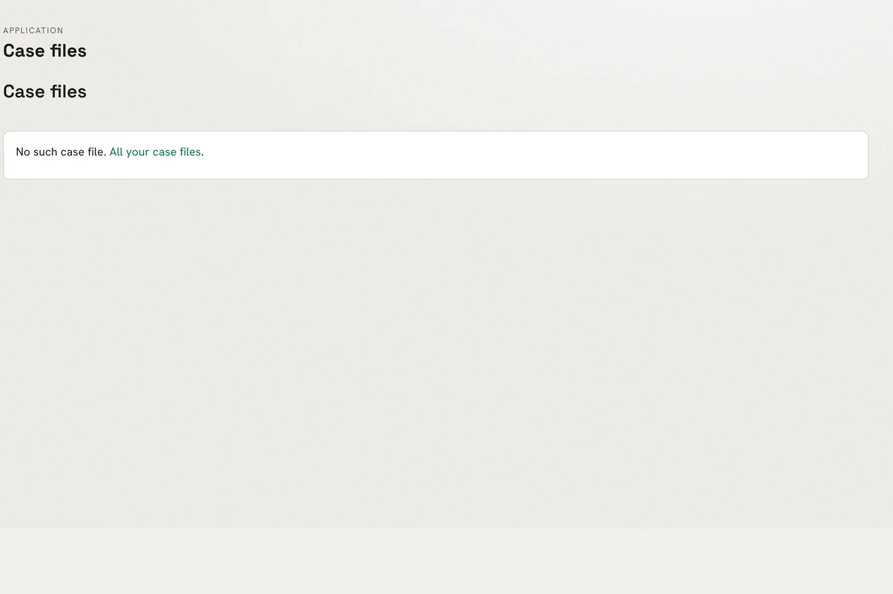

A case file is one wiki page built around a plot, filed in the **Case Files** category. It opens
with a **briefing**, which a newcomer reads first. Its **Developments** section records what
happened, newest first, and its **Scenes** section lists the scenes played for it. Only its members,
and staff with the wiki.admin permission, can read it. Everyone else finds nothing: it is not listed,
searched or shown anywhere.

| You want to | Read |
|---|---|
| turn case files on | [Installing](#installing) |
| open a case file for a plot | [Opening a case file](#opening-a-case-file) |
| let people in, or take them out | [Members](#members) |
| post what happened | [Developments](#developments) |
| file a scene into a case file | [Scenes](#scenes) |
| catch up on a plot | [Reading a case file](#reading-a-case-file) |

The examples follow **Harbour Fire**, a plot about a warehouse fire. Marta runs it, Ines writes in
it, and everyone with the City Watch role may read it.

## Installing

Case files come as four packages. Install them from **Packages** in Build & manage:

| Package | Adds |
|---|---|
| casefiles | `+casefile` and its help |
| casefiles-app | the **Case files** page in the portal, under Play |
| casefiles-scene | `+casefile/scene` and a line on the `+scene` card. Needs the Scene System |
| casefiles-help | `+casefile` in `+help`. Needs the plus-help package |

## Opening a case file

In the portal, open **Case files** and fill in **Open a case file**: a title and a briefing. It
becomes a page in the Case Files category, and you become its **lead**. In the game:

```
> +casefile/create Harbour Fire=Who set the fire at the east docks, and why.
[CASEFILE] Done: Opened Harbour Fire. You are its lead. Let people in with +casefile/add Harbour Fire=<player>.
```


Opening one needs the wiki.create permission and a title no other page has.

## Members

A member is a character or a role. Adding a role lets in every character who holds it, now and
later, so a case file needs no role or permission of its own. Each member has a level:

| Level | May |
|---|---|
| reader | read the page |
| contributor | also post developments, file scenes, and edit the page |
| lead | also let people in and out, and change levels |

A lead sees a **Members** form on the case file. Type a character's name, or `role:` and a role,
such as `role:city-watch`, pick a level and press **Let in**. **Take out** removes a member. A case
file always keeps at least one character as its lead.



In the game:

```
> +casefile/add Harbour Fire=Ines/contributor
[CASEFILE] Done: Ines is now a contributor of Harbour Fire.
> +casefile/add Harbour Fire=role:city-watch
[CASEFILE] Done: Everyone with the city-watch role is now a reader of Harbour Fire.
> +casefile/remove Harbour Fire=Marta
[CASEFILE] Warning: A case file keeps at least one character as its lead. Name another lead first.
```

Membership never lets anyone do more than the wiki's own permissions allow. A contributor who lacks
wiki.edit cannot post.

## Developments

To record what happened, fill in **Post a development** on the case file: a few words for the title,
and what happened. The entry goes first under the page's Developments heading, dated and signed.



In the game:

```
> +casefile/post Harbour Fire=Lamp oil on the stairs/The watch found a cracked oil flask on the counting-room stairs.
[CASEFILE] Done: Posted Lamp oil on the stairs to Harbour Fire.
```

What you type in the game is evaluated as you, as `say` is. To keep `[`, `]` or `%` as they are, put
a `\` before each.

The case file shows the whole page: the briefing, then the developments, newest first, each dated
and signed.



`+casefile/history <case file>` shows every post and change: who made it and when.

## Scenes

With casefiles-scene installed, a contributor or lead files a scene into a case file: one they were
in, or a public one.

```
> +casefile/scene Harbour Fire=1
[CASEFILE] Done: Added scene 1 to Harbour Fire.
> +casefile/scene Harbour Fire=1
[CASEFILE] Warning: Scene 1 is already in Harbour Fire.
```

The scene goes first under the page's Scenes heading, linked to its log.

The scene's `+scene` card ends with the case files it is in, shown only to their members:

```
> +scene 1
======================< Scene 1: Smoke over Saltmarket >======================
...
Owner   Ines                                                                 1
Case file: Harbour Fire
==============================================================================
```

Who may read the scene's log is still up to the Scene System, not the case file.

## Reading a case file

Readers see the same case file without the forms: the page, its scenes, and who is in it.


`+casefile` lists your case files, and `+casefile <case file>` reads one: the page, your level and
who is in it. A reader who tries to post is refused:

```
> +casefile/post Harbour Fire=Saw it/I was there.
[CASEFILE] Warning: Permission denied. Posting a development needs a contributor or lead of the case file.
```

Someone outside the case file who follows a link to it is told there is no such case file, and its
wiki page looks like a page that does not exist. If they try to open a case file with its title,
they are told only that the title is taken.



Staff with wiki.admin see every case file and act as a lead in each. See `+help casefile` in the game
for every switch.
