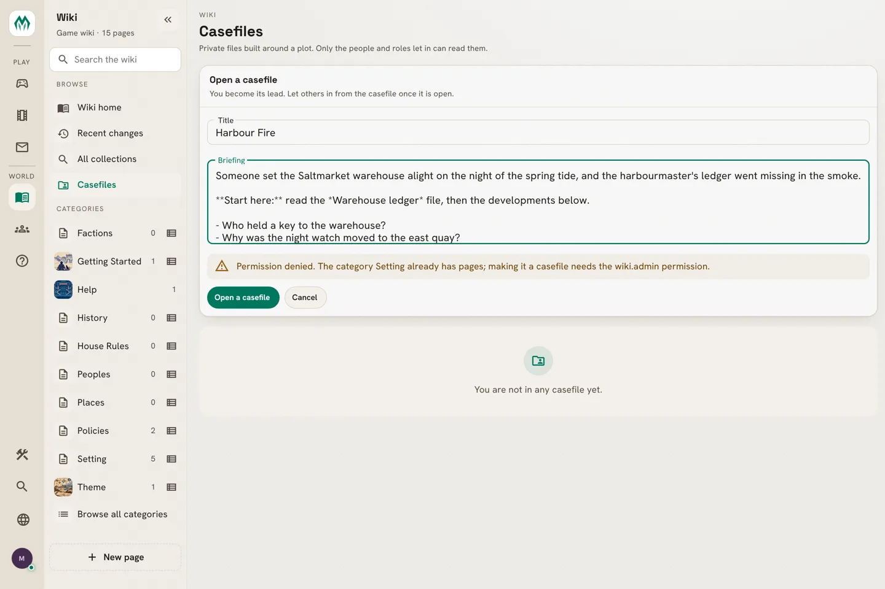
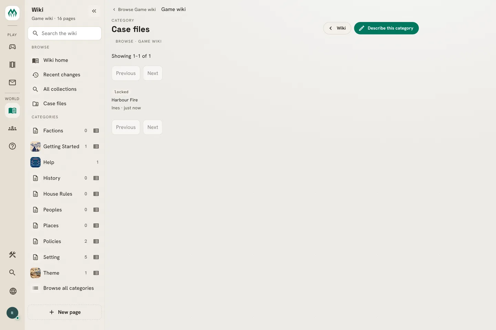

A case file is one wiki page built around a plot, filed in the **Case Files** category. It opens
with a **briefing**, which a newcomer reads first, and its **Developments** section records what
happened, newest first. Only its members, and staff with the wiki.admin permission, can read it.
Everyone else finds nothing: it is not listed in Case Files, searched or shown anywhere.

| You want to | Read |
|---|---|
| open a case file for a plot | [Opening a case file](#opening-a-case-file) |
| let people in, or take them out | [Members](#members) |
| post what happened, or edit the page | [Developments and editing](#developments-and-editing) |
| catch up on a plot | [Reading a case file](#reading-a-case-file) |
| do the same in the game | [In the game](#in-the-game) |

The examples follow **Harbour Fire**, a plot about a warehouse fire. Marta runs it, Ines writes in
it, and everyone with the City Watch role may read it.

## Opening a case file

In the portal, open **Wiki**, then **Case files**, and press **Open a case file**. Give it a title and
a briefing. It becomes a page in the Case Files category, and you become its **lead**.



Opening one needs the wiki.create permission, which approved characters hold, and a title no other
page has.

## Members

A member is a character or a role. Adding a role lets in every character who holds it, now and
later, so a case file needs no role or permission of its own. Each member has a level:

| Level | May |
|---|---|
| reader | read the page |
| contributor | also edit it and post developments |
| lead | also let people in and out, and change levels |

A lead sees a level list and a remove button beside each member, and a box under them. Type a
character's name, or `role:` and a role, such as `role:city-watch`, pick a level and press
**Let in**. A case file always keeps at least one character as its lead.


Membership never lets anyone do more than the wiki's own permissions allow. A contributor who lacks
wiki.edit reads the case file like a reader and sees no **Post a development** or **Edit**.

## Developments and editing

To record what happened, press **Post a development** and write what happened. The entry goes first
under the page's Developments heading, with the date and your name.


**Edit** opens the page in the wiki editor, for changing the briefing or anything else on it.
**History** shows every post and edit: who made it and when.

## Reading a case file

Readers see the same page without the controls: the briefing first, then the developments, and who
else is in it. The page itself is also listed in the Case Files category, for members only.




Someone outside the case file who follows a link to it is told there is no such case file, and a link
to its page finds no page. If they try to create a page or a case file with its title, they are told
only that the title is taken.


Staff with wiki.admin see every case file and act as a lead in each.

## In the game

`@casefile` does the same in the game:

```
> @casefile
+=============================< Your case files >============================+
| Case file     You are  Members  Updated                                    |
| -------------------------------------------------------------------------- |
| Harbour Fire  lead           4  2026-11-21                                 |
+============================================================================+
> @casefile/add Harbour Fire=Ines/contributor
CASEFILE: Ines is now a contributor of Harbour Fire.
> @casefile/add Harbour Fire=role:city-watch
CASEFILE: Everyone with the city-watch role is now a reader of Harbour Fire.
> @casefile/post Harbour Fire=Night watch orders/The watch captain moved the patrol to the east quay at nine, an hour before the fire.
CASEFILE: Posted to Harbour Fire.
```

`@casefile <case file>` shows who is in one, and `@wiki <case file>` reads the page. A reader who
tries to post, or a contributor who tries to let someone in, is refused:

```
> @casefile/post Harbour Fire=Saw it/I was there.
CASEFILE: Permission denied. Posting a development needs a contributor or lead of the case file.
```

See `help @casefile` in the game for every switch.
