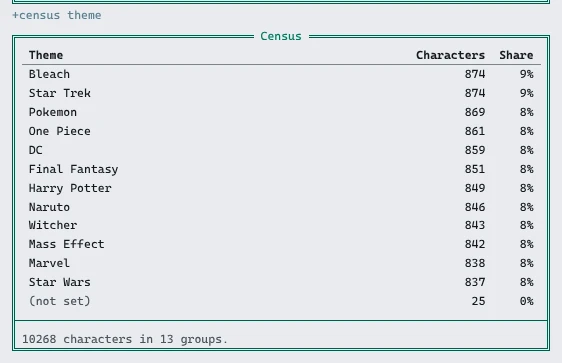
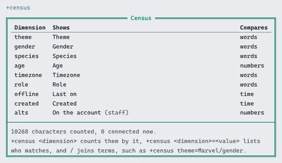
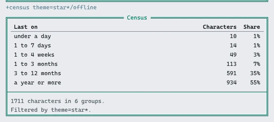
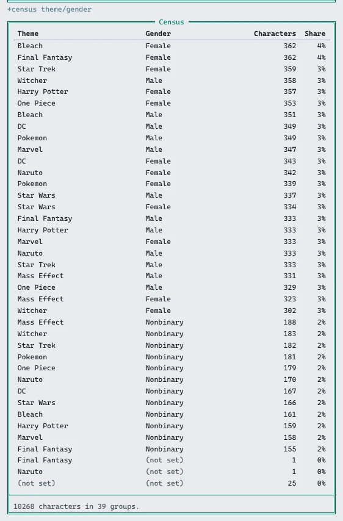
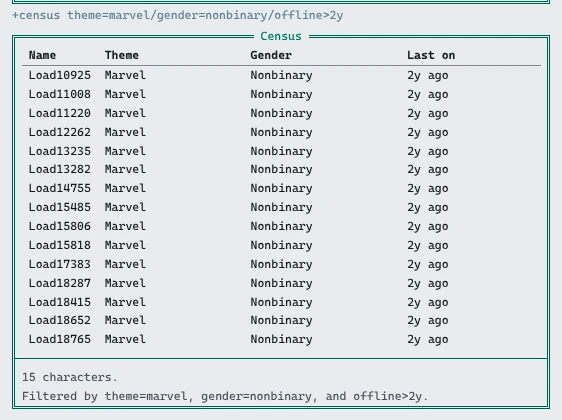
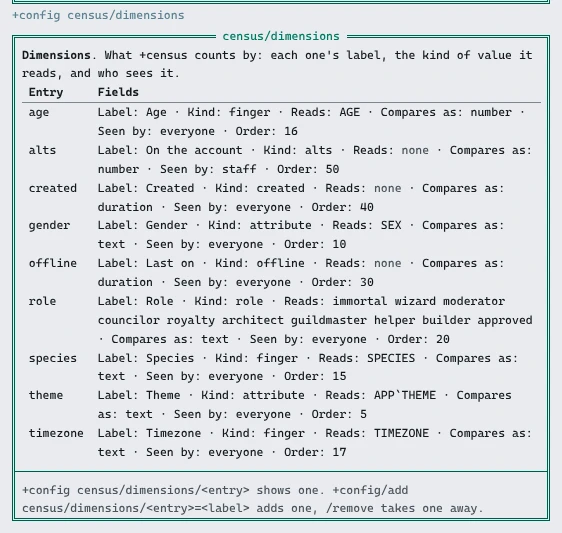

import { Aside } from '@astrojs/starlight/components';

The **census** package adds `+census`. It counts the game's characters by what staff choose:
how many play in each theme, how many of the Marvel characters have not logged in for a year,
how the approved characters split by gender.



- Each thing the census counts by is a **dimension**: theme, gender, role, when someone was last on.
- Staff add dimensions with `+config`, and choose which ones players see.
- Filters and dimensions join with `/`, so one line can ask a narrow question.
- Guests, God and the package manager are never counted.

| You are | You want to | Read |
|---|---|---|
| A player | count or list characters | [Asking the census](#asking-the-census) |
| A player | ask a narrower question | [Joining terms](#joining-terms) |
| Staff | count by something new | [Adding a dimension](#adding-a-dimension) |
| Staff | count only some characters | [Who is counted](#who-is-counted) |
| Staff | install it | [Installing](#installing) |
| A coder | count by something an attribute does not hold | [Adding a kind](#adding-a-kind) |

In the game, `+help census` has the same in short form.

## Asking the census

`+census` alone lists the dimensions you can use and how many characters are counted:



There are two kinds of question:

- **How many?** `+census <dimension>` counts the characters holding each value, most first:
  `+census theme`, `+census gender`, `+census role`.
- **Who?** `+census <dimension>=<value>` lists the characters who match, by name:
  `+census role=approved`, `+census theme=Marvel`.

Values compare without case, and `*` and `?` match anything, so `theme=star*` finds both Star
Wars and Star Trek. With nothing after it, `theme=` finds characters with no theme, and
`theme!=` those with one.

Numbers and times also take `<`, `<=`, `>` and `>=`. A time is a number and a unit, `s`,
`m` (minutes), `h`, `d`, `w` or `y`, and a number alone is days:

| Ask | Finds |
|---|---|
| `+census offline>30d` | characters last on more than 30 days ago |
| `+census created<1w` | characters made this week |
| `+census age>=18` | characters whose age is 18 or more |

Times are counted in spans, from `now` (connected) to `a year or more`:



A long answer comes in pages. The page is the last switch: `+census/2 theme=Marvel`, and each
page but the last ends with the line for the next.

## Joining terms

Terms join with `/`, and a character must match every filter:

```
> +census theme=Marvel/offline>1y
> +census role=approved/gender
> +census theme/gender
```

The first lists the Marvel characters nobody has seen for a year. The second counts the
approved characters by gender. The third counts every pair of theme and gender, up to two
dimensions at a time:



A list has a column for each dimension filtered by:



## Adding a dimension

Dimensions are a [table](/guides/config#tables) in `+config census/dimensions`. Changing it
needs the `config.admin` permission. Each dimension has:

- a **name**, what players type, such as `theme`;
- a **label**, the column heading, such as `Theme`;
- a **kind**, how a character's value is read (below);
- a **path**, what the kind reads, such as the attribute ``APP`THEME``;
- **compare as**: `text`, `number` or `duration`;
- **seen by**: `everyone`, or `staff`, the default;
- an **order**, lower first.

| Kind | Reads |
|---|---|
| `attribute` | the attribute the path names |
| `role` | the highest of the roles the path names that the character holds; any role when it is empty |
| `offline` | how long since the character was last on, `0` while they are connected |
| `created` | how long since the character was made |
| `alts` | how many characters are on the character's account |

A game that keeps each character's theme in ``APP`THEME`` adds it like this:

```
> +config/add census/dimensions/theme=Theme
[CONFIG] Done: Added census/dimensions/theme. +config census/dimensions/theme shows it.
> +config census/dimensions/theme/path=APP`THEME
[CONFIG] Done: census/dimensions/theme/path is now APP`THEME, was none.
> +config census/dimensions/theme/access=everyone
[CONFIG] Done: census/dimensions/theme/access is now everyone, was staff.
```

`+config census/dimensions` lists them all:



A new game has `gender` (the `SEX` attribute), `role`, `offline` (Last on), `created`, and
`alts`, which only staff see. Where the [finger](/guides/finger) package is installed, the
`census-finger` package adds `species`, `age` and `timezone` from `+finger`.

<Aside type="caution">
Everyone who sees a dimension sees the values the census reads, whoever set them. An
attribute flagged `mortal_dark` is read only for staff who see everything. A `+finger` field
a player hid is counted only for them and for staff who edit profiles.
</Aside>

On a big game, give the attribute an index so a filter such as `theme=Marvel` reads the
index instead of every character:

```
> @attribute/access APP`THEME=none
> @attribute/index APP`THEME=type:player
```

`help @attribute` in the game has more on indexes.

## Who is counted

`+config census/scope` holds filters every census starts from, written as `+census` takes
them. It is empty on a new game, so every character is counted but guests, God and the
package manager. To count only approved characters who were on in the last 90 days:

```
> +config census/scope=role=approved/offline<90d
```

Each answer's footer then says `Counting only role=approved/offline<90d.` Staff with the
`softcode.census.staff` permission, which wizards and royalty hold, count every character
anyway with `+census/all`, and see the dimensions only staff see.

## Big games

On a game of ten thousand characters, counting everyone by an attribute takes about four
seconds, and a list of who matches a few filters about as long. `+census` finds the characters, then
counts them in parts with `@dolist`, as `+who` does, so each part runs as its own queue entry
with its own function limit, and players' commands are answered in between. A filter on an
attribute with an index starts from the index, and answers in a second or two.

A breakdown with more than 400 different values asks for a filter instead of listing them
all.

## Installing

The census package ships with the server but is not installed on a new game. An
administrator installs it from the portal:

1. Open **Packages** in the admin area and choose **Browse**.
2. Install `census`. Its `+help` topics and `+config` settings come with it, through the
   `census-help` and `census-config` bridges, wherever `+help` and `+config` are installed.
3. Where `+finger` is installed, install `census-finger` too, to count by its fields.

It adds `+census` as a `$`-command on an object in the master room, **Census**, which also
holds the settings. The dimensions are kept on the **Census Store** inside it. A game that
already has a `+census` of its own should remove that first, or both answer.

See [Softcode Packages](/guides/packages) for how installing, upgrading and rolling back
work.

## Adding a kind

A package adds a kind of dimension with an attribute named ``KIND`<NAME>`` on the
**Census**. It is given a list of characters as `%0` and the dimension's path as `%1`, with
the reader as `%#`, and returns each one's value as the reader may see it, one line each, in
the same order. Reading the whole list in one call keeps a census on a big game fast.

Two more attributes are optional:

- ``KIND`<NAME>`TEST`` decides a filter itself. It gets the characters, the path, the
  comparison and the value, and returns the characters it keeps. The `role` kind has one, so
  `role=approved` finds an approved wizard too.
- ``KIND`<NAME>`FIND`` gets the path, the comparison and the value, and returns the only
  characters that can match, or `#-1` to look at everyone. The `attribute` kind's reads an
  index.

`census-finger` is one such package: its `finger` kind reads a field as `+finger` shows it to
the reader. A kind a package attaches goes away when that package is uninstalled.
