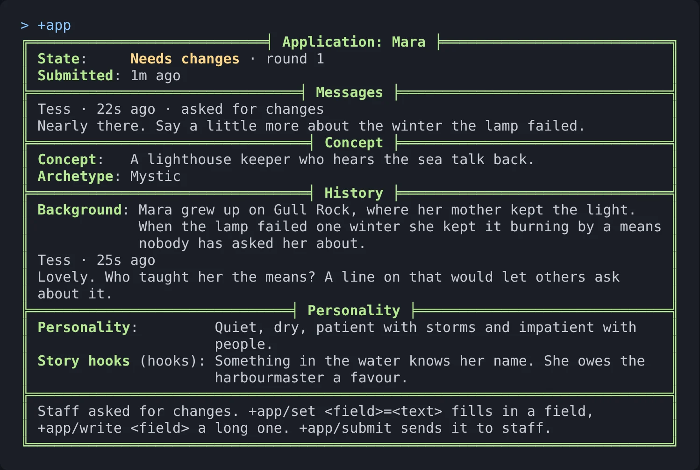
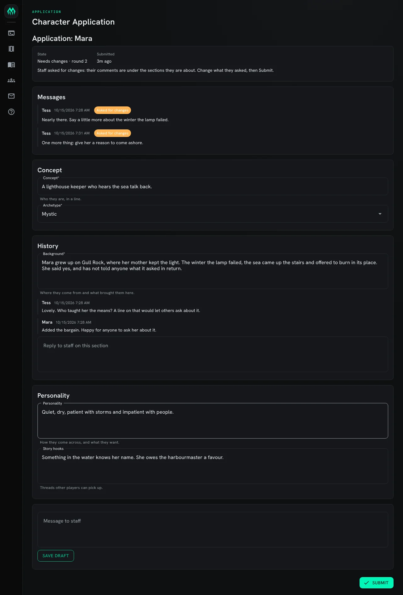
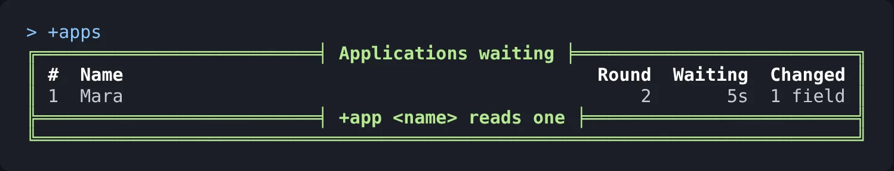
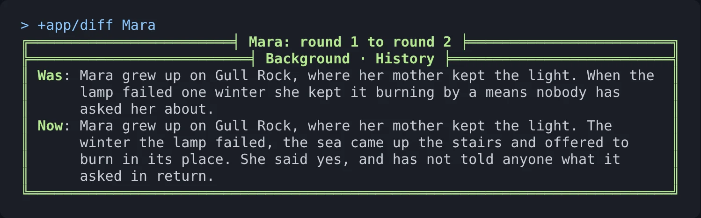
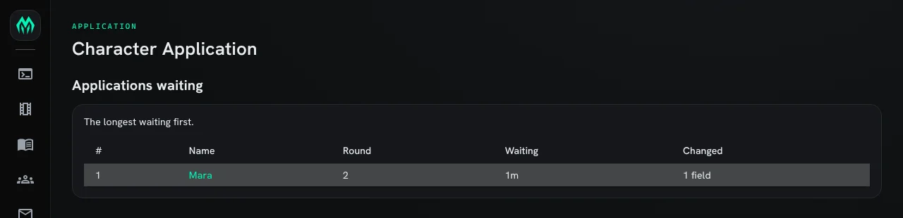
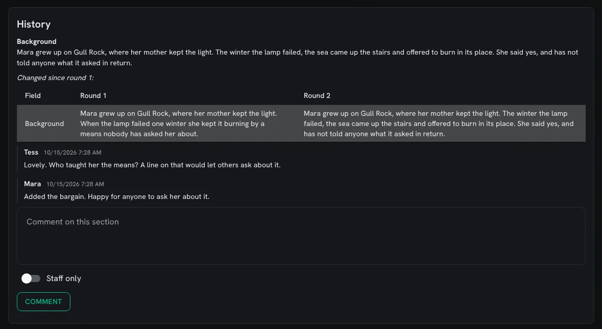
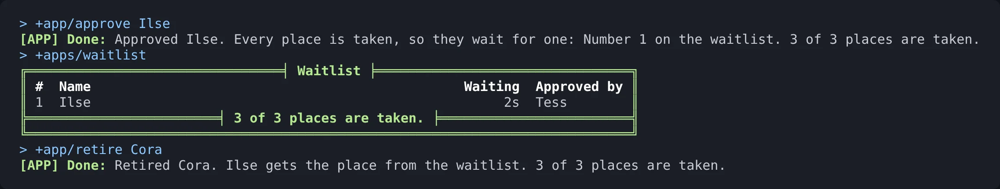

import { Aside } from '@astrojs/starlight/components';

Many games read a character before it plays. The `chargen` package keeps each character's
**application** as a draft the player fills in, sends to staff, and talks over with them until
staff approve it. The same application is in the game with `+app` and in the web portal at
`/apps/chargen`.

| You are | You want to | Read |
|---|---|---|
| A player | apply for a character | [Applying](#applying) |
| Staff | read, comment on and decide applications | [Reviewing](#reviewing) |
| Staff | limit how many characters play at once | [A cap and a waitlist](#a-cap-and-a-waitlist) |
| Staff | change the questions | [Changing the form](#changing-the-form) |
| Staff | install it and change its settings | [Running applications](#running-applications) |

In the game, `+help app` has the same commands in short form.

## How an application moves


- **Draft**: the player's to change. Staff cannot see it until it is first submitted.
- **Submitted**: staff have it. The player can still comment, and can withdraw it to change
  something.
- **Needs changes**: staff sent it back with comments. The player changes what they asked and
  submits again.
- **Approved**: the character gets the approved role and plays.
- **Waitlist**: approved, but every place is taken. It gets the next place that opens. Only when
  the game sets a cap.
- **Retired**: the character stopped playing and gave up its place.

Every submission is kept as a **round**. Staff see what changed since the round before, field by
field.

## Applying

`+app` shows your application. A new one lists the fields with a line about each:

```
> +app/set concept=A lighthouse keeper who hears the sea talk back.
[APP] Done: Concept saved.
> +app/set archetype=Mystic
[APP] Done: Archetype saved.
```

`+app/set <field>=<text>` fills in a field, and an empty text clears it. For a long field,
`+app/write <field>` lets you type as many lines as you like; send `.done` on a line by itself to
save it.

Each answer is an attribute on your character, named for the field. Only `+app` changes it, so
staff see every change in the next round:

```
> examine me/CONCEPT
CONCEPT [w #1]: A lighthouse keeper who hears the sea talk back.
> &CONCEPT me=A sailor
#-1 NO PERMISSION TO SET ATTRIBUTE
```

When every required field is filled in, `+app/submit` sends it to staff and tells you where you
are in the queue:

```
> +app/submit
[APP] Done: Submitted. Number 1 of 1 in the queue. Applications usually get an answer in about 2d.
```

The typical wait is the middle of the latest decisions, so it follows how fast your staff
actually answer. `+apps/queue` shows the same to anyone, without names, and the places left when
the game has a [cap](#a-cap-and-a-waitlist):

```
> +apps/queue
╔══════════════════════════════╡ Applications ╞══════════════════════════════╗
║ Waiting:      1 application                                                ║
║ Typical wait: about 1d                                                     ║
║ Places:       3 of 3 taken, 0 waiting                                      ║
╚════════════════════════════════════════════════════════════════════════════╝
```

To change something after submitting, `+app/withdraw` takes it back to a draft.

### When staff ask for changes

You hear when staff comment or send it back, by `@mail` if you are not connected. `+app` then
shows their message at the top and each comment under the section it is about:



Change what they asked, answer a comment with `+app/comment <section>=<text>`, and submit again.
`+app/comment =<text>` is about the whole application.

```
> +app/comment history=Added the bargain. Happy for anyone to ask her about it.
[APP] Done: Comment added.
> +app/submit
[APP] Done: Submitted. Number 1 of 1 in the queue. Applications usually get an answer in about 2d.
```

In `+app`, a `*` marks a field you changed since you last submitted. `+app/diff` lists them with
what each said and says now.

### In the portal

`/apps/chargen` is the same application as a form. Staff comments sit under the sections they are
about, each with a box to reply. **Save draft** keeps your changes without sending them;
**Submit** sends them.



## Reviewing

Reviewers hold the `application-reviewer` role:

```
> @role/assign *Tess=application-reviewer
Tess now holds application-reviewer.
```

`+apps` is the queue, the longest waiting first. **Changed** says how many fields changed since
the round before:



`+app <name>` reads one application as last submitted. `+app/diff <name>` shows each field that
changed since the round before; `+app/diff <name>=<round>` compares with an earlier round.



`+apps/waitlist`, `+apps/all` (every application not yet decided) and `+apps/decided` are the other
lists.

### Talking it over

Comments belong to a section, so the applicant reads them next to the answers they are about:

```
> +app/comment Mara/history=Lovely. Who taught her the means? A line on that would let others ask about it.
[APP] Done: Comment added.
> +app/note Mara/concept=Check with the sea-spirits plot before approving.
[APP] Done: Staff note added. Mara does not see it.
```

`+app/note` is the same as `+app/comment`, but only reviewers read it.

### Deciding

```
> +app/return Mara=Nearly there. Say a little more about the winter the lamp failed.
[APP] Done: Returned to Mara for changes.
```

- `+app/return <name>=<what to change>` sends it back. The message is required.
- `+app/approve <name>[=<message>]` approves it and gives the character the approved role.
- `+app/retire <name>` takes an approved character out of play: it loses the role.

Nobody decides their own application, even a wizard.

### In the portal

For a reviewer, `/apps/chargen/queue` is the queue, and `/apps/chargen/waitlist`, `/all` and
`/decided` the other lists:



Opening an application shows each section with a table of what changed since the round before,
the comments, a box for a new one with a **Staff only** switch, and at the end **Ask for changes**
and **Approve**:



## A cap and a waitlist

A game can limit how many characters play at once. The cap counts holders of the approved role,
and is off until you set it:

```
> +config chargen/cap=40
[CONFIG] Done: chargen/cap is now 40, was 0.
```

With every place taken, approving puts the application on the waitlist. Retiring a character
gives its place to the first one waiting, at once:



Raising the cap admits the waitlist into the new places straight away. `+config chargen/cap=0`
turns the cap off.

## Changing the form

The questions are the game's. The form is sections, and fields in them; `+apps/fields` lists them.
Changing it takes the `config.admin` permission:

```
> +apps/section skills=Skills
[APP] Done: Added the section Skills. +apps/field <key>=skills/<label> puts a field in it.
> +apps/field trade=skills/Trade
[APP] Done: Added the field Trade to Skills. +apps/field/type trade=long makes it take many lines.
> +apps/field/type trade=choice
[APP] Done: Trade type: choice
> +apps/field/choices trade=Sailor|Smith|Healer
[APP] Done: Trade choices: Sailor|Smith|Healer
> +apps/field/required trade=yes
[APP] Done: Trade required: yes
> +apps/field/help trade=What they do for coin.
[APP] Done: Trade help: What they do for coin.
```

Each field has these options, set with `+apps/field/<option> <key>=<value>`. An empty value puts
one back to its default.

| Option | Value |
|---|---|
| `label` | What the form calls it. |
| `section` | The section it is in. |
| `type` | `text` (a line), `long` (paragraphs) or `choice`. |
| `choices` | For a choice field, the choices, split by `|`. |
| `required` | `yes` when it must be filled in before submitting. |
| `max` | The most characters: 200 for text and 4000 for long by default. |
| `order` | Where it comes in its section. |
| `help` | A line shown under an empty field. |
| `attribute` | The attribute on the character that holds the answer: the key by default. |

`+apps/section/order <key>=<number>` moves a section; lower comes first.
`+apps/field/remove <key>` and `+apps/section/remove <key>` take things out. Answers already given
stay on the characters, and a new `attribute` does not move them.

## Running applications

### Installing

Applications ship with the server but are not installed on a new game. An administrator installs
them from the portal:

1. Open **Packages** in the admin area and choose **Browse**.
2. Install `chargen`, which gives `+app` and `+apps`. It needs `plus-help`, `plus-config` and
   `http-handler`; a new game already has them.
3. Install `chargen-app` for the portal page. It asks for the lowest portal role that may open the
   page, **player** by default.

The first-run setup also offers both.

### Settings

`+config chargen` lists the settings; `+config chargen/<setting>=<value>` changes one.

| Setting | Default | What it does |
|---|---|---|
| `cap` | 0 | The most characters with the approved role. 0 is no cap. |
| `approved-role` | approved | The role approval gives, and what the cap counts. |
| `show-queue` | yes | Applicants see their place and the typical wait, and anyone can use `+apps/queue`. |
| `wait-sample` | 20 | How many of the latest decisions the typical wait is the middle of. |
| `mail-offline` | yes | Applicants who are not connected hear about decisions and comments by `@mail`. |

### Hooks

Approval gives the role and nothing else. To do more, set one of these attributes on the
**Chargen** object (`@find Chargen`):

| Attribute | Runs when |
|---|---|
| ``ON`SUBMIT`` | an application is submitted |
| ``ON`RETURN`` | staff ask for changes |
| ``ON`APPROVE`` | a character is approved, including from the waitlist |
| ``ON`WAITLIST`` | an approval goes on the waitlist |
| ``ON`RETIRE`` | a character is retired |

Each runs as the Chargen object with `%<character>` the applicant's objid. The decisions also get
`%<actor>`, the reviewer, and `%<message>`. This one sends every approved character to the docks
and makes it their home:

```
> &ON`APPROVE Chargen=@tel %<character>=#26; @link %<character>=#26
Chargen/ON`APPROVE - Set.
```

After the next approval, the character is there:

```
> think [loc(*Wren)] [home(*Wren)]
#26:1792049674351 #26:1792049674351
```

<Aside>
The answers stay on the characters. The state, rounds and comments are kept on the Chargen Store,
so a character cannot change its own, and uninstalling `chargen` removes them.
</Aside>
