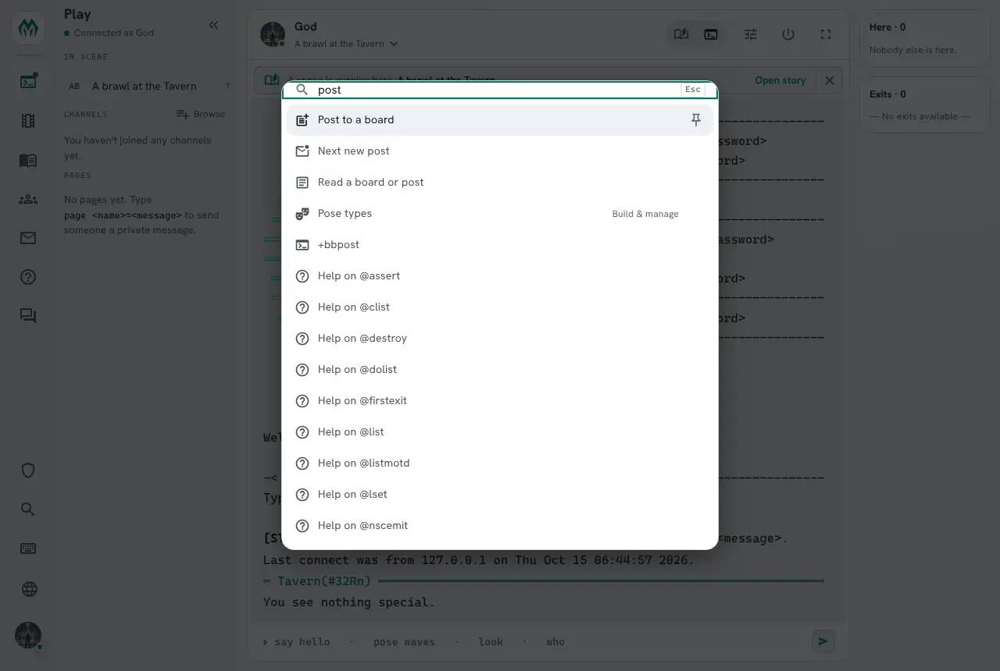
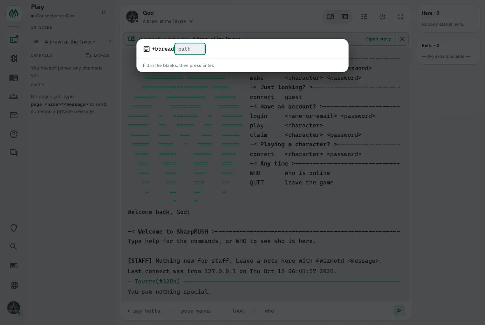
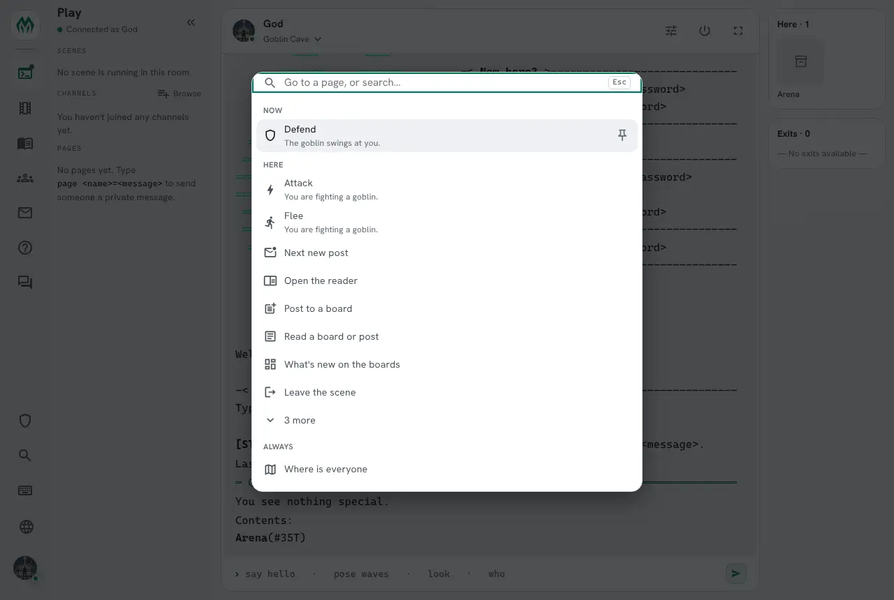
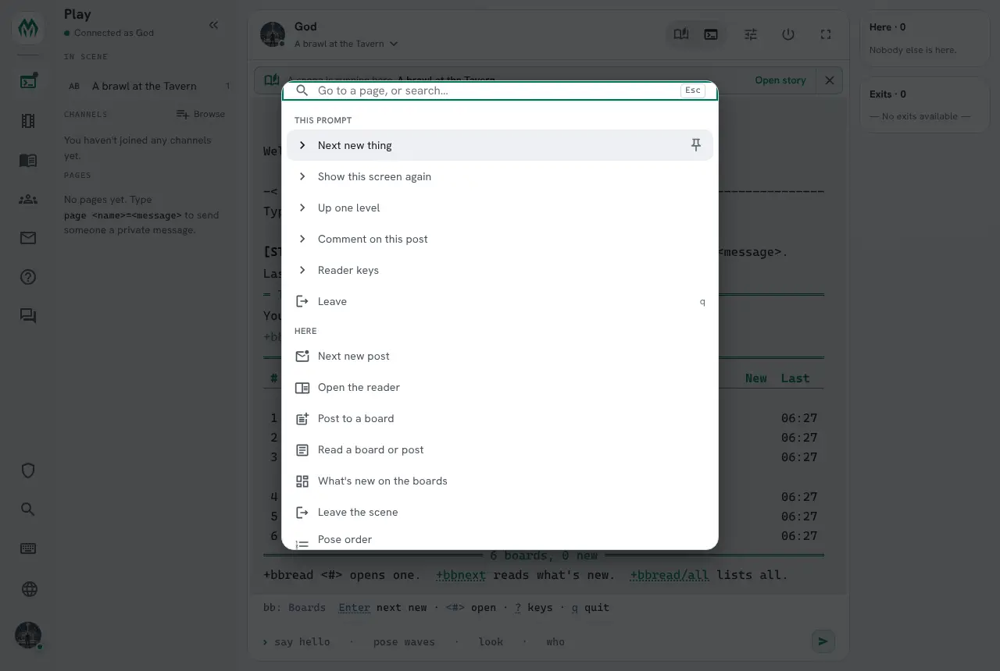

import { Aside } from '@astrojs/starlight/components';

Press **Ctrl+K** anywhere in the web portal, including while typing in the Play terminal, and the
command palette opens. It goes to portal pages, and it runs game commands as if the player had typed
them. With nothing typed, it shows what is most likely useful right now: the scene in this room, the
board reader the player has open, their turn in a fight.

None of that is built into the portal. A package, a builder or a player adds commands to the palette
by setting attributes, and pushes **contexts** to say what a player is doing. This guide shows both,
with a small combat system as the example.


## What it shows

With nothing typed, the palette lists, in this order:

1. **This prompt**: the keys of the `@input` session the player is in, such as a board reader.
2. **Now**: urgent commands, such as defending when it is your turn.
3. **Pinned**: rows the player pinned.
4. **Here**: what this page offers, and the commands the player's contexts raise.
5. **Always**: commands useful anywhere, such as `+who`.
6. **Go to**: the portal's pages.

Each group shows eight rows and a "more" row. Typing searches all of them by label, command and
keywords, and then the built-in commands the player may use, and help topics.



Choosing a row runs its line as if the player had typed it in the terminal, so every check the
command makes still applies. The palette never lets a player do something they could not type.

## Adding a command

A palette entry is an attribute ``PALETTE`<name>`` on the object that holds the command. Its value is a
JSON object: at least a `label`, what the row says, and a `line`, what it sends. `attr` names the
`$`-command the line runs, so the entry is offered only while that command exists.

This Arena holds three commands for a fight:

```text
> @create Arena
Created: Object #35.
> @set Arena=!no_command
Arena - NO_COMMAND reset.
> drop Arena
You drop Arena.
> &CMD`ATTACK Arena=$+attack *:@pemit %#=You swing at %0.
Arena/CMD`ATTACK - Set.
> &CMD`DEFEND Arena=$+defend:@pemit %#=You raise your guard.
Arena/CMD`DEFEND - Set.
> &CMD`FLEE Arena=$+flee:@pemit %#=You run for the exit.
Arena/CMD`FLEE - Set.
> &PALETTE`ATTACK Arena={"label":"Attack","line":"+attack <target>","attr":"CMD`ATTACK","when":["combat"],"icon":"Bolt","info":"Swing at whoever you are fighting."}
Arena/PALETTE`ATTACK - Set.
> &PALETTE`DEFEND Arena={"label":"Defend","line":"+defend","attr":"CMD`DEFEND","when":["my_turn"],"urgent":true,"icon":"Shield"}
Arena/PALETTE`DEFEND - Set.
> &PALETTE`FLEE Arena={"label":"Flee","line":"+flee","attr":"CMD`FLEE","when":["combat"],"icon":"DirectionsRun"}
Arena/PALETTE`FLEE - Set.
```

A player is offered an entry when a typed command would reach its object (they carry it, it is in
the room, the room's zone, their zone or the master room), they can see it, it answers commands, and
its `lock`, if it has one, passes for them. Things start `NO_COMMAND`, which is why the Arena is set
`!no_command`.

`help palette keys` in the game lists every key. The ones used most:

| Key | What it does |
|---|---|
| `label` | What the row says. |
| `line` | What it sends. A `<word>` in it is a **slot** the player fills in. |
| `attr` | The `$`-command attribute the line runs. |
| `when` | The contexts the entry waits for. |
| `urgent` | `true` puts it under Now while its contexts are there. |
| `always` | `true` lists it under Always. |
| `info` | One line shown under the row. |
| `lock` | A lock the player must pass, such as ``FUN`CAN`FIGHT/1``. |
| `action` | `insert` puts the line into the terminal for the player to finish, instead of running it. |

The value is data. Only `lock` is ever evaluated.

### Slots

A `<word>` in the line is asked for before the line runs:



When a context has a value of the same name, the slot is filled from it, and the row runs at once.
That is how "Attack" below becomes `+attack goblin`.

## Contexts

A player's **context stack** is the names of what they have been doing lately, newest on top. The
palette puts the commands of the contexts near the top first, and lets the others sink.

Two things push a context:

- **Typing a command.** A typed line that runs a `$`-command pushes the system of the object that
  answered it: the package the object came from, or the object itself when it came from none.
  Its entries without `when` rise. Nobody has to write anything for this.
- **`@context/push`.** Code says what the player is doing, with values for the slots, how long it
  lasts and a line saying why.

A context's weight halves every 15 minutes since it was last pushed, and it falls off after about an
hour, or when its lifetime runs out. `@context/drop` takes it off at once. Stacks are kept in memory,
so a restart empties them.

Here the fight starts and Alice's stack fills. context() returns the same commands the palette would
put first:

```text
> @context/push me=combat,[json(object,target,json(string,goblin))],10m,You are fighting a goblin.
> think context(me,5,%r)
Attack
Flee
> @context/push me=my_turn,,60s,The goblin swings at you.
> think context(me,5,%r)
Defend
Attack
Flee
```

The values are a JSON object built with json(), since the game removes `{ }` from a command. A text
value needs `json(string,...)`. A number does not.

Defend is first because it is urgent. In the portal it sits above everything else, under Now, with
the context's line under it:



Without an attribute, context() returns the ready commands as links a player can click. With one,
it hands every entry to that attribute, slots filled or not, and joins what comes back:

```text
> &FN`ITEM me=[if(%<urgent>,NOW%b)]%<label>: %<line>[if(not(%<ready>),%b- needs more)] - %<contexts>
Alice/FN`ITEM - Set.
> think context(me,5,%r,me/FN`ITEM)
NOW Defend: +defend - my_turn
Attack: +attack goblin - combat
Flee: +flee - combat
```

`help context()` lists every named argument the attribute gets. `@context me` shows the stack itself.
The third line was pushed when Alice typed `+defend` on the Arena, which belongs to no package:

```text
> @context me
╭─────────────────────┤ Context of Alice, newest first ├─────────────────────╮
│ Context            Weight  Values         Info                             │
│ ────────────────────────────────────────────────────────────────────       │
│ my_turn              1.00                 The goblin swings at you.        │
│ combat               0.99  target=goblin  You are fighting a goblin.       │
│ #35:1792047633016    0.96                                                  │
╰────────────────────────────────────────────────────────────────────────────╯
```

A player can push and drop their own contexts. Code can do it for the player whose command it is
running, `%#`, or a player its object controls.

### Pushing from an event

A context often follows the player around. The `scene-here` package pushes `scene_here` when a player
enters a room with a scene running, and drops it when they enter one without. It is one attribute on
the event handler:

```text
&OBJECT`MOVE`SCENE #9=@assert hastype(%<objid>,PLAYER); @assert not(strmatch(setr(scene,scenewhere(%<destination>)),#-1*))={@context/drop %<objid>=scene_here}; @context/push %<objid>=scene_here,[json(object,scene,%q<scene>)],,Scene %q<scene>[if(strlen(setr(title,scene(%q<scene>,title))),: %q<title>)] is running here.
```

The scene package's "About the scene here" entry waits for `scene_here` and has a `<scene>` slot, so
walking into the Tavern puts it at the top with the scene filled in. The scene package keeps `scene_here`
up to date for players already in the room, so it appears when a scene starts there and goes when the
scene pauses or finishes.

### Names are shared

Context names belong to no package. An add-on can raise its own commands on `scene_here` without
depending on the package that pushes it. These are the names the shipped packages use:

| Name | Pushed by | Values | Means |
|---|---|---|---|
| `scene_here` | scene-here, scene | `scene` | A scene is running in the player's room. |
| `scene_focus` | scene | `scene` | The player has joined or created a scene and not left it. |
| a package id | the engine | | The player typed one of that package's commands. |

A combat system might use `combat` and `my_turn`, as above. Pick plain words that another package
could raise its own commands on.

## Keys for an @input prompt

While an `@input` session takes the player's lines, entries with `"context":"input"` on the objects
the session sends lines to come first, under This prompt. The board reader lists its keys this way,
and its lock shows only the keys that work right now:

```text
&PALETTE`KEY_NEXT BBoards={"label":"Next new thing","line":"n","context":"input","lock":"FUN`PALETTE`WRITING/0","order":1}
&PALETTE`KEY_POST BBoards={"label":"Post what you wrote","line":".","context":"input","lock":"FUN`PALETTE`WRITING/1","order":1}
```



<Aside>
These rows send the line through the player's terminal, as the session takes lines from there. In the
portal, they need the Play terminal to be connected.
</Aside>

## Pins

A player pins a row with its pin button or Alt+P, and it stays under Pinned. Pins are kept in order in
`PALETTE_PINS` on the character, so softcode can read them, and so can a player who wants to tidy
them:

```text
> &PALETTE_PINS me=#15:1792044786423/SCENES cmd:page go:/wiki
```

A pin out of reach where the player is now is hidden, not removed.

## Packages that add entries

| Package | Entries |
|---|---|
| who-where | Who is on, Where is everyone (Always) |
| scene | Scenes running now (Always); About the scene here and Join the scene here on `scene_here`; Pose order, Recent poses and Leave the scene on `scene_focus` |
| scene-here | none of its own; it pushes `scene_here` as players move |
| bboards | Next new post, What's new on the boards, Read a board or post, Post to a board, Open the reader; the reader's keys |

A player who may examine an object sees, under the empty palette, which of its entries are not valid
and why, such as `not a JSON object`.
