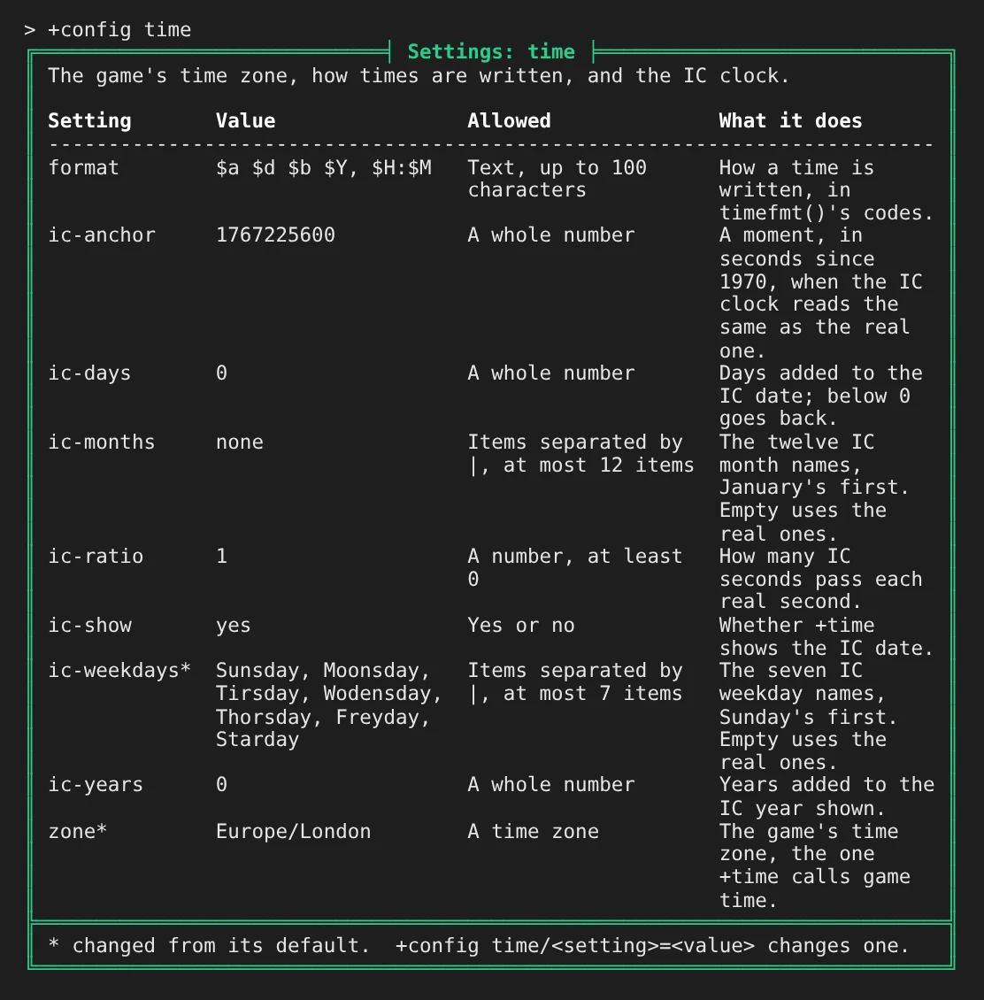
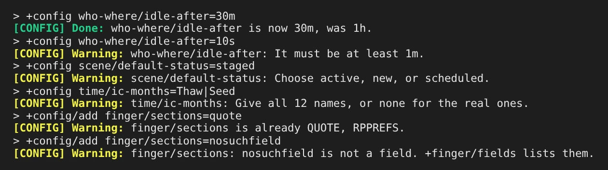
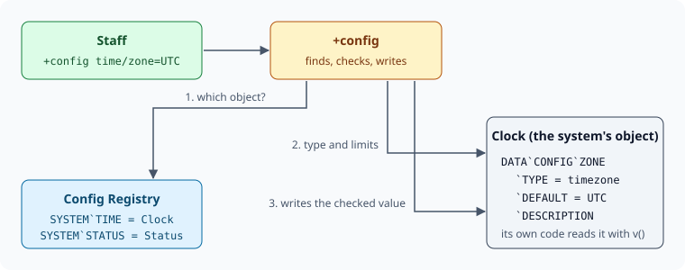

import { Aside } from '@astrojs/starlight/components';

Many softcode systems have a few choices a game makes once: how long a player is idle before
`+who` dims their name, the game's time zone, how long a status line may be. The `plus-config`
package gives all of them one command, `+config`. Each system keeps its settings on its own
object, says what each one accepts, and registers with `+config`. Staff list the settings, read
what each does, and change them; `+config` refuses a value the setting does not accept.

| You are | You want to | Read |
|---|---|---|
| Staff | see and change a system's settings | [Reading settings](#reading-settings) and [Changing a setting](#changing-a-setting) |
| Staff | know what each bundled package lets you set | [The bundled packages' settings](#the-bundled-packages-settings) |
| A coder | give your own code settings | [Giving your code settings](#giving-your-code-settings) |
| A package author | ship settings with a package | [In a package](#in-a-package) |

`plus-config` ships with the server and is installed on a new game.

## Reading settings

Anyone may read the settings. `+config` alone lists every system that has some:

```
> +config
╔════════════════════════════════╡ Settings ╞════════════════════════════════╗
║ System     Settings  About                                                 ║
║ -------------------------------------------------------------------------- ║
║ finger            4  Finger profiles. What +finger and +oocfinger show,    ║
║                      and who sets which field.                             ║
║ scene             3  Scenes. What a new scene starts as, which details     ║
║                      players may set, and how much +scene/recall shows.    ║
║ status            4  Status. How long a status line, note and place may    ║
║                      be, and what +status/list says under the list.        ║
║ time              9  Time and the IC clock. The game's time zone, how      ║
║                      times are written, and the IC clock.                  ║
║ who-where         3  Who and Where. What +who and +where show.             ║
╠════════════════════════════════════════════════════════════════════════════╣
║ +config <system> lists one system's settings.                              ║
╚════════════════════════════════════════════════════════════════════════════╝
```

A system shows up once its package is installed. The About column gives its display name, then what
it covers. `+config <system>` lists its settings with the value each has, what it accepts, and its
display name and what it changes. A `*` after a name marks a value changed
from its default:



`+config <system>/<setting>` shows one setting with its display name, its default, an example when
the system gives one, and who may change it:

```
> +config time/ic-months
╔═════════════════════════════╡ time/ic-months ╞═════════════════════════════╗
║ Name:         IC month names                                               ║
║ Value:        Deepwinter, Thaw, Seedtime, Rains, Bloom, Highsun, Hay,      ║
║               Harvest, Leafall, Mist, Frost, Longnight                     ║
║ Default:      none                                                         ║
║ Allowed:      Items separated by |, at most 12 items                       ║
║ What it does: The twelve IC month names, January's first. Empty uses the   ║
║               real ones.                                                   ║
║ Changed by:   The config.admin permission                                  ║
╠════════════════════════════════════════════════════════════════════════════╣
║ +config time/ic-months=<value> sets it, /add and /remove change items,     ║
║ /reset goes back to the default.                                           ║
╚════════════════════════════════════════════════════════════════════════════╝
```

System and setting names match in any case.

## Changing a setting

`+config <system>/<setting>=<value>` changes a setting. It needs the `config.admin` permission,
the same one `@config` needs. `+config` says what the value was and what it is now:

```
> +config who-where/idle-after=30m
[CONFIG] Done: who-where/idle-after is now 30m, was 1h.
```

A value the setting does not accept is refused, with the reason:



What you type is stored as text and never run as code, so `[` and `%` in a value are kept as
they are.

A list setting takes `/add` and `/remove` to change a few items, and keeps each item once:

```
> +config/add finger/locked=occupation
[CONFIG] Done: finger/locked is now occupation, was none.
```

`/reset` puts a setting back to its default:

```
> +config/reset who-where/idle-after
[CONFIG] Done: who-where/idle-after is now 1h, was 30m.
```

Someone without the permission can read a setting but not change it:

```
> +config weather/season=winter
[CONFIG] Error: Changing weather/season needs the config.admin permission.
```

<Aside>
A setting can name another permission in its `PERMISSION` leaf, so a package can hand one
setting to its own staff. To keep `+config` from someone who has `config.admin`, restrict the
command with `@command/restrict` or `@lock/command`.
</Aside>

## The bundled packages' settings

| System | Setting | What it changes | Default |
|---|---|---|---|
| `who-where` | `idle-after` | How long a player is idle before `+who` draws their name muted. At least `1m`. | `1h` |
| | `who-order` | The order bare `+who` lists players in: `name` or `idle`. | `name` |
| | `where-view` | What bare `+where` shows: `grouped` under a line per location, or one player per line by `room` or by `name`. | `grouped` |
| `finger` | `sections` | Fields shown under the rest, each below a line with its label. | `QUOTE RPPREFS` |
| | `locked` | Fields only staff set. | none |
| | `columns` | How many columns the other fields are dealt into, 1 to 4. | `2` |
| | `length` | The longest value, in characters. | `1000` |
| `status` | `line-length`, `note-length`, `place-length` | The longest status line, note and place. | `100`, `400`, `60` |
| | `list-footer` | A line shown under `+status/list`. | none |
| `time` | `zone` | The game's time zone. | `UTC` |
| | `format` | How a time is written, in `timefmt()`'s codes. | `$a $d $b $Y, $H:$M` |
| | `ic-anchor`, `ic-ratio`, `ic-days`, `ic-years` | Where the IC clock starts, how fast it runs, and days and years added. | `1767225600`, `1`, `0`, `0` |
| | `ic-months`, `ic-weekdays` | The IC month and weekday names, split by `\|`; all of them or none. | the real ones |
| | `ic-show` | Whether `+time` shows the IC date. | `yes` |
| `scene` | `default-status` | What `+scene/create` makes: `active` logs at once, `new` or `scheduled` waits for `+scene/start`. | `active` |
| | `open-details` | Whether an owner may set scene details the game does not list. | `yes` |
| | `recall-rounds` | How many rounds of poses a bare `+scene/recall` shows, 1 to 20. | `2` |
| `safety` | `topics` | The topics `+safety/topics` suggests, split by `\|`. | 14 common ones |
| | `warning-detail` | The scene detail that holds content warnings. | `warning` |
| | `topic-length`, `note-length` | The longest line or veil, and the longest note on a pause or skip. | `40`, `200` |
| | `signal-wait` | How long a player waits between one pause or skip and the next. | `1m` |

A list of entries that each carry several fields, such as the statuses on offer and how long
each lasts, keeps its own command (`+status/options`); `+config` is for single values and lists.

## Giving your code settings

A system keeps its settings on its own object, under ``DATA`CONFIG``, and registers that object.
`+config` finds the object through the registry, reads what each setting accepts from the object,
and writes a value back to it only once the value passes:



For example, a weather report that changes every half hour, picks from a list of skies and
follows a season. Each setting is one attribute holding the value, with leaves under it.
``DATA`CONFIG`` holds what the system covers and ``DATA`CONFIG`LABEL`` its display name:

```
> @create Weather
Created: Object #28.
> &DATA`CONFIG Weather=How the weather report behaves.
Weather/DATA`CONFIG - Set.
> &DATA`CONFIG`LABEL Weather=Weather report
Weather/DATA`CONFIG`LABEL - Set.
> &DATA`CONFIG`SEASON Weather=spring
Weather/DATA`CONFIG`SEASON - Set.
> &DATA`CONFIG`SEASON`TYPE Weather=choice
Weather/DATA`CONFIG`SEASON`TYPE - Set.
> &DATA`CONFIG`SEASON`CHOICES Weather=spring summer autumn winter
Weather/DATA`CONFIG`SEASON`CHOICES - Set.
> &DATA`CONFIG`SEASON`DEFAULT Weather=spring
Weather/DATA`CONFIG`SEASON`DEFAULT - Set.
> &DATA`CONFIG`SEASON`LABEL Weather=Season
Weather/DATA`CONFIG`SEASON`LABEL - Set.
> &DATA`CONFIG`SEASON`DESCRIPTION Weather=The season the weather follows.
Weather/DATA`CONFIG`SEASON`DESCRIPTION - Set.
> &DATA`CONFIG`EVERY Weather=1800
Weather/DATA`CONFIG`EVERY - Set.
> &DATA`CONFIG`EVERY`TYPE Weather=duration
Weather/DATA`CONFIG`EVERY`TYPE - Set.
> &DATA`CONFIG`EVERY`DEFAULT Weather=1800
Weather/DATA`CONFIG`EVERY`DEFAULT - Set.
> &DATA`CONFIG`EVERY`MIN Weather=300
Weather/DATA`CONFIG`EVERY`MIN - Set.
> &DATA`CONFIG`EVERY`LABEL Weather=Change every
Weather/DATA`CONFIG`EVERY`LABEL - Set.
> &DATA`CONFIG`EVERY`EXAMPLE Weather=45m
Weather/DATA`CONFIG`EVERY`EXAMPLE - Set.
> &DATA`CONFIG`EVERY`DESCRIPTION Weather=How often the weather changes.
Weather/DATA`CONFIG`EVERY`DESCRIPTION - Set.
> &DATA`CONFIG`SKIES Weather=clear|light rain
Weather/DATA`CONFIG`SKIES - Set.
> &DATA`CONFIG`SKIES`TYPE Weather=list
Weather/DATA`CONFIG`SKIES`TYPE - Set.
> &DATA`CONFIG`SKIES`DELIMITER Weather=|
Weather/DATA`CONFIG`SKIES`DELIMITER - Set.
> &DATA`CONFIG`SKIES`DEFAULT Weather=clear|light rain
Weather/DATA`CONFIG`SKIES`DEFAULT - Set.
> &DATA`CONFIG`SKIES`MIN Weather=1
Weather/DATA`CONFIG`SKIES`MIN - Set.
> &DATA`CONFIG`SKIES`LABEL Weather=Skies
Weather/DATA`CONFIG`SKIES`LABEL - Set.
> &DATA`CONFIG`SKIES`DESCRIPTION Weather=The skies the report picks from.
Weather/DATA`CONFIG`SKIES`DESCRIPTION - Set.
> +config/register weather=Weather
[CONFIG] Done: weather is Weather's settings. +config weather lists them.
> +config weather
╔════════════════════════╡ Settings: Weather report ╞════════════════════════╗
║ How the weather report behaves.                                            ║
║                                                                            ║
║ Setting  Value              Allowed                 What it does           ║
║ -------------------------------------------------------------------------- ║
║ every    30m                A length of time, at    Change every. How      ║
║                             least 5m                often the weather      ║
║                                                     changes.               ║
║ season   spring             Spring, summer,         Season. The season the ║
║                             autumn, or winter       weather follows.       ║
║ skies    clear, light rain  Items separated by |,   Skies. The skies the   ║
║                             at least 1 item         report picks from.     ║
╠════════════════════════════════════════════════════════════════════════════╣
║ +config weather/<setting>=<value> changes one.                             ║
╚════════════════════════════════════════════════════════════════════════════╝
```

An `EXAMPLE` leaf, written as staff would type the value, is shown as a whole `+config` line:

```
> +config weather/every
╔══════════════════════════════╡ weather/every ╞═════════════════════════════╗
║ Name:         Change every                                                 ║
║ Value:        30m                                                          ║
║ Default:      30m                                                          ║
║ Allowed:      A length of time, at least 5m                                ║
║ Example:      +config weather/every=45m                                    ║
║ What it does: How often the weather changes.                               ║
║ Changed by:   The config.admin permission                                  ║
╠════════════════════════════════════════════════════════════════════════════╣
║ +config weather/every=<value> sets it, /reset goes back to the default.    ║
╚════════════════════════════════════════════════════════════════════════════╝
```

`+config/register` needs `config.admin`. `+config/unregister weather` drops the registration and
leaves the settings on the object.

The value is stored in the form your code can use at once: a duration in seconds, a yes or no as
`1` or `0`, a list joined by its delimiter. The code reads it where it lives, with `v()` on the
object or `get()` from elsewhere, and needs nothing from `plus-config` to do so:

```
> +config weather/every=10m
[CONFIG] Done: weather/every is now 10m, was 30m.
> +config/add weather/skies=fog|Clear
[CONFIG] Done: weather/skies is now clear, light rain, fog, was clear, light rain.
> think get(Weather/DATA`CONFIG`EVERY) [get(Weather/DATA`CONFIG`SKIES)]
600 clear|light rain|fog
```

`Clear` was already in the list as `clear`, so `/add` kept the one there.

### Types

| Type | Accepts | Stored as |
|---|---|---|
| `text` | anything | as typed |
| `integer` | a whole number | the number |
| `number` | any number | the number |
| `boolean` | `yes`, `no`, `on`, `off`, `true`, `false`, `1`, `0` | `1` or `0` |
| `duration` | `4h`, `30m`, `1d 12h`, or seconds | seconds |
| `choice` | one word of `CHOICES`, in any case | as `CHOICES` writes it |
| `list` | items split on `DELIMITER`, a space when it has none | the same, each once, in the order given |
| `pattern` | a regular expression | as typed |
| `object` | a name or dbref the person setting it can find | objid |
| `timezone` | a zone such as `Europe/London` | as typed |

### Leaves

| Leaf | What it says |
|---|---|
| `TYPE` | Required. One of the types above. |
| `DEFAULT` | What `/reset` writes, in stored form. |
| `DESCRIPTION` | One line: what the setting changes. |
| `LABEL` | Its display name, such as `Change every`, shown before the description and at the top of its screen. |
| `EXAMPLE` | A value written as staff would type it, shown as a whole `+config` line. |
| `MIN`, `MAX` | Bounds: a number's value, a duration in seconds, a text's length, a list's number of items. |
| `CHOICES` | The words a `choice` takes, or the items a `list` may hold. |
| `PATTERN` | A regular expression a `text`, or each item of a `list`, must match. |
| `DELIMITER` | What splits a `list`'s items, such as `\|` for items with spaces in them. |
| `OBJECTTYPE` | For `object`: any of `ROOM PLAYER THING EXIT`. |
| `CHECK` | The name of an attribute on the same object. It gets the value as stored in `%0` and the setting in `%1`, and returns nothing when the value is fine, or the reason it is not. |
| `PERMISSION` | The permission that changes this setting, in place of `config.admin`. |

``DATA`CONFIG`LABEL``, beside the settings, is the system's display name, so no setting may be called
`label`.

A `CHECK` covers anything a type cannot say. The time package's month names are a list of at most
twelve, and its `CHECK` refuses any number but twelve or none:

```
> +config time/ic-months=Thaw|Seed
[CONFIG] Warning: time/ic-months: Give all 12 names, or none for the real ones.
```

### Reacting to a change

After a value changes, `+config` triggers the object's `ACONFIG` attribute, if it has one, with
`%<setting>`, `%<value>` (stored form), `%<previous>` and `%<by>` (who changed it, as an objid):

```
> &ACONFIG Weather=@pemit %<by>=The weather now follows %<value>, not %<previous>.
Weather/ACONFIG - Set.
> +config weather/season=autumn
[CONFIG] Done: weather/season is now autumn, was spring.
The weather now follows autumn, not spring.
```

## In a package

A package declares the same attributes on its own object and registers by attaching one leaf to
the Config Registry, the way it registers its help with `+help`. It depends on `plus-config`:

```yaml
depends:
  - package: plus-config
    version: ">=1.0"
    source:
      repo: https://github.com/SharpMUSH/SharpMUSH
      path: examples/packages/plus-config/
      branch: main

objects:
  - ref: weather
    type: thing
    name: Weather
    attributes:
      DATA`CONFIG:
        value: |-
          How the weather report behaves.
        flags: [no_command]
      DATA`CONFIG`EVERY: |-
        1800
      DATA`CONFIG`EVERY`TYPE: |-
        duration
      DATA`CONFIG`EVERY`DEFAULT: |-
        1800
      DATA`CONFIG`EVERY`MIN: |-
        300
      DATA`CONFIG`LABEL: |-
        Weather report
      DATA`CONFIG`EVERY`DESCRIPTION: |-
        How often the weather changes.
      DATA`CONFIG`EVERY`LABEL: |-
        Change every
      DATA`CONFIG`EVERY`EXAMPLE: |-
        45m

  - ref: config_registration
    target: "{{plus-config/registry}}"
    attributes:
      SYSTEM`WEATHER: |-
        {{weather}}
```

`no_command` on ``DATA`CONFIG`` reaches every leaf below it. Installing writes the registration,
and uninstalling removes it with the package's object and its values. A package's registration
cannot be dropped with `+config/unregister`.

Write the value and its `DEFAULT` with the same text. When the package is upgraded, a value staff
changed is kept, and one nobody changed follows a new default. When an upgrade changes the default
of a value staff also changed, the review screen asks which to keep. See
[Versioning Packages](/guides/versioning).

<Aside>
`+config` is for options a package invents. The server's own options belong to `@config`, and a
package sets those through `settings:` in its manifest. `+config` never writes them.
</Aside>
