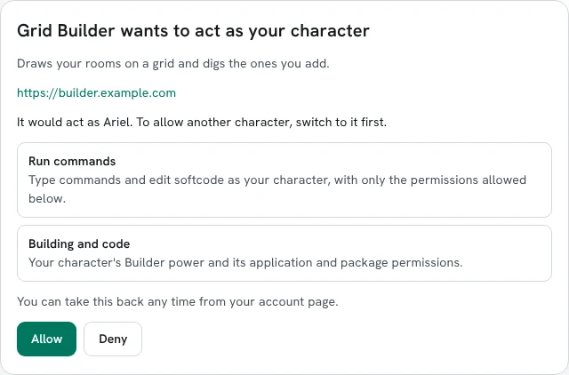
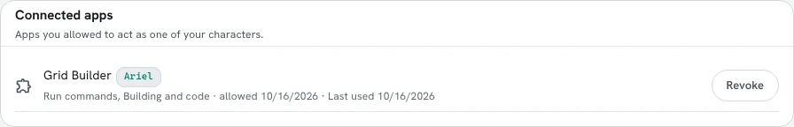
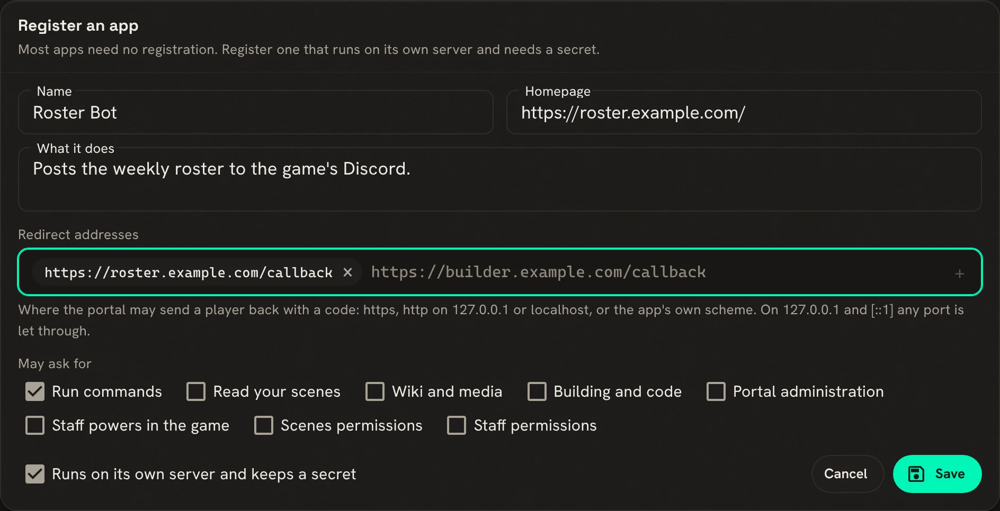
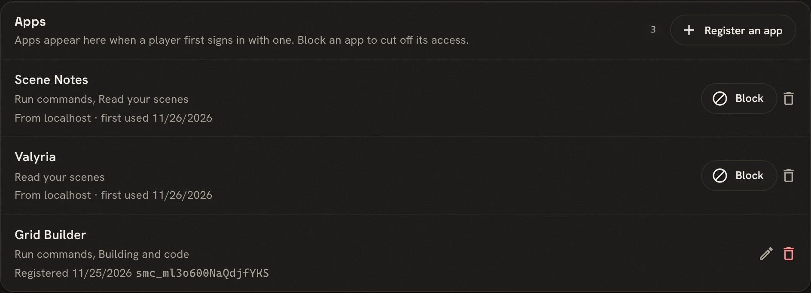
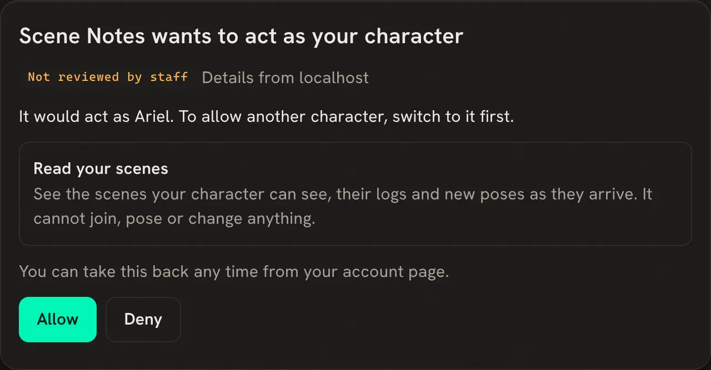

import { Aside } from '@astrojs/starlight/components';

An **app** is a tool that does things in the game for you: a map editor on another website, a
character sheet site, a bot, or a package in the portal that runs commands. Instead of giving it
your password, you allow it once in the portal. It then acts as the character you chose, with only
the permissions you allowed, until you take it back.

This page covers:

- [Allowing an app](#allowing-an-app)
- [What an app can do](#what-an-app-can-do)
- [Taking it back](#taking-it-back)
- [Registering an app](#registering-an-app)
- [Apps that describe themselves](#apps-that-describe-themselves)
- [Keeping apps away from a command](#keeping-apps-away-from-a-command)
- [Writing an app](#writing-an-app)
- [Reading scenes from a desktop app](#reading-scenes-from-a-desktop-app)
- [Packages that run commands](#packages-that-run-commands)

## Allowing an app

An app sends you to the portal's **Allow an app** page. Sign in if you are not already, and play
the character you want it to act as. The page names the app, the character, and what the app
asks for.



**Allow** sends you back to the app, which can now act as that character. **Deny** sends you back
with nothing. To let it act as another character, switch to that character in the portal and the
page asks again for that one.

You are asked once. When the app asks again later for the same things, the page sends you
straight back. It asks again only when the app wants something new.

## What an app can do

Each line on the page is one **scope**.

| Scope | What the app may do |
|---|---|
| Run commands | Type commands and edit softcode as your character, with its locks, quota and control, and manage its own queue, recurring jobs and snapshots |
| Read your scenes | See the scenes your character can see, their logs and new poses as they arrive. It cannot join, pose or change anything |
| Wiki and media | Use your wiki and media permissions |
| Building and code | Use your application and package permissions, and the Builder power |
| Portal administration | Use your staff permissions in the portal: configuration, roles, players, jobs, the queue |
| Staff powers in the game | Use your wizard, royalty and other powers, control over others' objects, and chat and server operation |

A game can add its own permissions in a category, such as **Scenes**. A category is a scope too,
shown as **Scenes permissions**.

While an app acts, your character holds only the permissions in the scopes you allowed. Ariel is a
builder. Allowed **Run commands** alone, the app sees no Builder power: `think [haspower(me,builder)]`
says `0`. Allowed **Building and code** too, it says `1`. A wizard who allows the same two scopes is
a builder to the app, not a wizard. Anything the app's commands queue, such as an `@trigger`, runs
the same way.

**Read your scenes** reads exactly what your character reads in the portal: public scenes, and the
private ones it owns, is in or is invited to. An app acting for a wizard sees hidden scenes only
when it was also allowed **Staff powers in the game**.

You are only asked about scopes in which your character holds something. A player with no building
permissions is not asked about **Building and code**, and the app does not get it. If you are given
building permissions later, the app asks you again before it can use them.

## Taking it back

Apps you have allowed are listed under **Connected apps** on your account page, with the character
each acts as, its scopes, and when it was last used.



**Revoke** stops the app at once. Unlinking the character from your account, a ban, or staff
removing the app does the same.

## Registering an app

Staff can register an app so it may ask players, or let apps [describe themselves](#apps-that-describe-themselves). You need the `config.admin` permission. Open
**Admin**, then **Configuration**, and under **Security** choose **Apps**. Fill in **Register an
app** and press **Save**.



- **Name**, **What it does** and **Homepage** are what players see when the app asks.
- **Redirect addresses** are where the portal may send a player back to. Use `https`, or `http` on
  `127.0.0.1`, `[::1]` or `localhost` for an app on the player's own computer. On `127.0.0.1` and
  `[::1]` the app may come back on any port, so register `http://127.0.0.1/callback` and it can
  listen on whatever port is free. On a port it did not register, the player is asked every time,
  even for an app they allowed before. `localhost` has to match exactly, port included.
- **May ask for** is what the app may ask for. It can ask for less.
- **Runs on a server it controls** gives the app a secret. The secret is shown once; **New secret**
  replaces it. An app that runs in a browser or on a player's computer cannot keep one, and uses
  PKCE alone.

Deleting an app takes back every grant players gave it.

## Apps that describe themselves

An app can skip registration: its client id is an `https` address that serves a short JSON
description of it, following OAuth Client ID Metadata Documents. The game reads the description the
first time a player is sent its way, and again at most once an hour.

```json
{
  "client_id": "https://valyria.example.com/oauth/client.json",
  "client_name": "Valyria",
  "client_uri": "https://valyria.example.com/",
  "redirect_uris": ["http://127.0.0.1/callback"],
  "scope": "profile scenes.read",
  "token_endpoint_auth_method": "none"
}
```

- `client_id` must be the address the description is served from: `https`, a host name (not an IP
  address), and a path.
- The app is public: no `client_secret`, and `token_endpoint_auth_method` is `none` when given. It
  uses PKCE alone.
- `redirect_uris` (1 to 10) must be `https` on the same host, `http` on `127.0.0.1` or `[::1]`, or
  the host's reversed name as a scheme, such as `com.example.valyria:/callback`.
- `scope` is the most it may ask for; without it, only `profile`. `client_uri` is shown as its
  homepage when it is on the same host.
- The description is at most 5 KB, and the game reads it only from a public internet address,
  without following redirects.

On the **Apps** page, **Apps that describe themselves** chooses what happens:

- **Staff allow each one first** (the default): the app is listed under **Self-described apps**, and
  a player sent to it is told it is waiting for staff. Press **Allow** to let it ask.
- **Accept them, marked as not reviewed**: it may ask at once, and the Allow an app page says
  **Not reviewed by staff**. Until staff allow it, it may ask only for `profile` and `scenes.read`.
- **Refuse them**: only registered apps, and apps staff allowed before, are accepted. No address is
  read.





**Block** refuses an app, takes back every grant players gave it and stops its tokens. It blocks
that one address; add its domain to **Blocked domains** to refuse every app on it and its
subdomains. The bin button forgets an app, so its description is read afresh next time.

An allowed app whose description later asks for more scopes or redirect addresses, or changes its
name, waits for staff again. At most 100 apps wait for staff, 5 from one host.

The same settings are the `oauth_app_policy` and `oauth_blocked_domains` options (`help @config
oauth`). The server's metadata says `client_id_metadata_document_supported` unless the policy refuses
such apps.

## Keeping apps away from a command

An app can run any command your character can. To keep apps away from one, restrict it with
`noapp`. This needs the `config.admin` permission, as any change to a command does.

```
> @command/restrict @dig=noapp
Name       : @DIG (Enabled)
Flags      : Eqsplit, NoApp
Lock       : *UNLOCKED*
Switches   : TELEPORT
Leftside   :
Rightside  : Args
```

The app is refused, and the player typing the same command is not:

```
app>    @dig Attic
Permission denied.

Ariel>  @dig Attic
Attic created with room number 19.
```

## Writing an app

SharpMUSH is an OAuth 2.0 authorization server for the code flow with PKCE (`S256`). The game
describes itself at `/.well-known/oauth-authorization-server`.

This example is Grid Builder, a public app registered with the redirect address
`https://builder.example.com/callback` and the client id `smc_3smLdIqEyx17lcVR`.

1. Make a random `code_verifier` of 43 to 128 characters, and its `code_challenge`: the SHA-256 of
   the verifier, in base64url without padding.

2. Send the player to the portal's `/oauth/authorize` page:

   ```
   https://game.example.com/oauth/authorize?response_type=code
     &client_id=smc_3smLdIqEyx17lcVR
     &redirect_uri=https%3A%2F%2Fbuilder.example.com%2Fcallback
     &scope=commands+build
     &state=<state>
     &code_challenge=<challenge>
     &code_challenge_method=S256
   ```

   When the player allows it, the portal sends them to
   `https://builder.example.com/callback?code=<code>&state=<state>`. Make `state` a new random
   value for each request and keep it in the app. Refuse the callback if `state` is missing or is
   not the one you sent. The code works once, within a minute.

3. Trade the code for tokens:

   ```
   curl https://game.example.com/api/oauth/token \
     -d grant_type=authorization_code -d code=<code> \
     -d redirect_uri=https://builder.example.com/callback \
     -d code_verifier=<verifier> -d client_id=smc_3smLdIqEyx17lcVR
   ```

   ```json
   {"access_token":"smat_…","token_type":"Bearer","expires_in":3600,
    "refresh_token":"smrt_…","scope":"profile commands build"}
   ```

   `scope` is what the player allowed, which can be less than you asked for. An app with a secret
   also sends `client_secret`, or the id and secret as HTTP Basic.

4. Ask who the token acts as:

   ```
   curl https://game.example.com/api/oauth/me -H "Authorization: Bearer smat_…"
   ```

   ```json
   {"character":"#17:1792117197795","name":"Ariel","app":"smc_3smLdIqEyx17lcVR",
    "scopes":["profile","commands","build"]}
   ```

5. Run a command as Ariel:

   ```
   curl https://game.example.com/api/commands -H "Authorization: Bearer smat_…" \
     -H "Content-Type: application/json" -d '{"command":"@dig/teleport Loft"}'
   ```

   ```json
   {"output":["Loft created with room number 18.", "…", "You see nothing special."],
    "result":null,"truncated":false}
   ```

An access token lasts an hour. Before then, trade the refresh token for a new pair at the same
endpoint with `grant_type=refresh_token`. A refresh token works once and lasts 30 days from its last
use. `POST /api/oauth/revoke` with `token` and `client_id` forgets a token, for an app that signs out.

The token reaches `api/commands`, `api/commands/eval`, `api/oauth/me`, the scene reads with
`scenes.read`, and the portal endpoints whose permission its scopes cover. It cannot reach the account: its characters, its sign-ins or its
connected apps.

## Reading scenes from a desktop app

A MU\* client on the player's computer can show the player's scenes with `scenes.read`. It cannot
keep a secret, so it is registered without one and uses PKCE alone, and it gets its code by
listening on a loopback port (RFC 8252).

1. Register the app with the redirect address `http://127.0.0.1/callback` and **May ask for**
   set to **Read your scenes**.

2. When the player signs in, listen on any free port, say 51234, and send them to:

   ```
   https://game.example.com/oauth/authorize?response_type=code
     &client_id=<client id>
     &redirect_uri=http%3A%2F%2F127.0.0.1%3A51234%2Fcallback
     &scope=scenes.read
     &state=<state>
     &code_challenge=<challenge>
     &code_challenge_method=S256
   ```

   Trade the code as in [Writing an app](#writing-an-app), with the same `redirect_uri`, port
   included.

3. Read the scenes with the access token. `filter=mine` is the character's own agenda:

   ```
   curl "https://game.example.com/api/scenes?filter=mine" -H "Authorization: Bearer smat_…"
   ```

   `api/scenes/<id>` is one scene, `api/scenes/<id>/poses` its log, and `api/scenes/<id>/members`
   who is in it. A scene the character cannot see answers `404`, as one that does not exist does.

4. Follow a scene live on the SignalR hub `/hubs/scene` with the same token, as
   `Authorization: Bearer` or, from a browser's WebSocket, as `access_token` in the query. Call
   `JoinScene("<id>")` and new poses arrive as `ReceiveSceneMessage`. The hub closes the connection
   when the token expires, and within a minute of the player revoking the app; connect again with a
   fresh token.

A token without `scenes.read` gets `403` with `WWW-Authenticate: Bearer error="insufficient_scope"`,
and an expired or revoked one `401` with `error="invalid_token"`: refresh it, or ask the player
again. The token cannot join, pose, move or change a scene, and cannot keep a draft or a calendar
link.

## Packages that run commands

A portal package can run commands as the player too. It names the scopes it needs under `scopes`
in its `ui.json`:

```json
"scopes": ["commands", "build"]
```

From its page, it sends a `command` message through the host and gets a `command-result` back,
whose `result` holds `output`, `truncated` and `error`:

```js
port.postMessage({ type: 'command', channel, requestId: 1, command: '@dig/teleport Loft' });
```

The first time, the portal asks the player above the package's page, with the same lines as the
**Allow an app** page. The package never sees the token, and it is listed under **Connected apps**
like any other app.

<Aside>
A package that only reads and changes rooms through the portal's room document, like the
[Builder Graph](/guides/builder-graph/), does not need this: the player confirms each change in the
portal already.
</Aside>
