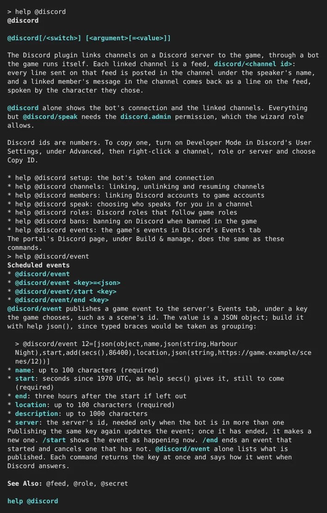
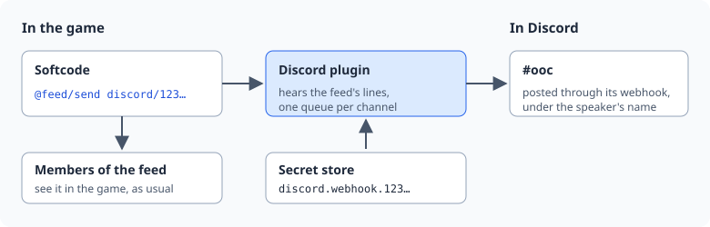
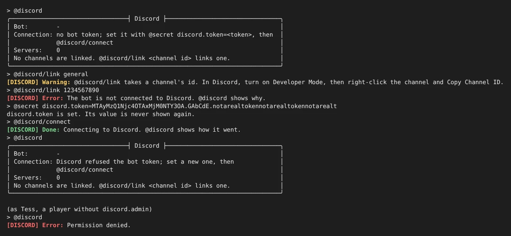
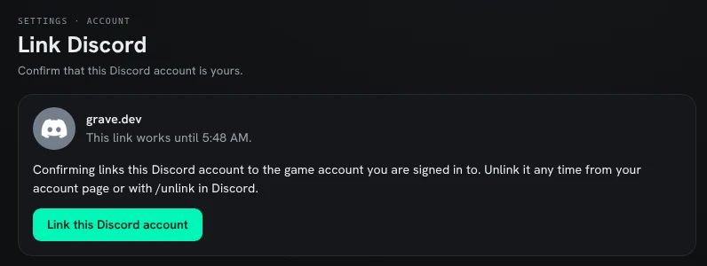
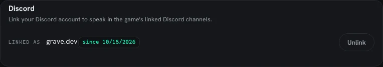
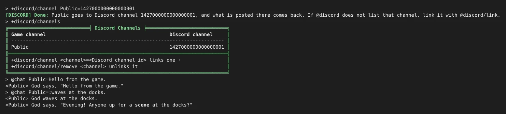
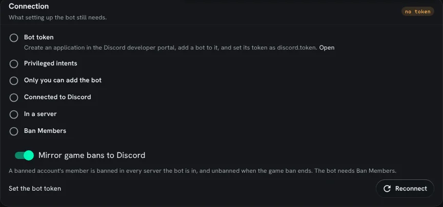
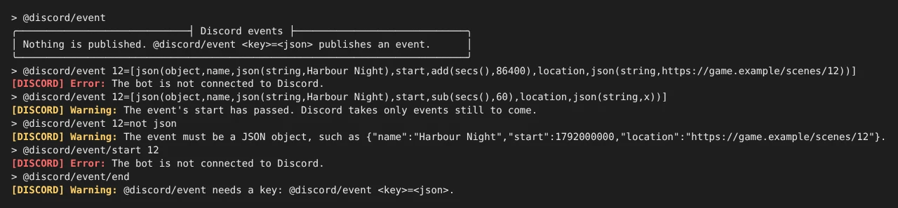
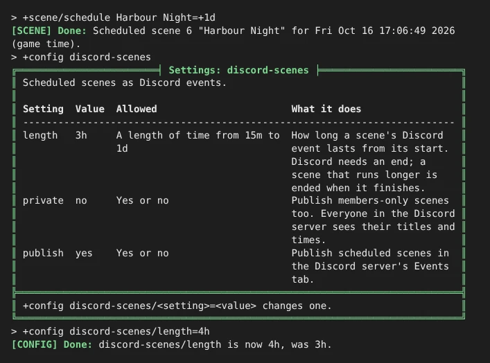
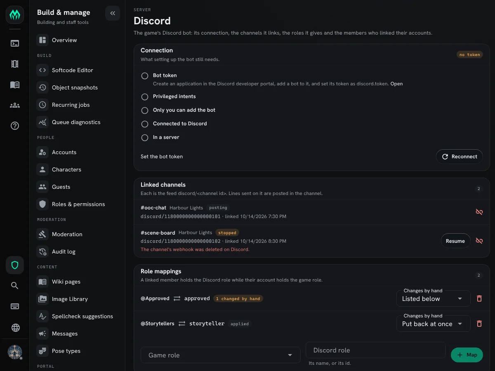

import { Aside } from '@astrojs/starlight/components';

The **Discord plugin** links channels on a Discord server to the game. Each linked channel
is a feed, `discord/<channel id>`, and every line sent on that feed is posted in the
channel under the speaker's name. What goes on the feed is up to the game's softcode: a
command, a tap on another feed, or an event. A linked member's message in the channel comes
back the other way, as a line on the feed spoken by the character they chose.

| You want to | Read |
|---|---|
| see how a line gets to Discord | [How it works](#how-it-works) |
| make the bot and connect it | [Setting up the bot](#setting-up-the-bot) |
| link a channel | [Linking a channel](#linking-a-channel) |
| link a member's Discord account to their game account | [Linking members](#linking-members) |
| speak in the game from Discord | [Speaking from Discord](#speaking-from-discord) |
| post from softcode | [Sending lines](#sending-lines) |
| join a game channel to a Discord channel | [Joining a game channel](#joining-a-game-channel) |
| give members Discord roles from their game roles | [Mapping roles](#mapping-roles) |
| do all of this from the portal | [The Discord page](#the-discord-page) |
| ban a member on Discord when they are banned in the game | [Game bans](#game-bans) |
| list the game's events in Discord's Events tab | [Scheduled events](#scheduled-events) |
| fix a link that stopped | [When a link stops](#when-a-link-stops) |

Setting up the bot and linking channels need the `discord.admin` permission. Wizards hold it,
and `@role/allow <role>=discord.admin` hands it to a staff role. Members link their own
accounts and choose their own characters.

In the game, `help @discord` covers every switch, and `help @discord/<switch>` goes straight
to one. The help is there only while the plugin is loaded.



## How it works



Each game runs its own bot, from a Discord application the game's administrator makes. The
bot's token is a [secret](/guides/secrets/), stored encrypted and never shown again.

Linking a channel makes a **webhook** in it, which is how the bot posts under each
speaker's name instead of its own. The webhook's token is a secret too, named
`discord.webhook.<channel id>`.

Each linked channel has its own queue, so a slow or broken channel holds up no other.

## Setting up the bot

Discord has no way for a program to make an application, so the first steps happen in
Discord's developer portal.

1. Open the [Discord developer portal](https://discord.com/developers/applications) and
   choose **New Application**. Its name is the name players see on the bot.
2. On the application's **Bot** page:
   - choose **Reset Token** and copy the token;
   - untick **Public Bot**, so nobody else can add it to their server;
   - under **Privileged Gateway Intents**, turn on **Server Members Intent** and
     **Message Content Intent**.
3. In the game, store the token and connect:

```
> @secret discord.token=<the token>
discord.token is set. Its value is never shown again.
> @discord/connect
[DISCORD] Done: Connecting to Discord. @discord shows how it went.
```

`@discord` shows where the connection stands. When something is wrong it says what to do
next, and `@discord/connect` tries again once it is done:



Once Discord accepts the token, `@discord` ends with a line starting `Add the bot to a server:`
and a link. Open it, pick the server, and keep every permission it asks for:

| Permission | Why |
|---|---|
| View Channels, Read Message History | see the linked channels |
| Send Messages, Send Messages in Threads | post in them |
| Manage Webhooks | make each linked channel's webhook |
| Manage Messages | replace a member's message with the game's version of it |
| Manage Roles | give linked members the Linked role, and let only that role post in linked channels |
| Create Events | publish the game's events, such as scenes, as Discord events |

<Aside>
The token can also be given from outside the game, as the environment variable
`SHARPMUSH_SECRET_DISCORD_TOKEN` or a file named `discord.token` in the secrets
directory. See [Secrets](/guides/secrets/#giving-a-secret-from-outside-the-game).
</Aside>

## Linking a channel

First install the **discord** package from the portal's Packages page. It is bundled with
the game but not installed until you choose it. It adds the `discord` feed kind and the
Discord Bridge object that owns it.

Then find the channel's id. In Discord, open **User Settings**, then **Advanced**, and turn
on **Developer Mode**. Right-click the channel and choose **Copy Channel ID**.

```
> @discord/link 1234567890123456789
```

The command returns at once, and tells you how it went when Discord answers:
`Linked #ooc in My Game. Lines sent on the feed discord/1234567890123456789 are posted there.
Only linked members may post there.`

The bot needs View Channel, Manage Webhooks and Manage Messages in that channel. A channel
that takes them away from the bot's role is refused, with the missing ones named. Threads
cannot be linked.

Linking also changes the channel's permissions, so that only members holding the **Linked**
role (see [Linking members](#linking-members)) may send messages: `@everyone` is denied
Send Messages there and the Linked role allowed it. The channel's other permissions stay as
they were. If the bot cannot make that change, the link still works and the answer says
why. `@discord` shows any channel that others can still post in, and
`@discord/gate <id>` makes the change again once the cause is fixed.

`@discord` lists every link with its server, its id and its state. `@discord/unlink <id>`
stops posting, deletes the channel's webhook and forgets its token. The feed and its lines
stay in the game.

## Linking members

Each member links their Discord account to their game account once. In the game's Discord
server they type `/link`. The bot answers with a link that only they can see, which works
once, for ten minutes. They open it while signed in to the game's website and confirm:



The link starts with the game's web address, the `mud_url` setting. Until `mud_url` is set,
`/link` tells the member to ask staff instead.

Once it is linked, the Discord section of the account page shows the Discord account, with
an Unlink button:



- A game account links to one Discord account, and a Discord account to one game account.
- Only an active account can link. A disabled or banned one cannot.
- A Discord account unlinked from one game account waits a week before it can link a
  different one, so a Discord role tied to a game role cannot be handed around. It can link
  the same account again at once.
- While a game account's ban stands, the Discord account that was linked to it cannot link
  a different game account.
- `/unlink` in Discord, or Unlink on the account page, drops the link.

The bot makes a role named **Linked** in each server it is in. It gives the role to every
member linked to an active game account and takes it from everyone else, and checks every
member each time it connects. A member whose game account is banned, disabled or closed
loses the role, so they cannot post in linked channels, and gets it back when the account
is active again. Renaming the role is fine, since the bot knows it by its id. If the role is
deleted, the bot makes a new one the next time it connects. This needs the Manage Roles
permission the invite asks for.

## Speaking from Discord

A linked member chooses which of their characters speaks for them in each linked channel.
In the game, as that character, they type `@discord/speak` and the channel's id:

```
> @discord/speak 1234567890123456789
```

From then on, each message they post in the channel comes into the game as a line on its
feed, spoken by that character. The member's own message is deleted and the game's version
posted in its place, so the channel shows what actually arrived in the game.


- **One character per channel.** Choosing another replaces the first.
  `@discord/speak/off <id>`, as the character, stops it. Unlinking the Discord account drops
  every choice.
- **It is not private.** Anyone who reads both the game and the Discord channel can tell
  which Discord member plays the character. The command says so when it is used.
- **The character must be allowed to send on the feed**, by the feed's send lock (`help
  @feed`). A character that is gagged, or no longer on the account, or an account that is
  disabled or banned, speaks nothing. The bot sends the member a direct message saying why,
  and their message stays in Discord.
- **A member with no character chosen** in the channel gets one direct message saying how to
  choose one. Their messages stay in Discord and do not reach the game.
- **A member who is not linked** cannot post there at all, because of the Linked role. If a
  channel lets them anyway, the bot deletes the message and sends them one direct message
  saying how to link.

How a message reads in the game:

| In Discord | In the game |
|---|---|
| `**bold**`, `*italic*`, `__underline__`, `~~strike~~` | the game's own bold, italic, underline and strikethrough |
| `:waves.` or `;'s here.` at the start | a pose or a semipose |
| a mention of a member | `@` and the name of the character they speak as in that channel, or their Discord name |
| a mention of a channel or role | `#channel` or `@role` |
| a custom emoji | `:name:` |
| a masked link `[text](https://...)` | a link |
| a file | a link to it, named for the file |
| a reply | `(replying to Name)` before the text |
| code, spoilers, game code such as `[pemit(me,hi)]` | the text as typed; nothing is ever run |

When a moderator deletes one of the game's posts in Discord, the line leaves the feed's
recall (what `feedrecall()` and `feedmsg()` read), and the audit log records it as
`feed.line.delete`. Players who already saw the line still have it on their screens. The bot
remembers which line each post carries for 90 days; deleting an older post leaves its line.

## Sending lines

A linked channel's feed is an ordinary feed (`help @feed` in the game), so anything that
sends a line on it posts in Discord:

```
@feed/send discord/1234567890123456789=Server restart in ten minutes.
```

The line goes out under the name of the enactor, the player the code speaks for. How it
reads in Discord:

| Sent as | Posted as |
|---|---|
| `say` (the default) | the text, under the speaker's name |
| `pose` (`:waves.`) | `*Ann waves.*` in italics |
| `semipose` (`;'s back.`) | `*Ann's back.*` |
| `/as Ghost/...` | the text, under the name Ghost |

Colour and other markup become Discord's own formatting where it has one, and are dropped
where it doesn't. Characters Discord treats as formatting, such as `*` and `_`, are posted
as typed. A line never pings anyone, even when it names `@everyone` or a role.

Some lines are not posted:

- a line sent to only some members with `@feed/send/to`, since everyone in the Discord
  channel would see it;
- a line still waiting after a minute, because Discord was down or slow. A flood of old
  chat reads worse than a gap. Past 200 waiting lines, the oldest are dropped too.

A line longer than one Discord message is split at spaces into up to three posts.

## Joining a game channel

The **discord-channels** package joins a game channel to a linked Discord channel, both
ways. What is said on the game channel is posted in Discord, and what members post in
Discord comes back onto the game channel as the character they speak as. Install it from
the Packages page; it needs the discord package.

```
> +discord/channel Public=1234567890123456789
```



- `+discord/channels` lists the game channels that go to Discord.
- `+discord/channel <channel>=<Discord channel id>` joins them. `@discord` lists the linked
  Discord channels with their ids.
- `+discord/channel/remove <channel>` takes them apart.

Only the channel's owner, or staff with `chat.admin`, joins or parts a channel. Each game
channel goes to one Discord channel, and each Discord channel to one game channel.

- **A private channel needs `/confirm`.** A channel with a see or join lock is refused at
  first, because everyone who can read the Discord channel reads what is said on it.
  `+discord/channel/confirm <channel>=<id>` joins it anyway.
- **Speakers must pass the feed's send lock.** A game line reaches Discord only if its speaker
  may send on the Discord channel's feed.
- **Connect and disconnect lines stay in the game.** An `@cemit` line, which names no
  speaker, is posted under the channel's name.
- **A line from Discord reads like any other** on the game channel: `God says, "..."`.
- **Renaming the game channel parts it** from Discord. Join it again under its new name.

A line goes one way only, so nothing comes back round: a line from Discord is not sent
there again. Softcode can tell the two apart the same way. A tap on the `discord` kind gets
`%<origin>`, which is `discord/<message id>` for a line a member posted and empty for a line
sent in the game.

## Mapping roles

`@discord/map` ties a Discord role to a game role. A linked member holds the Discord role
while their game account, or one of its characters, holds the game role, and loses it when
they no longer do. A member whose account is disabled, banned or closed holds no mapped role.

```
> @discord/map builder=@Builders
```


- `@discord/map` lists the mapped roles. The State column says whether the bot can manage
  each one, and how many members were changed by hand.
- `@discord/map <game role>=<Discord role>` maps one. Name the Discord role, with or without
  the `@`, or give its id.
- `@discord/unmap <Discord role>` stops mapping it. Members keep the role as it is.

The bot checks every member when it connects, once a day, and whenever an account's roles
change in the game. It needs the Manage Roles permission, and its own role must sit above
each mapped role in the server's role list. `@discord/map` says when either is missing.

Some mappings are refused:

- **`everyone`, `player` and `god`,** which the game hands out itself.
- **A role that allows `administrator`,** and a role not below your own highest role.
- **`wizard` and `royalty` until confirmed,** since the Discord role shows everyone who
  your staff are. `@discord/map/confirm wizard=Staff` maps it anyway.
- **On the Discord side,** `@everyone`, a role Discord manages for a bot or a boost, the
  Linked role, and a role already mapped.

### Changes made by hand

Someone with Manage Roles can still give or take a mapped role in Discord. The bot does not
undo that at first. It records the change, and `@discord/drift` lists it until staff decide:

- `@discord/drift/apply` puts back the game's answer for every role changed by hand.
  `@discord/drift/apply <Discord role>` does it for one role.
- `@discord/unmap <Discord role>` keeps Discord's version instead.

`@discord/map/enforce <Discord role>` makes the bot put a change back at once, and still list
it. `@discord/map/report <Discord role>` goes back to listing only.

A member who has not linked their account is never given a mapped role. If they hold one,
the bot lists it as a change made by hand rather than taking it, unless the role is
enforced.

## Game bans

A game ban always takes the Linked role and every mapped role, and the member's messages
stop reaching the game. The bot can also ban them on Discord. This is off until staff turn
it on:

```
> @discord/bans on
```


- With mirroring on, banning a game account bans its linked Discord member in every server
  the bot is in. Turning mirroring on also bans the members of accounts banned already.
- When the game ban is lifted or runs out, the bot lifts the Discord bans it made. A Discord
  ban staff made themselves is left alone, and so is one staff lifted by hand.
- `@discord/bans off` stops new bans. Bans the bot already made are still lifted when their
  game bans end.
- A disabled or closed account is not banned on Discord; only a ban is mirrored.
- `@discord/bans` says whether mirroring is on and lists the members the bot banned.

The bot needs the Ban Members permission for this. The invite link asks for it while
mirroring is on, and the setup checklist names any server where the bot lacks it.



## Scheduled events

`@discord/event` puts a game event in the server's Events tab, where members can mark
themselves interested. It is one way: the game says what the event is, and an edit made to it
on Discord lasts only until the game publishes it again. Each event has a key the game picks,
such as a scene's id, and later changes name the same key.

```
> @discord/event 12=[json(object,name,json(string,Harbour Night),start,add(secs(),86400),location,json(string,https://game.example/scenes/12))]
```

The part after `=` is a JSON object. Build it with `json()`: typed straight into a command, its
braces would be taken as grouping and dropped.

| Field | What it is |
|---|---|
| `name` | the event's name, up to 100 characters (required) |
| `start` | when it starts, in seconds since 1970 UTC, as `secs()` gives it (required; still to come) |
| `end` | when it ends; three hours after the start if left out |
| `location` | where it happens, up to 100 characters, such as the scene's page on the game's website (required) |
| `description` | up to 1000 characters |
| `server` | the server's id; needed only when the bot is in more than one |

- Publishing the same key again updates the event while it is still to come. Once it has
  started, ended or been cancelled, publishing ends it and makes a new one, since the start
  given is still to come: a scene that was paused and moved to another day.
- `@discord/event/start <key>` shows the event as happening now.
- `@discord/event/end <key>` ends an event that started and cancels one that has not.
- `@discord/event` lists the events the game has published.

Each command answers at once with the key, then says how it went when Discord replies:



### Scheduled scenes

The `discord-scenes` package publishes the game's scheduled scenes this way, so nobody has to
type `@discord/event`. It needs the Scene plugin as well as the Discord plugin. Install it from
the Packages page, or:

```
> @package/install discord-scenes
```

A scene scheduled with `+scene/schedule` then shows in the Events tab, under the scene's title,
with its summary as the description and its page on the game's website as the place. When the
game has no website address (`mud_url`), the place is the game's name and the scene's room.
After that the event follows the scene:

| In the game | On Discord |
|---|---|
| `+scene/reschedule`, `+scene/title` | the event moves or is renamed |
| `+scene/start` | the event shows as happening now |
| `+scene/finish` | the event ends |
| `+scene/cancel` | the event is cancelled |
| `+scene/pause` with a new time | a new event at that time |
| `+scene/pause` with no time, or the scene made members-only | the event is taken down |

Only scenes anyone may watch are published. Three settings change that, through `+config`:

| Setting | As shipped | What it does |
|---|---|---|
| `discord-scenes/publish` | yes | `no` stops publishing; events already up stay until their scenes finish |
| `discord-scenes/private` | no | `yes` publishes members-only scenes too, and everyone in the server sees their titles and times |
| `discord-scenes/length` | 3h | how long an event lasts from its start; a scene that runs longer ends when it finishes |



Each scene is published under the key `scene-<id>`, so `@discord/event` lists them beside any
the game published by hand. `+help discord scenes` covers the same ground in the game.

The package is built on two events the Scene plugin raises: ``SCENE`STATUS`` when a scene is made
or its status changes, and ``SCENE`CHANGE`` when its time, title or another of its keys does
(`help event scene`). A game that wants other rules can write its own handler on them instead.

## The Discord page

Staff with the `discord.admin` permission find a **Discord** page in the portal, under
Build & manage, Server. It does what the `@discord` commands do:

- **Connection** shows what setting up the bot still needs, with a link to set its token,
  the invite link once the bot is ready, a Reconnect button, and the switch that mirrors
  game bans.
- **Linked channels** lists each link with its feed and state. A stopped link shows the
  reason and a Resume button. Pick a channel the bot can see to link a new one.
- **Role mappings** maps a game role to a Discord role, sets whether a change made by hand
  is listed or put back at once, and unmaps a role.
- **Changed by hand** lists those changes, with a button to put back one role or all of them.
- **Linked members** finds a member by their Discord name, their account or their Discord
  id, and unlinks them.




## When a link stops

When Discord refuses a channel's posts for a reason a retry won't fix, the link stops. Its
lines are not posted, and `@discord` shows the reason in the State column. Fix the cause,
then `@discord/resume <id>` posts again.

The common causes:

- **The webhook was deleted** in Discord's channel settings. The bot makes a new one by
  itself and carries on. If it was deleted again within ten minutes, the link stops, since
  someone is removing it on purpose.
- **The bot lost a permission** in the channel. Give it back, then resume.
- **Discord refused five posts within a minute.** That points at a bug, and the server log
  has the details.

Posts go through each channel's webhook, not the bot's connection, so links keep posting
while the bot is disconnected. Only making a new webhook needs the bot connected.
