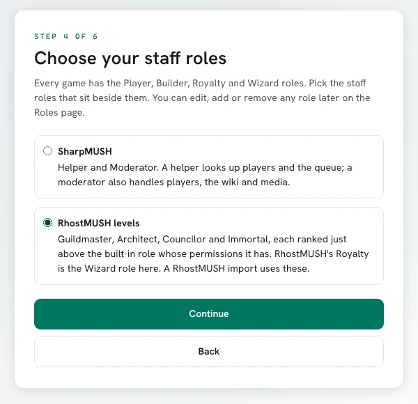

import { Steps, Aside, LinkCard } from '@astrojs/starlight/components';

SharpMUSH runs as a small set of containers: the **game server** (which also serves the web portal
and holds the embedded LMDB world), the **connection server** (telnet and the browser WebSocket), the
**rendering worker**, and **NATS** for messaging. Docker Compose brings the whole thing up together.

The stack is deliberately modest. It runs comfortably on a €4–6/month VPS, or free on Oracle Cloud's
Always Free ARM tier. **Kubernetes is not needed at this scale.**

<Aside type="tip">
Want to see it before you build it? The [live example game](https://mush.sharpmush.com) runs this
exact stack.
</Aside>

## Deploy a game

The maintained deployment lives in the `deploy/` folder of the SharpMUSH repository, and the
[Deployment Reference](/guides/deployment) covers every file and setting in it. It uses **LMDB
embedded** — one directory on disk, with no separate database server to run or back up separately.

Pick your entry point based on how you terminate TLS:

| File | Use it when |
|------|-------------|
| `docker-compose.prod.yml` | The box faces the internet directly. **Caddy** gets you automatic HTTPS. |
| `docker-compose.cloudflare.yml` | You would rather open no inbound web ports. A **Cloudflare Tunnel** dials out instead, hiding the origin IP. |

<Steps>

1. Get the files onto the host.

   ```bash
   git clone https://github.com/SharpMUSH/SharpMUSH.git
   cd SharpMUSH/deploy
   cp .env.example .env
   ```

2. Edit `.env` and set your domain.

   ```bash
   SHARPMUSH_DOMAIN=mush.example.com
   ```

   Off-machine (restic) backups are opt-in — leave that section commented out for now. The server
   still makes a local copy of the world every six hours.
   If you chose the Cloudflare variant, also set `CLOUDFLARE_TUNNEL_TOKEN` here.

3. Bring the stack up.

   ```bash
   docker compose -f docker-compose.prod.yml up -d --build
   ```

   The portal comes up on `https://<your-domain>`, and telnet on port **4201**.

4. Claim the admin account.

   Visit `https://<your-domain>/setup`. The first visitor after a fresh install claims the
   pre-generated administrator account, linked to God (`#1`). Do this **immediately** after
   deploying — the setup route is open until someone completes it.

   Setup then walks you through the rest of a new game. One step chooses the staff roles that
   sit beside Player, Builder, Royalty and Wizard: SharpMUSH's Helper and Moderator, or
   RhostMUSH's Guildmaster, Architect, Councilor and Immortal. A game imported from RhostMUSH
   starts on RhostMUSH's levels. The roles of the set you leave out are removed unless someone
   holds one.

   

</Steps>

<Aside type="danger" title="Complete setup right away">
A freshly deployed server with an unclaimed `/setup` page will hand the game to whoever reaches it
first. Deploy and claim in one sitting.
</Aside>

## After the first start

The [Deployment Reference](/guides/deployment) has the details for each of these:

- **The browser terminal.** In the portal, set the terminal's **Server URI** to
  `wss://<your-domain>/ws`. See [The browser terminal address](/guides/deployment#the-browser-terminal-address).
- **Ports.** Which ports to open, and which stay private: [Ports](/guides/deployment#ports). Port
  `4201` is plaintext telnet; [telnet over TLS](/guides/deployment#telnet-over-tls) on `4203` is
  optional. Behind a Cloudflare Tunnel, telnet needs its own DNS-only record:
  [Part B: the telnet side](/guides/deployment#part-b-the-telnet-side).
- **Updates.** The Caddy stack is updated by hand; the Cloudflare stack updates the game server and
  renderer itself. See [Updating](/guides/deployment#updating).
- **Starting on boot.** The supplied `sharpmush.service` unit:
  [Starting on boot](/guides/deployment#starting-on-boot).
- **Backups.** Turning on nightly encrypted off-machine backups, and restoring them:
  [Backups](/guides/deployment#backups).

<LinkCard
  title="Operator Handbook"
  href="/guides/operator-handbook"
  description="Turn this first deployment into a tested backup, upgrade, monitoring, and recovery practice."
/>

## Running the development stack

The Compose files at the repository root are a different thing. `docker-compose.yml` builds the
images from your checkout and `docker-compose-hub.yml` pulls the latest build of `main`; both run the
stack on your own machine (portal at `http://localhost:8080`, telnet on 4201) to check a change, with
no proxy, no backups and no automatic updates. They are covered in
[Develop SharpMUSH](/guides/local-install#run-the-whole-stack-in-docker).

<LinkCard
  title="Develop SharpMUSH"
  href="/guides/local-install"
  description="Build from source, run each process on your machine, and run the tests."
/>

## Editor and AI analysis

Once the HTTPS game and an existing character are ready, follow [Administrator walkthrough](/guides/mcp#administrator-walkthrough) to enable the optional transports and verify diagnostics/MCP requests.

## Next steps

<LinkCard
  title="Migrate from another MUSH"
  href="/guides/pennmush-migration"
  description="Use a rehearsed import and validation matrix before moving an existing game."
/>

<LinkCard
  title="The Web Portal"
  href="/guides/web-portal"
  description="What to do once the server is up: setup, configuration, moderation, and the wiki."
/>

<LinkCard
  title="Softcode Packages"
  href="/guides/packages"
  description="Install the global softcode your game needs from a package repository."
/>
