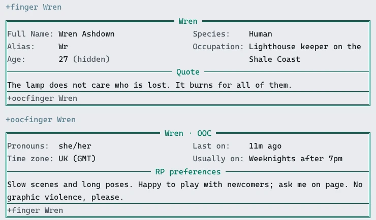
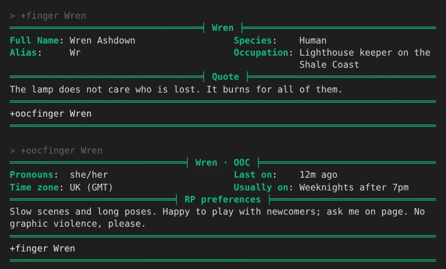

import { Aside } from '@astrojs/starlight/components';

The **finger** package gives every character two short profiles:

- `+finger` shows the in-character one: name, age, what they do, a quote.
- `+oocfinger` shows the player's out-of-character one: pronouns, time zone, when they play,
  what scenes they like.

The fields are a list the game keeps, one attribute per field, so adding or removing one is
a single line.

| You are | You want to | Read |
|---|---|---|
| A player | look someone up | [Reading a profile](#reading-a-profile) |
| A player | fill in your own | [Filling in your profile](#filling-in-your-profile) |
| A player | keep a field to yourself | [Hiding a field](#hiding-a-field) |
| Staff | set a player's field | [Staff](#staff) |
| Staff | change the fields | [Choosing the fields](#choosing-the-fields) |

In the game, `+help finger` has the same commands in short form.

## Reading a profile

`+finger <name>` shows a character's IC profile, and `+oocfinger <name>` the player's OOC one.
On their own, both show yours.

```
> +finger Wren
===================================< Wren >===================================
Full Name: Wren Ashdown                  Species:    Human
Alias:     Wr                            Occupation: Lighthouse keeper on the
                                                     Shale Coast
===================================< Quote >==================================
The lamp does not care who is lost. It burns for all of them.
==============================================================================
+oocfinger Wren
==============================================================================
> +oocfinger Wren
================================< Wren · OOC >================================
Pronouns:  she/her                       Last on:    6s ago
Time zone: UK (GMT)                      Usually on: Weeknights after 7pm
==============================< RP preferences >==============================
Slow scenes and long poses. Happy to play with newcomers; ask me on page. No
graphic violence, please.
==============================================================================
+finger Wren
==============================================================================
```

Short fields sit in two columns, and stack on a narrow screen. Longer text, such as the quote,
gets a line of its own with its label in it. The line at the bottom is the command for the
other profile.

A field the player has not filled in is left out, and so is one they hid: Wren's age is missing
above because she hid it. See [Hiding a field](#hiding-a-field).

Some fields are worked out by the game rather than typed:

- **Alias** is the character's alias.
- **Last on** says `on now` and how idle they are, when you could see them in `WHO`, or how long
  ago they left.

A web client and the portal show the same profile as a card:



A terminal shows it in the reader's own colours:



## Filling in your profile

Your own profile shows every field, with `-` where you have set nothing, so you can see what is
left to fill in:

```
> +finger
===================================< Tomas >==================================
Full Name: -                             Species:    -
Alias:     -                             Occupation: -
Age:       -
===================================< Quote >==================================
-
==============================================================================
+oocfinger Tomas · +finger/set <field>=<text> · +finger/fields
==============================================================================
```

`+finger/set <field>=<text>` sets a field. Name it by its label or its key; case and spaces do not
matter:

```
> +finger/set full name=Wren Ashdown
[FINGER] Done: Your Full Name: Wren Ashdown
> +finger/set age=27
[FINGER] Done: Your Age: 27
```

`+finger/set <field>=` with nothing after the `=` clears it:

```
> +finger/set age=
[FINGER] Done: Your Age is cleared.
```

`+oocfinger/set` is the same command, so either works for any field.

What you type is kept as you typed it, less the spaces around the `=`. Brackets and percent signs
are plain text, so `+finger/set quote=[Laughs] 100%` stores just that.

A field the game works out cannot be set:

```
> +finger/set alias=Wr
[FINGER] Warning: Alias is worked out by the game: nobody sets it.
```

### Every field

`+finger/fields` lists the fields, which command shows each one, and what you have in it:

```
> +finger/fields
===============================< Finger fields >==============================
Field           Key         Shown by    Yours
Full Name       fullname    +finger     set
Alias           alias       +finger     worked out
Age             age         +finger     set · hidden
Species         species     +finger     set
Occupation      occupation  +finger     set
Quote           quote       +finger     set
Pronouns        pronouns    +oocfinger  set
Time zone       timezone    +oocfinger  set
Last on         laston      +oocfinger  worked out
Usually on      playtimes   +oocfinger  set
RP preferences  rpprefs     +oocfinger  set
==============================================================================
+finger/set <field>=<text> sets one · +finger/set <field>= clears it ·
+finger/hide <field> keeps it to you and staff
==============================================================================
```

## Hiding a field

`+finger/hide <field>` keeps a field you have set to you and staff. Everyone else's `+finger` leaves
it out, and yours marks it:

```
> +finger/hide age
[FINGER] Done: Only you and staff see your Age now.
> +finger
===================================< Wren >===================================
Full Name: Wren Ashdown                  Species:    Human
Alias:     Wr                            Occupation: Lighthouse keeper on the
Age:       27 (hidden)                               Shale Coast
===================================< Quote >==================================
The lamp does not care who is lost. It burns for all of them.
==============================================================================
+oocfinger Wren · +finger/set <field>=<text> · +finger/fields
==============================================================================
```

`+finger/unhide <field>` shows it to everyone again:

```
> +finger/unhide age
[FINGER] Done: Everyone sees your Age again.
```

A hidden field stays hidden when you change it, and a field you clear and set again starts out
shown.

Each field is an attribute on your character, ``PROFILE`<KEY>``, and hiding it clears the
attribute's `visual` flag. `` @set me/PROFILE`AGE=!visual `` does the same as `+finger/hide age`.

## Staff

Staff with the `softcode.finger.edit` permission look after profiles. The package gives it to
nobody but the administrator, so a game hands it out. To every wizard, through their role:

```
> @role/allow wizard=softcode.finger.edit
Role Wizard: allows softcode.finger.edit.
```

Or to one player:

```
> @permission/allow Tomas=softcode.finger.edit
Tomas: allows softcode.finger.edit.
```

They can:

- set or clear anyone's field with `+finger/set <player>/<field>=<text>`. The player is told who
  changed it.
- see every field of anyone's profile, set or not, with the hidden ones marked.
- set the fields only staff set. See [Settings](#settings).

```
> +finger/set Wren/height=Tall for a Coaster
[FINGER] Done: Wren's Height: Tall for a Coaster
```

Wren hears, if she is connected:

```
[FINGER] God changed your Height.
```

Anyone else who tries is refused with `Only staff change someone else's fields.`

## Running the package

### Installing

The finger package ships with the server but is not installed on a new game. An administrator
installs it from the portal:

1. Open **Packages** in the admin area and choose **Browse**.
2. Install `finger`. It needs `plus-help`, which a new game already has.

It adds the commands `+finger` and `+oocfinger` for everyone. They are game commands, which are
matched before softcode `$`-commands, so a `+finger` your game already has in softcode stops
running once the package is in.

See [Softcode Packages](/guides/packages) for how installing, upgrading and rolling back work.

### Choosing the fields

The fields are attributes on the **Finger** object in the master room. Find its number with
`@find`:

```
> @find Finger
Finger(#15TW)
Finger Help(#16T)
*** 2 objects found ***
```

The numbers on your game will differ. Each field is one attribute named
``FIELD`<view>`<order>`<KEY>``, with its label as the value:

- `<view>` is `IC` for `+finger` or `OOC` for `+oocfinger`.
- `<order>` sorts the fields. The shipped ones count in tens, so a new field fits between two.
- `<KEY>` names the player's attribute, ``PROFILE`<KEY>``, and is what `+finger/set` takes.

The package ships these:

| Attribute | Label |
|---|---|
| ``FIELD`IC`010`FULLNAME`` | Full Name |
| ``FIELD`IC`020`ALIAS`` | Alias (worked out) |
| ``FIELD`IC`030`AGE`` | Age |
| ``FIELD`IC`040`SPECIES`` | Species |
| ``FIELD`IC`050`OCCUPATION`` | Occupation |
| ``FIELD`IC`060`QUOTE`` | Quote |
| ``FIELD`OOC`010`PRONOUNS`` | Pronouns |
| ``FIELD`OOC`020`TIMEZONE`` | Time zone |
| ``FIELD`OOC`030`LASTON`` | Last on (worked out) |
| ``FIELD`OOC`040`PLAYTIMES`` | Usually on |
| ``FIELD`OOC`050`RPPREFS`` | RP preferences |

To add a Height field after Age, set one attribute:

```
> &FIELD`IC`035`HEIGHT #15=Height
Finger/FIELD`IC`035`HEIGHT - Set.
```

Players can fill it in at once, and it shows in `+finger`:

```
> +finger
===================================< Wren >===================================
Full Name: Wren Ashdown                  Height:     Tall for a Coaster
Alias:     Wr                            Species:    Human
Age:       27 (hidden)                   Occupation: Lighthouse keeper on the
                                                     Shale Coast
===================================< Quote >==================================
The lamp does not care who is lost. It burns for all of them.
==============================================================================
+oocfinger Wren · +finger/set <field>=<text> · +finger/fields
==============================================================================
```

To take a field away, clear its attribute: `` &FIELD`IC`040`SPECIES #15 ``. What players typed into
it stays on them, so putting the field back brings their values back too. To rename one, set
its label again.

### Fields the game works out

A field with a ``SHOW`<KEY>`` attribute beside it is worked out instead of typed. The attribute
is evaluated with `%<target>` the player whose profile it is and `%<viewer>` the player reading
it. An empty result leaves the field out for everyone but the player and staff.

For example, the month a character was made:

```
> &FIELD`OOC`015`SINCE #15=Playing since
Finger/FIELD`OOC`015`SINCE - Set.
> &SHOW`SINCE #15=timefmt($B $Y,csecs(%<target>))
Finger/SHOW`SINCE - Set.
> +oocfinger Wren
================================< Wren · OOC >================================
Pronouns:      she/her                   Last on:    17s ago
Playing since: October 2026              Usually on: Weeknights after 7pm
Time zone:     UK (GMT)
==============================< RP preferences >==============================
Slow scenes and long poses. Happy to play with newcomers; ask me on page. No
graphic violence, please.
==============================================================================
+finger Wren
==============================================================================
```

The shipped ``SHOW`ALIAS`` is `alias(%<target>)`. Change it the same way.

<Aside type="caution">
A ``SHOW`` attribute runs as the Finger object, which is a wizard. Read players' attributes in it
with `get()`, never `u()` or `s()`, so nothing a player typed is ever run.
</Aside>

Another package can add fields the same way: it puts its own ``FIELD`` and ``SHOW`` attributes
on the Finger object, and they go away when that package is uninstalled.

### Settings

Each setting is an attribute on the Finger object:

| Attribute | What it is | Default |
|---|---|---|
| ``DATA`SECTIONS`` | Keys shown under the rest, each below a line with its label, for text longer than a line. | `QUOTE RPPREFS` |
| ``DATA`LOCKED`` | Keys only staff set. | none |
| ``DATA`COLUMNS`` | How many columns the other fields are dealt into. | 2 |
| ``DATA`LENGTH`` | The longest value, in characters. | 1000 |

For example, to let only staff set Occupation:

```
> &DATA`LOCKED #15=occupation
Finger/DATA`LOCKED - Set.
```

A player who tries is told so:

```
> +finger/set occupation=Smuggler
[FINGER] Error: Only staff set Occupation.
```

### The portal's profile page

A player's values are their ``PROFILE`<KEY>`` attributes. The `profile-handler` package, which
serves the portal's profile page, reads the same attributes for any field a game adds to its
schema, so that page and `+finger` show the same text.

### Drawing your own screen

`+finger` builds its screen with [`lfields()`](/reference/sharpmush-help/layout-functions/#lfields),
which takes the labels and the values as two lists, so the number of fields can come from the
attributes. The same works in your own code:

```
> think lfields({{"width":40}},Full Name|Origin,Mannaz Byron|Super Robot Wars AG,|)
Full Name: Mannaz Byron
Origin:    Super Robot Wars AG
```
