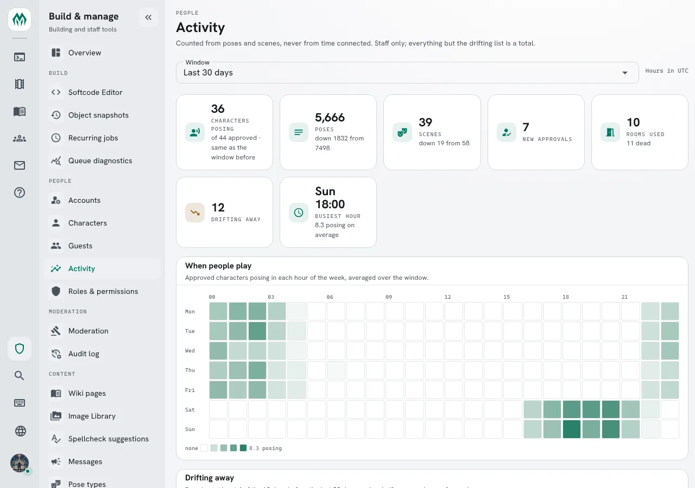
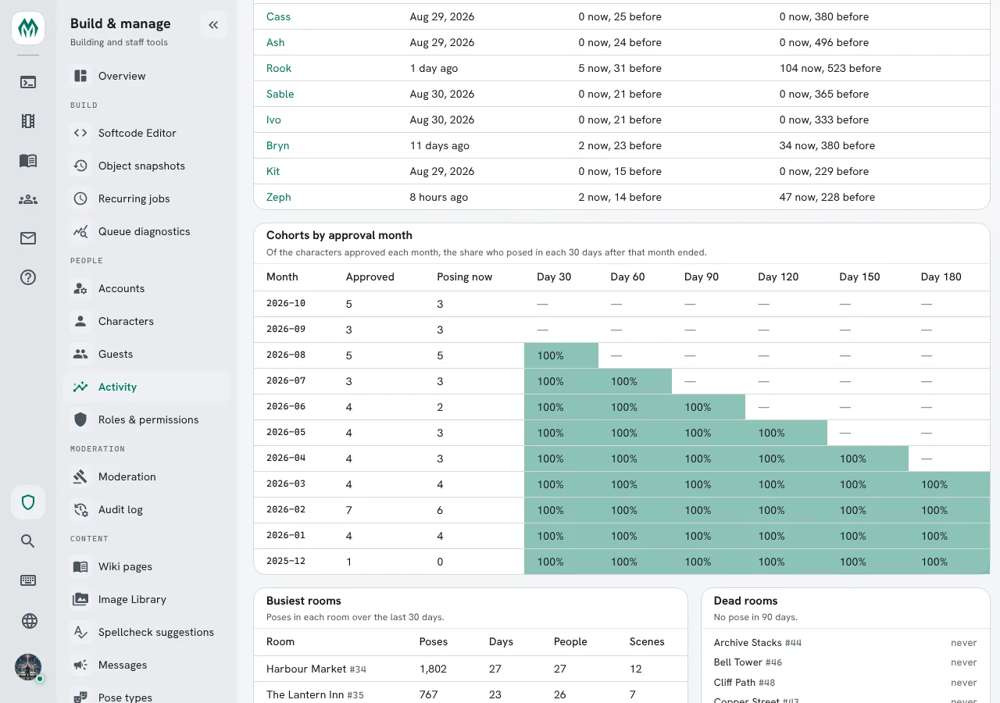
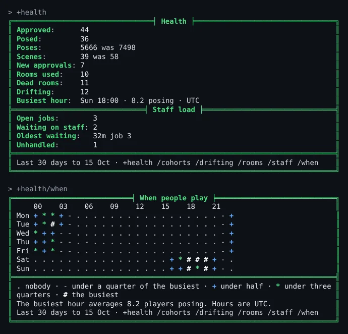
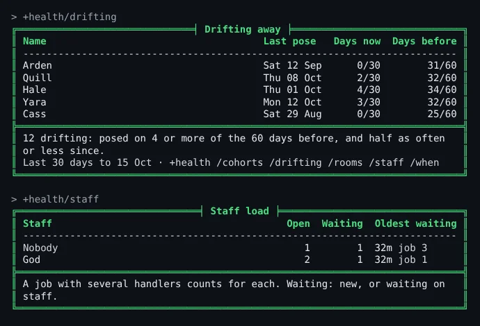

import { Aside } from '@astrojs/starlight/components';

Staff want to know whether the game is healthy, and connection time does not tell them: a player
idle in a corner for eight hours counts the same as one in a scene all evening. SharpMUSH counts
**poses** instead, and draws from them:

- how many approved characters posed lately, next to the weeks before;
- the regulars who have slowed down or stopped;
- how each month's new players stayed on;
- which rooms people use, and which nobody does;
- the hours of the week people play.

The numbers are for staff with the `players.view` permission. They are shown in the portal's
**Activity** page, by the **health** package's `+health` command, and to your own code by
`activity()`.

| You are | You want to | Read |
|---|---|---|
| Staff | see the numbers in the portal | [The Activity page](#the-activity-page) |
| Staff | see them in the game | [+health](#health) |
| Staff | find players drifting away | [Drifting away](#drifting-away) |
| Staff | see how new players stay | [Cohorts](#cohorts) |
| Staff | tidy up the grid | [Rooms](#rooms) |
| Staff | pick a time for an event | [When people play](#when-people-play) |
| Staff | see who is carrying the jobs | [Staff load](#staff-load) |
| An administrator | change the settings, or how long counts are kept | [Settings](#settings) |
| A coder | draw the numbers your own way | [For coders](#for-coders) |

## What is counted

A pose is a `pose`, `say`, `semipose` or `@emit` typed by a player, or a pose a player adds to a
scene from the portal. When the scene package records a typed pose, it still counts once.

Only **approved** characters count toward the player numbers: approval is the `approved` role, as
`isapproved()` reads it. The rooms count every pose made in them.

Nothing anyone wrote is kept. For each character and day the game keeps how many times they
posed and which hours of the day they posed in; for each room and day, its poses, the scenes
started there and who posed there; and the time of each character's and room's last pose.

<Aside>
Counting starts when the server is upgraded. The weeks before that have no counts, so the first
month's comparisons read as if nobody posed before.
</Aside>

## The Activity page

Under **People** in the admin area, **Activity** shows every report on one page: the summary at
the top, then the week as a heatmap, the drifting list, cohorts and rooms. Choose the last 7, 30
or 90 days at the top; hours are shown in your browser's time zone.



Each name in the drifting list opens that character's page. Lower down, each cohort's shares are
shaded the same way, next to the busiest and dead rooms:



## +health

Install the **health** package from **Admin, Packages**. It adds `+health`. These examples come from
a game with `+config health/limit=5` and the health-jobs package, which adds the *Staff load*
section and `/staff` (see [Staff load](#staff-load)):

```
> +health
╔═════════════════════════════════╡ Health ╞═════════════════════════════════╗
║ Approved:      44                                                          ║
║ Posed:         36                                                          ║
║ Poses:         5666 was 7498                                               ║
║ Scenes:        39 was 58                                                   ║
║ New approvals: 7                                                           ║
║ Rooms used:    10                                                          ║
║ Dead rooms:    11                                                          ║
║ Drifting:      12                                                          ║
║ Busiest hour:  Sun 18:00 · 8.2 posing · UTC                                ║
╠═══════════════════════════════╡ Staff load ╞═══════════════════════════════╣
║ Open jobs:        3                                                        ║
║ Waiting on staff: 2                                                        ║
║ Oldest waiting:   32m job 3                                                ║
║ Unhandled:        1                                                        ║
╠════════════════════════════════════════════════════════════════════════════╣
║ Last 30 days to 15 Oct · +health /cohorts /drifting /rooms /staff /when    ║
╚════════════════════════════════════════════════════════════════════════════╝
```

Each count covers the last 30 days. `was` gives the count for the 30 days before, when it is
different. *Busiest hour* is the hour of the week with the most characters posing, on average.

Give a number of days after any `+health` command to count over that many instead:
`+health 7`, `+health/rooms 90`.

*Scenes* appears only when the Scene plugin is running. Without it, scenes are left out rather
than shown as 0.

## Drifting away

`+health/drifting` lists the regulars who now pose half as often or less:

```
> +health/drifting
╔══════════════════════════════╡ Drifting away ╞═════════════════════════════╗
║ Name                                     Last pose   Days now  Days before ║
║ -------------------------------------------------------------------------- ║
║ Arden                                    Sat 12 Sep      0/30        31/60 ║
║ Quill                                    Thu 08 Oct      2/30        32/60 ║
║ Hale                                     Thu 01 Oct      4/30        34/60 ║
║ Yara                                     Mon 12 Oct      3/30        32/60 ║
║ Cass                                     Sat 29 Aug      0/30        25/60 ║
╠════════════════════════════════════════════════════════════════════════════╣
║ 12 drifting: posed on 4 or more of the 60 days before, and half as often   ║
║ or less since.                                                             ║
║ Last 30 days to 15 Oct · +health /cohorts /drifting /rooms /staff /when    ║
╚════════════════════════════════════════════════════════════════════════════╝
```

A **regular** posed on at least 4 of the 60 days before the window. They are **drifting** when the
share of days they posed in the window is half their share in those 60 days, or less. Arden posed
on 31 of 60 days, about half of them, then on none of the last 30.

The list puts the biggest drop first. It is a list of people to say hello to, not a judgement:
a player on holiday drifts too.

## Cohorts

`+health/cohorts` groups approved characters by the month they were approved, and shows how many
of each month kept posing. It shows the last 12 months, the `months` setting:

```
> +health/cohorts
╔═════════════════════════════════╡ Cohorts ╞════════════════════════════════╗
║ Month    Approved  Active   30d   60d   90d  120d  150d  180d              ║
║ -------------------------------------------------------------              ║
║ 2026-10         5       3    -     -     -     -     -      -              ║
║ 2026-09         3       3    -     -     -     -     -      -              ║
║ 2026-08         5       5  100%    -     -     -     -      -              ║
║ 2026-07         3       3  100%  100%    -     -     -      -              ║
║ 2026-06         4       2  100%  100%  100%    -     -      -              ║
║ 2026-05         4       3  100%  100%  100%  100%    -      -              ║
║ 2026-04         4       3  100%  100%  100%  100%  100%     -              ║
║ 2026-03         4       4  100%  100%  100%  100%  100%  100%              ║
║ 2026-02         7       6  100%  100%  100%  100%  100%  100%              ║
║ 2026-01         4       4  100%  100%  100%  100%  100%  100%              ║
║ 2025-12         1       0  100%  100%  100%  100%  100%  100%              ║
║ 2025-11         0       0    -     -     -     -     -      -              ║
╠════════════════════════════════════════════════════════════════════════════╣
║ Active: posed in the last 30 days. 30d to 180d: the share who posed in     ║
║ each 30 days after their approval month ended.                             ║
║ Last 30 days to 15 Oct · +health /cohorts /drifting /rooms /staff /when    ║
╚════════════════════════════════════════════════════════════════════════════╝
```

- **Active** is how many of that month's characters posed in the window.
- **30d** is the share who posed in the first 30 days after the month ended, **60d** the next 30
  days, and so on. A dash means those days have not all passed yet.

The month comes from the audit log: the first time the character, or its account, was given the
`approved` role. A character approved before the audit log kept that counts by the month it was
created, and the screen says how many did.

## Rooms

`+health/rooms` lists the busiest rooms, then the dead ones:

```
> +health/rooms
╔══════════════════════════════════╡ Rooms ╞═════════════════════════════════╗
╠═════════════════════════════════╡ Busiest ╞════════════════════════════════╣
║ Room                               Poses  Days  People  Scenes  Last pose  ║
║ -------------------------------------------------------------------------- ║
║ Harbour Market                      1802    27      27      12  Thu 15 Oct ║
║ The Lantern Inn                      767    23      26       7  Thu 15 Oct ║
║ Temple Steps                         539    17      18       4  Wed 14 Oct ║
║ Old Lighthouse                       489    20      19       4  Thu 15 Oct ║
║ Glass Gardens                        470    15      15       3  Tue 13 Oct ║
╠══════════════════════════════════╡ Dead ╞══════════════════════════════════╣
║ Room                                                             Last pose ║
║ -------------------------------------------------------------------------- ║
║ Archive Stacks                                                   never     ║
║ Bell Tower                                                       never     ║
║ Cliff Path                                                       never     ║
║ Copper Street                                                    never     ║
║ Duelling Yard                                                    never     ║
╠════════════════════════════════════════════════════════════════════════════╣
║ Rooms with a pose: 10. Rooms with none in 90 days: 11.                     ║
║ Last 30 days to 15 Oct · +health /cohorts /drifting /rooms /staff /when    ║
╚════════════════════════════════════════════════════════════════════════════╝
```

A **dead** room is older than 90 days and has had no pose in 90 days. That makes it a candidate
for tidying, not a fault: a corridor people walk through is dead here too.

## When people play

`+health/when` maps the week, a row per day and a mark per hour:

```
> +health/when
╔════════════════════════════╡ When people play ╞════════════════════════════╗
║     00    03    06    09    12    15    18    21                           ║
║ Mon + * * + - . . . . . . . . . . . . . . . . . - +                        ║
║ Tue + * # + - . . . . . . . . . . . . . . . . . - +                        ║
║ Wed * + + - - . . . . . . . . . . . . . . . . . - +                        ║
║ Thu + + * - - . - . . . . . . . . . . . . . . . - +                        ║
║ Fri * + * - - . . . . . . . . . . . . . . . . . - +                        ║
║ Sat . . . . . . . . . . . . . . . . + * # # # + - .                        ║
║ Sun . . . . . . . . . . . . . . . . + + # * # + - .                        ║
╠════════════════════════════════════════════════════════════════════════════╣
║ . nobody · - under a quarter of the busiest · + under half · * under three ║
║ quarters · # the busiest                                                   ║
║ The busiest hour averages 8.2 players posing. Hours are UTC.               ║
║ Last 30 days to 15 Oct · +health /cohorts /drifting /rooms /staff /when    ║
╚════════════════════════════════════════════════════════════════════════════╝
```

In a client with colour, each mark is also tinted with the game's theme:



Each mark compares an hour with the busiest one, so the map reads the same without colour. Hours
are shown in your own zone when you have set one with `+timezone` (the time package), and in the
game's otherwise.

## Staff load

Install **health-jobs** as well when the game runs the **jobs** package. It adds a *Staff load*
section to `+health`, and `+health/staff`:

```
> +health/staff
╔═══════════════════════════════╡ Staff load ╞═══════════════════════════════╗
║ Staff                                        Open  Waiting  Oldest waiting ║
║ -------------------------------------------------------------------------- ║
║ Nobody                                          1        1  32m job 3      ║
║ God                                             2        1  32m job 1      ║
╠════════════════════════════════════════════════════════════════════════════╣
║ A job with several handlers counts for each. Waiting: new, or waiting on   ║
║ staff.                                                                     ║
╚════════════════════════════════════════════════════════════════════════════╝
```



A row for each staffer handling an open job: how many they handle, how many of those wait on staff,
and how long the oldest has waited. **Nobody** counts the open jobs no one handles. A job assigned
to a role shows as `+<role>`.

## Settings

`+config health` changes what `+health` counts over (see [Game Settings with +config](/guides/config)):

| Setting | Default | What it changes |
|---|---|---|
| `days` | 30 | The days `+health` counts back when you give none |
| `baseline` | 60 | The days before the window a player's usual pace is read from |
| `minimum` | 4 | How many of those days make a player a regular |
| `months` | 12 | How many months `+health/cohorts` shows |
| `dead-days` | 90 | How many days without a pose make a room dead |
| `limit` | 20 | How many rows each list shows |
| `zone` | UTC | The time zone for a reader with none of their own |

```
> +config health/baseline=90
[CONFIG] Done: health/baseline is now 90, was 60.
```

The counts are kept for good. To keep only the last 400 days, set
`SHARPMUSH_HISTORY_ACTIVITY_MAX_AGE=400d` on the server; `@storage/history` shows how much they
take. Each character's and room's last pose is kept when older days go.

## For coders

`activity(<report>[, <options>])` returns each report as JSON: `summary`, `drifting`, `cohorts`,
`rooms` or `hours`. Like `+health`, it needs `players.view`.

```
> think activity(rooms,{{"limit":1,"days":7}})
{"asOf":"2026-10-15","days":7,"deadDays":90,"usedTotal":10,"deadTotal":11,"used":[{"objid":"#34:1774785600000","name":"Harbour Market","poses":537,"days":7,"people":19,"scenes":5,"lastPose":"2026-10-15T02:00:00+00:00"}],"dead":[{"objid":"#44:1774785600000","name":"Archive Stacks","poses":0,"days":0,"people":0,"scenes":0,"lastPose":null}]}
```

Typed at a client, the options object takes a second pair of braces: the outer pair groups.
`help activity()` lists every option and field.

The health package draws its screens from these reports. Another package adds to it the way
health-jobs does: a `` FILTER`HEALTH`SCREEN`<name> `` attribute on the Health object adds lines to
the summary, and an attached `` INC`VIEW`<name> `` adds `+health/<name>`. `+help health code`
gives the details.
