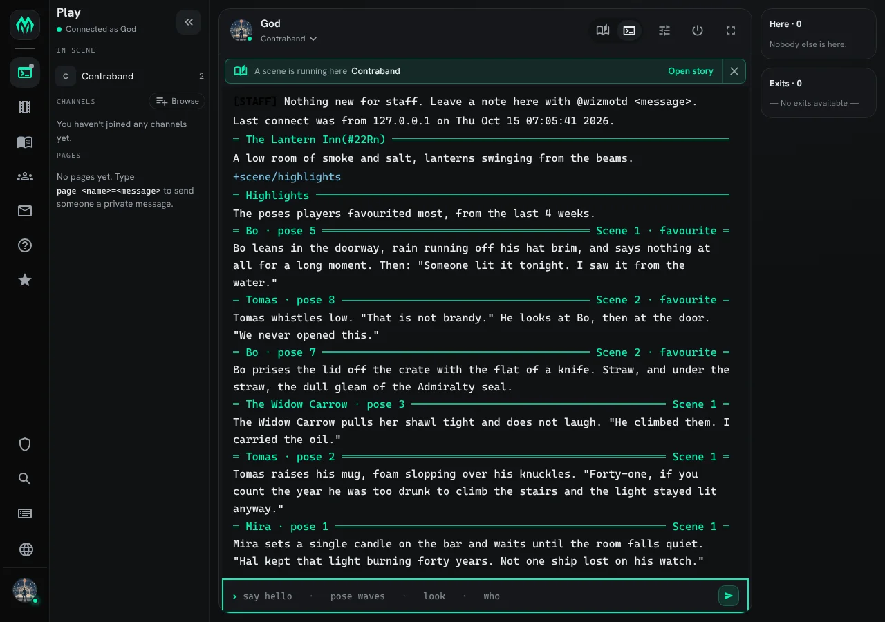
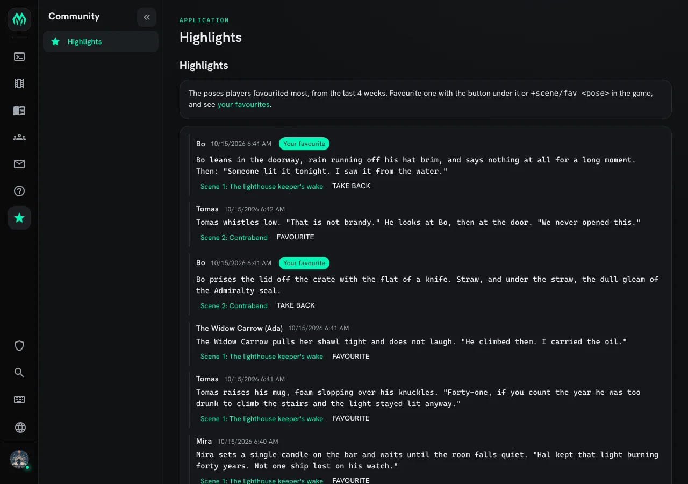
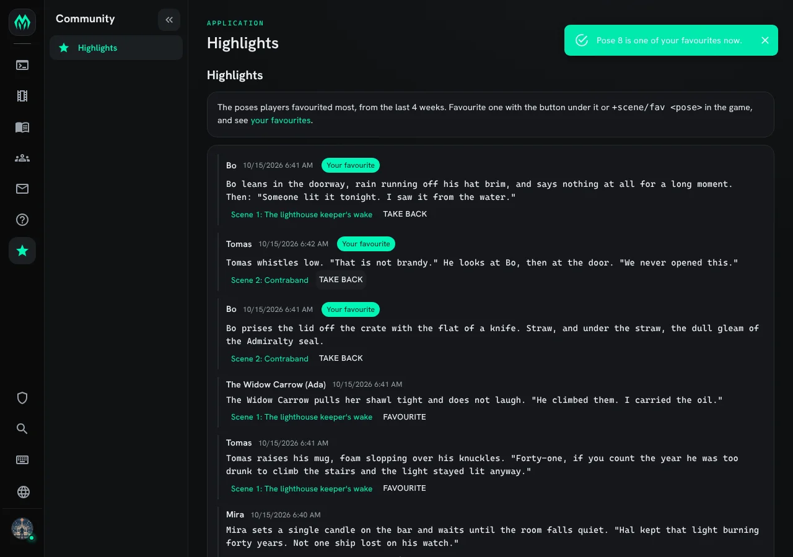
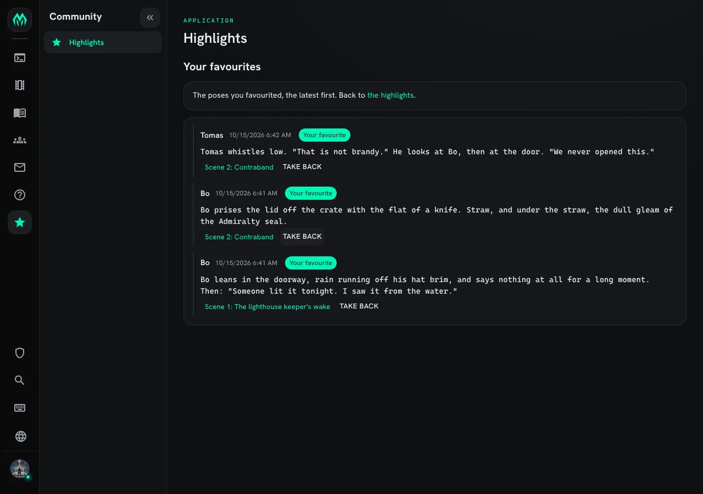

**Highlights** let players mark poses they liked as **favourites**. The poses favourited most
make the game's highlights: a list in the game and a page on the website, each pose credited
to the character who wrote it.

The highlights show no counts and rank no players. A pose is there because someone liked it,
and nobody can see how many people did.

| You are | You want to | Read |
|---|---|---|
| A player | favourite a pose, or take it back | [Favouriting a pose](#favouriting-a-pose) |
| A player | read the highlights or your favourites | [Reading the highlights](#reading-the-highlights) |
| A player | use the website | [On the website](#on-the-website) |
| Staff | install it, change how far back it reaches | [Running Highlights](#running-highlights) |

In the game, `+help scene highlights` has the same commands in short form. Highlights need
the scene system: see [Scene Pose Types](/guides/scene-pose-types) for how scenes record
poses.

## Favouriting a pose

Every pose a scene records has a number. It is on the line over the pose in `+scene/recall`
and `+scene/log`. `+scene/fav <number>` makes it one of your favourites:

```
> +scene/fav 3
[HIGHLIGHTS] Done: Pose 3 by The Widow Carrow (Ada) is one of your favourites now.
```

When a pose was written under another name, such as a persona, both names show: the name
it went out under, then the character's own.

`+scene/unfav <number>` takes it back:

```
> +scene/unfav 3
[HIGHLIGHTS] Done: Pose 3 is no longer one of your favourites.
```

Some poses cannot be favourited:

```
> +scene/fav 1
[HIGHLIGHTS] Warning: Pose 1 is your own. Favourites are for other players' poses.
> +scene/fav 3
[HIGHLIGHTS] Warning: Pose 3 is already one of your favourites.
> +scene/unfav 3
[HIGHLIGHTS] Warning: Pose 3 is not one of your favourites.
```

A pose in a private scene you are not part of reads as `No such pose`, the same as a number
no scene has. Favouriting needs an approved character, as joining a scene does.

### The mark on a favourite

Once a pose is one of your favourites, the line over it says so, beside its scene, wherever
the game draws it for you:

```
> +scene/recall 1=3
═╡ Bo · pose 5 ╞══════════════════════════════════════╡ Scene 1 · favourite ╞═
Bo leans in the doorway, rain running off his hat brim, and says nothing at all for a long moment. Then: "Someone lit it tonight. I saw it from the water."
═╡ Mira · pose 6 ╞════════════════════════════════════════════════╡ Scene 1 ╞═
Mira goes very still, the candle flame bending toward the open door.
```

Only you see your own mark. Others see `favourite` only on the poses they favourited.

## Reading the highlights

`+scene/highlights` shows the poses favourited most, from the last four weeks. Among poses
favourited by as many players, the newer pose comes first:

```
> +scene/highlights
═╡ Highlights ╞═══════════════════════════════════════════════════════════════
The poses players favourited most, from the last 4 weeks.
═╡ The Widow Carrow · pose 3 ╞════════════════════════╡ Scene 1 · favourite ╞═
The Widow Carrow pulls her shawl tight and does not laugh. "He climbed them. I carried the oil."
═╡ Bo · pose 5 ╞══════════════════════════════════════╡ Scene 1 · favourite ╞═
Bo leans in the doorway, rain running off his hat brim, and says nothing at all for a long moment. Then: "Someone lit it tonight. I saw it from the water."
═╡ Tomas · pose 8 ╞═══════════════════════════════════════════════╡ Scene 2 ╞═
Tomas whistles low. "That is not brandy." He looks at Bo, then at the door. "We never opened this."
```

`+scene/favs` shows your own favourites, the latest first:

```
> +scene/favs
═╡ Your favourites ╞══════════════════════════════════════════════════════════
═╡ The Widow Carrow · pose 3 ╞════════════════════════╡ Scene 1 · favourite ╞═
The Widow Carrow pulls her shawl tight and does not laugh. "He climbed them. I carried the oil."
═╡ Bo · pose 7 ╞══════════════════════════════════════╡ Scene 2 · favourite ╞═
Bo prises the lid off the crate with the flat of a knife. Straw, and under the straw, the dull gleam of the Admiralty seal.
```

Each list comes ten poses to a page. When there are more, the last line says how to see
them, such as `+scene/highlights 2 shows more.`



What you are shown follows what you may read:

- Poses from a private scene show only to its members.
- A pose its writer deleted leaves both lists.
- A pose type you hid with `+scene/hide`, such as OOC, stays out of both lists.

## On the website

The **Highlights** page, under Community, shows the same list. Each pose shows who wrote
it, when, and a link to its scene. Signed in with an approved character, you get a
**Favourite** button under each pose you may favourite, and **Take back** under your own
favourites. A pose you favourited is tagged **Your favourite**.



Pressing **Favourite** does what `+scene/fav` does, and the page updates in place:



The **your favourites** link in the text at the top opens `/apps/highlights/mine`, your own
list, the latest first:



A visitor who is not signed in can read the highlights from public scenes, with no buttons.

## Running Highlights

### Installing

Highlights ship with the server but are not installed on a new game. They need the scene
system, so the Scene plugin must be running. An administrator installs them from the
portal:

1. Open **Packages** in the admin area and choose **Browse**.
2. Install `highlights`, which adds the commands. It needs `scene` and `http-handler`, which a new
   game already has. Its `+config` settings come with it, through the `highlights-config` bridge, wherever `+config` is installed.
3. Install `highlights-app` for the website page.

The commands are added beside the other `+scene` commands. See
[Softcode Packages](/guides/packages) for how installing, upgrading and rolling back work.

### Settings

Staff who can change the game's configuration (the `config.admin` permission) change the
settings with `+config highlights`:

```
> +config highlights
╔══════════════════════════╡ Settings: Highlights ╞══════════════════════════╗
║ Favourite poses and the highlights they make.                              ║
║                                                                            ║
║ Setting    Value  Allowed                      What it does                ║
║ -------------------------------------------------------------------------- ║
║ own-poses  no     Yes or no                    Own poses. Whether players  ║
║                                                may favourite their own     ║
║                                                poses.                      ║
║ page-size  10     A whole number from 1 to 50  Poses per page. How many    ║
║                                                poses one page of the       ║
║                                                highlights or of a player's ║
║                                                favourites shows.           ║
║ window     4w     A length of time, at least   Window. How far back the    ║
║                   0s                           highlights reach, by when   ║
║                                                the pose was written. 0     ║
║                                                shows every favourited      ║
║                                                pose.                       ║
╠════════════════════════════════════════════════════════════════════════════╣
║ +config highlights/<setting>=<value> changes one.                          ║
╚════════════════════════════════════════════════════════════════════════════╝
```

For example, to keep the highlights to the last two weeks, then go back to the default:

```
> +config highlights/window=2w
[CONFIG] Done: highlights/window is now 2w, was 4w.
> +config/reset highlights/window
[CONFIG] Done: highlights/window is now 4w, was 2w.
```

The window counts from when the pose was written, not from when it was favourited, so an old
pose favourited today stays out. A window of `0` shows every favourited pose. Favourites
outside the window are kept: widening it brings them back, and `+scene/favs` always shows
them.

Players can read `+config highlights` too, but only staff can change it.

### Where the favourites are kept

The package keeps its favourites on its own object, the Highlights Store, not on the
scenes. One branch per favourited pose holds who favourited it, its scene, and when it was
written. When nobody favourites a pose any more, its branch is removed. Uninstalling the
package removes the store and every favourite in it, and leaves the scenes as they were.
