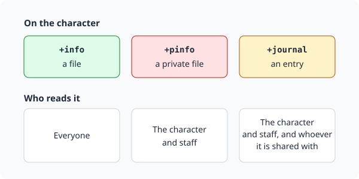
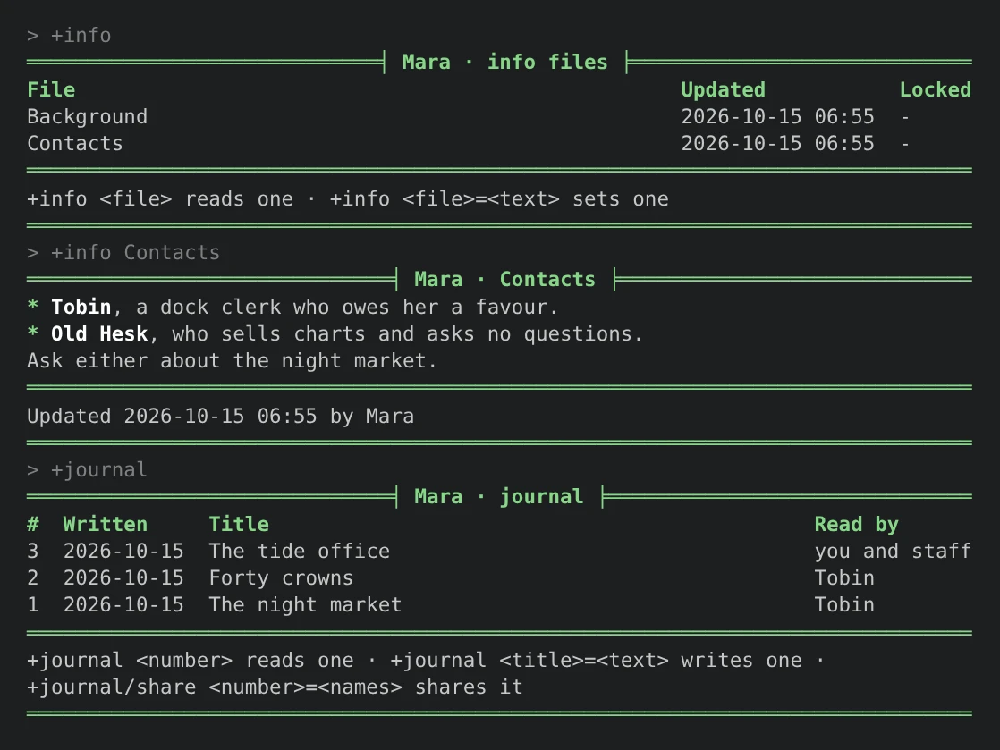
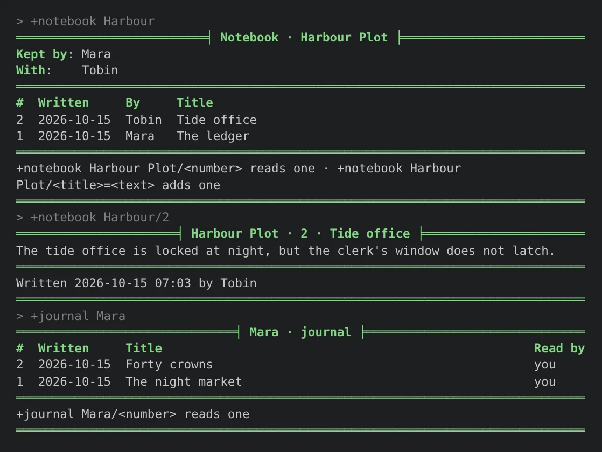

import { Aside } from '@astrojs/starlight/components';

The **info** package gives players four places to write things down:

- `+info` keeps files about a character that anyone can read: a background, contacts, what
  they own.
- `+pinfo` keeps private files, which only the character and staff read.
- `+journal` is a character's own journal. An entry stays private until the player shares it,
  with a few people or with everyone.
- `+notebook` is a notebook a group shares, for a plot or a project. Everyone in it reads and
  writes entries.



| You are | You want to | Read |
|---|---|---|
| A player | keep files about your character | [Info files](#info-files) |
| A player | write something long | [Writing a line at a time](#writing-a-line-at-a-time) |
| A player | keep a journal | [Journals](#journals) |
| A player | share notes with a plot group | [Notebooks](#notebooks) |
| Staff | read and lock players' files | [Staff](#staff) |
| Staff | install it and change its settings | [Running the package](#running-the-package) |

In the game, `+help info`, `+help journal` and `+help notebook` have the same commands in short
form.

## Info files

`+info <file>=<text>` saves a file:

```
> +info Background=Mara grew up above her mother's net shop on the Shale Coast, and ran cargo for the harbour guild until the guild ran out of work.
[INFO] Done: Your info file Background is saved.
```

The same command with a file you already have replaces its text. `+info` on its own lists your
files:

```
> +info
═════════════════════════════╡ Mara · info files ╞════════════════════════════
File                                                  Updated           Locked
Background                                            2026-10-15 06:55  -
Contacts                                              2026-10-15 06:55  -
══════════════════════════════════════════════════════════════════════════════
+info <file> reads one · +info <file>=<text> sets one
══════════════════════════════════════════════════════════════════════════════
```

`+info <file>` reads one. The start of its name is enough when only one file starts with it, and
`+info <file>|<file>` reads several at once.

In a terminal, in the reader's own colours:



Anyone reads someone else's files. `+info <name>` lists them and `+info <name>/<file>` reads one:

```
> +info Mara/Back
═════════════════════════════╡ Mara · Background ╞════════════════════════════
Mara grew up above her mother's net shop on the Shale Coast, and ran cargo for
the harbour guild until the guild ran out of work.
══════════════════════════════════════════════════════════════════════════════
Updated 2026-10-15 06:55 by Mara
══════════════════════════════════════════════════════════════════════════════
```

A name on its own is tried as a player first, so `+info Mara` lists Mara's files even if you have
a file called Mara. `+info me/Mara` reads your own.

### Private files

`+pinfo` takes every command `+info` does, and keeps the files to you and staff:

```
> +pinfo Secrets=Owes the harbourmaster forty crowns. [OOC: open to plots about this.]
[INFO] Done: Your private file Secrets is saved.
```

Anyone else is refused:

```
> +pinfo Mara/Secrets
[INFO] Error: Only Mara and staff read Mara's private files.
```

### Changing a file

- `+info/get <file>` shows the command that saves the file again, with its text exactly as
  stored. Copy it, change it and send it back.
- `+info/rename <file>=<new name>` renames one.
- `+info/delete <file>` deletes one, and `+info/delete <file>|<file>` several.

```
> +info/get Background
+info Background=Mara grew up above her mother's net shop on the Shale Coast, and ran cargo for the harbour guild until the guild ran out of work.
```

What you type is kept as you typed it. Brackets and percent signs are plain text, never code, so
`[OOC: open to plots about this.]` above is stored and shown just as it is.

A file's name is up to 30 characters and cannot hold a slash, a bar, an equals sign, a comma or a
backtick. Its text is up to 8000 characters. A game can change both.

Text is shown as Markdown: `*emphasis*`, a dash at the start of a line for a list, and an empty
line between paragraphs. See the next section for writing more than one line.

## Writing a line at a time

A command is one line, so a long text with paragraphs or a list is written with `/write`. It works
for all four commands:

- `+info/write <file>` and `+pinfo/write <file>`
- `+journal/write <title>`
- `+notebook/write <notebook>/<title>`

Each line you type is added to the text, and nothing you type runs as a command until you finish.

- `.undo` on a line by itself drops the last line.
- `.done` on a line by itself saves it.
- `@input/cancel` throws it away.

```
> +info/write Contacts
Writing your info file Contacts. Type it a line at a time, with an empty line between paragraphs. .done on a line by itself saves it, .undo drops the last line, and @input/cancel throws it away.
> - *Tobin*, a dock clerk who owes her a favour.
> - *Old Hesk*, who sells charts and asks no questions.
>
> Ask either about the night market.
> .done
[INFO] Done: Your info file Contacts is saved.
> +info Contacts
══════════════════════════════╡ Mara · Contacts ╞═════════════════════════════
* Tobin, a dock clerk who owes her a favour.
* Old Hesk, who sells charts and asks no questions.
Ask either about the night market.
══════════════════════════════════════════════════════════════════════════════
Updated 2026-10-15 06:55 by Mara
══════════════════════════════════════════════════════════════════════════════
```

An hour after you start, what you have written is saved as if you had typed `.done`. Saving runs
the same checks as the one-line command, so a file staff locked while you were writing stays as it
was.

## Journals

`+journal <title>=<text>` writes an entry. Only you and staff read it until you share it:

```
> +journal The night market=Nobody followed me past the fish stalls. I am almost sure of it.
[INFO] Done: Journal entry 1, The night market, is written. You and staff read it until you share it: +journal/share 1=<names> or all.
```

`+journal` lists your entries, newest first, and `+journal <number>` reads one.

### Sharing an entry

`+journal/share <number>=<names>` lets those players read it, and tells them it is there:

```
> +journal/share 1=Tobin
[INFO] Done: Tobin reads journal entry 1, The night market, now.
```

If Tobin is connected, he hears:

```
[INFO] Mara shared a journal entry with you: +journal Mara/1
```

Names are split at commas when there are any, else at spaces: `+journal/share 1=Tobin Hesk` and
`+journal/share 1=Tobin, Old Hesk` both work. `+journal/share <number>=all` lets everyone read it.

The list's Read by column says who reads each entry:

```
> +journal
══════════════════════════════╡ Mara · journal ╞══════════════════════════════
#  Written     Title                                             Read by
2  2026-10-15  Forty crowns                                      you and staff
1  2026-10-15  The night market                                  Tobin
══════════════════════════════════════════════════════════════════════════════
+journal <number> reads one · +journal <title>=<text> writes one ·
+journal/share <number>=<names> shares it
══════════════════════════════════════════════════════════════════════════════
```

`+journal/unshare <number>=<names>` takes some players off, and `+journal/unshare <number>` keeps
the entry to you and staff again:

```
> +journal/unshare 1
[INFO] Done: Only you and staff read journal entry 1, The night market, now.
```

### Reading someone's journal

`+journal <name>` lists what someone has shared with you, and `+journal <name>/<number>` reads an
entry. You see only `you` or `everyone` in the Read by column, never who else it was shared with:

```
> +journal Mara
══════════════════════════════╡ Mara · journal ╞══════════════════════════════
#  Written     Title                                                   Read by
1  2026-10-15  The night market                                        you
══════════════════════════════════════════════════════════════════════════════
+journal Mara/<number> reads one
══════════════════════════════════════════════════════════════════════════════
> +journal Mara/2
[INFO] Warning: There is no entry '2' in Mara's journal that you can read.
```

### Changing an entry

- `+journal/edit <number>=<text>` replaces its text.
- `+journal/get <number>` shows the `/edit` command with the text exactly as stored.
- `+journal/title <number>=<title>` renames it.
- `+journal/delete <number>` deletes it. The other entries keep their numbers.

## Notebooks

A notebook belongs to a group. Whoever starts it keeps it and brings the others in:

```
> +notebook/create Harbour Plot
[INFO] Done: Notebook Harbour Plot is made. +notebook/invite Harbour Plot=<names> brings others in.
> +notebook/invite Harbour Plot=Tobin
[INFO] Done: Tobin is in Harbour Plot now.
```

Tobin hears, if he is connected:

```
[INFO] Mara brought you into the notebook Harbour Plot: +notebook Harbour Plot
```

Notebook names are unique across the game. `+notebook` lists the ones you are in.

### Writing in a notebook

`+notebook <notebook>/<title>=<text>` adds an entry, and tells everyone else in the notebook:

```
> +notebook Harbour/Tide office=The tide office is locked at night, but the clerk's window does not latch.
[INFO] Done: Entry 2 of Harbour Plot, Tide office, is written.
```

Mara hears:

```
[INFO] Tobin wrote in Harbour Plot: +notebook Harbour Plot/2
```

`+notebook <notebook>` shows who is in it and its entries, newest first, and
`+notebook <notebook>/<number>` reads one. The start of the notebook's name is enough:



Whoever wrote an entry, whoever keeps the notebook, and staff change it:

- `+notebook/edit <notebook>/<number>=<text>` replaces its text.
- `+notebook/get <notebook>/<number>` shows the `/edit` command with the text exactly as stored.
- `+notebook/title <notebook>/<number>=<title>` renames it.
- `+notebook/delete <notebook>/<number>` deletes it.

Anyone else is refused:

```
> +notebook/edit Harbour/1=Changed
[INFO] Error: Only whoever wrote an entry, whoever keeps the notebook, or staff change it.
```

### Keeping a notebook

Only its keeper and staff do these:

- `+notebook/invite <notebook>=<names>` brings players in, and `+notebook/remove <notebook>=<names>`
  takes them out. Both tell the players.
- `+notebook/owner <notebook>=<name>` hands it to someone else. The old keeper stays in it.
- `+notebook/rename <notebook>=<new name>` renames it.
- `+notebook/destroy <notebook>` says how many entries it holds, and
  `+notebook/destroy <notebook>=yes` throws it away for good.

Anyone but the keeper leaves with `+notebook/leave <notebook>`.

## Long lists

A list longer than your screen comes in pages. Ask for a page with its number as the last switch,
and the last line of each page names the command for the next:

- `+info/2` is the second page of your files, `+info/2 Mara` of Mara's.
- `+journal/2` is the second page of your journal.
- `+notebook/2` is the second page of your notebooks, and `+notebook/2 Harbour Plot` of that
  notebook's entries.

A page past the end says how many there are:

```
> +info/2
[INFO] Warning: There is only one page.
```

## Staff

Staff with the `softcode.info.staff` permission look after players' writing. The package gives it to
nobody but the administrator, so a game hands it out. To every wizard, through their role:

```
> @role/allow wizard=softcode.info.staff
Role Wizard: allows softcode.info.staff.
```

Or to one player, with `@permission/allow <player>=softcode.info.staff`.

They can:

- read anyone's private files with `+pinfo <name>` and `+pinfo <name>/<file>`.
- change anyone's `+info` and `+pinfo` files with `+info <name>/<file>=<text>`, `/write`, `/rename`
  and `/delete`. The player is told.
- read every journal entry: `+journal <name>` lists them all, shared or not.
- list every notebook with `+notebook/all`, read any of them, and manage any of them as its keeper
  does.

### Locking a file

`+info/lock <name>/<file>` locks a file so only staff change it, for an approved background or a
staff note. `+info/unlock <name>/<file>` frees it, and `+info/lset <name>/<file>=<text>` saves a file
and locks it in one step. `+pinfo` takes the same switches.

```
> +info/lock Mara/Background
[INFO] Done: Mara's info file Background is locked: only staff change it now.
> +info Mara
═════════════════════════════╡ Mara · info files ╞════════════════════════════
File                                                  Updated           Locked
Background                                            2026-10-15 06:55  locked
Contacts                                              2026-10-15 06:55  -
══════════════════════════════════════════════════════════════════════════════
+info Mara/<file> reads one
══════════════════════════════════════════════════════════════════════════════
```

Mara is told, and is refused if she tries to change it:

```
> +info Background=Rewritten.
[INFO] Error: Staff locked Background, so only staff change it.
```

To leave every file of an approved character to staff, turn on the `approval-lock` setting. See
[Settings](#settings).

## Running the package

### Installing

The info package ships with the server but is not installed on a new game, because `+info`,
`+journal` and `+notebook` are names a game may already use. An administrator installs it from the
portal:

1. Open **Packages** in the admin area and choose **Browse**.
2. Install `info`. It needs `plus-help` and `plus-config`, which a new game already has.

It adds `+info`, `+pinfo`, `+journal` and `+notebook` for everyone. They are game commands, which
are matched before softcode `$`-commands, so a `+info` your game already has in softcode stops
running once the package is in.

See [Softcode Packages](/guides/packages) for how installing, upgrading and rolling back work.

### Settings

`+config info` lists the settings and `+config info/<setting>=<value>` changes one, with the
`config.admin` permission. See [Game Settings with +config](/guides/config).

| Setting | What it is | Default |
|---|---|---|
| `name-length` | The longest name of a file or notebook, or title of an entry, in characters, 1 to 60. | 30 |
| `length` | The longest text of a file or entry, in characters. | 8000 |
| `approval-lock` | Once a character is approved, only staff add, change or delete their `+info` and `+pinfo` files. | no |
| `markdown` | Show the text of files and entries as Markdown. Off shows it as typed. | yes |

```
> +config info/approval-lock=yes
[CONFIG] Done: info/approval-lock is now yes, was no.
```

The game's own limit on an attribute's length caps `length` too. A text over that limit is refused,
never cut short.

### Where the writing is kept

Files and journal entries are attributes on the character, so they move with it:

| Attribute | What it holds |
|---|---|
| ``INFOFILE`<n>`NAME``, ``TEXT``, ``SET``, ``BY``, ``LOCKED``, ``LOCKEDAT`` | `+info` file `<n>` |
| ``PINFOFILE`<n>`...`` | `+pinfo` file `<n>`, the same leaves |
| ``JOURNAL`<n>`TITLE``, ``TEXT``, ``AT``, ``EDITED``, ``SHARE`` | journal entry `<n>`; `SHARE` is empty, `all`, or the readers' object ids |

The package flags each of these trees `wizard` and `no_command` the first time it writes one, so a
player cannot change them with `&`. Code reads them with `get()`; for example, the text of a
character's first file:

```
> think get(*Mara/INFOFILE`1`TEXT)
Mara grew up above her mother's net shop on the Shale Coast, and ran cargo for the harbour guild until the guild ran out of work.
```

Notebooks are on the **Notebook Store** object, inside the Info Files object in the master room, as
``BOOK`<n>`` trees with ``ENTRY`<n>`` branches.

<Aside type="caution">
Uninstalling the package leaves the files and journal entries on the characters, but the notebooks
go with the Notebook Store. Take a backup with `@backup` first if a game wants to keep them.
</Aside>
