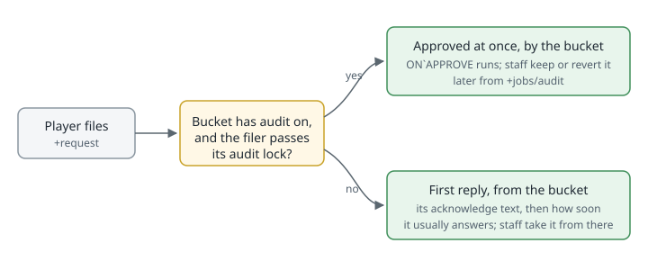
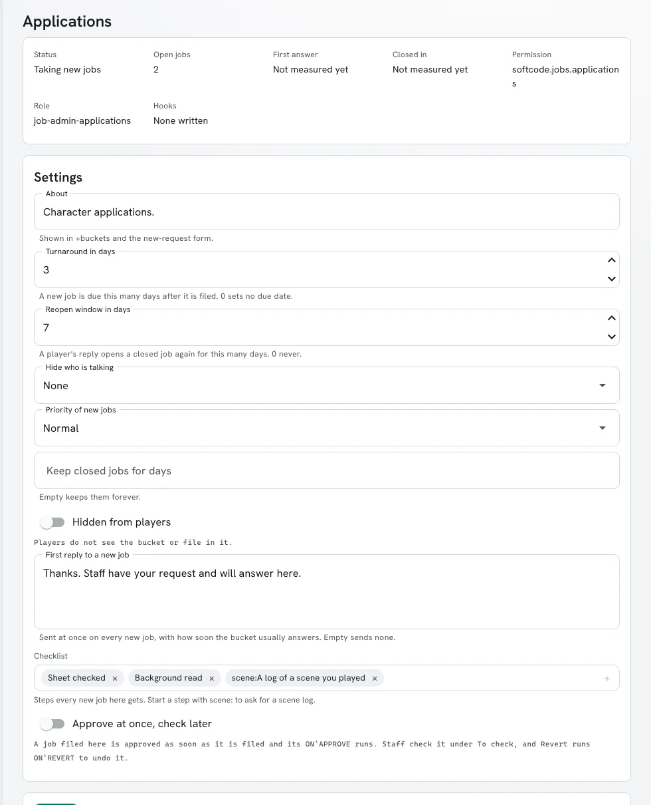
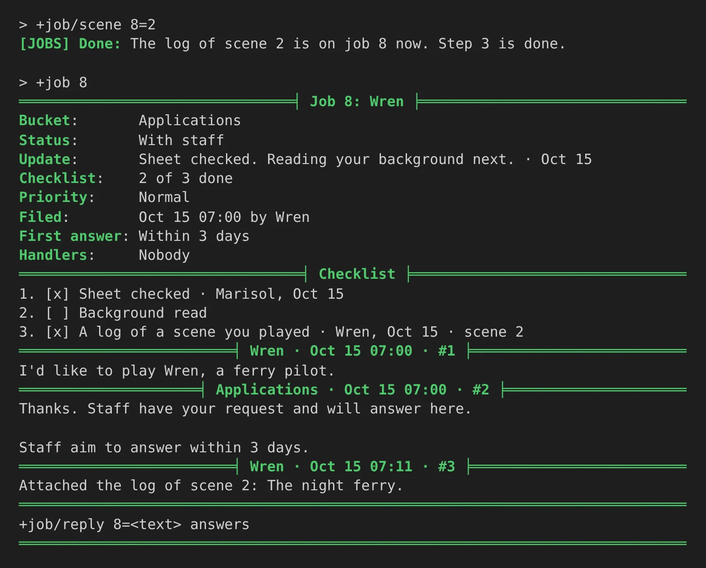
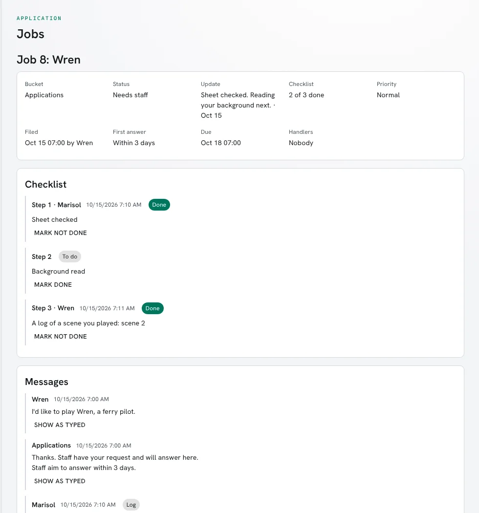
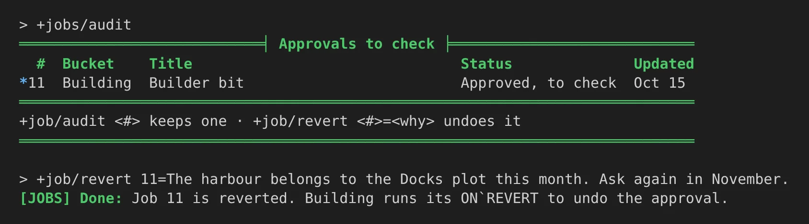
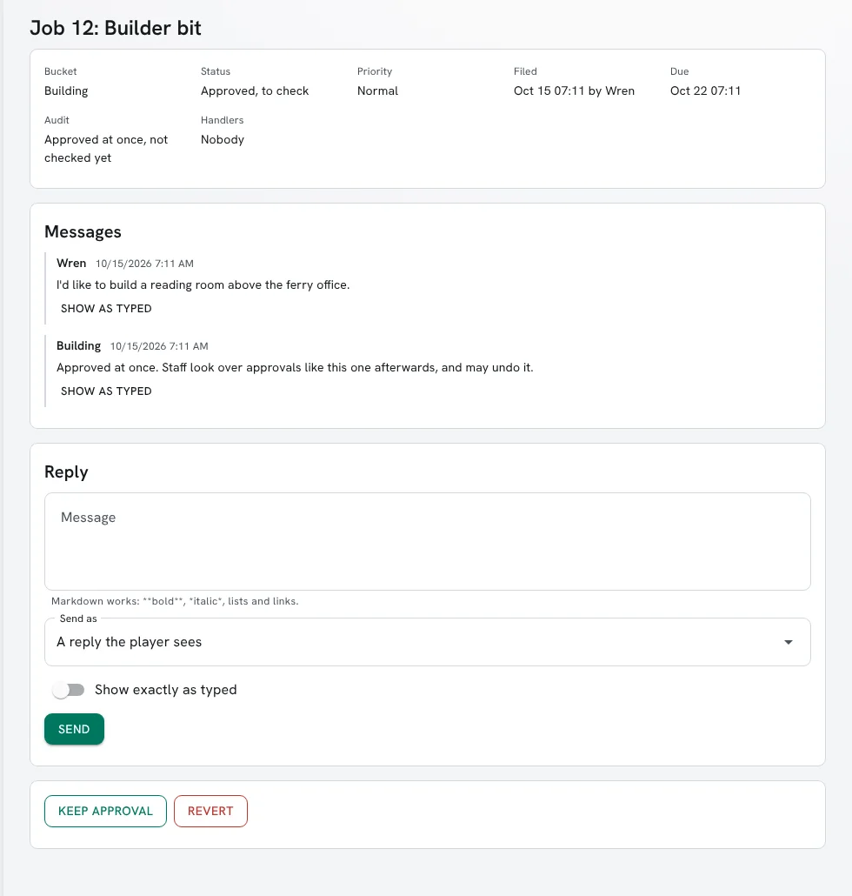

import { Aside } from '@astrojs/starlight/components';

The jobs package keeps the queue of requests players send to staff: applications, room fixes,
bugs, plot ideas. Each job sits in a **bucket**, such as Applications or Building, and each
bucket decides how its jobs are handled. This guide covers the parts that save staff from
typing the same thing twice:

| A bucket can | So that | Read |
|---|---|---|
| Answer every new job at once | the player knows it arrived and how long to wait | [First replies](#first-replies) |
| Measure how soon it answers | that wait comes from real jobs, not a guess | [How soon a bucket answers](#how-soon-a-bucket-answers) |
| Give each job a checklist | staff and the player see what is left | [Checklists](#checklists) |
| Let staff leave a one-line update | the player knows where a job stands without a reply | [Status updates](#status-updates) |
| Approve some jobs at once | routine requests do not wait on staff | [Approving at once](#approving-at-once) |

Everything here is a bucket setting, changed with `+bucket/set <bucket>/<setting>=<value>` by a
Job Admin or by someone who works that bucket, or on the bucket's page under **Bucket
settings** in the portal. In the game, `+help buckets`, `+help jobs checklist` and
`+help jobs audit` have the same in short form.



## First replies

A new job gets a reply from its bucket straight away. It is the bucket's `acknowledge` text,
followed by how soon the bucket usually answers:

```
> +request Room description=My room in the harbour still has the default description.
[JOBS] Done: Filed job 9 in Requests: Room description. Staff usually answer in about 4 hours. +job 9 shows it.
> +job 9
══════════════════════════╡ Job 9: Room description ╞═════════════════════════
Bucket:       Requests
Status:       New
Priority:     Normal
Filed:        Oct 15 07:00 by Wren
First answer: About 4 hours
Handlers:     Nobody
═════════════════════════╡ Wren · Oct 15 07:00 · #1 ╞═════════════════════════
My room in the harbour still has the default description.
═══════════════════════╡ Requests · Oct 15 07:00 · #2 ╞═══════════════════════
Thanks. Staff have your request and will answer here.

Staff usually answer in about 4 hours.
══════════════════════════════════════════════════════════════════════════════
+job/reply 9=<text> answers
══════════════════════════════════════════════════════════════════════════════
```

The reply is written by the bucket, so it does not count as staff answering: the job stays
**New**, and the filer does not see it as unread. Each bucket has its own text. Change it, or
leave it empty to send none:

```
> +bucket/set Requests/acknowledge=Thanks. Staff have your request and will answer here.
[JOBS] Requests acknowledge is Thanks. Staff have your request and will answer here.
> +bucket/set Feedback/acknowledge=
[JOBS] Feedback acknowledge is nothing.
```

A job staff file themselves, and a question staff send a player with `+job/query`, get no
first reply.

## How soon a bucket answers

Every bucket keeps two measurements:

- **First answer**: how long its jobs waited for staff's first reply.
- **Closed in**: how long they took to close.

Each is the middle value of the bucket's last 25 jobs, so one job that sat over a holiday does
not skew it. Jobs staff filed, `+job/query` jobs and jobs approved at once are left out, since
nobody waited on them. Until a bucket has three jobs measured, players are told its
`turnaround` setting instead: "Staff aim to answer within 3 days."

`+buckets` shows the first-answer time beside every bucket, and players see the same when they
choose a bucket in the portal's **New request** form:

```
> +buckets
════════════════════════════════╡ Job buckets ╞═══════════════════════════════
Bucket         Open  First answer   What it is for
Applications*     2  within 3 days  Character applications.
Bugs*             0  within 7 days  Problems with code or the server.
Building*         0  at once        Rooms, objects, descriptions and typos.
Feedback*         0  within 7 days  Suggestions and complaints. Staff do not
                                    see who sent them.
Plots*            0  within 7 days  Plot and scene proposals.
Requests*         5  about 4 hours  Anything you need from staff.
Staff*            0  within 7 days  Work among staff. Players do not see it.
══════════════════════════════════════════════════════════════════════════════
* you work it · +request [<bucket>/]<title>=<text>
══════════════════════════════════════════════════════════════════════════════
```

`+bucket <name>` shows both measurements and how many jobs they come from:

```
> +bucket Requests
═════════════════════════════╡ Bucket: Requests ╞═════════════════════════════
About:           Anything you need from staff.
Turnaround:      3 days
First answer:    About 4 hours (the last 7 jobs)
Closed in:       About 2 days (the last 5 jobs)
...
```

To measure over more or fewer jobs, change the `wait-sample` setting with
[`+config`](/guides/config):

```
> +config jobs/wait-sample=50
```

## Checklists

A bucket can give every new job the same list of steps. Separate the steps with `|`. A step
that starts with `scene:` asks for the log of a scene:

```
> +bucket/set Applications/checklist=Sheet checked|Background read|scene:A log of a scene you played
[JOBS] Applications checklist is Sheet checked, Background read, and A log of a scene you played (a scene log).
```

Each job copies the checklist when it is filed, so changing the bucket's list later leaves
the jobs already filed alone. In the portal, the checklist is a list on the bucket's page: type
a step and press Enter to add it, or click its × to remove it. A step may contain a comma.



Staff tick a step with `+job/check <#>=<step>` and untick it with `+job/uncheck`:

```
> +job/check 8=1
[JOBS] Done: Step 1 of job 8 is done: Sheet checked
```

### Attaching a scene log

The player, anyone they added as a helper, or staff attach a scene with
`+job/scene <#>=<scene>`. It goes on the job as a message with a link to the log, and ticks
the first scene step that is still open. A player can attach only scenes they were in.

```
> +job/scene 8=2
[JOBS] Done: The log of scene 2 is on job 8 now. Step 3 is done.
> +job 8
════════════════════════════════╡ Job 8: Wren ╞═══════════════════════════════
Bucket:       Applications
Status:       With staff
Update:       Sheet checked. Reading your background next. · Oct 15
Checklist:    2 of 3 done
Priority:     Normal
Filed:        Oct 15 07:00 by Wren
First answer: Within 3 days
Handlers:     Nobody
═════════════════════════════════╡ Checklist ╞════════════════════════════════
1. [x] Sheet checked · Marisol, Oct 15
2. [ ] Background read
3. [x] A log of a scene you played · Wren, Oct 15 · scene 2
═════════════════════════╡ Wren · Oct 15 07:00 · #1 ╞═════════════════════════
I'd like to play Wren, a ferry pilot.
═════════════════════╡ Applications · Oct 15 07:00 · #2 ╞═════════════════════
Thanks. Staff have your request and will answer here.

Staff aim to answer within 3 days.
═════════════════════════╡ Wren · Oct 15 07:11 · #3 ╞═════════════════════════
Attached the log of scene 2: The night ferry.
══════════════════════════════════════════════════════════════════════════════
+job/reply 8=<text> answers
══════════════════════════════════════════════════════════════════════════════
```



In the portal, the job page lists the steps with **Mark done** and **Mark not done** for staff,
and an **Attach a scene log** box for the player and staff.



<Aside>
Scene logs need the Scene plugin. On a game without it, `scene:` steps are left out of every
checklist and `+job/scene` is refused, so the same bucket settings work on both.
</Aside>

## Status updates

`+job/status <#>=<text>` sets one line the player reads at the top of the job, under
**Update**. It tells them where things stand without a reply that passes the turn back to them:

```
> +job/status 8=Sheet checked. Reading your background next.
[JOBS] Done: The player reads on job 8: Sheet checked. Reading your background next.
```

`+job/status 8=` with nothing after it clears the line. In the portal it is the **Update for the
player** box on the job page.

## Approving at once

Some requests are almost always granted: a builder bit, a room, a name change. A bucket with
`audit` on approves a job as soon as it is filed, and staff look it over afterwards.

```
> +bucket/set Building/audit=yes
[JOBS] Building audit is yes.
```

The approval is a normal one, made by the bucket: the job closes as approved and the bucket's
`` ON`APPROVE `` hook runs, the same as when staff approve. The player is told straight away:

```
> +request Building/Builder bit=I'd like to build a ferry dock off the harbour.
[JOBS] Done: Filed job 11 in Building: Builder bit. It is approved at once, and staff look it over later. +job 11 shows it.
```

To approve at once only for some players, set the bucket's audit lock. Anyone it refuses waits
for staff as usual. With no audit lock, everyone's job is approved at once.

```
> +bucket/lock Building/audit=perm^softcode.jobs.admin|role^approved
[JOBS] Building audit lock: PERM^softcode.jobs.admin|ROLE^approved
```

### Checking approvals

`+jobs/audit` lists the approvals nobody has checked. They also show in `+jobs`, as
**Approved, to check**, and under **To check** in the portal.

- `+job/audit <#>` keeps the approval.
- `+job/revert <#>=<why>` undoes it. The reason goes on the job for the player, the job shows
  **Reverted**, and the bucket's `` ON`REVERT `` hook runs.

```
> +jobs/audit
════════════════════════════╡ Approvals to check ╞════════════════════════════
  #  Bucket    Title                               Status              Updated
*11  Building  Builder bit                         Approved, to check  Oct 15
══════════════════════════════════════════════════════════════════════════════
+job/audit <#> keeps one · +job/revert <#>=<why> undoes it
══════════════════════════════════════════════════════════════════════════════
> +job/revert 11=The harbour belongs to the Docks plot this month. Ask again in November.
[JOBS] Done: Job 11 is reverted. Building runs its ON`REVERT to undo the approval.
```





### Writing the hooks

Only the bucket knows what its approval did, so each bucket undoes its own in
`` ON`REVERT ``. Here Building gives the filer the `builder` role when it approves, and takes it
back when staff revert:

```
> &ON`APPROVE Building=@role/assign %<filer>=builder
> &ON`REVERT Building=@role/unassign %<filer>=builder
```

The hooks run as the bucket, so the bucket must be allowed to assign the role. That takes
`roles.admin` on a role ranked above `builder`, since nobody can manage a role at or above their
own highest one. Give the bucket a role of its own for this, rather than a staff role:

```
> @role/create grants-builder=Jobs/Grants Builder
> @role/priority grants-builder=16
> @role/allow grants-builder=roles.admin
> @role/assign Building=grants-builder
```

`builder` is at priority 15, so 16 is enough. Change the bucket name and the role to suit.
With these in place, filing the request above gave Wren the `builder` role, and reverting it
took the role away again.

A bucket with `audit` on and no `` ON`REVERT `` can still be reverted: the job shows
**Reverted** and the player is told why, but nothing else is undone.

## Hooks for this

Two bucket hooks belong to these features, alongside the ones `+help jobs hooks` lists:

| Hook | Runs after | Named arguments |
|---|---|---|
| `` ON`CHECK `` | a checklist step is ticked or unticked, by staff or by attaching a scene log | `job`, `actor`, `step`, `done` (1 or 0) |
| `` ON`REVERT `` | staff revert a job the bucket approved at once | `job`, `actor`, `filer`, `entry` (the reason) |

`job(<#>, <field>)` reads the new parts of a job from softcode: `update` (the status line),
`steps` and `done` (how many checklist steps it has and how many are done), `scenes` (the
scenes attached), `audit` (`pending`, `passed` or `reverted`) and `answered` (when staff first
replied, in seconds). This hook tells a job's handlers once every step is done:

```
&ON`CHECK Applications=@if cand(%<done>,eq(job(%<job>,done),job(%<job>,steps)))=@dolist [job(%<job>,handlers)]=@pemit ##=Every step of job %<job> is done.
```
