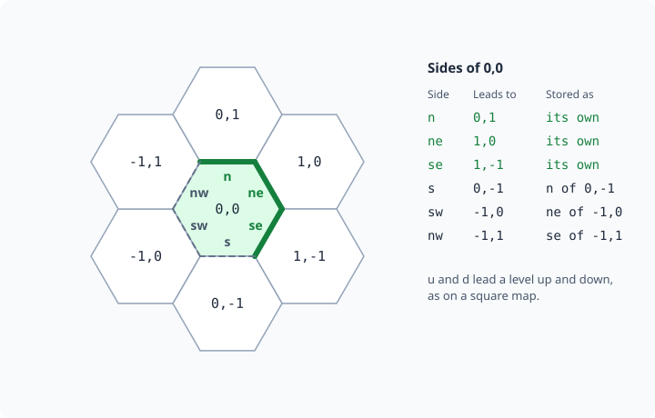
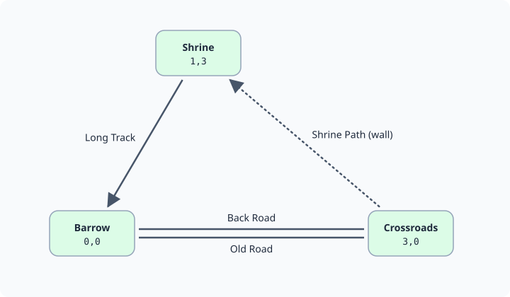

A large grid of rooms, such as a forest, a desert or open sea, takes one object for every room. A
**world map** keeps its places itself instead: each place has a terrain, may have walls and a name,
and costs no object. When someone walks onto a place, the map lends it a room, and takes the room
back once it is empty. A place that needs a real room, such as an inn, can have one of its own that
stays.

This page covers:

- [Setting it up](#setting-it-up)
- [Making a world map](#making-a-world-map)
- [Walking a map](#walking-a-map)
- [Lent rooms](#lent-rooms)
- [Rooms that stay](#rooms-that-stay)
- [Locks](#locks)
- [Hex maps](#hex-maps)
- [Graph maps](#graph-maps)
- [Changing a world map in the portal](#changing-a-world-map-in-the-portal)
- [Reading a map in softcode](#reading-a-map-in-softcode)

## Setting it up

World maps come from the World plugin, which the server loads unless an administrator turns it off under
**Plugins** on the portal's Packages page. It adds `@world` and the world functions. To walk a map, also install the
**World grid** package from the portal's Packages page, after the [World map](/guides/world-map/)
package it depends on. On a game with +help, **World grid: +help topics** adds `+help map grid`.

## Making a world map

A world map that people walk is a room that nobody enters: its exits work in every room it lends.
Make it with `@dig`, then `@world/create`, then paint its places with a terrain type. Each `@world`
switch needs control of the map.

```
> @dig Wilds
Wilds created with room number 25.
> @world/create #25
Wilds is now a world map.
> @world/paint #25/0,0:9,9=forest
Painted 100 places as forest.
> @world/paint #25/6,0:6,9=river
Painted 10 places as river.
```

A place is `x,y`, or `x,y,z` with z the level. The map's legend says how each terrain looks, as on
any map: `` MAP`LEGEND`<type>`LABEL ``, `` `TONE `` and `` `ICON ``. `` `CHAR `` is the one character
`+map` and `worlddraw()` show for it. `` `DESC `` describes the rooms the map lends, and a type whose
`` `CLOSED `` holds a reason cannot be entered.

```
> &MAP`LEGEND`FOREST`LABEL #25=Old forest
Wilds/MAP`LEGEND`FOREST`LABEL - Set.
> &MAP`LEGEND`FOREST`DESC #25=Oaks crowd the path, and the light comes down green.
Wilds/MAP`LEGEND`FOREST`DESC - Set.
> &MAP`LEGEND`RIVER`LABEL #25=River
Wilds/MAP`LEGEND`RIVER`LABEL - Set.
> &MAP`LEGEND`RIVER`CLOSED #25=The river runs too fast to wade.
Wilds/MAP`LEGEND`RIVER`CLOSED - Set.
```

A side of a place can be a wall, one-way or locked, with the reason a mover is told (locks are
below). A place can have a name of its own, and JSON data that the portal's World map shows in its
panel. A place whose data sets `"render":{"hidden":true}` shows as bare terrain to anyone who may
not examine the map: no name, data, room or walls of its own.

```
> @world/wall #25/2,2/n=wall,A fallen oak blocks the path.
The north side of 2,2,0 is now a wall.
> @world/place #25/3,4=Old Oak
Named 3,4,0 Old Oak.
> @world/data #25/3,4={"info":{"Danger":"Low"}}
Set the data of 3,4,0.
```

`help @world` lists every switch. When `@world` refuses, it says what is missing, such as
control of the map. A map it cannot find by name is named by its dbref instead.

## Walking a map

`+map/exits` opens an exit on the map for each way out of its places, and gives them to the map's
owner: ten, `North;n` to `Down;d`, on a square map and a [hex map](#hex-maps) alike. Name the map
by its dbref unless you are standing near it.

```
> +map/exits #25
[MAP] Done: Opened 10 direction exits on Wilds.
```

Each exit leads to the room on the place beside the mover's, lending one if the place has none. A
wall, a one-way side seen from the wrong end, a closed terrain and a lock the mover does not pass
refuse, with their reasons. The map's exits are a zone's exits, so a room's own exits come first.

`+map/exits` also puts `` ZONE`EXITS `` on the map: given a room and a viewer, the map's exits that
lead somewhere from it. `look` in a lent room lists those ways, and so do the Play page and a GMCP
client's room data. A way that refuses, or leads off the map, is left out.

`worldroom()` gives the room on a place, lending one if it has none. A wizard puts Wren on 2,2:

```
> think worldroom(#25,2,2)
#36
> @tel *Wren=#36
```

Wren, standing on 2,2:

```
> look
=< Old forest (2,2,0) >=======================================================
Oaks crowd the path, and the light comes down green.
> north
A fallen oak blocks the path.
> east
=< Old forest (3,2,0) >=======================================================
Oaks crowd the path, and the light comes down green.
> north
=< Old forest (3,3,0) >=======================================================
Oaks crowd the path, and the light comes down green.
```

`+map` draws the places within five of yours, north up, with `@` where you stand. Each place is its
terrain's `` `CHAR ``, else its icon when that is a character or two, else the first letter of its
label. A place with nothing painted is blank. Under the map, a key line names each type.

```
> +map
  OOOOOOROO
  OOOOOOROO
  OOOOOOROO
  OOOOOOROO
  OOOOOOROO
  OOO@OOROO
  OOOOOOROO
  OOOOOOROO
  OOOOOOROO
```

Three steps east, the river refuses:

```
> e
=< Old forest (4,3,0) >=======================================================
Oaks crowd the path, and the light comes down green.
> e
=< Old forest (5,3,0) >=======================================================
Oaks crowd the path, and the light comes down green.
> e
The river runs too fast to wade.
```

## Lent rooms

A lent room is named after its place's name, or its terrain's label and where it is. It joins the
map's zone and is set `FLOATING`, so nothing reports it as cut off from the rest of the game. It is
described by the World grid package's cell parent. To describe the rooms of a map your own way, set
`` MAP`CELLPARENT `` on the map to a parent of your own.

`@world` on a place names the room on it, and whether the room is lent:

```
> @world #25/2,2
2,2,0 on Wilds: Old forest (forest).
North: wall (A fallen oak blocks the path.)
Room: #36, lent
```

Once a lent room has held nothing for five minutes, the game takes it back: it is renamed
Spare room, leaves the map's zone and parent, and waits to be lent again to another place on its
owner's maps. A room with anyone or anything in it stays lent, and one whose map is destroyed waits
until it is empty. The game keeps at most 50 spare rooms, and
destroys a spare that has waited a week. Lent rooms and spares belong to the map's owner and count
against that player's [building quota](/guides/player-building/#your-building-quota). A wizard can take back every empty lent room at once:

```
> @world/sweep
Took back 4 empty rooms, and destroyed 0 spares.
```

## Rooms that stay

A room of your own can stand on a place, and is then the room every way onto that place leads to.
Placing it needs control of the map and of the room. It joins the map's zone, and keeps its own
name, description and exits.

```
> @dig Wayside Inn
Wayside Inn created with room number 37.
> @world/room #25/5,5=#37
Wayside Inn now stands on 5,5,0 to stay.
```

`+map/keep` keeps the lent room you stand in on its place, as it is, so it is never taken back. It
needs control of the map:

```
> +map/keep
[MAP] Done: Old forest (2,2,0) stays on 2,2,0 now.
```

`@world/room #25/5,5=` with nothing after the `=` takes the room off its place again.

## Locks

A locked side works like a locked exit. `@world/lock` gives it a key, the same keys `@lock` takes,
and a mover who passes the key goes through. The map is the locked object. The reason set with
`@world/wall` is what everyone else is told.

```
> @world/wall #25/3,3/n=lock,The ranger's gate is barred.
The north side of 3,3,0 is now locked.
> @world/lock #25/3,3/n=RANGER:yes
The north side of 3,3,0 is now locked.
```

Wren, on 3,3, is not a ranger:

```
> north
The ranger's gate is barred.
```

`@world/lock #25/3,3/n` with no key opens the side again.

The legend can also lock moving from one terrain into another, which suits mountains, deep water
and the like:

- `` MAP`LEGEND`<type>`LOCK ``: the key for entering that type from any other type. Moving between
  two places of the same type needs no key.
- `` MAP`LEGEND`<type>`LOCK`<from> ``: the key for entering it from one type, used in place of
  `` `LOCK ``. Set it for the type itself to lock moving within it.
- `` MAP`LEGEND`<type>`FAILURE `` and `` `FAILURE`<from> ``: what a refused mover is told.

`#FALSE` lets nobody in. Here the mountains are closed except to climbers coming from the forest:

```
> @world/paint #25/0,9:9,9=mountain
Painted 10 places as mountain.
> &MAP`LEGEND`MOUNTAIN`LOCK #25=#FALSE
Wilds/MAP`LEGEND`MOUNTAIN`LOCK - Set.
> &MAP`LEGEND`MOUNTAIN`LOCK`FOREST #25=CLIMBER:yes
Wilds/MAP`LEGEND`MOUNTAIN`LOCK`FOREST - Set.
> &MAP`LEGEND`MOUNTAIN`FAILURE #25=The slope is too steep to climb without gear.
Wilds/MAP`LEGEND`MOUNTAIN`FAILURE - Set.
> think worldway(#25,3,8,0,n,reason,*Wren)
The slope is too steep to climb without gear.
```

Names in a legend key are looked up from the map, so use dbrefs, flags and attributes there.

## Hex maps

A hex map's places are hexagons, so every place has six neighbours the same distance away. Make one
with `=hex` after the map:

```
> @dig Moor
Moor created with room number 36.
> @world/create #36=hex
Moor is now a world map.
> @world/paint #36/-2,-2:2,2=heath
Painted 25 places as heath.
```

A place is still `x,y`, with north at y + 1. The hexagons stand with a flat side to the north, and
each column is half a place higher than the one to its west, so a paint box draws as a slanted
block. A place's sides are `n`, `ne`, `se`, `s`, `sw` and `nw`, with `u` and `d` as on a square map.

`e` and `w` face a corner of the hexagon, not a side. Going east leads round that corner to the place
two columns over, as a square map's diagonal does: it is open when either way round is, through the
northeast place or the southeast one.

```
> think worldway(#36,0,0,0,e,to)/[worldway(#36,0,0,0,w,to)]
2,-1,0/-2,1,0
```



Walls, locks and one-way sides work as on a square map, and a side is the same side seen from either
place:

```
> @world/wall #36/0,0/sw=wall,A drystone wall.
The southwest side of 0,0,0 is now a wall.
> think worldway(#36,-1,0,0,ne)/[worldway(#36,-1,0,0,ne,reason)]
wall/A drystone wall.
> @world/wall #36/0,0/e=wall
Which side? A hex place's sides are n, ne, se, s, sw, nw, u or d: give one as <map>/<x>,<y>[,<z>]/<side>.
```

`+map/exits` opens the ten ways, and `+map` and `worlddraw()` draw two lines for each row of
places, each column two characters from the next:

```
> +map/exits #36
[MAP] Done: Opened 10 direction exits on Moor.
> think worlddraw(#36,0,0,0,2,@)
    H
  H   H
H   H   H
  H   H
H   @   H
  H   H
H   H   H
  H   H
    H
```

### Pointy hexagons

A `pointy-hex` map stands its hexagons on a corner instead, so their sides face `ne`, `e`, `se`,
`sw`, `w` and `nw`. East is x + 1 and northeast y + 1, and each row is half a place east of the one
below it. Here `n` and `s` face a corner, and lead round it to the place two rows over:


```
> @dig Carr
Carr created with room number 57.
> @world/create #57=pointy-hex
Carr is now a world map.
> @world/paint #57/-2,-2:2,2=reeds
Painted 25 places as reeds.
> @world/wall #57/0,0/w=wall,A dyke.
The west side of 0,0,0 is now a wall.
> think worldway(#57,-1,0,0,e)/[worldway(#57,-1,0,0,e,reason)]
wall/A dyke.
> think worldway(#57,0,0,0,n,to)/[worldway(#57,0,0,0,s,to)]
-1,2,0/1,-2,0
> +map/exits #57
[MAP] Done: Opened 10 direction exits on Carr.
> think worlddraw(#57,0,0,0,2,@)
  R R R
 R R R R
R R @ R R
 R R R R
  R R R
```

`+map` and `worlddraw()` draw a pointy map a row a line, each row a character east of the one below.

The portal's World map draws both kinds as hexagons, with each wall on its side and each room a
smaller hexagon inside the place it stands on.

## Graph maps

A graph map's places have no sides and no neighbours. They are joined only by the ways you make
between them, each with names, as an exit has. Use one for a road map, a set of islands or a
dungeon where only some places lead to others. A place is still `x,y` or `x,y,z`, and that is where
the World map draws it, but places side by side are not joined unless a way joins them.

`@world/link` makes a way. Give the place it leads to and its names, `;` between them: the first is
shown, and any of them walks it. Give names back as well and the way back is made too.

```
> @dig Downs
Downs created with room number 75.
> @world/create #75=graph
Downs is now a world map.
> @world/paint #75/0,0=grass
Painted 1 place as grass.
> @world/paint #75/3,0=grass
Painted 1 place as grass.
> @world/paint #75/1,3=wood
Painted 1 place as wood.
> @world/link #75/0,0=3,0,Old Road;road,Back Road;back
Old Road leads from 0,0,0 to 3,0,0, and Back Road from 3,0,0 back.
> @world/link #75/3,0=1,3,Shrine Path;shrine
Shrine Path leads from 3,0,0 to 1,3,0.
> @world/link #75/1,3=0,0,Long Track;track
Long Track leads from 1,3,0 to 0,0,0.
```



A way leads to any place on the map, on any level. A place has at most 64 ways out. Linking a way
with the same first name out of the same place replaces it. To remove a way, name it with no `=`;
the way back stays:

```
> @world/link #75/1,3/track
Removed the way Long Track out of 1,3,0.
```

`@world/wall` and `@world/lock` take a way's name where a side goes. A way is `open`, `wall` or
`lock`. A walled way stays on the map and refuses with its reason. A way already leads one way, so
it is never `oneway`: link a way back for a road that goes both ways.

```
> @world/wall #75/3,0/shrine=wall,Brambles block the path.
The way Shrine Path out of 3,0,0 is now a wall.
> think worldway(#75,0,0,0,road,to)/[worldway(#75,3,0,0,back,to)]
3,0,0/0,0,0
> think worldway(#75,3,0,0,shrine)/[worldway(#75,3,0,0,shrine,reason)]
wall/Brambles block the path.
> think worldway(#75,0,0,0,n)
none
```

`+map/exits` opens one exit for each way name on the map, rather than the ten directions. Ways out
of different places with the same first name share one exit, which takes the way out of the mover's
place:

```
> +map/exits #75
[MAP] Done: Opened 3 way exits on Downs.
```

The portal's World map draws each place as a box and each way as a line between two places on the
level shown. A way to another level is not drawn. A way with a way back is two lines side by side. A way with no way back ends in an arrow. A wall is
dotted and a lock dashed, and each line has the way's first name beside it.

## Changing a world map in the portal

On the portal's World map, **Edit map** on a grid map you control shows a World map section. On a
map that is not a world map yet, **Make this a world map** plans `@world/create`, **Make this a
flat-topped hex world map** plans it with `=hex`, **Make this a pointy-topped hex world map**
with `=pointy-hex`, and **Make this a graph world map, its places joined by named ways** with
`=graph`. On a world map:

- Click the map to choose a place. The paint box starts on it: give the far corner and a terrain
  type, or pick one of the legend's types, and **Paint**. An empty type erases.
- The chosen place takes a name, a side (on a hex map one of its six, or up or down) set open, wall, one way or locked with the reason a
  refused player is told, **Hide from players** or **Show to players**, and a room you control
  placed on it by its dbref. A locked side keeps its key; give it one in the game with
  `@world/lock`.
- On a graph map, the chosen place lists its ways, each with **Remove**. Give the x, y and z of the
  place a new way leads to, its names and, if you like, the names of the way back, and **Add way**.
  The way's passage is set open, wall or locked with **Set way**.
- **Open the direction exits** runs `+map/exits`. It needs the World grid package, and the map must
  be a room.

Each change is the `@world` command you would type. Nothing runs until you review and apply them,
as for any map. See [Changing a map in the portal](/guides/world-map/#changing-a-map-in-the-portal).
Rooms standing on a place are reached by the map's own exits, so the review does not warn that
they have no way in.

## Reading a map in softcode

| Function | Gives |
|---|---|
| `worldmap(<map>[, <field>])` | the map's space (`square`, `hex`, `pointy-hex` or `graph`), its sides, the directions `worldway()` takes there (on a graph map, its ways and their names), its levels and its painted box |
| `worldcell(<map>, <x>, <y>[, <z>[, <field>]])` | a place's terrain, label, name, data, room, its ways on a graph map, and more |
| `worldway(<map>, <x>, <y>, <z>, <direction>[, <field>[, <mover>]])` | where a way out of a place leads, and whether it is open, for a mover if one is named; on a graph map, the way is named instead of a direction |
| `worlddraw(<map>, <x>, <y>[, <z>[, <radius>[, <mark>]]])` | the places around one, drawn as text, as `+map` does |
| `worldroom(<map>, <x>, <y>[, <z>])` | the room on a place, lending one if it has none |
| `worldplace(<room>[, <field>])` | the place a room stands on |

With the Wayside Inn still standing on 5,5:

```
> think worldroom(#25,5,5)
#37
> think worldplace(#37)
5,5,0
```

`worldroom()` needs control of the map, and lends a room, so it is a side-effect function. See
`help world functions` for every field.
