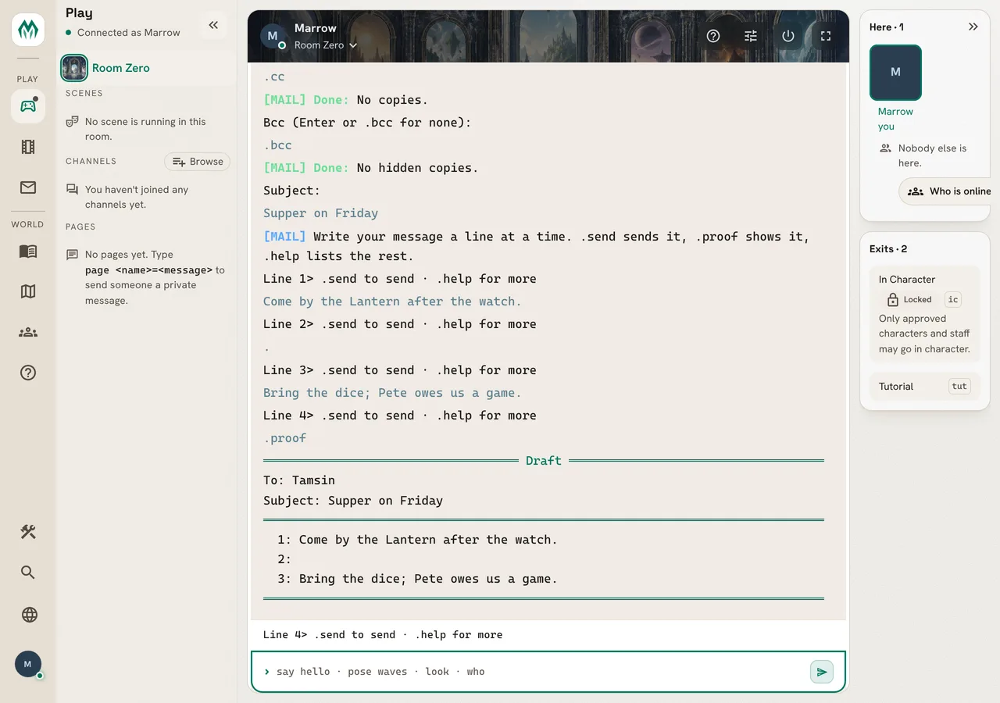

import { Aside } from '@astrojs/starlight/components';

**`+compose`** writes a mail message a line at a time. It asks who the message is to and the subject,
then takes each line you type as the next line of the message until you send
it. Nothing you type is run or evaluated while you write, so brackets, percent signs and semicolons
go in exactly as typed. It works from any MU\* client and from the website's Play terminal.

| You are | You want to | Read |
|---|---|---|
| A player | write and send a message | [Writing a message](#writing-a-message) |
| A player | skip the prompts | [Starting with the names](#starting-with-the-names) |
| A player | fix a line, or change who it goes to | [Editing](#editing) |
| A player | know what each reader sees | [What readers see](#what-readers-see) |
| A player | stop and finish later | [Stopping and going on later](#stopping-and-going-on-later) |
| A player | know what goes wrong and why | [When it refuses](#when-it-refuses) |
| Staff | install it, or end a player's composer | [For staff](#for-staff) |

In the game, `help +compose` has the same commands in short form. `@mail/send` still sends a
one-line message; see [Playing a Game](/guides/playing/#mail).

## Writing a message

`+compose` on its own asks who the message is to, then the subject:

```text
> +compose
To (player names, or .abort to stop):
> Tamsin, Old Pete
Subject:
> Dock rota
[MAIL] Write your message a line at a time. .send sends it, .proof shows it, .help lists the rest.
Line 1> .send to send · .help for more
> Morning watch is yours this week.
Line 2> .send to send · .help for more
>
Line 3> .send to send · .help for more
> Bring the lantern [the brass one] and 20% more oil; the last was short.
Line 4> .send to send · .help for more
```

`.proof` shows the message as it stands, its lines numbered, and `.send` sends it:

```text
> .proof
===================================< Draft >==================================
To: Tamsin, Old Pete
Subject: Dock rota
==============================================================================
  1: Morning watch is yours this week.
  2:
  3: Bring the lantern [the brass one] and 20% more oil; the last was short.
==============================================================================
Line 4> .send to send · .help for more
> .send
MAIL: You sent your message to Tamsin.
MAIL: You sent your message to Old Pete.
```

Separate players with commas or spaces. A part between commas that is one player's whole name is
that player, so `Tamsin, Old Pete` needs no quotes. A dbref, `me` and a mail alias such as `+crew`
work too.

A line that has to start with a dot starts with two instead: `..send` adds the line `.send`.

### In the Play terminal

The website's Play terminal does not send an empty line. There, type a line of only `.` for a blank
line in the message:



## Starting with the names

`+compose <players>` fills in To and asks only for the subject. `+compose <players>=<subject>` goes
straight to the message:

```text
> +compose Tamsin=Cargo list
[MAIL] Write your message a line at a time. .send sends it, .proof shows it, .help lists the rest.
Line 1> .send to send · .help for more
```

## Editing

| Type | To |
|---|---|
| `.send` | send the message |
| `.proof` | show the message, its lines numbered |
| `.edit <n> <text>` | replace line `<n>` |
| `.insert <n> <text>` | put a line before line `<n>` |
| `.delete <n>` | take out line `<n>` |
| `.to <players>` | change who it is to |
| `.subject <text>` | change the subject, at most 60 characters |
| `.urgent` | send it urgent, or not |
| `.quit` | stop, and keep the draft for later |
| `.abort` | stop, and throw the draft away |
| `.help` | list these |

Line numbers are the ones `.proof` shows:

```text
> .proof
===================================< Draft >==================================
To: Tamsin
Subject: Cargo list
==============================================================================
  1: Two crates of salt.
  2: Rope, fifty fathoms.
  3: Lamp oil.
==============================================================================
Line 4> .send to send · .help for more
> .edit 2 Rope, a hundred fathoms.
[MAIL] Done: Line 2 is now: Rope, a hundred fathoms.
Line 4> .send to send · .help for more
> .insert 1 For Thursday's boat:
[MAIL] Done: Line 1 is now: For Thursday's boat:
Line 5> .send to send · .help for more
> .delete 4
[MAIL] Done: Line 4 is taken out.
Line 4> .send to send · .help for more
> .urgent
[MAIL] Done: It will be sent urgent.
Line 4> .send to send · .help for more
> .send
MAIL: You sent your message to Tamsin.
```

## What readers see

The message comes from you, as `@mail` sends it, with your mail signature, and holds exactly the
lines you wrote. Tamsin and Old Pete each read this:

```text
> @mail 6
=< Message 0:6 >==============================================================
From:    Marrow
Date:    Fri Nov 27 22:59 2026
Status:  Unread
Subject: Dock rota
==============================================================================
Morning watch is yours this week.

Bring the lantern [the brass one] and 20% more oil; the last was short.
==============================================================================
```

A player named twice, or named and also in a mail alias you name, gets one copy.

## Stopping and going on later

A character has one draft, kept on the character until it is sent or thrown away.

```text
> +compose Tamsin, Old Pete=Harbour fees
[MAIL] Write your message a line at a time. .send sends it, .proof shows it, .help lists the rest.
Line 1> .send to send · .help for more
> The harbourmaster wants
Line 2> .send to send · .help for more
> .quit
[MAIL] Your draft is kept. Type +compose to go on with it.
```

`+compose` on its own goes on with it, at the prompt where you stopped:

```text
> +compose
[MAIL] Going on with your draft to Tamsin, Old Pete (Harbour fees). .proof shows it.
Line 2> .send to send · .help for more
> the fees paid by Friday.
Line 3> .send to send · .help for more
> .send
MAIL: You sent your message to Tamsin.
MAIL: You sent your message to Old Pete.
```

The draft is also kept when you disconnect, when you type `@input/cancel`, after an hour with the
composer open, and when staff end it. `.abort` throws it away.

## When it refuses

Each refusal says what to do, and the composer stays open unless it says otherwise.

| You | It says |
|---|---|
| name someone it cannot find | `I can't find 'Tamzin'. Type whole names, dbrefs or +aliases, and separate them with commas when a name has a space in it.` It asks again. |
| type a name with a space without commas, as `Old Pete Tamsin` | `I can't find 'Old', 'Pete'.` Type `Tamsin, Old Pete` instead. |
| send with no lines | `The message is empty. Write at least one line first.` |
| mistype a command, as `.sned` | `There is no .sned command. .help lists them. To write a line that starts with a dot, start it with two.` The line is not added. |
| give a line number that is not there | `Type .edit <n> <text> with a line number from 1 to 1. .proof numbers the lines.` |
| give a subject over 60 characters | `A subject is at most 60 characters, so it was cut to: ...` |
| add, edit or insert past the game's longest message | `That would make the message longer than <limit> bytes, so the draft is unchanged.` (`That line would make...` for a new line, which is left out) |
| send to someone whose mail lock refuses you | `@mail`'s own reason, then `Not sent. Your draft is still open.` |
| start a new message with a draft kept | `You have an unsent draft to Tamsin, Old Pete (Harbour fees). Type +compose on its own to go on with it.` |

When some readers take the message and others refuse it, those who took it have it and the draft
is gone; `@mail` names each one it could not reach.

## For staff

### Installing

The composer is the bundled `mail-composer` package, under Essentials. Tick **Mail composer** in the
last step of the setup wizard, or install it later from **Admin**, **Packages**. It adds `+compose`
and a Mail Composer object, and nothing else.

### Ending a player's composer

`@input/rescue <player>` ends a composer that is stuck open. The player keeps the draft:

```text
> @input/rescue Marrow
Ended Marrow's input session. Its timeout callback runs now.
```

Marrow sees:

```text
A staff member ended your input session.
[MAIL] +compose has stopped. Your draft is kept. Type +compose to go on with it.
```

<Aside>
The draft lives on the character, in attributes under `MAILDRAFT` that only the composer can change.
A wizard can read them with `examine <player>/MAILDRAFT**`.
</Aside>
