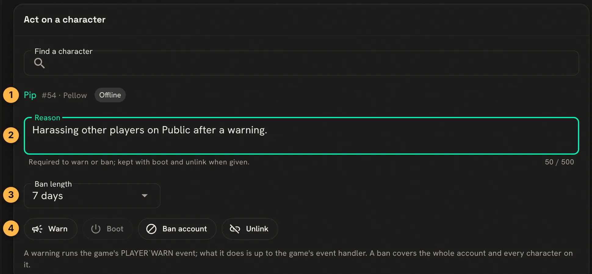
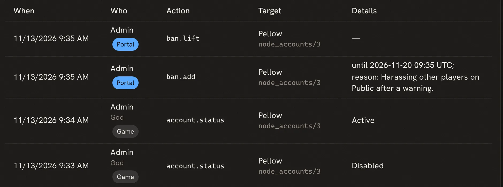

import { Aside } from '@astrojs/starlight/components';

When a player causes trouble, staff can warn them, disconnect them, or ban their account. A ban
covers the whole account, so every character on it is shut out together. Names and sites can be
blocked before anyone connects. Each of these actions is written to the audit log, whether it was
taken in the portal or in the game.

These need the `players.moderate` permission, which the `moderator` and `wizard` roles hold. See
[Staff Roles and Permissions](/guides/roles).

The examples follow Pip, a character on the account Pellow.

## On the Moderation page

**Build & manage**, **Moderation** (`/admin/moderation`) puts the common actions in one place:



1. Find the character by name. The line shows its account and whether it is online.
2. Write a reason. Warn and Ban need one, and it goes into the audit log.
3. Choose how long a ban lasts, or make it permanent.
4. Act:
   - **Warn** runs the game's ``PLAYER`WARN`` event. What a warning does is up to the game's event
     handler.
   - **Boot** disconnects the character. It is only available while they are online.
   - **Ban account** signs out the account and every character on it, and keeps them out until the
     ban ends.
   - **Unlink** takes the character off its account.

A banned player who tries to connect is told how long the ban lasts:

```
This account is banned until 2026-11-20 09:35 UTC.
```

**Banned accounts**, lower on the page, lists every ban with its reason, who set it and when it ends.
**Lift ban** there ends one early.

## In the game

The same work has commands, for staff who stay in a MU\* client.

`@boot *Pip` disconnects a character at once. Pip can connect again straight away, so pair it with
a warning or a ban.

`@account/disable` keeps an account out until `@account/enable` lets it back in. It signs out the
account's characters at once:

```
> @account/disable Pellow
Account 'Pellow' disabled; active sessions revoked.
> @account/enable Pellow
Account 'Pellow' enabled.
```

Pip, trying to connect while it is disabled, gets `This account is disabled.`

`@account Pellow` shows an account and its characters, and `@account/list` every account with its
state.

## Blocking names

`@sitelock/name` stops new characters from taking a name. `*` and `?` work as wildcards:

```
> @sitelock/name Grief*
Name Grief* locked.
```

A player who then tries `create Griefer ...` is told `That name is not allowed.` Wizards, and a player
who already has the name, are not affected. `@sitelock/name !Grief*` lifts it, and `@sitelock/name` lists
them. The portal edits the same list at **Banned names** (`/admin/config/bannednames`).

## Blocking a site

`@sitelock/ban` refuses connections, new characters and guests from a host or address:

```
> @sitelock/ban *.badhost.example
```

A pattern can be a wildcard, an IP address or a range such as `10.0.0.0/8`. Connections the new rule
blocks are dropped. `@sitelock` lists the rules, and `@sitelock/remove *.badhost.example` deletes one.
`help @sitelock` covers the finer options, such as allowing connections but not new characters. The
Moderation page shows the rules under **Host bans**, and **Manage the sitelock** edits them.

<Aside>
A ban on an account follows the player to any site. A site ban follows a site to any account. Use
the account ban first; block a site when the same person keeps making new accounts from it.
</Aside>

## The audit log

**Audit log** (`/admin/audit`) lists staff actions, newest first, with who took each one, whether in
the portal or the game, and its details:



Filter it by action, by who acted, by target, or by date.

## Next steps

- [Staff Roles and Permissions](/guides/roles) to decide who can moderate.
- `help @sitelock`, `help @account` and `help @boot` in the game.
