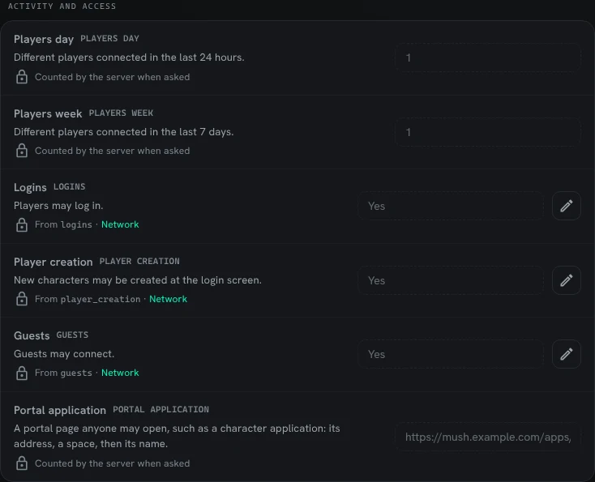

MU\* directories find out about a game by asking it. They connect and request its **MSSP** report
(the MUD Server Status Protocol), a list of named values such as its name, genre and how many
players are on. SharpMUSH answers on every telnet connection that asks, and to anyone who types
`MSSP-REQUEST` at the login screen.

This page covers:

- [Filling in your game's details](#filling-in-your-games-details)
- [What the server reports itself](#what-the-server-reports-itself)
- [Activity and access](#activity-and-access)
- [Seeing the report](#seeing-the-report)

## Filling in your game's details

Open **Admin**, then **Configuration**, then **MSSP** under Server. The page lists every variable
the MSSP specification defines, in its groups. Fill in the ones that describe your game, such as
**Genre**, **Contact** and **Discord**, and press **Save**. **Other variables** at the bottom takes
any name the list does not have; directories read names they have never heard of.

You need the `config.admin` permission. Importing a PennMUSH `mush.cnf` carries over its
`mssp name/value` lines.

## What the server reports itself

Greyed rows are values the server fills in, and you cannot type over them. Each says where it comes
from:

- **From an option**, such as **Name** from `mud_name` or **Website** from `mud_url`. The link
  beside it opens the page where that option is set.
- **Counted by the server when asked**, such as **Players**, the number connected now.
- **Reported by SharpMUSH**, such as the codebase and the protocols it speaks.

## Activity and access

A directory that only sees how many players are on right now cannot tell a quiet hour from a game
nobody plays any more. So beyond the specification, SharpMUSH also reports these:



| Variable | Value |
|---|---|
| `PLAYERS DAY` | How many different players connected in the last 24 hours. |
| `PLAYERS WEEK` | How many different players connected in the last 7 days. |
| `LOGINS` | `1` when players may log in, from the `logins` option. |
| `PLAYER CREATION` | `1` when new characters may be created at the login screen, from `player_creation`. |
| `GUESTS` | `1` when guests may connect, from `guests`. |
| `PORTAL APPLICATION` | One value for each portal page anyone with a character may open: its address, a space, then its name. |

- The server notes who is connected once a minute, so someone who connects and leaves within a
  minute may not be counted. Only the counts leave the game, never names.
- The counts survive a restart: the server keeps the hour it last saw each player for a week.
- **Portal application** lists [Portal Applications](/guides/applications/) whose minimum role is
  Guest or Player and that need no permission, such as a character application, so a directory
  can link to them. Staff pages are left out. The addresses are built from `mud_url`, so none is
  reported while it is unset.

There is nothing to set: these appear in every report.

## Seeing the report

The **Report** panel on the right of the MSSP page shows what the game sends right now. From any
MUD client, type `MSSP-REQUEST` at the login screen:

```
> MSSP-REQUEST
MSSP-REPLY-START
NAME	SharpMUSH
PLAYERS	1
...
PLAYERS DAY	1
PLAYERS WEEK	1
LOGINS	1
PLAYER CREATION	1
GUESTS	1
PORTAL APPLICATION	https://mush.example.com/apps/chargen Character Application
MSSP-REPLY-END
```

Each line is a name, a tab, and a value. A variable with several values repeats its name on one
line per value.
