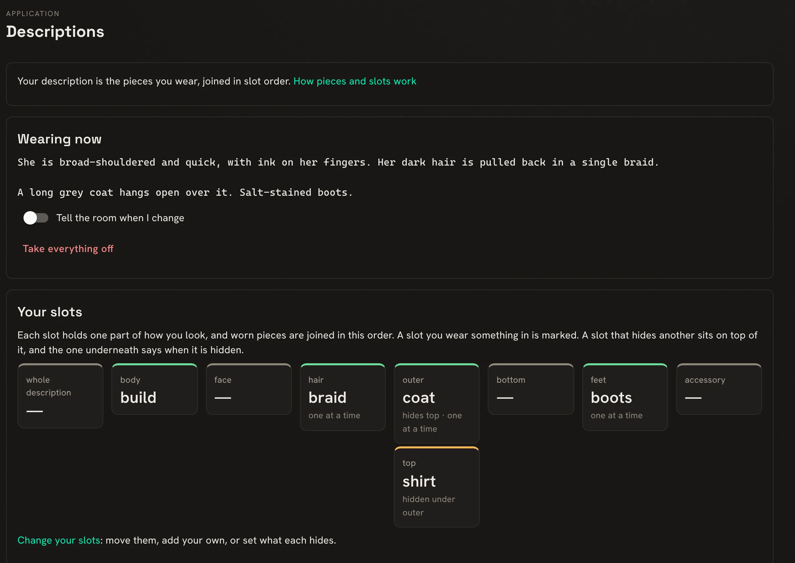

The multidescer package lets a character keep more than one description and change between them,
as the multi-descers on RhostMUSH and PennMUSH games do. A description can be one whole text, or be
put together from **pieces**, each in a **slot** such as hair, top or feet, so a player changes a
coat without rewriting the rest. A set of pieces can be saved as an **outfit**.

| You want to | Read |
|---|---|
| turn it on | [Installing](#installing) |
| save and wear a whole description | [Whole descriptions](#whole-descriptions) |
| build a description from pieces | [Pieces and slots](#pieces-and-slots) |
| change your own slots | [Your slots](#your-slots) |
| save what you wear | [Outfits](#outfits) |
| set a one-line look | [Short description](#short-description) |
| do it all on the website | [The Descriptions page](#the-descriptions-page) |
| set the game's slots and limits | [Staff settings](#staff-settings) |

The examples follow Ada, a character with a few outfits for the docks. The picture shows Ariel, another player.

## Installing

Install the packages from **Packages** in Build & manage:

| Package | Adds |
|---|---|
| multidescer | `+desc`, `+wear`, `+remove` and `+shortdesc` |
| multidescer-app | the **Descriptions** page in the portal, under Play |
| multidescer-help | the topics in `+help`. Needs the plus-help package |
| multidescer-config | the settings in `+config`. Needs the plus-config package |

The first time a character wears something, the description they had is saved as `original`, so
nothing is lost.

## Whole descriptions

`+desc <name>=<text>` saves a description and `+desc <name>` wears it:

```
> +desc winter=A tall woman bundled in grey wool.
[DESC] Saved the description 'winter'. +desc winter wears it.
> +desc winter
[DESC] You now wear winter.
```

`+desc` on its own lists what you have saved and what you wear:

```
> +desc
+===========================< Ada * descriptions >===========================+
| Wearing: winter                                                            |
|                                                                            |
| Name                                                           Slot   On   |
| winter                                                         whole  worn |
+============================================================================+
| +desc <name> wears one * +wear <name> adds one * +desc/save <name>=<text>  |
| saves one * +desc/slots                                                    |
+============================================================================+
```

What you type is evaluated as you, as `say` is. To keep `[`, `]` or `%` as they are, put a `\`
before each.

## Pieces and slots

`+desc/save <slot>/<name>=<text>` saves a piece in a slot. `+desc` with several names joined by `+`
wears them together, and `look` shows them in slot order:

```
> +desc/save body/build=She is broad-shouldered and quick.
[DESC] Saved the body piece 'build'. +wear build wears it.
> +desc/save top/shirt=A linen shirt is rolled to the elbows.
[DESC] Saved the top piece 'shirt'. +wear shirt wears it.
> +desc build + shirt
[DESC] You now wear build and shirt.
> look me
Ada(#21PenAc)
She is broad-shouldered and quick.

A linen shirt is rolled to the elbows.
```

`+wear` puts a piece on over what you wear, and `+remove` takes one off, leaving the rest:

```
> +desc/save outer/coat=A long grey coat hangs open.
[DESC] Saved the outer piece 'coat'. +wear coat wears it.
> +wear coat
[DESC] You put on coat.
> +remove coat
[DESC] You took off coat.
```

Add `/noisy` to `+desc`, `+wear` or `+remove` to tell the room, such as `Ada puts on coat.`

`+desc/slots` lists your slots in the order they are joined. Slots in the same paragraph run on
together. Some slots hold one piece at a time, such as `feet`, and some hide others: while you wear
something in `outer`, what you wear in `top` does not show.

```
> +desc/slots
+==================================< Slots >=================================+
| Slot       Paragraph    Hides                                         Max  |
| whole      description  -                                             none |
| body       body         -                                             none |
| face       body         -                                             none |
| hair       body         -                                             1    |
| top        clothes      -                                             none |
| outer      clothes      top                                           1    |
| bottom     clothes      -                                             none |
| feet       clothes      -                                             1    |
| accessory  clothes      -                                             none |
+============================================================================+
```

A whole description can hold a slot's place: write the slot's name in angle brackets, such as
`<face>`, and the pieces worn in that slot are read there.

## Your slots

Everyone starts with the game's slots. The first time you change one, you get a list of your own:

```
> +desc/addslot scars=face
[DESC] Added the slot 'scars' after 'face', in the body paragraph. +desc/save scars/<name>=<text> saves a piece in it.
> +desc/slot outer/hides=top scars
[DESC] While you wear a piece in 'outer', your pieces in 'top' and 'scars' do not show.
```

| Command | Does |
|---|---|
| `+desc/addslot <slot>=<after>` | adds a slot after another |
| `+desc/slot <slot>/after=<slot>` | moves a slot |
| `+desc/slot <slot>/paragraph=<name>` | puts it in a paragraph; `none` makes it one of its own |
| `+desc/slot <slot>/hides=<slots>` | hides those slots while it holds a piece; `none` hides nothing |
| `+desc/slot <slot>/max=<number>` | sets how many pieces it holds at once; `0` or `none` is no limit |
| `+desc/slot <slot>/name=<name>` | renames it, pieces and all |
| `+desc/delslot <slot>` | takes it away; its pieces stay saved |
| `+desc/resetslots` | goes back to the game's slots |

A slot cannot hide one that already hides it. When a slot is taken away, the slots that hid it hide
what it hid.

## Outfits

`+desc/outfit <name>` saves what you wear as an outfit. `+desc <outfit>` wears exactly those pieces,
and `+wear <outfit>` adds them:

```
> +desc/outfit market
[DESC] Saved the outfit 'market': build, shirt, and coat. +desc market wears it.
```

`+desc/view <name>` shows a piece or an outfit as `look` would, `+desc/replace` gives a piece new
text, `+desc/rename` renames one, and `+desc/delete` deletes one. A deleted piece comes off and out of
every outfit.

## Short description

`+shortdesc` sets a line about how you look at a glance, for other commands and pages to show. It
does not change with `+desc` or `+wear`:

```
> +shortdesc A tall woman in grey wool.
[DESC] Your short description is now: A tall woman in grey wool.
```

`+shortdesc/clear` clears it.

## The Descriptions page

With multidescer-app installed, **Descriptions** under Play shows what you wear now and a board of
your slots. A slot that hides another sits on top of it, and the one underneath says it is hidden.
Below are your pieces by slot and your outfits, with forms to write, change, wear and delete them.
**Change your slots** opens a page that moves, adds, renames and takes away your slots, and **How
pieces and slots work** is a short guide drawn with your own slots.



Text written on the page is kept exactly as written. Tick that it is code to have it evaluated, as
it is when typed in the game.

## Staff settings

Staff with `config.admin` set the slots players start with and the limits, with `+config`:

```
> +config multidescer/max-entries=50
[CONFIG] Done: multidescer/max-entries is now 50, was 100.
```

| Setting | Default | What it does |
|---|---|---|
| `length` | 8000 | the longest text of one piece |
| `max-entries` | 100 | how many pieces and outfits one character keeps |
| `max-slots` | 30 | how many slots a player's own list holds |
| `name-length` | 30 | the longest name of a piece or outfit |
| `short-length` | 100 | the longest `+shortdesc` |
| `slots` | 9 entries | the slots every player starts with |

`+config multidescer/slots/<slot>/<field>=<value>` changes a starting slot's `order`, `paragraph`,
`covers` or `max`, and `+config/add` and `+config/remove` add and take away slots. A player who has
changed their own slots keeps their copy until they type `+desc/resetslots`.

A character's pieces and outfits are kept on the character under `MULTIDESC`, flagged so that only
the package changes them. The short description is `SHORTDESC`.
