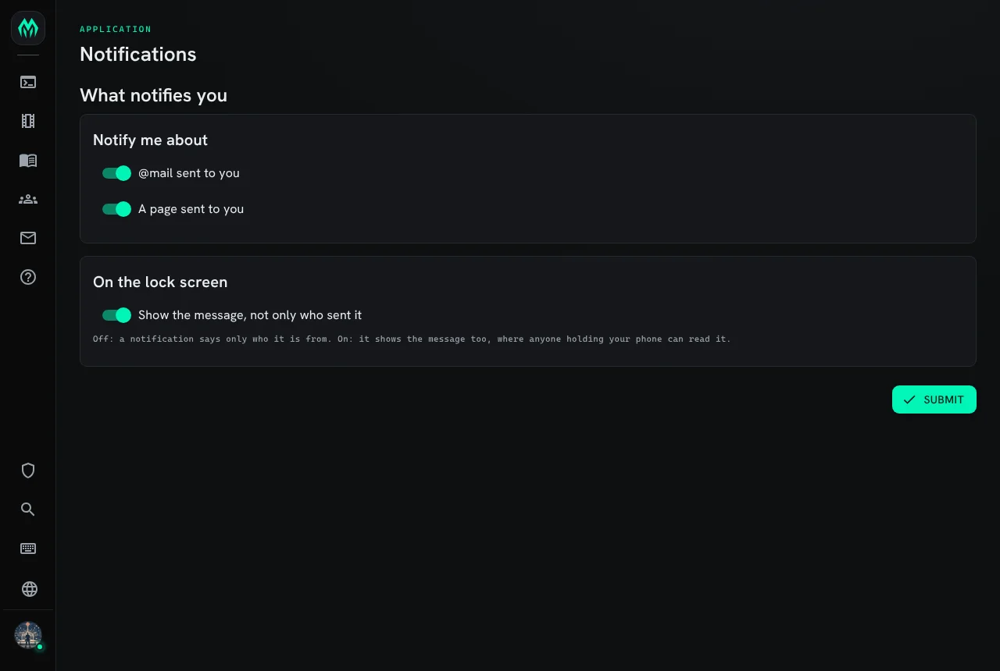

import { Aside } from '@astrojs/starlight/components';

A **notification** tells your phone or computer that something happened in the game while you were
away, the same way a chat app does. With the bundled notifications package, a page or new `@mail`
sends one. Tapping it opens the portal as the character it was for.

| You are | You want to | Read |
|---|---|---|
| A player | get notifications on a phone or computer | [Turning notifications on](#turning-notifications-on) |
| A player | choose what notifies you | [Choosing what notifies you](#choosing-what-notifies-you) |
| Staff | set it up for the game | [Running notifications](#running-notifications) |
| A package author | notify players from your own code | [Sending notifications from softcode](#sending-notifications-from-softcode) |


## Turning notifications on

Notifications are turned on for each phone or computer, in the portal:

1. Sign in to the portal and open **Settings**, then **Notifications**.
2. Choose **Turn on**. The browser asks whether the site may show notifications; allow it.
3. Choose **Send a test**. A notification saying "Notifications are on for this device." should
   arrive within a few seconds.


**Your devices** on the same page lists every phone and computer with notifications on for your
account, when each was last sent one, and any that failed. Remove one there, or choose **Turn off**
on the device itself.

Notifications belong to your account, so one device gets them for every character on it. Each
notification says which character it is for, and opening it switches the portal to that character.

### iPhone and iPad

On an iPhone or iPad, a website can only show notifications once it is on the home screen:

1. Open the portal in Safari.
2. Tap **Share**, then **Add to Home Screen**.
3. Open the portal from the new icon, then follow the steps above.

### When you are notified

You are notified only while you are away. Nothing is sent while you have typed something in the
game in the last five minutes, or while a portal tab of yours is open in front of you. The game
decides how long counts as away; `push_idle_seconds` is five minutes unless your staff changed it.

## Choosing what notifies you

Each character chooses for itself. `+notify` lists the choices:

```
> +notify
╔══════════════════════════════╡ Notifications ╞═════════════════════════════╗
║ Setting  On   What it covers                                               ║
║ ----------------------------------------------------                       ║
║ mail     on   @mail sent to you                                            ║
║ page     on   A page sent to you                                           ║
║ preview  off  Show the message, not only who sent it                       ║
╠════════════════════════════════════════════════════════════════════════════╣
║ +notify <setting>=on or off changes one. Turn notifications on for a phone ║
║ or browser in the portal: Settings, Notifications.                         ║
╚════════════════════════════════════════════════════════════════════════════╝
```

`+notify <setting>=on` or `off` changes one:

```
> +notify mail=off
[NOTIFY] Done: mail is off: @mail sent to you.
> +notify preview=on
[NOTIFY] Done: preview is on: Show the message, not only who sent it.
```

**preview** starts off. With it off, a locked phone shows only who wrote to you, such as
"Page from Tobin", never what they said. Turn it on to see the page itself, or the subject of the
mail.

The portal has the same choices as switches: on **Settings**, **Notifications**, choose
**Choose what notifies you**.



## Running notifications

### Installing

The notifications packages ship with the server but are not installed on a new game. An
administrator installs them from the portal:

1. Open **Packages** in the admin area and choose **Browse**.
2. Install `notifications`. It gives `+notify` and sends a notification for pages and new mail. It
   needs `http-handler` and `plus-help`, which a new game already has.
3. Install `notifications-app` for the portal page where players choose what notifies them. It
   opens from **Settings**, **Notifications**.

Players can turn notifications on for their devices without the packages, but nothing sends one
until something runs [`@push`](#push).

### What the server needs

- **Outgoing HTTPS** to the browsers' push services: `fcm.googleapis.com` (Chrome), `updates.push.services.mozilla.com` (Firefox), `*.push.apple.com` (Safari) and
  `*.notify.windows.com` (Edge on Windows). The server refuses a device that names any other host.
  `WebPush__AdditionalHosts__0` adds one, for a browser that uses a push service of its own.
- **A contact address**. Every notification carries one, so a push service can reach whoever runs
  the game. The server uses `mud_url` when it is an `https` address. Set `WebPush__Subject` to a
  `mailto:` or `https:` address to use a different one. Without either, the server logs a warning,
  and some push services refuse the notifications.
- **HTTPS for the portal**. Browsers allow notifications only on a site served over HTTPS (or on
  `localhost`).

### The signing key

The server signs every notification with a key it makes the first time it needs one. It keeps the
key as the secret `push.vapid` in [the secret store](/guides/secrets), so it is in every backup:

```
> @secret
...
│ push.vapid     stored      2026-10-15 04:50 by      The key web push       │
│                            SharpMUSH(#1)            notifications are      │
│                                                     signed with. Made on   │
│                                                     first use; clearing it │
│                                                     makes a new one, and   │
│                                                     every browser has to   │
│                                                     turn notifications on  │
│                                                     again.                 │
...
```

`@secret/clear push.vapid` replaces it. The server makes a new key the next time it needs one, and
every device has to turn notifications on again: **Your devices** marks the old ones.

### Limits

- `push_idle_seconds` (300) is how long a player goes without typing before they count as away.
- `push_limit` (10) is how many notifications one character is sent in a minute. Past it, the rest
  are dropped.

`@config limit` lists both, and `@config/set` changes them.

## Sending notifications from softcode

### @push

`@push <player>=<title>,<text>,<path>,<topic>` sends a notification to every device the player's
account turned notifications on in. Only the title is required.

- `<path>` is the portal page a tap opens, such as `/mail` or `/play`.
- A later notification with the same `<topic>` for the same character replaces the earlier one, so
  ten pages from one person show as one.
- `@push` sends nothing while the player is at the game; `/always` sends anyway. `/urgent` asks the
  push service to wake a device that is saving power.

It needs the `notify.push` permission, which the wizard role allows. Its output is one word, read
with `%>`:

```
> &SEND me=@push Mira=Page from Tobin,,/play,page-tobin; think %>
> @include me/SEND
sent
> &SEND me=@push Tobin=Your scene starts soon; think %>
> @include me/SEND
none
```

`none` means the player has no device with notifications on, `attended` that they are at the game,
and `limited` that they passed `push_limit`. `help @push` has the details.

### Adding a kind of notification

`@push` sends whatever it is told, so a package that wants to notify players about something else
should go through the notifications package instead. Then each player can turn it off with
`+notify`, and the text stays hidden until they turn preview on.

A kind is two attributes on the **Notifications** object in the master room: what it covers, and
whether it is on until a player turns it off. This adds one for replies to `+jobs`:

```
> &DATA`KIND`JOB #15=A reply to one of your +jobs
Notifications/DATA`KIND`JOB - Set.
> &DATA`KIND`JOB`DEFAULT #15=1
Notifications/DATA`KIND`JOB`DEFAULT - Set.
> +notify
╔══════════════════════════════╡ Notifications ╞═════════════════════════════╗
║ Setting  On   What it covers                                               ║
║ ----------------------------------------------------                       ║
║ job      on   A reply to one of your +jobs                                 ║
║ mail     on   @mail sent to you                                            ║
║ page     on   A page sent to you                                           ║
║ preview  off  Show the message, not only who sent it                       ║
╠════════════════════════════════════════════════════════════════════════════╣
║ +notify <setting>=on or off changes one. Turn notifications on for a phone ║
║ or browser in the portal: Settings, Notifications.                         ║
╚════════════════════════════════════════════════════════════════════════════╝
```

The new kind also shows on the portal page. `#15` is the Notifications object in this game;
`@find Notifications` shows yours.

To send one, trigger `API`SEND` on that object, from an object that controls it, such as the event
handler or a wizard's global, naming each value. Here `%#` is the player who ran the command:

```
@trigger/args #15/API`SEND=to,%#,kind,JOB,title,Job 12 has a reply,text,Staff answered your request.,path,/play,topic,job-12
```

| Name | What it is |
|---|---|
| `to` | The player, as a dbref or objid |
| `kind` | The kind, as named in `DATA`KIND`<NAME>` |
| `title` | The notification's title |
| `text` | Its text, shown only when the player turned preview on |
| `path` | The portal page a tap opens |
| `topic` | Replaces an earlier notification with the same topic |
| `urgent` | `1` to wake a device that is saving power |

It sends nothing when the player turned that kind off, and the player's device shows only the
title until they turn preview on.

<Aside>
The package's own kinds are sent from the event handler: `PAGE`MESSAGE`NOTIFICATIONS` and
`MAIL`RECEIVED`NOTIFICATIONS` (see [Events](/guides/events)). Read them for a worked example.
</Aside>
