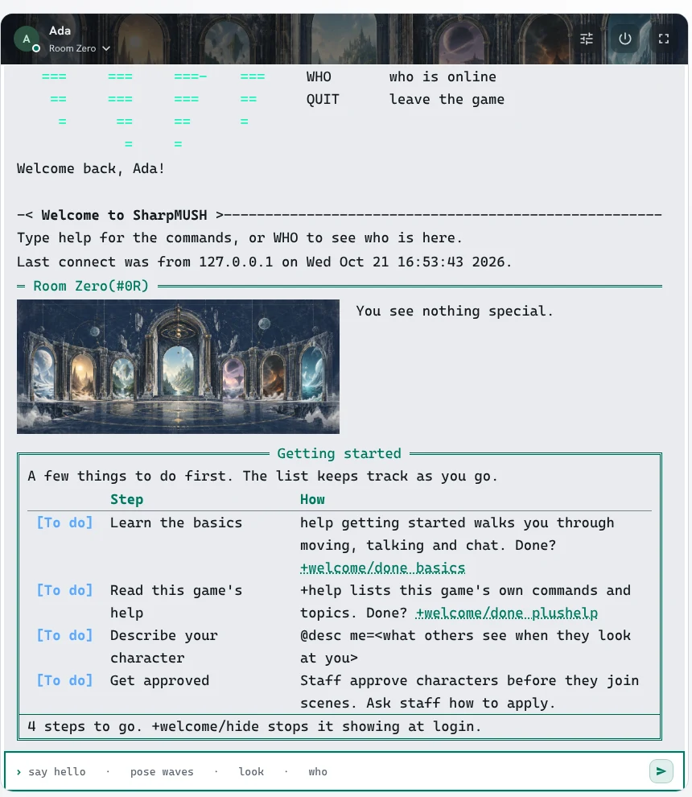
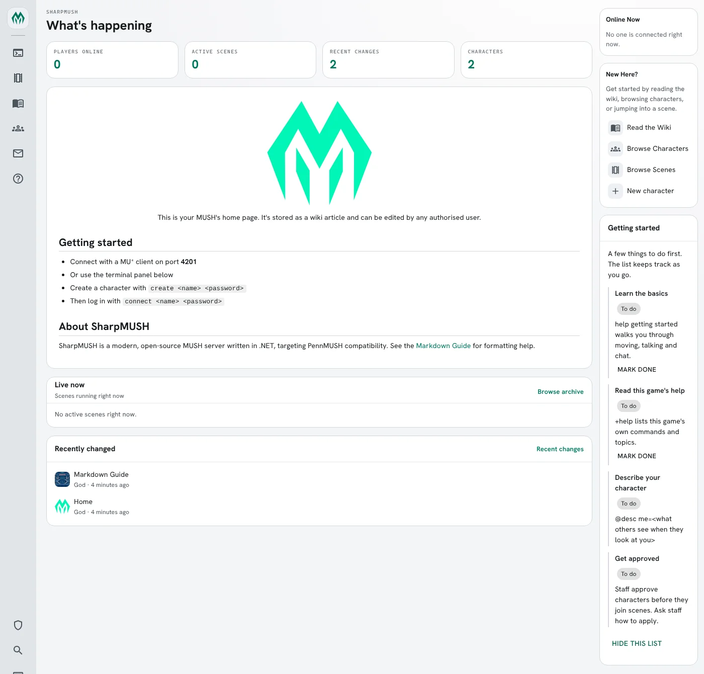
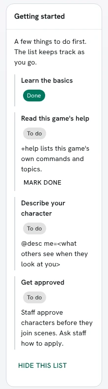

import { Aside } from '@astrojs/starlight/components';

The **onboarding** package gives each new character a short checklist of things to do first:
learn the basics, read the game's help, write a description, get approved. It shows when they log
in, any time they type `+welcome`, and on the portal's home page. The game chooses the steps.

- A step the game can check ticks itself off: setting a description, joining a channel, getting
  approved.
- Any other step the player ticks off with `+welcome/done <step>`, or **Mark done** on the portal.
- `+welcome/hide` stops the list showing at login and on the portal. `+welcome` still shows it.

| You are | You want to | Read |
|---|---|---|
| A player | see what to do next | [The checklist](#the-checklist) |
| A player | tick a step off, or stop the list showing | [Ticking steps off](#ticking-steps-off) |
| A player | use it on the portal | [On the portal](#on-the-portal) |
| Staff | change the steps or when it shows | [For staff](#for-staff) |
| A package author | add a step from a package | [Adding a step from a package](#adding-a-step-from-a-package) |
| Staff | install it | [Running the package](#running-the-package) |

In the game, `+help welcome` has the commands in short form, `+help welcome staff` the settings,
and `+help welcome steps` how a step is put together.

## The checklist

A new game installs the package on its first start, so a new character sees the list the first
time they log in, below the room:



`+welcome` shows it again at any time:

```
> +welcome
╔═════════════════════════════╡ Getting started ╞════════════════════════════╗
║ A few things to do first. The list keeps track as you go.                  ║
║          Step                     How                                      ║
║ -------------------------------------------------------------------------- ║
║ [Done]   Learn the basics                                                  ║
║ [To do]  Read this game's help    +help lists this game's own commands and ║
║                                   topics. Done? +welcome/done plushelp     ║
║ [To do]  Describe your character  @desc me=<what others see when they look ║
║                                   at you>                                  ║
║ [To do]  Get approved             Staff have your application. +app shows  ║
║                                   where it stands.                         ║
╠════════════════════════════════════════════════════════════════════════════╣
║ 3 steps to go. +welcome/hide stops it showing at login.                    ║
╚════════════════════════════════════════════════════════════════════════════╝
```

A step's line says how to do it while it is open, and nothing once it is done. On a client that
shows links, `+welcome/done <step>` is a link.

Not every character sees every step. A guest has no description or approval step, and the
channel step shows only when there is a channel to join.

## Ticking steps off

The game ticks off a step it can check as soon as it is done. Write a description and the
**Describe your character** step shows `[Done]` the next time you look; you can't tick it off
yourself:

```
> +welcome/done describe
[WELCOME] Warning: Describe your character ticks itself off once it is done.
> @desc me=A cartographer with ink on her cuffs.
Bea/DESCRIBE - Set.
```

A step the game cannot check, such as reading the help, you tick off when you have done it. The
step's name is the word after `+welcome/done` in its line:

```
> +welcome/done basics
[WELCOME] Done: Learn the basics. 3 steps to go.
> +welcome/undo basics
[WELCOME] Done: Learn the basics is open again.
```

While a step is open, the list shows at every login. Two commands change that for you:

- `+welcome/hide` stops it showing at login and on the portal. `+welcome` still shows it, with a
  note at the bottom: `Hidden at login: +welcome/show brings it back.`
- `+welcome/show` brings it back.

Once every step is done, the list stops showing at login on its own.

## On the portal

With the **onboarding-app** package, the list is a card on the portal's home page for a signed-in
character with a step still open:



**Mark done** ticks a step off, the same as `+welcome/done`. The card updates in place:



**Hide this list** does what `+welcome/hide` does: the card goes, and stays gone at login too.
The card also goes once every step is done. A visitor who is not signed in never sees it.

## For staff

With **onboarding-config**, the list's settings are in `+config onboarding`:

| Setting | Default | What it changes |
|---|---|---|
| `login` | `open` | When the list shows at login: `open` at every login while a step is open, `first` at the first login only, `off` never. |
| `title` | Getting started | The list's title, in the game and on the portal. |
| `intro` | A few things to do first. The list keeps track as you go. | The line above the steps. Empty shows none. |
| `steps` | five steps | The steps, as a table. |

```
> +config onboarding/login=first
[CONFIG] Done: onboarding/login is now first, was open.
```

### The steps

The steps are a table: each has a name, a `label`, a `hint` saying how to do it, and an `order`
(lowest first). A new game has these:

| Step | Order | Ticks itself off when |
|---|---|---|
| `basics` | 10 | never: the player ticks it off |
| `plushelp` | 20 | never: the player ticks it off (added by onboarding-help) |
| `describe` | 30 | the character has a description (not shown to guests) |
| `channel` | 40 | the character is on a channel (shown only when there is a channel to join) |
| `approval` | 60 | staff approve the character (not shown to guests) |

`+config/add` adds a step. A step you add has no check, so players tick it off themselves:

```
> +config/add onboarding/steps/rules=Read the house rules
[CONFIG] Done: Added onboarding/steps/rules. +config onboarding/steps/rules shows it.
> +config onboarding/steps/rules/hint=The Policies page on the wiki.
[CONFIG] Done: onboarding/steps/rules/hint is now The Policies page on the wiki., was none.
> +config onboarding/steps/rules/order=5
[CONFIG] Done: onboarding/steps/rules/order is now 5, was 50.
```

With order 5 it comes first, and a player ticks it off with `+welcome/done rules`:

```
> +welcome/done rules
[WELCOME] Done: Read the house rules. 4 steps to go.
```

`+config/remove onboarding/steps/approval` takes a step away, for a game that approves no one.
`+config onboarding/steps/describe/label=Write your description` renames one.

## Adding a step from a package

A package adds a step by putting an entry in the steps table, the Onboarding Steps object, and
any code the step needs on the Onboarding object, keyed by the same name. Each piece of code is
given the player as `%0`:

| Attribute, on the Onboarding object | What it does |
|---|---|
| `` CHECK`<STEP> `` | True once the step is done. Without one, the player ticks the step off. |
| `` SHOW`<STEP> `` | False leaves the step off that player's list. |
| `` NOTE`<STEP> `` | A line shown in place of the hint, such as where an application stands. |

This is how **onboarding-help** adds its step. It depends on onboarding and plus-help, and
attaches one entry to the store:

```yaml
- ref: plushelp_step
  target: "{{onboarding/store}}"
  attributes:
    STEP`PLUSHELP: Read this game's help
    STEP`PLUSHELP`HINT: +help lists this game's own commands and topics.
    STEP`PLUSHELP`ORDER: "20"
```

A step that can check itself adds a `CHECK`. A package that adds a `+tutorial` might tick its
step off once the player finishes it:

```yaml
- ref: tutorial_check
  target: "{{onboarding/guide}}"
  attributes:
    CHECK`TUTORIAL:
      value: hasattr(%0,TUTORIAL`FINISHED)
      flags: [funsyntax]
```

**onboarding-chargen** uses `NOTE` for the approval step. While the character is not approved,
the line under **Get approved** says where their [character application](/guides/character-applications/)
stands: `+app starts your application.`, `Your application is a draft. +app/submit sends it to
staff.`, `Staff have your application. +app shows where it stands.`, and so on.

<Aside>
A package's own messages never name another package's command. The onboarding package doesn't
mention `+help` or `+app`; onboarding-help and onboarding-chargen add those lines. That keeps a
step from pointing at a command the game hasn't installed.
</Aside>

What a player has done is kept on the player: `` ONBOARDING`DONE`<STEP> `` for each step they
ticked off, and `` ONBOARDING`HIDE `` while they have the list hidden.

## Running the package

A new game installs **onboarding**, **onboarding-help**, **onboarding-config** and
**onboarding-app** on its first start; the setup wizard lists them in its Essentials group.
**onboarding-chargen** is offered, not installed, like chargen itself: it is in the setup wizard's
Characters group, with chargen.

| Package | Adds |
|---|---|
| `onboarding` | `+welcome`, the list at login, and the steps |
| `onboarding-help` | `+help welcome`, and the **Read this game's help** step |
| `onboarding-config` | `+config onboarding`, and `+help welcome staff` |
| `onboarding-chargen` | Where the player's application stands, under **Get approved** |
| `onboarding-app` | The card on the portal's home page |

The package needs the event handler, for the list at login, and the HTTP handler, for the portal
card. Both come with a new game.
