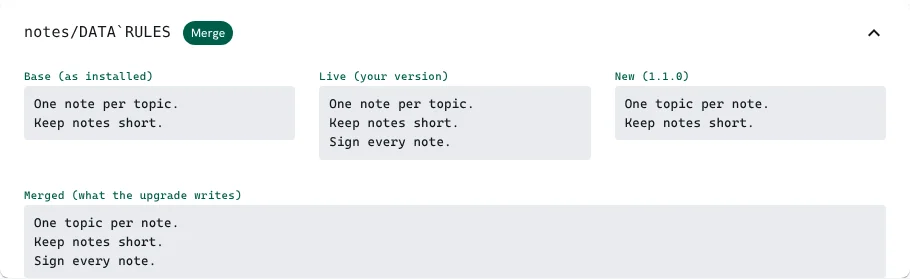
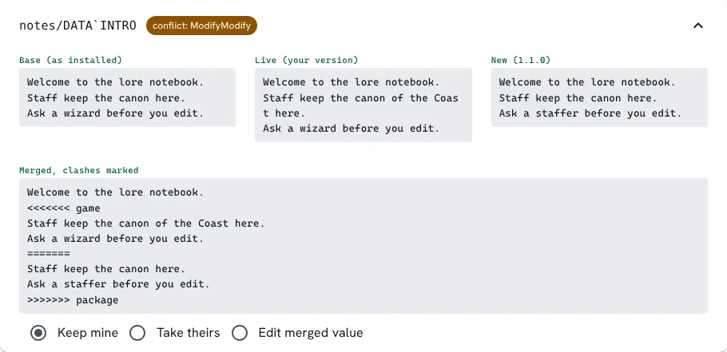
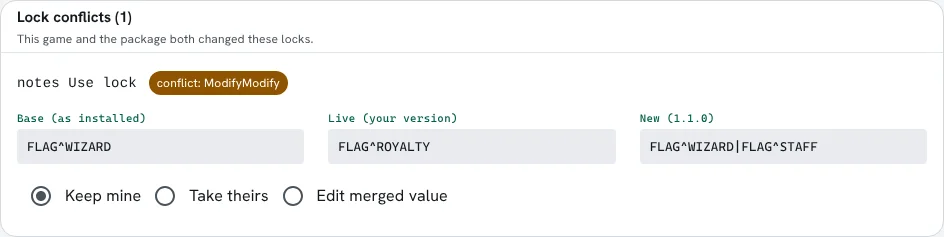
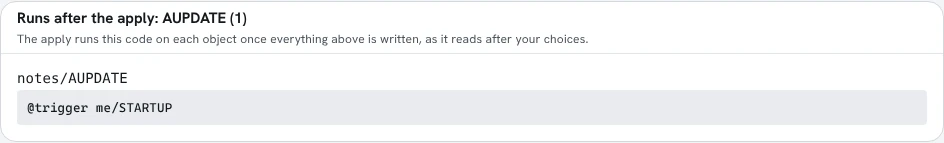
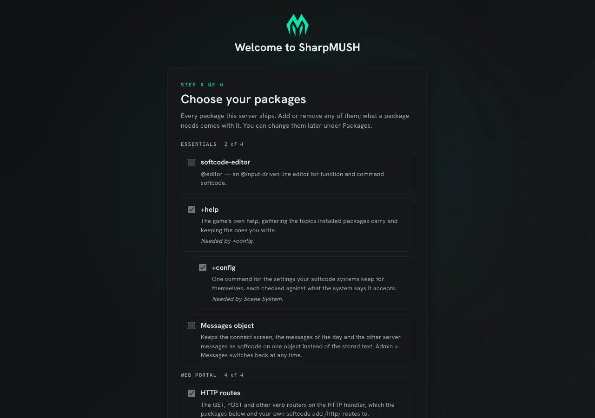
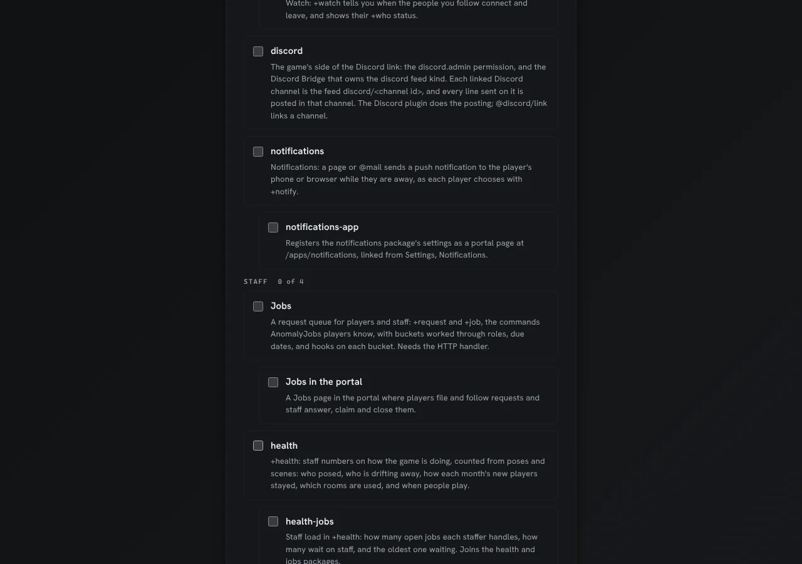
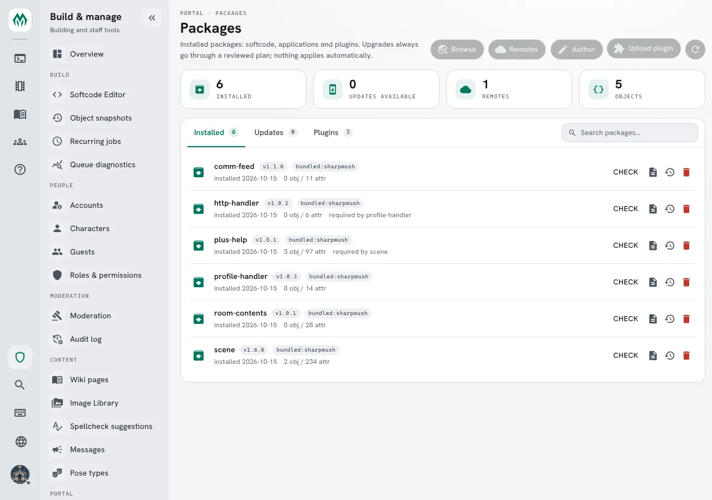
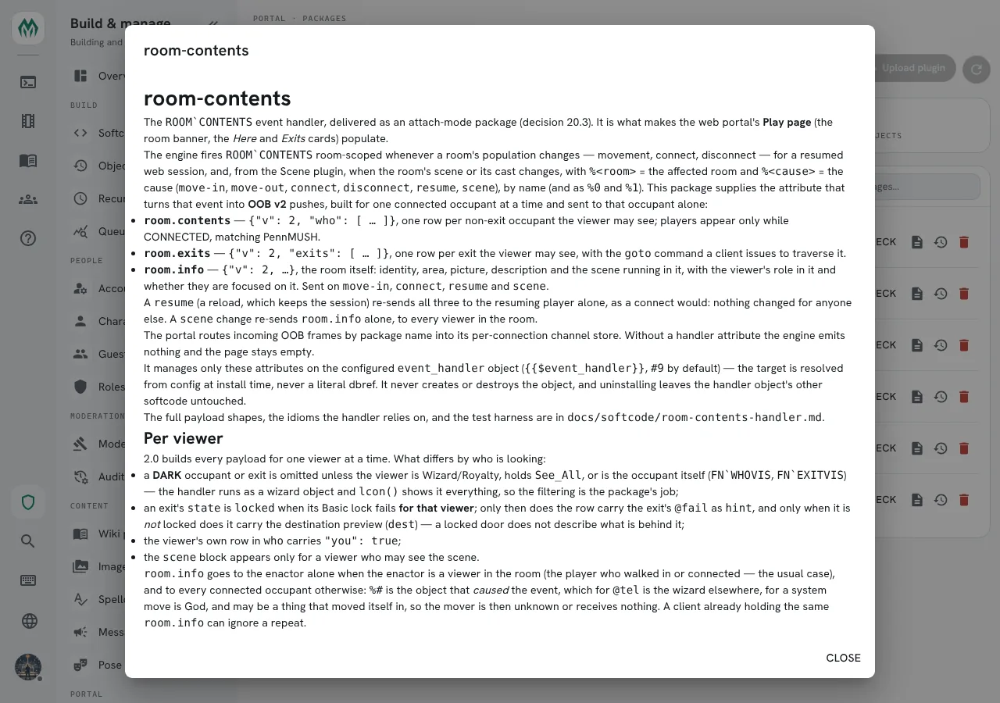

import { Steps, LinkCard } from '@astrojs/starlight/components';
import SharpieIllustration from '../../../components/SharpieIllustration.astro';

Global softcode has traditionally been distributed as a `.mush` file you paste into a client and
hope for the best: the dbrefs have to line up, there is no record of what was installed, and there is
no way to upgrade without clobbering local edits.

SharpMUSH still accepts `.mush` files: paste one in as you would on any other MUSH. It also offers
**packages**, which are safer and much easier to upgrade and maintain. A package is a declarative description of softcode — the
objects that should exist, and the attributes, flags, locks and parents they carry — installed
through the admin panel at `/admin/packages`.

<SharpieIllustration scene="packages" />

## How installing works

Packages are **desired state**, not a script. There is no ordering, no `@create` lines, and
crucially **no dbrefs**: object identity is symbolic and resolved to real dbrefs at install time.

That makes a plan/apply model possible:

<Steps>

1. **Plan.** The server compares the manifest against your live database and computes a changeset.

2. **Review.** A wizard shows you exactly what will be created, changed or removed. Nothing has been
   written yet.

3. **Apply.** Only now does anything change, and the result is recorded as a revision.

</Steps>

Because every apply is a revision, an install can be **rolled back**. And because upgrades
**three-way-merge** against the baseline stored at install time, the local customizations you made
to a package's attributes survive an upgrade instead of being overwritten.

Dependencies are resolved against your installed packages, and version constraints are checked
before anything is planned. A package can also say which SharpMUSH versions it runs on: the review
screen refuses one that needs a newer server, and warns about one that has not been tested on yours.
[Versioning Packages](/guides/versioning) covers what each warning means and how to set the range
when you write a package.

## Upgrading a package you changed

Games change the packages they install: a header in the game's own words, a rule added to a list,
a lock that lets the game's staff role in. An upgrade keeps those changes. For every attribute and
lock it compares three values: what the package installed, what the game has now, and what the new
version ships.


The review page starts with **Changed by this game**. It lists every attribute and lock the game
changed since the package installed it, and what this upgrade does with each one:


Everything not on that list takes the new version. To see only the listed attributes, turn on
**Only what this game changed** above the attribute list.

### Lines merged

When the game and the package changed different lines of a value, the upgrade writes both
changes. Here the game added a third rule and the new version reworded the first, so the upgrade
writes the reworded first rule followed by the game's added one:



### When both changed the same lines

When both changed the same lines, or both changed a value that is one line long, the review page
shows the three values side by side. **Keep mine** is already chosen, so applying without looking
never overwrites the game's work. **Take theirs** writes the new version's value. **Edit merged
value** opens an editor, and for a value of several lines it starts from the merge with each clash
marked:



Delete the marker lines and keep what you want from each side. The editor holds the value the
upgrade writes.

Locks work the same way:



Whatever you choose, the new version's value becomes the base for the next upgrade. An attribute
you kept is listed as the game's own and is not asked about again until a later version changes
it too. Wiki pages a package ships merge the same way.

### What runs after the apply

A package can carry an `AINSTALL` attribute, which runs after a first install, and an `AUPDATE`
attribute, which runs after an upgrade. The last card on the review page, **Runs after the
apply**, shows that code for each object as it will read once the apply has written it. When you
change a choice above, the card shows the code that choice leaves. It also lists any hook the
game put on one of the package's objects itself, since the apply runs that too.



## Getting packages

Add a repository under **Admin → Packages → Remotes**. The official one is:

```
https://github.com/SharpMUSH/SharpMUSH-Packages
```

Then browse, pick a package and a version, review the changeset, and apply.

A git repository holds one or more packages. Its root may have an `index.yaml` so browsing is fast;
without one, the repository is searched for `package.yaml` files. An entry is a folder path, or a
mapping with `path` and optionally `name`, `package`, `version` and `description`, so the portal can
list packages without reading every manifest (an id may appear only once):

```yaml
name: SharpMUSH Packages
description: Official softcode packages.
packages:
  - path: who-where/
    name: Who/Where
    package: who-where
    version: 1.2.0
    description: +who and +where commands
  - starter-area/
```

**Releases are git tags** named `<package-folder>/v<version>`, for example `who-where/v1.2.0`. The
version list in the portal is the tag list, installing a version uses its tag, and the latest commit
is the development channel. Never move or delete a release tag; publish a fix as a new version. The
installer records the commit it applied and warns loudly if a tag it installed from later points
somewhere else.

The official repository also carries a curated **community directory**, so games can discover
third-party package repos from the admin panel along with their trust tier.

### The bundled catalogue

Some packages are built into the server and appear in the portal under the reserved remote name
**`bundled`**, with no download and no configured remote. Two separate things can be true of them:

- **Shipped**: the package is in the server and can be installed from the catalogue at any time.
- **Installed on first start**: a new game gets it without being asked. `http-handler`,
  `profile-handler`, `room-contents`, `comm-feed`, `plus-help`, `plus-config`, `scene`,
  `scene-help`, `scene-config`, `scene-here`, [`onboarding`](/guides/onboarding/), `onboarding-help`
  and `onboarding-config` are. They are why a fresh game already has a working
  HTTP handler, `+help`, `+config`, a scene system and a getting-started checklist. A bridge such as `scene-help` installs only
  where both of the packages it joins are installed (see [Bridge Packages](/guides/bridge-packages/)). Every other bundled package is shipped but not installed: the
  [bulletin boards](/guides/bboards), `+who`, [`+status`](/guides/status), the [watch list](/guides/watch), [`+finger`](/guides/finger)
  and [`+notify`](/guides/notifications), for example, add commands a game
  may not want, a game chooses whether it wants a [verse and content warnings](/guides/scene-details#verse-canon-and-content-warnings)
  named on its scenes, and a new game reads its connect screen and MOTDs from stored text until
  an administrator chooses the Messages object (in the setup wizard or on the package's page).

A bundled package may only depend on other bundled packages, so installing it never needs the
network. Anything installed from the catalogue records `bundled:sharpmush` as its source, and is
upgraded in place when a newer server ships a newer version.

The setup wizard offers every bundled package in its last step, grouped by what the packages are
for: Essentials, Web portal, Scenes, Community, Staff, Characters and MUD clients, with any package
that names no category last, under Uncategorized. Each group says how many of its
packages are ticked. A package that builds on another one in its group, such as a portal page for a
package's commands, is listed under that package. What a ticked package needs is ticked with it.



The bundled packages use these categories (a package's `category:`, described in
[Package Declarations](/reference/package-declarations#category-format-110)):

| Category | Packages |
|---|---|
| Essentials | `softcode-editor`, `plus-help`, `plus-config`, `messages`, `onboarding`, `onboarding-help`, `onboarding-config` |
| Web portal | `http-handler`, `profile-handler`, `room-contents`, `comm-feed` |
| Scenes | `scene`, `scene-help`, `scene-config`, `scene-here`, `radio-scene`, `scene-verse`, `scene-safety`, `highlights`, `highlights-app`, `time`, `timeline`, `scene-availability`, `summary` |
| Community | `wiki-reader`, `radio`, `bboards`, `bboards-app`, `who-where`, `status`, `watch`, `discord`, `notifications`, `notifications-app` |
| Staff | `jobs`, `jobs-app`, `health`, `health-jobs` |
| Characters | `chargen`, `chargen-app`, `finger`, `info`, `roster`, `roster-jobs`, `relationships`, `relationships-scene`, `relationships-app`, `relationships-card`, `alts`, `onboarding-chargen` |
| MUD clients | `gmcp-room`, `gmcp-comm`, `gmcp-items`, `gmcp-char`, `mudlet-client`, `mud-kit` |
| Uncategorized | `discord-channels`, `discord-scenes` |



## Reading a package's README

A package can carry a `README.md` beside its `package.yaml`. The Packages page shows it: each row
under **Installed**, and each plugin under **Plugins** that came from a package, has a README button
that opens it in a dialog, rendered from Markdown. **Browse** shows the same file before you install.





The README you see on the Packages page is the one the installed version came with. It is read from
the same commit, upload or bundled copy as the manifest, and kept with the revision the install
records, so it needs no network and doesn't change when the repository does:

- an upgrade replaces it with the new version's README, or removes it if the new version has none;
- a rollback brings back the README of the revision it restores;
- uninstalling the package removes it.

A bundled package without a README of its own shows one written from its manifest: its description,
whether a new game gets it, what it requires and what it creates.

A README is written for the package's folder, so links and pictures that point into that folder
(`../profile-handler/`, `docs/setup.md`, `screenshot.png`) are not served by the game. The dialog
shows such a link as plain text and such a picture as its description. Web links (`https://…`),
links to a heading on the same page (`#usage`) and wiki links (`[[Main:home]]`) still work. Raw HTML
is removed, as on wiki pages.

For example, this `README.md` in a package folder:

```markdown
# coast-guide

Travel notes for the coast road. Install it, then read [[Main:coast-road]].

See [the page format](docs/format.md) and [SharpMUSH](https://sharpmush.com).
```

shows a heading, a wiki link to the installed page, the words "the page format" without a link, and
a working link to sharpmush.com.

A README larger than 256 KB, or one that is not UTF-8 text, is left out; the package still installs.

## Authoring a package

### From objects you already built

If the code already exists in your game, export it rather than writing YAML by hand:

```
@package/scan <objects>
```

is a read-only report — it shows the manifest that would be produced, including anything it cannot
resolve, without touching the database. When the report looks right:

```
@package <objects>=<package-id>[,<version>[,<description>]]
```

writes the package out. The `/admin/packages/author` page covers the same ground in the portal.

### The manifest

A package is a directory containing a `package.yaml`:

```yaml
format: 1.2
package: myrddins-bbs
version: 2.4.1
authors: [Myrddin]
description: "Bulletin Board"
license: MIT

depends:
  - who-where: ">=1.0"

configure:
  board_name:
    label: "Board display name"
    type: string
    default: "Community Board"

objects:
  - ref: bbs_global
    type: thing
    name: BBS Global Object
    flags: [no_command]
    attributes:
      CMD_+BBREAD:
        value: |-
          $+bbread *:@pemit %#=[u({{bbs_parent}}/FN_READ,%0)]
        flags: []
      DATA_TITLE: |-
        {{?board_name}}

  - ref: bbs_parent
    type: thing
    name: BBS Parent Object

permissions:
  - name: bbs.moderate
    category: Staff
    description: Edit or remove anyone's post.

roles:
  - slug: bbs-moderator
    name: Board Moderator
    category: Staff
    permissions:
      bbs.moderate: allow
```

`ref` names are intra-package identifiers; `{{token}}` references are resolved to real dbrefs when
the package is applied. `configure` declares typed parameters the installer is asked for, so a
package can adapt to a game without being forked. `permissions` and `roles` bring the custom
permission the board's softcode checks with `permission()`, and a role that holds it, so a game
hands out moderation with `@role` instead of editing code. A package can also bring its own
categories and set configuration options.

Write attribute values as block scalars (`|-`), as above; [Writing softcode in YAML](/reference/package-format#writing-softcode-in-yaml)
says why.

The [Package Format](/reference/package-format) reference covers every field, the rules for refs
and versions, and a set of example packages, from the bundled systems such as `jobs` to the
learning examples in the SharpMUSH Guide, a one-object `hello-world` and a dependency-carrying
`bbs-lite`.
[Package Declarations](/reference/package-declarations) covers the roles, settings and other blocks a
package can bring.

`SharpMUSH.PackageTool` validates a manifest locally, before you push.

## Beyond softcode

Packages come in kinds. `kind: softcode` is the default described above; `kind: application`
registers a [Dynamic Application](/guides/applications) — a portal page backed by a
softcode schema — `kind: plugin` distributes a compiled C# plugin, and `kind: ui` a hosted HTML and
JavaScript page. See [Application, Plugin and UI Packages](/reference/package-kinds).

<LinkCard
  title="Writing Plugins"
  href="/guides/plugins"
  description="When softcode is not enough: compiled C# commands, functions and services."
/>

<LinkCard
  title="Extension Starter Repository"
  href="https://github.com/SharpMUSH/SharpMUSH.Template"
  description="A 'Use this template' repo with a working example of all three extension layers."
/>
