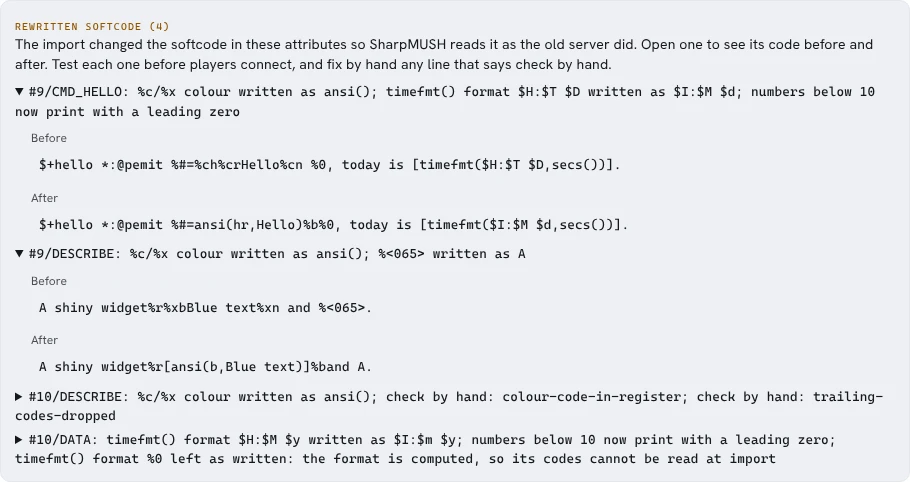

import { Steps, Aside, LinkCard } from '@astrojs/starlight/components';

SharpMUSH directly imports a **PennMUSH flatfile** and, optionally, its `mush.cnf`, mail database
(`maildb`), and chat database (`chatdb`). The flatfile keeps every object's dbref, so softcode can
keep referring to the same objects. The mail and chat databases bring mail aliases, messages and
channels. It also imports a **RhostMUSH flatfile** with its mail dumps, and a **TinyMUX flatfile**
with its `mail.db` and `comsys.db`; [Importing from RhostMUSH or TinyMUX](#importing-from-rhostmush-or-tinymux)
says what those imports carry over and what they leave behind. Everything else on this page applies
to all three. Where it names a PennMUSH file, use the matching file from your server.

<Aside type="danger" title="Plan this as a one-way move">
SharpMUSH does not export a PennMUSH flatfile. Keep the original PennMUSH installation and a backup
nobody can change until the new game has passed its observation period. A successful upload is not
proof the game is ready for players.
</Aside>

## 1. Take stock of the source game

Before changing either server, write down:

- the PennMUSH version, flatfile format, database size, highest dbref and object count;
- custom flags, powers, attributes, locks, command and function restrictions, and any files
  `mush.cnf` includes;
- channels, mail, mail aliases, player passwords, guests and login rules (mail and channels live in
  the separate `maildb` and `chatdb` files);
- globals, master room objects, HTTP and event handlers, startup attributes and scheduled jobs;
- packages and the important softcode commands players and staff use;
- DNS, telnet and browser addresses, bots, monitoring, outgoing mail and other connected services;
- uploaded files and anything plugins or maintenance scripts use.

Make a flatfile, `maildb` and `chatdb` while the game is quiet, and record a checksum of each. Copy
them, the whole configuration folder, help and text files, and anything else the game relies on, to
storage the SharpMUSH machine cannot overwrite.

The importer takes one `mush.cnf` and does **not** follow its `include` lines, so list the included
files and carry their settings across yourself. The mail and chat files are optional, but leaving
them out means no mail aliases or channels are imported.

Check the new machine with `@storage`. An import needs room for the live world, the world being
imported, and the world it replaces (see [Disk space](/guides/storage-and-retention#disk-space)). Do the first
full-size rehearsal on a throwaway, private SharpMUSH installation with the same version and storage
settings you plan to use for real.

## 2. Rehearse the import

<Steps>

1. Start a clean SharpMUSH stack, keep `/setup` away from untrusted visitors, and claim the
   administrator account linked to `#1`.

2. In setup, open **Import a PennMUSH, RhostMUSH or TinyMUX database** (later, **Database import**
   under Build & manage). Leave the format on **Tell from the file** unless the import picks the wrong
   one. Upload the flatfile together with the matching `mush.cnf`,
   `maildb` and `chatdb`. Settings from `mush.cnf` (including the objects it names and its
   restrictions) are applied before objects are converted; mail aliases, messages, channels,
   members and history come from the mail and chat files.

3. Read every warning about a setting that was skipped. Recreate the ones SharpMUSH supports, and
   write down the ones you are deliberately leaving behind.

4. Let the conversion finish. SharpMUSH builds the imported world separately, in a
   `<world>.staging-*` folder, so a failed conversion never half-replaces the live world.

5. Read the import report before accepting it. Accepting moves the old live world to
   `<world>.previous` and puts the imported world in its place in one step.

6. Go back to setup to choose HTTP and event handlers and bundled packages. An imported world may
   already have its own handlers; understand which attributes a setup choice moves or removes before
   you add a second one.

</Steps>

A rehearsal is evidence, not the real thing. Don't open it to players, don't accept their changes,
and don't quietly turn it into the production game. Repeat the import from a fresh flatfile when you
cut over.

SharpMUSH's developers compare its behaviour with PennMUSH's automatically, by replaying the same
scripted sessions against both and reporting every difference. Those comparisons show how compatible
the engine is, but they don't replace testing your own game's code. The
[Compatibility](/reference/compatibility) page and the
[PennMUSH compatibility](/reference/sharpmush-help/pennmush-compatibility) help topic list the known
differences.

## Importing from RhostMUSH or TinyMUX

The import tells the three formats apart from the file's first lines: a TinyMUX flatfile starts `+X`,
and a PennMUSH database and a RhostMUSH flatfile both start `+V` and differ in the line after it. If it
guesses wrong, choose the format on the import page. A start-up import reads
`PENNMUSH_DATABASE_FORMAT` (`auto`, `pennmush`, `rhostmush` or `tinymux`) beside
`PENNMUSH_DATABASE_PATH`.

| Format | Database | Mail | Channels |
|---|---|---|---|
| PennMUSH | the flatfile | `maildb` | `chatdb` |
| RhostMUSH | the flatfile `@dump/flat` writes | `.dump.mail` from `wmail/unload`, with `.dump.folder` in the mail folders slot | none, see below |
| TinyMUX | the flatfile (versions 1 to 5) | `mail.db` | `comsys.db` in the chat slot |

The configuration slot takes PennMUSH's `mush.cnf`, TinyMUX's `netmux.conf` or RhostMUSH's
`netrhost.conf`. A setting the two TinyMUSH-family servers name differently, such as
`player_starting_room`, sets the option PennMUSH calls `player_start`. The import does not follow
include lines, and its report lists each one it passed over, so paste the included files' lines into
the main file. Every file may be uploaded gzipped, as PennMUSH writes its dumps.

**What comes across.** Objects keep their numbers, names, owners, parents, zones, locks, attributes
and creation times. Flags and powers become SharpMUSH's where one matches: a wizard gets the `wizard`
role, a RhostMUSH councilor the `royalty` role and an architect the `builder` role, and a TinyMUX power
such as `control_all` becomes the permission it stands for. A flag or power with no match is kept as
a custom flag or power, so `hasflag()` still sees it. Passwords keep working: each form these servers
store is checked at login and replaced with SharpMUSH's own the first time the player connects. Mail
comes across, in RhostMUSH's folders when the folder dump is given. TinyMUX channels come across with
their members, and each player's comsys aliases become `CHANALIAS` attributes.

**What the import changes in softcode.** Colour written as `%c` or `%x` codes, such as
`%crRed%cn`, becomes `ansi()`, here `ansi(r,Red)`, because in SharpMUSH `%c` is the last command and
`%x` an attribute. A code the import can't turn into `ansi()`, such as one built by a function at run
time, is removed, and the report warns about each attribute it was removed from. A RhostMUSH import
also rewrites its character codes (`%<065>` becomes `A`) and
literal `timefmt()` formats. The import also turns on the compatibility options the old server's
softcode expects, and lists them in its report.

**What is left behind.** Destroyed objects, money, flags and toggles SharpMUSH has nothing for, and
attribute numbers the flatfile does not name. RhostMUSH exits that lead HOME are left unlinked, as a
PennMUSH import leaves them. RhostMUSH channels are not imported: a stock RhostMUSH runs them in
softcode, which comes across with the objects that hold it. A bcrypt password cannot be checked, so
those players need a new password from a wizard. TinyMUX squeezes runs of spaces in evaluated text and
SharpMUSH does not, so output that relied on it may show extra spaces.

### Check the rewritten softcode

When the import ends, the import page lists every attribute whose softcode it rewrote under
**Rewritten softcode**, one line each, apart from the other warnings. Each line names the object, the
attribute and what changed. Click a line to see the attribute's code before and after the rewrite. A
line that says **check by hand** names code the rewrite could not carry over exactly, with the reason,
for example colour stored in a register.



Output: four attributes are listed and the first two are open. In `#9/DESCRIBE`, `%xbBlue text%xn`
became `[ansi(b,Blue text)]` and `%<065>` became `A`. `#10/DESCRIBE` says check by hand twice, so that
attribute needs a person to read it.

Test each listed attribute on the rehearsed world, and fix the check-by-hand ones before players
connect.

### Keep the import log

The **Download import log** button at the bottom of the import page saves the whole report as a text
file named `sharpmush-import-<date>-<time>.log`: the counts, every error and warning, and each
rewritten attribute with its code before and after. Keep it with your cutover notes, or attach it
when you ask for help with an import.

```text
Rewritten softcode (4)

#9/DESCRIBE: %c/%x colour written as ansi(); %<065> written as A
  Before:
    A shiny widget%r%xbBlue text%xn and %<065>.
  After:
    A shiny widget%r[ansi(b,Blue text)]%band A.
```

Output: one rewritten attribute from the log, with its code before and after.

An import started with `PENNMUSH_DATABASE_PATH` writes the same file into the directory that holds
the imported database, and the server log names it. The server log also lists every rewritten
attribute, one line each, after a warning that gives the count.

## 3. Check the rehearsed world

For every row, record pass or fail, the command or screen you used, and any difference you accepted.

| Area | At least check |
|---|---|
| Logins and passwords | God, a wizard, an ordinary player, a guest, aliases, a failed login, a password reset, and linking a character to a web account. Replace imported password hashes with new passwords over time. |
| Objects and dbrefs | Object counts and the highest dbref look right; known rooms, exits, things and players keep the dbrefs softcode uses. |
| Attributes and locks | Inherited, private, wizard-only, visual and large attributes; representative lock types and their failure messages. |
| Flags and powers | Custom and built-in ones exist, permissions are right, and sample objects kept theirs. |
| Channels and mail | The right `maildb` and `chatdb` were used. Check membership, aliases, history, mail folders, sending, reading, deleting and privacy with separate accounts. |
| Settings | `mush.cnf` settings, command and function restrictions, names, limits, login rules and named objects match your notes. |
| Handlers and packages | HTTP and event handlers, globals, master room code, startup behaviour and each package have one deliberate owner. |
| Softcode | Every attribute under **Rewritten softcode**, then a list of player commands, building commands, queues, loops, regular expressions, locks, stored data and error cases, most important first. |
| Connections | Log in over telnet and the portal terminal; check colour, client negotiation, disconnecting and reconnecting. |
| Web portal | Claiming, logging in, linking characters, the wiki, permissions, the terminal and the admin pages work for each role. |
| Connected services | DNS, proxy routes, bots, outgoing web requests, mail, monitoring, metrics and backups work from the private copy. |

When something differs, find out why instead of adjusting the test until it passes. Whether the data
imported correctly and whether the engine behaves the same are separate questions.

## 4. Cut over

Agree the go/no-go checklist, and who decides on rolling back, before the maintenance window.

<Steps>

1. Announce the freeze, and stop logins or put PennMUSH into maintenance mode.

2. Let queued work finish, make the final flatfile with its matching `maildb` and `chatdb`, archive
   the configuration and anything else the game relies on, and record checksums and counts for every
   file.

3. Repeat the rehearsed import on the real SharpMUSH machine. Don't reuse a rehearsal world that has
   been changed.

4. Run the short acceptance list: administrator and player login, known dbrefs, core softcode, sample
   mail and channels, telnet, the portal terminal, connected services, backup, storage, health, logs
   and metrics.

5. Change DNS, proxy and client addresses only after the named person signs off. Keep PennMUSH stopped
   but ready to start again.

6. Watch errors, queues, storage, logins, connection drops and player reports through the agreed
   period. Keep the import report and a log of the cutover.

</Steps>

## 5. Roll back safely

Decide in advance what sends the game back: logins failing, data widely wrong, important softcode
not working, unsafe storage behaviour, or a connected service that can't be fixed.

To go back to PennMUSH: stop accepting changes in SharpMUSH, point the addresses back, and start the
preserved PennMUSH world from its state before the cutover. Changes players made after SharpMUSH
opened do not carry back automatically; say so when you announce the rollback.

`<world>.previous` is something else: it is the **SharpMUSH** world that was replaced when the import
was accepted. It can undo a just-accepted import on the SharpMUSH side; it is not a copy of PennMUSH.
Stop the SharpMUSH stack before moving world folders, and never copy or read a live `data.mdb`. For
ongoing SharpMUSH recovery, restore a copy made by `@backup`, or a restic snapshot holding one,
following the [restore steps](/guides/deployment#restoring-for-real).

Keep the source archive and `<world>.previous` until acceptance and the observation period are over.
Delete old data only after the decision is written down and a separate, working backup is confirmed.

## Before you announce a date

- Complete at least one full-size rehearsal on the SharpMUSH version you will use.
- Name the person who decides go/no-go and rollback.
- Prove both telnet and browser access through the real proxy setup.
- Make sure there is disk room for the live, imported and replaced worlds.
- Write down the observation period and exactly what sends the game back to PennMUSH.

<LinkCard
  title="Operate SharpMUSH"
  href="/guides/operator-handbook"
  description="Backups, restore drills, upgrades, health checks, and what to do when something goes wrong."
/>
