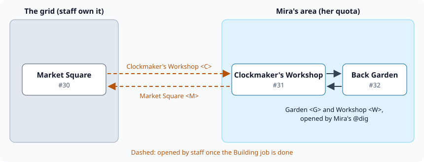

import { Aside } from '@astrojs/starlight/components';

Players can build their own corner of the game: a shop, a house, a ship. They build it apart from
the rest of the world, using their own building quota. When it is ready they file a job, staff look
it over and open the exits that join it to the grid, and the rooms can then stay with the builder,
go to a group of builders, or go to someone else.

Everything here uses commands every SharpMUSH game has, plus `+request` and `+job` from the Jobs
package. Nothing needs to be installed beyond Jobs.

| You are | You want to | Read |
|---|---|---|
| A player | see how much you can build | [Your building quota](#your-building-quota) |
| A player | build an area | [Building your area](#building-your-area) |
| A player | have it joined to the game | [Asking to join the grid](#asking-to-join-the-grid) |
| Staff | review a request and join an area | [Joining an area to the grid](#joining-an-area-to-the-grid) |
| Anyone | decide who owns the rooms afterwards | [Who owns an area](#who-owns-an-area) |
| Staff | give someone more room to build | [Changing quotas](#changing-quotas) |

The examples follow Mira, a player, and Rook, a member of staff. Market Square (`#30`) is a room on
the grid that staff own.

## Your building quota

Your quota is how many objects you may own. Every room, exit and thing you build takes one slot.
`@quota` shows how many you have used:

```
> @quota
Mira's quota: 0/20 objects used.
```

A new player starts with the number in the `starting_quota` @config option, 20 unless your game
changed it. When the quota is used up, building stops with:

```
Sorry, your building quota has run out.
```

Destroying something gives its slot back once it is gone. `@destroy` marks an object for
destruction and the game removes it a few minutes later; `@destroy` it a second time to remove it
at once:

```
> @destroy #35
Market(#35E) is scheduled to be destroyed.
> @destroy #35
Halted: Market(#35)
Destroyed.
```

## Building your area

Build your area away from everyone else, then ask for it to be joined to the grid. Start with one
room. `@dig/teleport` makes it and takes you there:

```
> @dig/teleport Clockmaker's Workshop
Clockmaker's Workshop created with room number 31.
> @desc here=Shelves of half-finished clocks tick out of step.
Clockmaker's Workshop/DESCRIBE - Set.
```

Write down the room number. You need it to come back, and staff need it to find the room.

`@dig` with exit names makes the next room and the exits to and from it in one go. The first name
after `=` is the exit from where you stand to the new room, the second is the way back. Names
separated by `;` are aliases, so `garden` and `g` work as well as the full name:

```
> @dig Back Garden=Garden <G>;garden;g,Workshop <W>;workshop;w
Back Garden created with room number 32.
Opened exit #33
Trying to link...
Linked exit #33 to #32
Opened exit #34
Trying to link...
Linked exit #34 to #31
> garden
═╡ Back Garden(#32Rn) ╞═══════════════════════════════════════════════════════
You see nothing special.
Obvious exits:
Workshop <W>
```

That one command used three slots, one room and two exits:

```
> @quota
Mira's quota: 4/20 objects used.
```

### Getting in and out

Until staff join your area to the grid, there is no exit between the two. `home` takes you back to
your home on the grid, and `@tel` takes you to any room you own:

```
> home
There's no place like home...
═╡ Market Square(#30Rn) ╞═════════════════════════════════════════════════════
Stalls crowd the cobbles under striped awnings.
> @tel #31
═╡ Clockmaker's Workshop(#31Rn) ╞═════════════════════════════════════════════
Shelves of half-finished clocks tick out of step.
Obvious exits:
Garden <G>
```

You can't join your area to the grid yourself. You can only open exits in rooms you own, and only
link them to rooms you own. Trying anyway still makes the exit, unlinked, and it takes a slot:

```
> @open Market;m=#30
Opened exit #35
Trying to link...
You can't link to that.
```

`@destroy` an exit like that so it stops using your quota.

<Aside type="tip" title="Keep your home on the grid">
`@link me=here` makes the room you stand in your home, and works in any room you own. Leave your
home on the grid until your area is joined, or `home` takes you nowhere new.
</Aside>

## Asking to join the grid

When your area is ready, file a job in the Building bucket. Say which rooms are yours, by number,
and where you would like the way in:

```
> +request Building/Link my workshop=Clockmaker's Workshop (#31) and Back Garden (#32) are ready. An exit from Market Square would suit.
[JOBS] Done: Filed job 1 in Building: Link my workshop. +job 1 shows it.
```

`+job 1` shows the job and anything staff write back. When staff finish, you are told:

```
[JOBS] Rook completed your job 1: Link my workshop. +job 1 shows it.
```

## Joining an area to the grid

This part is for staff.

The Building bucket is worked by anyone with the `job-admin-building` role, or `job-admin` for
every bucket. A wizard needs the role too:

```
> @role/assign Rook=job-admin-building
Rook now holds job-admin-building.
```

`+jobs` lists what is waiting, and `+job <#>` reads one:

```
> +job 1
══════════════════════════╡ Job 1: Link my workshop ╞═════════════════════════
Bucket:   Building
Status:   New
Priority: Normal
Filed:    Oct 15 04:46 by Mira
...
═════════════════════════╡ Mira · Oct 15 04:46 · #1 ╞═════════════════════════
Clockmaker's Workshop (#31) and Back Garden (#32) are ready. An exit from
Market Square would suit.
```

Visit the rooms before joining them. `@tel #31` takes a wizard anywhere, and `examine` shows who
owns each room and what exits it has.

To join the area, stand in the grid room and open an exit to the player's room, with a return exit
named after the grid room:

```
> @open Clockmaker's Workshop <C>;clock;c=#31,Market Square <M>;market;m
Opened exit #37
Trying to link...
Linked exit #37 to #31
Opened exit #38
Trying to link...
Linked exit #38 to #30
```

You own both exits, so the player can't remove the way in, and they don't count against the
player's quota. Then close the job, which tells the player:

```
> +job/complete 1=Linked from Market Square. Take the clock exit from the square.
[JOBS] Done: Job 1 is closed: completed.
```



## Who owns an area

Once an area is on the grid, decide who should own its rooms:

| Choice | Who can change the rooms | Whose quota |
|---|---|---|
| Leave it with the builder | the builder | the builder's |
| [Give it to a shared player](#a-shared-player-for-an-area) | everyone on that player's list | nobody's |
| [Pass it to another player](#passing-a-room-to-another-player) | the new owner | the new owner's |
| [Staff take it over](#staff-taking-an-area-over) | staff | nobody's |

Doing nothing is a fine answer for one player's home. A shop or a ship that several people look
after is better with a shared player.

<Aside type="caution" title="A room is halted after it changes hands">
`@chown` sets HALT on what it moves, as it does in PennMUSH. A halted room runs none of its code:
`look` shows its name and description plainly, without the game's styling, and its `@aenter` and other
actions do nothing. Once the new owner has checked the room, they clear HALT:

```
> @set here=!HALT
Clockmaker's Workshop - HALT reset.
```
</Aside>

### A shared player for an area

A shared player is a character set SHARED. Nobody needs to play it. Anyone who passes its zone lock
controls everything it owns, and can give it what they own.

Staff make one for the area and list who may build there:

```
> @pcreate Clockworks=clockpass1
New player 'Clockworks' (#39) created with password 'clockpass1'
> @set *Clockworks=SHARED
Clockworks - SHARED set.
> @lock/zone *Clockworks=*Mira
Clockworks(#39) - Zone locked.
```

The builder then gives each room and exit to it. A room is given from inside it, or by number:

```
> @chown here=Clockworks
Owner changed.
> @chown #32=Clockworks
Owner changed.
> @chown #33=Clockworks
Owner changed.
> @chown #34=Clockworks
Owner changed.
> @quota
Mira's quota: 0/20 objects used.
```

Mira can still change the rooms, and they no longer count against her quota. Exits staff opened stay
with staff; `@chown #38=Clockworks` tells Mira `Permission denied.`

To let someone else build there, staff change the lock. `|` means "or":

```
> @lock/zone *Clockworks=*Mira|*Tomas
Clockworks(#39) - Zone locked.
```

Taking a name off the lock takes away that player's control at once.

### Passing a room to another player

To hand a room to another player, set it CHOWN_OK and lock it to them, so nobody else can take it:

```
> @dig Attic
Attic created with room number 40.
> @set #40=CHOWN_OK
Attic - CHOWN_OK set.
> @lock/chown #40=*Tomas
Attic(#40) - Chown locked.
```

Anyone else who tries is refused:

```
> @chown #40=me
Permission denied.
```

The new owner takes it with `@chown <room>=me`, then clears HALT and CHOWN_OK:

```
> @chown #40=me
Halted: Attic(#40)
Owner changed.
> @set #40=!HALT
Attic - HALT reset.
> @set #40=!CHOWN_OK
Attic - CHOWN_OK reset.
```

The room now takes a slot of Tomas's quota and frees one of Mira's. If Tomas has no slot left, he
is told `Sorry, your building quota has run out.` and the room stays with Mira.

A thing works the same way, but has to be in the new owner's hands: hand it over first.

### Staff taking an area over

A wizard can `@chown` anything to anyone, and `@chownall` moves everything one player owns:

```
> @chown #32=Rook
Halted: Back Garden(#32)
Owner changed.
> @chownall/rooms Mira=Rook
Halted: Spare Room(#45)
Ownership changed for 1 objects.
```

`/rooms` limits `@chownall` to rooms; `/exits` and `/things` work the same way, and with none of
them it moves everything.

## Changing quotas

Staff with the `players.moderate` permission, which the wizard role has, change one player's quota
with `@quota/set` and list everyone's with `@quota/all`:

```
> @quota/set Mira=30
Quota for Mira set to 30.
> @quota/all
Quota listing for all players:
Player                      Used/Quota
=========================================
God                            9/999999
Package Manager               17/999999
Rook                           4/20
Mira                           0/30
Tomas                          3/20
Ada                            2/20
Clockworks                     3/20
```

The number is the total, not an addition, and setting it below what a player already owns stops
them building without taking anything away. `@allquota <number>` sets every player's quota at once.

A request for more quota is a job like any other: `+request Building/More quota=...`.

## Letting others into a room

Four flags open a room you own to other players. Each has a lock, so you can choose who:

| Flag | Others can | Lock |
|---|---|---|
| `LINK_OK` | link exits to the room | `@lock/link` |
| `OPEN_OK` | open exits in the room | `@lock/open` |
| `JUMP_OK` | `@tel` into the room | `@lock/teleport` |
| `ABODE` | make the room their home with `@link me=here` | none |

An unset lock lets everyone through. To let only Tomas link exits to your workshop:

```
> @set #31=LINK_OK
Clockmaker's Workshop - LINK_OK set.
> @lock/link #31=*Tomas
Clockmaker's Workshop(#31) - Link locked.
```

Tomas can now open an exit in one of his own rooms and link it to the workshop. Anyone else gets
`You can't link to that.`

```
> @open Workshop;w=#31
Opened exit #42
Trying to link...
Linked exit #42 to #31
```
