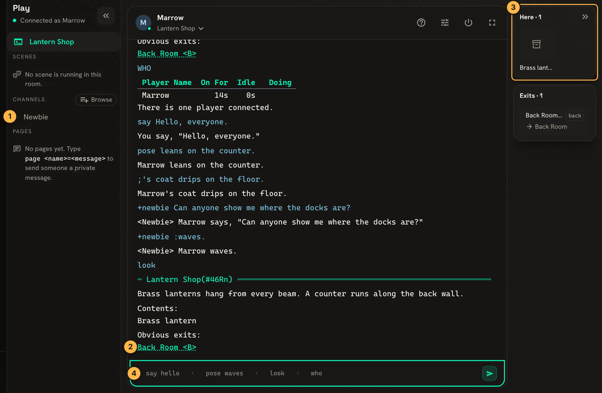

This page walks through a first session on a SharpMUSH game: making a character, moving, talking,
paging, channels and mail. Everything works the same in the game's website terminal and in a MU\*
client such as Mudlet or BeipMU. The examples follow Marrow, a new character, on an account named
Wren.

## An account and a character

Your **account** is your sign-in. A **character** is who you play. One account can hold several
characters, and each character has its own password.

On a game's website, use **Register**, then **Create a character**. The
[Web Portal guide](/guides/web-portal/#accounts-and-characters) covers those pages.

In a MU\* client, connect to the game's address and port, then make the account and its first
character on the connect screen:

```
> register Wren Paper-Lantern-7
Account 'Wren' created successfully.

-< Your account is ready >----------------------------------------------------
create <character> <password>  create your first character
claim <character> <password>   add a character you already have
play <character>               enter the game as one of them
> create Marrow Tide-Glass-31
```

`register` also takes an email address before the password: `register Wren wren@example.com
Paper-Lantern-7`. `create` makes the character and puts you in the game as it.

Next time, connect straight to the character:

```
> connect Marrow Tide-Glass-31
```

To add another character, `login` to the account and `create` again. A character you made before
the game had accounts joins yours with `claim <character> <password>`.

Many games show a short checklist when a new character arrives. It ticks itself off as you go, and
`+welcome` shows it again. See [Getting Started Checklist](/guides/onboarding).

## The website terminal

On a game's website, **Play** opens a terminal in the page. It takes the same commands as a MU\*
client and adds a few panes around them:



1. The channels you have joined, and below them your recent pages.
2. Exits in the output are links: click one to walk through it.
3. **Here** lists who and what is in the room, and **Exits** the ways out.
4. Type commands here and press Enter.

## Looking and moving

`look` shows the room you are in. Exits are listed at the bottom; type an exit's name to go through
it:

```
> look
=< Room Zero >================================================================
New characters arrive here. Type look to see this room again, help for the
list of commands, and @channel/on Newbie to ask other players a question.
Obvious exits:
In Character and Tutorial
> Tutorial
=< Tutorial >=================================================================
The basics, one command at a time.
Obvious exits:
Out
```

`look <name>` looks at a person or thing in the room. `home` takes you back to your home room from
anywhere.

## Talking in the room

Everyone in the room hears these.

| Type | Others see |
|---|---|
| `say Hello.` or `"Hello.` | `Marrow says, "Hello."` |
| `pose waves.` or `:waves.` | `Marrow waves.` |
| `;'s coat drips.` | `Marrow's coat drips.` |

A game with the Scene System also records poses as scene logs. See [Scenes](/guides/scenes).

## Paging someone

`page` reaches one person wherever they are in the game:

```
> page Tamsin=Are you around?
You paged Tamsin with 'Are you around?'
```

Tamsin sees `Marrow pages: Are you around?`. Leave the name out to page the last person you paged:
`page Just saying hello.` A `:` before the message makes it a pose: `page Tamsin=:waves.` shows
Tamsin `From afar, Marrow waves.`

`WHO` lists who is connected.

## Channels

Channels are chat lines that anyone who joins can hear, wherever they are. `@channel/list` shows
the ones you can join, and `@channel/on` joins one:

```
> @channel/on Newbie
CHAT: You join channel <Newbie>.
> +newbie Can anyone show me where the docks are?
<Newbie> Marrow says, "Can anyone show me where the docks are?"
```

`+<channel> <message>` talks on a channel you have joined, and `+<channel> :<pose>` poses there.
`@channel/recall Newbie` shows the last lines you missed, `@channel/who Newbie` who is listening,
and `@channel/off Newbie` leaves it.

## Mail

`@mail` holds messages for you while you are away:

```
> @mail/send Tamsin=Dock rota/You have the morning watch.
MAIL: You sent your message to Tamsin.
```

The part before `/` is the subject. Tamsin's inbox then lists it:

```
> @mail
=< Mail, folder 0 (INBOX) >===================================================
#  Flags  From      Subject     Sent
------------------------------------------------------------------------------
1  N      Marrow    Dock rota   Fri Nov 13 09:03
==============================================================================
1 message, 1 unread.
```

`@mail 1` reads message 1 and `@mail/clear 1` deletes it. The website's Mail page shows the same
inbox.

## Describing yourself

`@desc me=` sets what others see when they look at you:

```
> @desc me=A tall sailor in an oilskin coat.
Marrow/DESCRIBE - Set.
```

## Getting help

There are two help commands:

- `help` explains the server's own commands, the same on every SharpMUSH game. `help getting
  started` is a good first read.
- `+help` explains what this game has installed and what its staff wrote: its scenes, its
  character sheet, its rules.

The website shows both under **Help**, and the
[help reference](/reference/sharpmush-help/sharptop/) on this site has the server's half.

`QUIT` disconnects.

## Next steps

- [Scenes](/guides/scenes) for roleplay logs and scheduling.
- [Letting Your Players Build](/guides/player-building) to build rooms of your own.
- [Screen Readers](/guides/screen-readers) to play with one.
