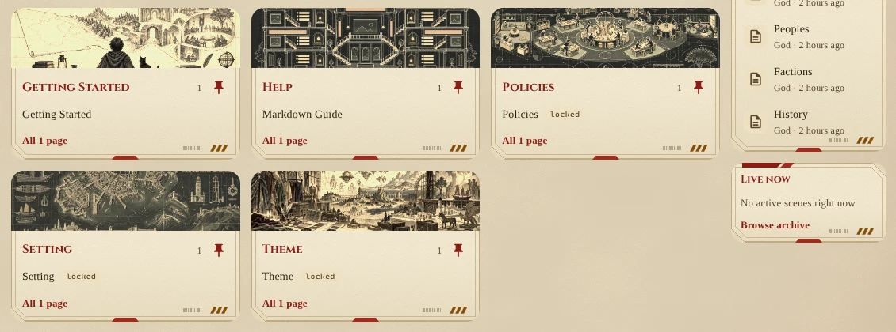

import { Aside, Steps } from '@astrojs/starlight/components';

A portal theme decides how the web portal looks: its colours, its typefaces, what is drawn on the page and on
every card, and how titles are set. Players choose one under **Settings > Preferences > Theme** (`/settings/theme`), or **Theme** in the account menu. Staff make and edit themes at
**Admin > Portal > Themes** (`/admin/themes`), which needs the `layout.admin` permission.

Portal themes are separate from [layout themes](/guides/layout-themes), which colour the boxes and tables in
a MU\* client.

Players who are colour-blind can name their [colour vision](/guides/colour-vision) on the same page, and get
colours that stay apart for it.

## How a theme is put together

A theme is two things:

- **Colours.** Thirteen colours for the page, cards, text, lines and links, checked for contrast, plus two
  **decorative colours** that only drawings use.
- **Parts.** Named choices for each piece of the look: the title face, the text face, corners, title lettering,
  picture tone, the page texture, and the card drawing, border and shadow, the title glyphs and underline, and
  the title colour and shadow.

A part is never a colour of its own. Every drawing is filled with the theme's colours, so the same part looks
right on a dark theme and a light one, and changes with the theme's accent.


## Three ways to edit a theme

At the top of the **Style** section, choose how you want to edit:

**Simple** is one menu for each part of the look, as every built-in theme is made. Choosing a texture, card
frame, title ornament or title effect brings everything that goes with it. The **Plating** card frame, for
example, sets the plating drawing, no border and no shadow.

**Complex** gives every part its own menu, so you can mix them: one theme's card drawing with another's border
and shadow, one theme's title glyphs with another's underline. It also shows the two decorative colours and
**Texture strength** (full, soft, faint or off), which fades the page texture.

**Custom (CSS)** keeps the Complex menus and adds a stylesheet of your own, laid over everything. Use it for
what the menus can't do: a drawing on a different layer, two textures at once, or a change to one part of the
portal.

Switching from Simple to Complex changes nothing on the page: each menu starts at the part your Simple choices
gave. Switching back to Simple asks first if the parts no longer match a Simple choice, then puts them back.
Leaving Custom asks first, then removes the stylesheet.

### Mix parts in Complex

To give the Fantasy theme the armour plating from Real Robot:

<Steps>

1. Open **Admin > Portal > Themes**, choose **Fantasy**, and press **Duplicate**. Built-in themes can't be
   changed, so you edit a copy.

2. Under **Style**, choose **Complex**.

3. Set **Card drawing** to **Armour plating** and **Card border** to **None**. The plating draws its own edge.

4. Pick the two **Decorative colours**. The plating's tab stripe and chin plate use the first, its vents the
   second.

5. Turn on **Try on the portal** to see it everywhere, then **Save**.

</Steps>



Every part, its values, and the built-in theme each comes from are listed in [Portal Theme Parts](/reference/portal-theme-parts).

## Decorative colours

Some drawings need more colours than a theme's accent: the three spotlights of the Idol texture, or the red and
yellow on Real Robot's armour. These come from the two decorative colours. They never carry text, so the contrast
report doesn't check them. A theme that doesn't set them uses its **Errors and missing links** colour and its **Warning**
colour.

## Write your own CSS

In **Custom (CSS)** mode the stylesheet box starts with a guide that changes nothing until you edit it:

1. Every variable the portal paints with, with this theme's value, commented out.
2. The rules this theme's parts use, copied out as `:root` rules and commented out. Remove the `/*` and `*/`
   around one to make it the theme's own, then change it.
3. An empty rule for each part of the portal (the page, the sidebars, cards, page headers, wiki pages, buttons),
   for anything a variable can't reach.

Your stylesheet loads after the parts, so anything it sets wins. The portal refuses to save a stylesheet that
loads from another site, or holds HTML or script.

### How drawings are painted

The page texture and every card have six layers. The bottom layer holds plain gradients (`--texture` on the page,
`--card-marks` on a card). Above it is one layer for each of the theme's colours: the border colour, the text
colour, decorative 2, decorative 1 and the accent, with the accent on top. A layer is filled with its colour
wherever its **mask** lets it through. The mask is a drawing, black where the colour shows and clear where it
doesn't.

| Variable | What it does |
|---|---|
| `--texture`, `--texture-size` | The page's gradients and their sizes, as for `background-image` and `background-size` |
| `--texture-mask-text`, `--texture-mask-accent`, `--texture-mask-accent-2`, `--texture-mask-accent-3`, `--texture-mask-border` | The drawing each colour fills on the page. A list in the `mask` shorthand: `url(...) position / size repeat` |
| `--texture-ink-text`, `--texture-ink-accent`, ... | The colour itself. Set it to make a layer fainter: `color-mix(in srgb, var(--accent) 40%, transparent)` |
| `--texture-opacity` | The whole texture's strength, from 0 to 1 |
| `--card-marks` | A card's gradients, over its background |
| `--card-mask-text`, `--card-mask-accent`, ... , `--card-mask-grain` | The drawing each colour fills on every card. `grain` is the paper grain some textures put on cards |
| `--card-ink-text`, `--card-ink-accent`, ... , `--card-ink-grain` | The colour of each card layer |
| `--card-border-style`, `--card-border-width`, `--card-shadow` | A card's border and shadow |
| `--ornament-before`, `--ornament-after` | The glyphs either side of page titles, as CSS strings (`"\2726"`) |
| `--title-underline`, `--title-underline-height`, `--title-underline-pad` | The line under page titles (a gradient), how tall it is, and the gap above it |
| `--title-color`, `--title-shadow` | The colour of titles, and what is drawn behind them (a `text-shadow` list) |
| `--accent-2`, `--accent-3` | The two decorative colours |

Every drawing the built-in parts use is on the site under `/themes/drawings/`, so you can use any of them in your
own masks. The ones under `/themes/drawings/shared/` are made to tile: `noise.svg` (fine grain, 180px),
`clouds-360.svg` to `clouds-800.svg` (soft mottling at those sizes), and `starfield-200.svg`, `starfield-320.svg`
and `starfield-530.svg` (stars at those sizes).

### Example: stars over any texture

This puts two depths of stars, in the text colour at 60%, over the page:

```css
:root {
	--texture-mask-text: url(/themes/drawings/shared/starfield-200.svg) 0 0 / 200px 200px,
		url(/themes/drawings/shared/starfield-320.svg) 0 0 / 320px 320px;
	--texture-ink-text: color-mix(in srgb, var(--text) 60%, transparent);
}
```

A variable set here replaces the texture's own value for that layer. If the theme's texture also draws in the
text colour (Parchment's grain does), copy its rule from the starter and add the stars to the end of its list.

### Example: two card frames at once

Fantasy's flourished corners, filled with the accent, and Modern's bar down the left side:

```css
:root {
	--card-mask-accent: url(/themes/drawings/frames/filigree-accent.svg) 0 0 / 100% 100% no-repeat;
	--card-marks: linear-gradient(var(--accent), var(--accent)) left top / 5px 100% no-repeat;
}
```

### Example: change one part, keep the menus

A rule can name a part's value, so it only applies while that value is chosen. This makes the Mystery theme's
tape fainter, whatever else the theme changes:

```css
[data-frame-marks="tape"] {
	--card-ink-accent-2: color-mix(in srgb, var(--accent-2) 10%, transparent);
}
```

Each part is an attribute on the page: `data-texture`, `data-texture-strength`, `data-frame-marks`,
`data-frame-edge`, `data-frame-shadow`, `data-ornament-glyphs`, `data-ornament-underline`, `data-effect-color`,
`data-effect-shadow`, `data-font-display`, `data-font-body`, `data-corners`, `data-titles` and `data-imagery`.
`data-scheme` is `dark` or `light`, for a rule that should differ between the two:
`[data-scheme="dark"][data-texture="paper"] { ... }`.

Every part's values, and the built-in themes that use each, are listed in [Portal Theme Parts](/reference/portal-theme-parts).
