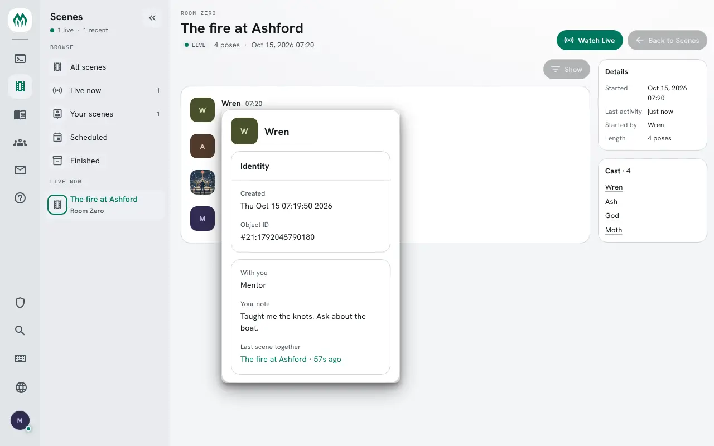

import { Aside } from '@astrojs/starlight/components';

The **relationships** package keeps what characters are to each other: siblings, rivals, a mentor
and a student. One player asks, the other confirms, and only then does anyone else see it.

It also gives every character a card. `+rel <name>` shows a few of their `+finger` fields, what
they are to you, a note only you see, and the relationships of theirs you may see. In the portal
the same card opens when you rest the pointer on a name, and a character's profile draws their
relationships as a web.

| You are | You want to | Read |
|---|---|---|
| A player | see who you know | [Your relationships](#your-relationships) |
| A player | ask someone, or answer | [Asking and confirming](#asking-and-confirming) |
| A player | look someone up | [A character's card](#a-characters-card) |
| A player | keep one to the two of you | [Hiding a relationship](#hiding-a-relationship) |
| A player | keep a note about someone | [Notes](#notes) |
| Staff | add a type or a card line | [Running the package](#running-the-package) |

In the game, `+help rel` has the same commands in short form.

## Your relationships

`+rel` lists yours:

```
> +rel
════════════════════════════╡ Your relationships ╞════════════════════════════
Name  Relationship  About                                          Since
Ash   Sibling       Raised him after the fire                      15 Oct 2026
Moth  Student       -                                              15 Oct 2026
Rook  Parent        -                                              15 Oct 2026
══════════════════════════════════════════════════════════════════════════════
+rel <name> shows someone's card · +rel/types lists the types · +help rel
══════════════════════════════════════════════════════════════════════════════
```

**Relationship** is what that character is to you: Rook is Wren's parent, and Moth her student.

`+rel/types` lists the types a game has, and the side each one gives the other character:

```
> +rel/types
════════════════════════════╡ Relationship types ╞════════════════════════════
Type       Key        The other side
Ally       ally       Ally
Child      child      Parent
Colleague  colleague  Colleague
Enemy      enemy      Enemy
Family     family     Family
Friend     friend     Friend
Mentor     mentor     Student
Parent     parent     Child
Partner    partner    Partner
Rival      rival      Rival
Sibling    sibling    Sibling
Student    student    Mentor
══════════════════════════════════════════════════════════════════════════════
+rel/set <name>=<type> · a type is named by its key or its label
══════════════════════════════════════════════════════════════════════════════
```

## Asking and confirming

`+rel/set <name>=<type>` says what someone is to you. Here Rook asks Moth to be a friend:

```
> +rel/set Moth=friend
[REL] Done: You asked Moth. They show as your Friend once they confirm it.
```

Moth is told, with the commands to answer:

```
[REL] Rook asked to be your Friend. +rel/confirm Rook · +rel/decline Rook
```

Until Moth answers, the ask shows in both lists. Moth's `+rel` has it under **Asking you**:

```
> +rel
════════════════════════════╡ Your relationships ╞════════════════════════════
Name  Relationship  About                                          Since
Ash   Friend        -                                              15 Oct 2026
Wren  Mentor        -                                              15 Oct 2026
════════════════════════════════╡ Asking you ╞════════════════════════════════
Rook: Friend · +rel/confirm Rook · +rel/decline Rook
══════════════════════════════════════════════════════════════════════════════
+rel <name> shows someone's card · +rel/types lists the types · +help rel
══════════════════════════════════════════════════════════════════════════════
```

and Rook's under **Waiting on them**:

```
══════════════════════════════╡ Waiting on them ╞═════════════════════════════
Moth: Friend
```

`+rel/confirm <name>` takes the other side of the type. For a friend that is Friend again; when
Wren says Rook is her Parent, Rook confirming makes Wren his Child.

```
> +rel/confirm Rook
[REL] Done: Rook is your Friend now.
```

Rook hears:

```
[REL] Done: Moth confirmed it. Moth is your Friend.
```

`+rel/decline <name>` turns an ask down, and nothing is kept. Confirming or declining when nobody
asked is refused:

```
> +rel/decline Rook
[REL] Warning: Rook is not asking you anything.
```

### Changing or ending one

`+rel/set` on a confirmed relationship changes your side, and the other player confirms it again.
Until they do, the card shows both sides:

```
> +rel/set Moth=rival
[REL] Done: You asked Moth. They show as your Rival once they confirm it.
```

```
With you:  You asked: Friend · Asks you: Rival
```

`+rel/end <name>` ends it for both of you, confirmed or not:

```
> +rel/end Rook
[REL] Done: You and Rook have no relationship now.
```

Rook hears `[REL] Moth ended your relationship.`

### A line about it

`+rel/text <name>=<text>` adds a line about a relationship, shown beside it in `+rel` and on the
other character's card. Nothing after the `=` clears it.

```
> +rel/text Rook=Shares a cell block with him
[REL] Done: About Rook: Shares a cell block with him
```

What you type is kept as you typed it. Brackets and percent signs are plain text.

## A character's card

`+rel <name>` shows that character's card:

```
> +rel Ash
════════════════════════════════════╡ Ash ╞═══════════════════════════════════
Full Name:           Ash Vale
Pronouns:            he/him
With you:            Sibling
Your note:           Owes me for the boat.
Last scene together: The fire at Ashford · 11m ago
═══════════════════════════════╡ Relationships ╞══════════════════════════════
Name  Relationship  About                                          Since
Moth  Friend        -                                              15 Oct 2026
Wren  Sibling       -                                              15 Oct 2026
══════════════════════════════════════════════════════════════════════════════
+finger Ash · +rel/set Ash=<type> · +rel/note Ash=<text>
══════════════════════════════════════════════════════════════════════════════
```

From the top:

- **Full Name** and **Pronouns** are the character's `+finger` fields. A field they left empty or
  hid is left out. Staff choose the fields; see [Settings](#settings).
- **With you** is what they are to you.
- **Your note** is yours alone. See [Notes](#notes).
- **Last scene together** is the latest scene you both belong to, and how long since anyone posed
  in it. It needs the `relationships-scene` package, which needs the Scene System.
- **Relationships** lists theirs that you may see: confirmed and not hidden, or involving you.

A line with nothing to show is left out. Moth, who has no note about Ash, gets the same card
without **Your note**.

## Hiding a relationship

`+rel/hide <name>` keeps your side of a relationship to the two of you and staff. If either side
is hidden, the relationship is:

```
> +rel/hide Rook
[REL] Done: Only you and Rook and staff see it now.
```

Wren, looking at Rook, no longer sees Moth among his relationships. A hidden relationship is
marked in the two players' own lists. Rook hid his rivalry with Ash, so his `+rel` shows:

```
Ash   Rival (hidden)  -                                            15 Oct 2026
```

`+rel/unhide <name>` shows it again:

```
> +rel/unhide Rook
[REL] Done: Everyone sees it again.
```

Hiding clears the `visual` flag on your side's attribute, so the portal follows it too.

## Notes

`+rel/note <name>=<text>` keeps a note about anyone, related to you or not. Only you see it, on
their card in the game and in the portal:

```
> +rel/note Rook=Knows where the key is.
[REL] Done: Your note about Rook: Knows where the key is.
```

Nothing after the `=` clears it:

```
> +rel/note Wren=
[REL] Done: Your note about Wren is cleared.
```

## In the portal

Two application packages show the same relationships in the portal. Each needs `relationships`.

### The web

`relationships-app` adds a **Relationships** panel to every character's profile. The character
sits in the middle with the people they know around them, each line labelled and coloured by its
type. When the two sides differ, as Parent and Child do, an arrow points from a character to the
one they are that to: Rook's arrow to Wren reads Parent. Under the web is the same list as `+rel`.


Each name is a link to that character's profile. A visitor who is not signed in sees the
relationships nobody hid, and a screen reader is given them as a list.

The panel joins the profile without a layout change. An administrator can still move it from
**Layout** in the admin area.

### The name card

`relationships-card` adds the card's lines to the portal's name card. Rest the pointer on a name
in a scene and the card opens with the character's profile header and, for a signed-in player,
the lines between you. **Last scene together** links to the scene's log.



Escape closes the card. The same lines show on a character's sheet in the Play page.

## Running the package

### Installing

None of the four packages is installed on a new game. An administrator installs them from the
portal:

1. Open **Packages** in the admin area and choose **Browse**.
2. Install `relationships`. It needs `finger`, `plus-help`, `plus-config` and `http-handler`; a new
   game already has all but `finger`.
3. Install `relationships-scene` for **Last scene together**. It needs the Scene System, so a game
   without it skips this one.
4. Install `relationships-app` for the web and `relationships-card` for the name card.

See [Softcode Packages](/guides/packages) for how installing, upgrading and rolling back work.

### Settings

`+config relationships` lists the settings and `+config relationships/<setting>=<value>` changes
one, with the `config.admin` permission. See [Game Settings with +config](/guides/config).

| Setting | What it is | Default |
|---|---|---|
| `card-fields` | The `+finger` fields at the top of a card, by key. | `FULLNAME PRONOUNS` |
| `note-length` | The longest note, in characters, 1 to 8000. | 2000 |
| `text-length` | The longest line about a relationship, 1 to 1000. | 200 |
| `web-reach` | How far the web reaches: 1 draws a character and the people they know, 2 adds the people those know. | 1 |

`card-fields` takes only keys `+finger` has:

```
> +config relationships/card-fields=fullname pronouns bogus
[CONFIG] Warning: relationships/card-fields: bogus is not a +finger field. +finger/fields lists them.
```

To add a field:

```
> +config/add relationships/card-fields=age
[CONFIG] Done: relationships/card-fields is now fullname, pronouns, age, was fullname, pronouns.
```

### Types

The types are attributes on the **Relationships** object in the master room, one each, named
``DATA`TYPE`<KEY>`` with the label as the value. Under each:

- ``DATA`TYPE`<KEY>`PAIR`` is the key the other side takes. Parent's is `CHILD`. Without one, both
  sides take the same key.
- ``DATA`TYPE`<KEY>`TONE`` is the colour the web draws it in, a `tone()` name such as `green` or `warning`.

Find the object's number with `@find`:

```
> @find Relationships
Relationships(#19TW)
Relationships Help(#20T)
*** 2 objects found ***
```

The numbers on your game will differ. To add a Cousin type, which both sides take, drawn in purple:

```
> &DATA`TYPE`COUSIN #19=Cousin
Relationships/DATA`TYPE`COUSIN - Set.
> &DATA`TYPE`COUSIN`TONE #19=purple
Relationships/DATA`TYPE`COUSIN`TONE - Set.
```

Players can use it at once:

```
> +rel/set Rook=cousin
[REL] Done: You asked Rook. They show as your Cousin once they confirm it.
```

Taking a type away leaves the relationships that use it, shown by their key.

### Card lines

The card's own lines are attributes on the Relationships object too, named
``LINE`<order>`<KEY>`` with the label as the value. ``SHOW`<KEY>`` works out the line, with
`%<target>` the character on the card and `%<viewer>` the reader; an empty result leaves the line
out. ``LINK`<KEY>``, worked out the same way, makes the line a link in the portal.

The package ships **With you** (`010`) and **Your note** (`020`), and `relationships-scene` adds
**Last scene together** this way. For a line with when the character was last on:

```
> &LINE`030`SEEN #19=Last on
Relationships/LINE`030`SEEN - Set.
> &SHOW`SEEN #19=if(hasflag(%<target>,connected),now,get(%<target>/LASTLOGOUT))
Relationships/SHOW`SEEN - Set.
> +rel Rook
═══════════════════════════════════╡ Rook ╞═══════════════════════════════════
With you: Cousin
Last on:  now
═══════════════════════════════╡ Relationships ╞══════════════════════════════
Name  Relationship  About                                          Since
Wren  Cousin        -                                              15 Oct 2026
══════════════════════════════════════════════════════════════════════════════
+finger Rook · +rel/set Rook=<type> · +rel/note Rook=<text>
══════════════════════════════════════════════════════════════════════════════
```

<Aside type="caution">
A ``SHOW`` attribute runs as the Relationships object, which is a wizard. Read players'
attributes in it with `get()`, never `u()` or `s()`, so nothing a player typed is ever run.
</Aside>

### Staff

Staff with the `softcode.relationships.see` permission see every relationship, the hidden ones
too, marked `(hidden)`. The package gives it to nobody but the administrator, so a game hands it
out:

```
> @role/allow wizard=softcode.relationships.see
Role Wizard: allows softcode.relationships.see.
```

### Where the data lives

Each player keeps their own side on themselves:

- ``RELATION`<key>`` holds the type's key: what the other character is to them.
  ``RELATION`<key>`TEXT`` and ``RELATION`<key>`SINCE`` sit under it.
- ``RELNOTE`<key>`` holds their note.

`<key>` is the other character's object ID with the `#` dropped and the `:` written as `_`, since
an attribute name can hold neither: `#20:1792045608032` is `20_1792045608032`.

### Shared scenes in your own code

`scenelist(shared, <player>)` lists the scenes you and that player both belong to,
the latest activity first, keeping those you may see; `scenelist(shared, <player>, <player>)` starts from someone else. It comes with the Scene System:

```
> think scenelist(shared,Ash)
1
```
