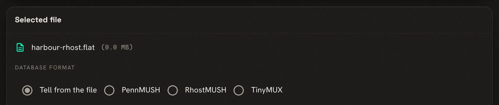
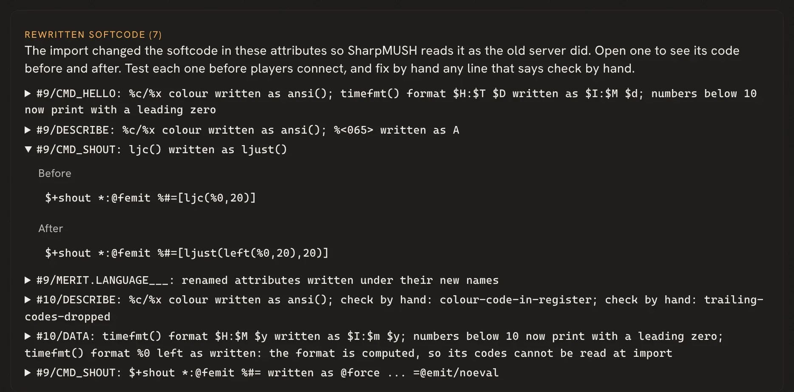

SharpMUSH imports a RhostMUSH or TinyMUX game, keeps its objects and softcode, and rewrites the code
that would read differently here. This page lists everything the import does to such a game. Plan the
move itself (rehearsal, checks, cutover and rollback) with the
[migration guide](/guides/pennmush-migration/); the import is one step of it.

| You want to | Read |
|---|---|
| know which files to upload | [What to upload](#what-to-upload) |
| know what comes across | [What comes across](#what-comes-across) |
| see what the import changes in softcode | [What the import rewrites](#what-the-import-rewrites) |
| know which settings it turns on | [Settings the import turns on](#settings-the-import-turns-on) |
| find a TinyMUX or RhostMUSH command SharpMUSH names differently | [Commands under a dialect](#commands-under-a-dialect) |
| know what is not supported | [What is left out](#what-is-left-out) |
| check the result | [Checking the import](#checking-the-import) |

## What to upload

The import page (**Admin > Database import**, `/admin/import`) tells the formats apart from the file's
contents, and you can choose the format there if it guesses wrong.



| Game | Database | Mail | Channels | Configuration |
|---|---|---|---|---|
| RhostMUSH | the flatfile `@dump/flat` writes | `.dump.mail` from `wmail/unload`, with `.dump.folder` in the mail folders slot | not imported (see below) | `netrhost.conf` |
| TinyMUX 1 to 2.13 | the flatfile | `mail.db` | `comsys.db` in the chat slot | `netmux.conf` |
| TinyMUX 2.14 | `game/data/netmux.sqlite` | inside the database | inside the database | `netmux.conf` |

Upload the files the configuration includes, such as `alias.conf` and `compat.conf`, in the slot beside
it. The database, mail and chat files may be gzipped.

**TinyMUX 2.14.** `netmux.sqlite` holds the game, its mail and its channels, so it is the whole upload.
TinyMUX writes recent changes to `netmux.sqlite-wal` first, and the import reads only the main file. Stop
the game cleanly before you copy it. If `netmux.sqlite-wal` is still there and not empty, run
`sqlite3 netmux.sqlite "PRAGMA wal_checkpoint(TRUNCATE);"` in `game/data` with nothing else using the
database.

**RhostMUSH without a flatfile.** If all you have is a stopped game's native backup (`netrhost.db` with its
QDBM or MDBX cache files), the `RhostExport` tool in the SharpMUSH repository turns it into the flatfile and
mail dumps the import reads. It supports RhostMUSH's default cache layout on Linux x64. It is run from a
SharpMUSH source checkout (`tools/RhostExport`), and it needs RhostMUSH's `dbconvert` exporter and a matching
profile, built from the one RhostMUSH revision the tool supports; the tool's README gives the steps.

## What comes across

- **Objects** keep their numbers, names, owners, parents, zones, locks, attributes and creation times.
- **Flags** become SharpMUSH's where one matches. Most with no match are kept as a flag of its own, so
  `hasflag()` still finds them; the import report lists any that are dropped.
- **RhostMUSH toggles** become flags of their own, so `@toggle` and `hastoggle()` keep working.
- **Staff.** A wizard gets the `wizard` role. RhostMUSH's royalty is a wizard here too. RhostMUSH's staff
  levels become roles of their own, each just above the role with the same rights: `guildmaster` above
  `player`, `architect` above `builder`, `councilor` above `royalty` and `immortal` above `wizard`. The
  setup wizard's staff step offers these levels for a RhostMUSH game.
- **Powers** become permissions. A TinyMUX power such as `control_all` becomes the permission it stands
  for. A RhostMUSH power becomes a permission held by that object alone, reaching as far down the staff
  levels as its level did, and a depower becomes a denied permission.
- **RhostMUSH totems** become roles named `totem-<name>`, in a Totems category. They grant nothing; softcode
  tests them with `hasrole()`.
- **RhostMUSH reality levels** become [reality layers](/reference/sharpmush-help/reality/) when
  `netrhost.conf` names them. `rxlevel(me,Umbra)` still reads.
- **RhostMUSH tags** come across, so `#weather` still names the same object.
- **Passwords** keep working. Each player's stored password is checked at login and replaced with
  SharpMUSH's own form the first time they connect. A password that is empty, or stored in a form
  SharpMUSH does not recognise, needs a new password from a wizard; the import report lists those players.
- **Mail** comes across, in RhostMUSH's folders when the folder dump is given.
- **TinyMUX channels** come across with their members, and each player's comsys aliases become
  `CHANALIAS` attributes. RhostMUSH's stock channels are softcode, which comes across with the objects
  that hold it.

A RhostMUSH cluster is merged into its first object, which takes the custom attributes the others held.
An object here holds up to 100,000 attributes, so the cluster is not needed.

## What the import rewrites

Each rewrite is listed in the import report, with the object and attribute. Code built at run time
(a command name or function name made by a function) cannot be seen by the import and is left as
written.

### Colour codes

`%c` and `%x` colour codes become `ansi()`, because in SharpMUSH `%c` is the last command and `%x` an
attribute. A code that is built at run time, such as `%c0X[printf(...)]`, is removed, and the report
warns about each attribute it was removed from; colour that text again with `ansi()`.

```text
Before:  A shiny widget%r%xbBlue text%xn
After:   A shiny widget%r[ansi(b,Blue text)]
```

RhostMUSH character codes such as `%<065>` become the character (`A`), and literal `timefmt()` formats
become SharpMUSH's.

### Attribute names

SharpMUSH attribute names refuse some characters, such as `:`, `(`, `)` and spaces. The import renames such an attribute, changing each
character it refuses to `_`, and rewrites the code that names it in full. A name that would then clash
with another gets `_2`, `_3` and so on.

```text
MERIT.LANGUAGE_()              becomes  MERIT.LANGUAGE___
_MERIT.ALLIES_(STREET CRIME)   becomes  _MERIT.ALLIES__STREET_CRIME_
```

When the old name looks like a function call, such as `NAME()`, the attribute is renamed but code is not
rewritten for it, since every call of that function would match. The report lists these; search for
them by hand.

### @hook

On TinyMUX and RhostMUSH, the hook's code is an attribute on the game's `hook_obj`, and `@hook/before look`
only turns the hook on. SharpMUSH's `@hook` names the object and attribute, and the bare form clears a
hook. The import writes each one out in full, here with `hook_obj` #12:

```text
@hook/before look          becomes  @hook/before look=#12,B_LOOK
@hook/before/after look    becomes  @hook/before look=#12,B_LOOK;@hook/after look=#12,A_LOOK
@hook/igswitch look        becomes  @hook/extend look=*
@hook/permit/clear look    becomes  @hook/permit look
```

Hooks the configuration file turned on at startup are added to God's `STARTUP`, because SharpMUSH keeps
hooks only while it runs. If the configuration names no `hook_obj`, the commands are left as written and
the report says so.

### @femit, @fpose and @fsay

These become `@force`, which evaluates the message as the one forcing, as TinyMUX does:

```text
@femit Lackey=sweeps [name(me)].   becomes  @force Lackey=@emit/noeval sweeps [name(me)].
@fpose Lackey=bows.                becomes  @force Lackey=pose/noeval bows.
```

### RhostMUSH commands

In command code (`$`-commands, `^`-listens and attributes that start with `@`, `&`, `{`, `think` or
`wmail`), RhostMUSH commands that SharpMUSH spells differently are rewritten:

| RhostMUSH | SharpMUSH |
|---|---|
| `join Bob` | `@teleport me=[loc(pmatch(Bob))]` |
| `grab %0` | `@teleport [pmatch(%0)]=here` |
| `@freeze 123`, `@thaw 456` | `@queue/pause 123`, `@queue/resume 456` |
| `@thaw/del 456` | `@halt/pid 456` |
| `@zone/add #3=#2`, `@zone/del #3=#2` | `@chzone/add #3=#2`, `@chzone/remove #3=#2` |
| `@lfunction double=me/DOUBLE` | `@function/local double=me,DOUBLE` |
| `@dynhelp history/lesson` | `@pemit %#=[textfile(history,lesson)]` |
| `wmail/wipe Jerk` | `@mail/debug clear=Jerk` |
| `@totem %#=Shiny !Dull` | `@role/assign %#=totem-shiny;@role/unassign %#=totem-dull` |

A `join` or `grab` aimed at a pronoun such as `him`, or at text that is not one name, dbref or
substitution, is left as written without a note, so search for those by hand.

### RhostMUSH functions

RhostMUSH functions whose arguments differ from SharpMUSH's are rewritten as the SharpMUSH call that
gives the same answer, among them `ljc()`, `rjc()`, `streq()`, `ncomp()`, `nummatch()`, `pedit()` and
`medit()`. RhostMUSH's `tag()` becomes `tagref()`, because SharpMUSH's `tag()` writes an HTML tag. The
totem functions become role tests:

```text
hastotem(%#,Shiny)          becomes  hasrole(%#,totem-shiny)
andtotem(%#,shiny !dull)    becomes  and(hasrole(%#,totem-shiny),not(hasrole(%#,totem-dull)))
ltotems(%#)                 becomes  iter(roles(%#,Totems),after(##,totem-))
```

A call that cannot be rewritten safely is left as written and listed under **check by hand**: for
example `ljc()` with a function call for its width, which the rewrite would run twice. `totems()`,
`listtotems()` and the other totem functions with no role form are listed the same way.

## Settings the import turns on

The import sets the game's `dialect` to `mux` or `rhost`, and turns on the
[compatibility settings](/reference/compatibility/#what-an-import-turns-on) that game's softcode
expects. The report lists each one. The dialect decides how typed commands and attributes without a
dialect flag are read: under `mux` and `rhost`, `strlen(a,b)` is 3, as on those servers, and under
`rhost`, `%-n` and `%+!` mean what RhostMUSH means. An attribute can carry its own dialect with the
`mux` or `rhost` attribute flag. See [compatibility dialects](/reference/sharpmush-help/compatibility-dialects/).

Runs of spaces in evaluated text are squeezed to one, as on PennMUSH and a stock TinyMUX or RhostMUSH game.
If the old game's configuration turned `space_compress` off, importing that file turns it off here too.

The [TinyMUX Softcode](/guides/tinymux-softcode/) and [RhostMUSH Softcode](/guides/rhostmush-softcode/)
guides explain each setting.

## Commands under a dialect

Some TinyMUX and RhostMUSH commands have no PennMUSH equivalent, or would clash with a PennMUSH
abbreviation (`@last` sets the LAST attribute on PennMUSH). Each has its own name, which works
everywhere, and the old name works under the dialect:

| Under the dialect | Its own name | Dialect |
|---|---|---|
| `@last` | `@dialect_last` | both |
| `@program`, `@quitprogram` | `@dialect_program`, `@dialect_quitprogram` | both |
| `@icmd` | `@dialect_icmd` | both |
| `@email` | `@dialect_email` | `mux` |
| `@addcommand`, `@delcommand`, `@listcommands` | `@dialect_addcommand`, `@dialect_delcommand`, `@dialect_listcommands` | `mux` |
| `@query` | `@dialect_query` | `mux` |
| `@folder` | `@mux_folder` | `mux` |
| `@site`, `@flagdef`, `@progreset` | `@rhost_site`, `@rhost_flagdef`, `@rhost_progreset` | `rhost` |

The dialect also maps commands SharpMUSH has under another name, such as RhostMUSH's `@sudo`
(`@force/inplace`) and `@reboot` (`@restart`), and each server's own abbreviations, such as `@pe` for
`@pemit`.

## What is left out

Some RhostMUSH and TinyMUX functions, commands and switches are left out on purpose: those that reach the
host machine, manage the old server's own storage, or have a SharpMUSH counterpart that works differently.
Imported code that calls one gets `#-1 FUNCTION (<NAME>) NOT FOUND` or `Huh?`, and the import report
names each use. The full list, with what to use instead, is
[compatibility left out](/reference/sharpmush-help/compatibility-left-out/).

Also not imported: destroyed objects, money, flags and toggles SharpMUSH has nothing for, attribute
numbers the flatfile does not name, and exits whose destination is not an object, HOME or a variable destination (they are left unlinked).


## Checking the import

When the import ends, the import page lists every rewritten attribute under **Rewritten softcode**. Open a
line to see the code before and after. A line marked **check by hand** gives the reason; fix those before
players connect.
**Download import log** saves the whole report, including every rewrite, as a text file.
The [migration guide](/guides/pennmush-migration/#check-the-rewritten-softcode) shows the page and the log.



