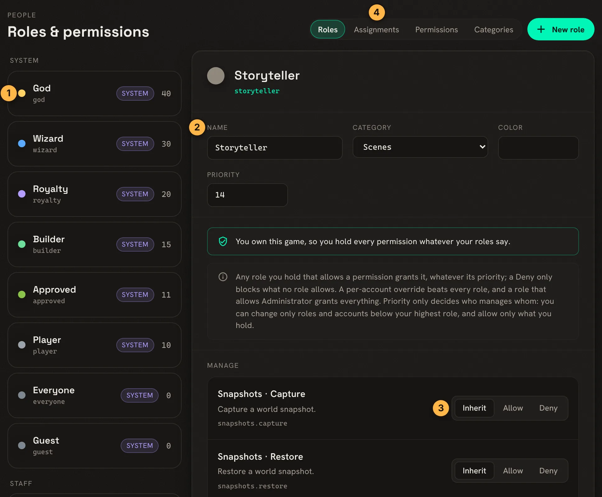

import { Aside } from '@astrojs/starlight/components';

SharpMUSH has no single wizard bit. Access comes from **roles**, named sets of permissions that work
like the roles on a Discord server. A character can hold several, and an account can hold roles that
every one of its characters gets. This page covers the everyday jobs. The `roles` and `@role` help
topics have the full rules.

The examples follow God setting up staff for Marrow and Tamsin.

## The roles a game starts with

| Role | For |
|---|---|
| `wizard` | Running the game. Holds almost everything. |
| `moderator` | Handling players: the Moderation page and audit log, sitelocks, guests, the wiki and media, and roles below its own. |
| `royalty` | Seeing everything in the game, plus the wiki and media. |
| `builder` | Commands a game has restricted to builders, such as `@dig` on a game where only builders build. |
| `helper` | Looking up characters, guests and activity in the portal, and the command queue, to help players. |
| `approved` | A character staff have approved. It can write on the wiki and show pictures. |
| `player` | Every character that is not a guest. Never assigned by hand. |
| `guest` | Guest characters. |
| `everyone` | Every object. It lets anyone read the wiki. |
| `god` | `#1` alone. |

`@role` lists them with their priority. A game that came from RhostMUSH, or chose RhostMUSH's staff
levels in setup, has `immortal`, `councilor`, `architect` and `guildmaster` in place of `helper` and
`moderator`.

## Making someone staff

Give the narrowest role that fits the job. A helper does not need to be a wizard:

```
> @role/assign *Tamsin=helper
Tamsin now holds helper.
```

`@role/unassign *Tamsin=helper` takes it away. `@set *Tamsin=WIZARD` still works and assigns the
`wizard` role.

<Aside type="caution">
God (`#1`) passes every check, so a mistake made as God has nothing to stop it. Make yourself an
ordinary character for staff work and give it the role you need.
</Aside>

## Approving a character

Once a character meets your game's bar, such as a finished application, assign `approved`:

```
> @role/assign *Marrow=approved
Marrow now holds approved.
> think isapproved(*Marrow)
1
```

Softcode checks it with `isapproved()` or `hasrole(<character>,approved)`.

## Making your own role

A role goes in a category. Make the category, then the role, then say where it ranks and what it
allows:

```
> @role/category/create Scenes=People who run and close scenes
Role category Scenes created. Put a role in it with @role/category <role>=Scenes.
> @role/create storyteller=Scenes/Storyteller
Role Storyteller (storyteller) created in Scenes at priority 1. Set what it allows with @role/allow.
> @role/priority storyteller=14
Role Storyteller is now at priority 14.
> @role/allow storyteller=wiki.delete media.admin
Role Storyteller: allows wiki.delete, media.admin.
```

`@permission` lists every permission a role can allow. Priority only decides who may manage whom:
you can change roles, and the people holding them, only below your own highest role. It never
decides what someone may do.

## A role for every character on an account

`/account` gives the role to the account the character belongs to, so all of that player's
characters hold it:

```
> @role/assign/account *Tamsin=storyteller
Tamsin (account Wren) now holds storyteller.
```

## One permission for one character

To give one character one thing without a role, set an override:

```
> @permission/allow *Marrow=game.see_all
Marrow: allows game.see_all.
```

`@permission/deny` takes a permission away from that character even when a role allows it, and
`@permission/clear` removes the override. `@power` sets the same overrides under PennMUSH's power
names.

## Checking what someone can do

`@role/player` shows a character's roles, where each comes from, its overrides, and every
permission it holds and lacks:

```
> @role/player *Marrow
=< Marrow >===================================================================
Account:           Wren
Roles:             Approved (11), Player (10), plus everyone
Overrides:         allow game.see_all; deny none
Account overrides: allow none; deny none
Holds:             game.see_all game.send_image jobs.manage.own media.upload
                   player.chat player.chown player.commands player.create
                   ...
```

## On the Roles page

Everything above can also be done in the portal, under **Build & manage**, **Roles & permissions**
(`/admin/roles`):



1. Every role, grouped by category, highest priority first.
2. The role's name, category, colour and priority.
3. Each permission is set to **Inherit** (leave it to other roles), **Allow** or **Deny**.
4. **Assignments** gives roles to characters and accounts.

## Next steps

- `help roles` explains how roles combine, guarded roles, and the full list of what each built-in
  role allows.
- [Staff List](/guides/staff) shows staff to players, with duty status.
