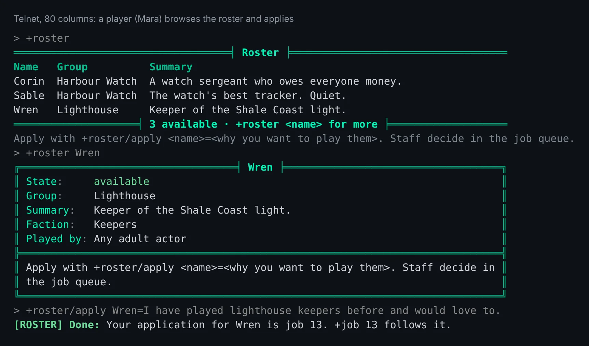
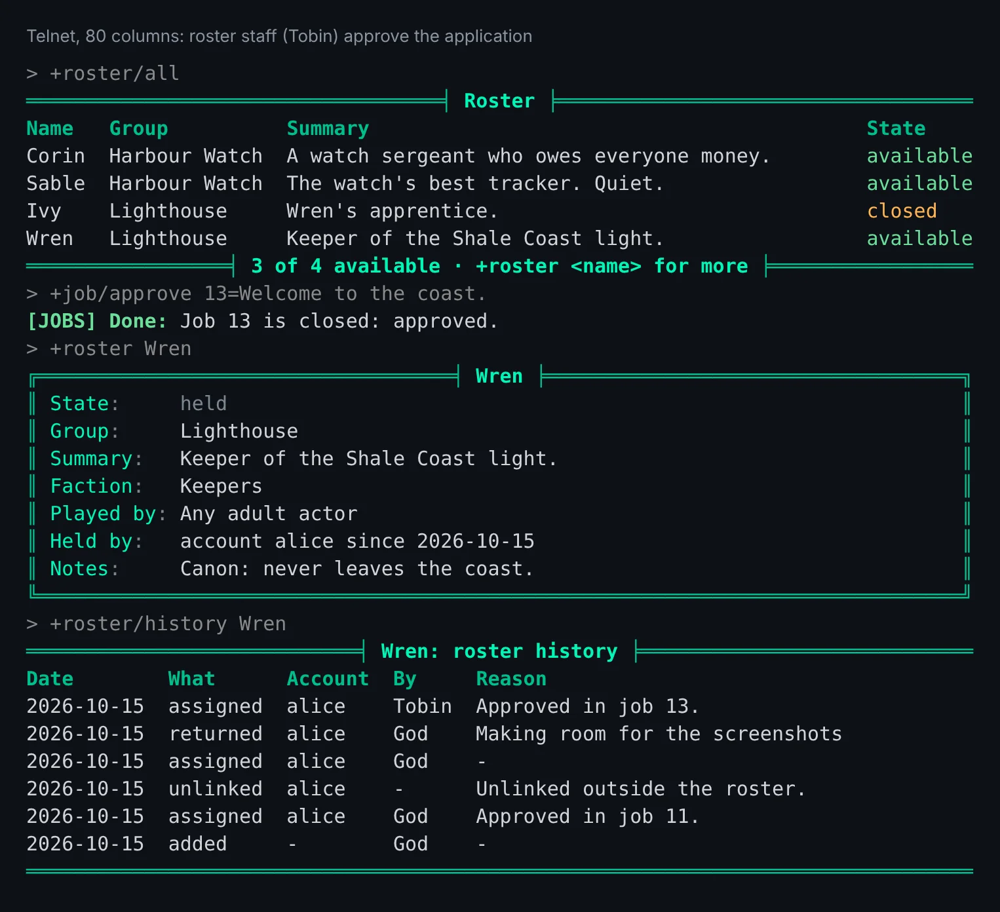

import { Aside } from '@astrojs/starlight/components';

The **roster** package keeps a list of characters a game hands out to players: canon characters,
or ones a player left behind. Staff put a character on the roster, give it to a player's account,
and take it back when the player stops playing it. The roster remembers who held each character
and when.

The roster does not decide how a player asks for a character. A game writes a line saying how, or
installs **roster-jobs**, which adds `+roster/apply` and decides applications in the job queue.

| You are | You want to | Read |
|---|---|---|
| A player | see who you could play | [Browsing the roster](#browsing-the-roster) |
| A player | ask for a character | [Applying](#applying) |
| Staff | add a character and describe it | [Adding characters](#adding-characters) |
| Staff | give a character out or take it back | [Giving and returning](#giving-and-returning) |
| Staff | find characters nobody plays | [Idle characters](#idle-characters) |
| An administrator | install it and choose how players ask | [Running the package](#running-the-package) |
| A coder | change the roster from softcode | [From softcode](#from-softcode) |

In the game, `+help roster` has the same commands in short form.

## Browsing the roster

`+roster` lists the characters you could ask for, by group, and says how to ask:

```
> +roster
══════════════════════════════════╡ Roster ╞══════════════════════════════════
Name   Group          Summary
Corin  Harbour Watch  A watch sergeant who owes everyone money.
Wren   Lighthouse     Keeper of the Shale Coast light.
═══════════════════╡ 2 available · +roster <name> for more ╞══════════════════
Apply with +roster/apply <name>=<why you want to play them>. Staff decide in the job queue.
```

`+roster <name>` shows one character, with every field staff wrote about it:

```
> +roster Wren
╔══════════════════════════════════╡ Wren ╞══════════════════════════════════╗
║ State:     available                                                       ║
║ Group:     Lighthouse                                                      ║
║ Summary:   Keeper of the Shale Coast light.                                ║
║ Faction:   Keepers                                                         ║
║ Played by: Any adult actor                                                 ║
╠════════════════════════════════════════════════════════════════════════════╣
║ Apply with +roster/apply <name>=<why you want to play them>. Staff decide  ║
║ in the job queue.                                                          ║
╚════════════════════════════════════════════════════════════════════════════╝
```

`+roster/all` lists every character on the roster, with its state:

- **available**: nobody holds it, and you can ask for it.
- **held**: it is on someone's account.
- **closed**: the game lists it but is not offering it.

```
> +roster/all
══════════════════════════════════╡ Roster ╞══════════════════════════════════
Name   Group          Summary                                        State
Corin  Harbour Watch  A watch sergeant who owes everyone money.      available
Sable  Harbour Watch  The watch's best tracker. Quiet.               held
Ivy    Lighthouse     Wren's apprentice.                             closed
Wren   Lighthouse     Keeper of the Shale Coast light.               available
════════════════╡ 2 of 4 available · +roster <name> for more ╞════════════════
```

A terminal shows the roster in the reader's own colours:



A character you are given is linked to your account. Play it the way you play any other
character on your account: `play <name>` at the account menu, or the character list in the web
portal. Its password is the game's, not yours.

## Applying

With roster-jobs installed, `+roster/apply <name>=<why>` asks for an available character. It files
a job in the **Roster** bucket, and `+job <number>` follows it like any other job:

```
> +roster/apply Wren=I have played lighthouse keepers before and would love to.
[ROSTER] Done: Your application for Wren is job 11. +job 11 follows it.
```

Apply from a character that is already on your account: the character you are given is linked
to that account. A character that is on no account is told so:

```
[ROSTER] Warning: Apply from a character on your account: the character you are given is linked to it.
```

An account can have one application open for each character, and three open at once.

When staff approve the job, the character is linked to your account, and your connected
characters hear:

```
[ROSTER] Wren is yours now. Play it from your account: play Wren
```

When the character goes to someone else, or leaves the roster, your application is closed and
says why.

Without roster-jobs, the line under `+roster` says how your game wants you to ask.

## Staff

Staff with the `softcode.roster.manage` permission look after the roster. The package makes a
`roster-admin` role that allows it, and gives it to nobody, so a game hands it out. To one player:

```
> @role/assign Tobin=roster-admin
Tobin now holds roster-admin.
```

Or to every wizard, through their role:

```
> @role/allow wizard=softcode.roster.manage
Role Wizard: allows softcode.roster.manage.
```

Anyone else who tries a staff switch is refused:

```
[ROSTER] Error: Only roster staff can use +roster/assign.
```

### Adding characters

`+roster/add <name>[=<group>]` puts a character on the roster:

```
> +roster/add Wren=Lighthouse
[ROSTER] Done: Wren is on the roster (Lighthouse), available. Its password has been changed, so only an account it is given to can play it.
```

A character that is on nobody's account is **available**, and its password is changed so nobody
can log in to it until it is given out. A character that is already on an account is added as
**held** by that account, and keeps its password. God, wizards and royalty are refused.

`+roster/set <name>/<field>=<text>` writes a field. `group` and `summary` show in the list; any
other field shows on the character's own screen. A field name is a letter followed by letters,
digits or `_`:

```
> +roster/set Wren/SUMMARY=Keeper of the Shale Coast light.
[ROSTER] Done: Wren's summary field is set.
> +roster/set Wren/FACTION=Keepers
[ROSTER] Done: Wren's faction field is set.
> +roster/set Wren/PLAYED_BY=Any adult actor
[ROSTER] Done: Wren's played_by field is set.
> +roster/set Wren/NOTES=Canon: never leaves the coast.
[ROSTER] Done: Wren's notes field is set.
```

`notes` is shown to roster staff only. Leave the text out to clear a field.

`+roster/close <name>` keeps an available character listed but not offered, and `+roster/open
<name>` offers it again. `+roster/remove <name>` takes a character off the roster; the character,
its account and its history stay.

### Giving and returning

`+roster/assign <name>=<character or account>` links the character to an account. Name a
character to mean the account it is on, or name the account:

```
> +roster/assign Corin=Tobin
[ROSTER] Done: Corin is now held by account bob.
```

The account's connected characters are told. An account holds one roster character at a time
unless the game changes that (see [Settings](#settings)):

```
[ROSTER] Warning: Account alice already holds 1 roster character, the most one account may.
```

With roster-jobs installed, giving a character out this way also closes the open applications
for it: the one from the account that got it as approved, the others as denied.

`+roster/return <name>[=<reason>]` takes the character off its account and makes it available
again. Its password is changed, any connection to it is closed, and the account's connected
characters are told:

```
> +roster/return Sable=Player stepped away
[ROSTER] Done: Sable is back on the roster, taken from account alice. Its password has been changed and its connections closed.
```

`+roster <name>` shows staff who holds a character, and since when:

```
> +roster Wren
╔══════════════════════════════════╡ Wren ╞══════════════════════════════════╗
║ State:     held                                                            ║
║ Group:     Lighthouse                                                      ║
║ Summary:   Keeper of the Shale Coast light.                                ║
║ Faction:   Keepers                                                         ║
║ Played by: Any adult actor                                                 ║
║ Held by:   account alice since 2026-10-15                                  ║
║ Notes:     Canon: never leaves the coast.                                  ║
╚════════════════════════════════════════════════════════════════════════════╝
```

`+roster/history <name>` lists who held it and who changed it, newest first:

```
> +roster/history Sable
══════════════════════════╡ Sable: roster history ╞══════════════════════════
Date        What      Account  By   Reason
2026-10-15  returned  alice    God  Player stepped away
2026-10-15  assigned  alice    God  -
2026-10-15  added     -        God  -
══════════════════════════════════════════════════════════════════════════════
```

Approving an application gives the character out the same way, and its history says which job did it:



The roster stays right when an account changes some other way. A character linked with
`@account/link`, claimed by a player or unlinked in the portal is held or available on the roster
at once, and its history says so:

```
> @account/unlink alice=Wren
Wren is no longer linked to account 'alice'.
> +roster/history Wren
═══════════════════════════╡ Wren: roster history ╞═══════════════════════════
Date        What      Account  By   Reason
2026-10-15  unlinked  alice    -    Unlinked outside the roster.
2026-10-15  assigned  alice    God  Approved in job 11.
2026-10-15  added     -        God  -
══════════════════════════════════════════════════════════════════════════════
```

### Idle characters

`+roster/idle [<days>]` lists held characters nobody has played for that many days, 60 unless the
game changes it. A character counts as played from its last login, or from when it was given
out, whichever is later:

```
> +roster/idle
══════════════════════════╡ Idle roster characters ╞══════════════════════════
Name  Account                                          Held since  Last played
Wren  alice                                            2026-08-01  75 days ago
══════╡ 1 not played in 60 days · +roster/return <name> takes one back ╞══════
```

Nothing is returned on its own: staff decide, and use `+roster/return`.

## Running the package

### Installing

The roster ships with the server but is not installed on a new game. An administrator installs it
from the portal:

1. Open **Packages** in the admin area and choose **Browse**.
2. Install `roster`. It needs an event handler, which is chosen in first-run setup. Its `+help` topics and `+config` settings come with it, through the `roster-help` and `roster-config` bridges, wherever `+help` and `+config` are installed.
3. To decide applications in the job queue, also install `roster-jobs`. It needs `jobs`.

`+roster` is a game command, matched before softcode `$`-commands, so a `+roster` your game
already has in softcode stops running once the package is in.

See [Softcode Packages](/guides/packages) for how installing, upgrading and rolling back work.

### Choosing how players ask

Without roster-jobs, the roster has no way to apply. Say how players ask in
``DATA`HOW`TO`GET`` on the **Roster** object in the master room:

```
> &DATA`HOW`TO`GET Roster=Page a wizard, or post on the Roster board.
```

The line shows under `+roster` and under every available character. A package can put its own
line in ``DATA`HOW`TO`GET`<name>``, which shows instead; roster-jobs does, to point at `+roster/apply`.

With roster-jobs, applications are jobs in the **Roster** bucket. Whoever works that bucket
decides them: the `softcode.jobs.roster` permission, which the `job-admin-roster` role allows,
or `softcode.jobs.admin` for every bucket.

- `+job/approve <number>` gives the character to the applicant's account and closes the other
  open applications for it as denied. If the roster refuses, because the account already holds
  as many roster characters as it may, the job gets a staff note saying why.
- `+job/deny <number>=<reason>` refuses one.

Nobody can file in the Roster bucket with `+request`: applications come only from
`+roster/apply`.

### Settings

Settings are attributes on the **Roster** object:

| Attribute | What it is | Default |
|---|---|---|
| ``DATA`MAX`PER`ACCOUNT`` | how many roster characters one account may hold; `0` is no limit | `1` |
| ``DATA`IDLE`DAYS`` | the days `+roster/idle` uses when given none | `60` |
| ``DATA`HOW`TO`GET`` | the line saying how a player gets a character | `Ask staff how to take on a roster character.` |
| ``DATA`RETURN`MESSAGE`` | what the account's characters are told when one goes back | `Its password has been changed, so it is no longer yours to play.` |
| ``DATA`FIELDS`ORDER`` | the fields a character's screen shows first, in order | `GROUP SUMMARY` |

``DATA`MAX`OPEN`` on the **Roster Applications** object, inside the Roster, is how many
applications one account may have open. It is 3.

## From softcode

### Who holds a character

Two functions answer which account a character is on, without the roster:

- `account(<player>)` is the account's id, and empty when the character is on none.
  `account(<player>, name)` is the account's username.
- `accountchars(<player>)` lists the objids of every character on the same account.

A character may ask about itself and the other characters on its account. Anyone else needs the
`players.view` permission, and so does `account(<player>, name)`, since a username is half of a
login:

```
> think account(Wren) / [accountchars(Mara)]
node_accounts/2 / #15:1792041887040 #16:1792041895280 #48:1792044477789
```

When an account changes, the game raises the [events](/guides/events) `player`link` and
`player`unlink`, with `%<objid>` the character and `%<account>` the account's id.

### Changing the roster

Code on a WIZARD object changes the roster the way the commands do. Each step runs as the Roster,
takes named arguments, and leaves `%q<roster_error>` empty when it worked or says why it did not.
It tells nobody, so the caller says what happened:

```
@trigger/inline/nobreak/args Roster/INC`API`ASSIGN=character,Wren,to,Mara,actor,%:,reason,Won the contest.
@assert not(strlen(%q<roster_error>))=@pemit %#=%q<roster_error>
```

`` INC`API`RETURN ``, `` INC`API`ADD `` (with `group`) and `` INC`API`REMOVE `` take the same
arguments. To read the roster:

- ``u(Roster/FUN`API`STATE,<character>)`` is `available`, `held` or `closed`, and empty off the
  roster.
- ``u(Roster/FUN`API`FIELD,<character>,<field>)`` reads one field.
- ``u(Roster/FUN`API`LIST[,<state>])`` lists the roster's characters.

### Steps after a change

After each change, the Roster runs every ``ON`<STEP>`<name>`` attribute on itself, in name order,
with `%<character>`, `%<actor>`, `%<reason>` and `%<account>`. The steps are `ADD`, `ASSIGN`,
`RETURN` and `REMOVE`. Welcoming a new holder by mail, wiping a returned character's notes or
posting to a channel belongs here:

```
&ON`RETURN`WIPE Roster=&NOTES %<character>
```

### Adding a switch

``DATA`ROUTE`<SWITCH>`` on the Roster names the routine each switch runs. A value with a `/` in
it is an attribute on another object, run as that object when the switch is typed, with the
command's parts in `%q<cmd_left_side>` and `%q<cmd_right_side>` and the player as `%#`. This is
how roster-jobs adds `/apply`:

```
&DATA`ROUTE`APPLY Roster=<Roster Applications>/INC`APPLY
```

<Aside>
A package that adds a switch this way sets the attribute from its own `package.yaml`, as
roster-jobs does, so uninstalling the package takes the switch away again.
</Aside>
