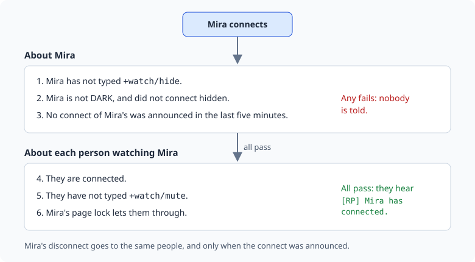

import { Aside } from '@astrojs/starlight/components';

**RP Finder** helps players find someone to play with. It has two parts:

- `+lfrp` says what you would like to play. It shows in `+who` and in a list of who is
  looking.
- The **watch list** tells you when the people you follow connect and leave.

How a game uses the status beyond that, such as pointing to a board or a channel for
longer requests, is up to the game and its other packages.

| You are | You want to | Read |
|---|---|---|
| A player | find a scene | [Looking for RP](#looking-for-rp) to [The watch list](#the-watch-list) |
| A player | keep others from tracking you | [Privacy](#privacy) |
| A moderator | clear a status | [Moderating](#moderating) |
| Staff | install it and change its settings | [Running the finder](#running-the-finder) |

In the game, `+help rp` has the same commands in short form.

What you type is kept exactly as you typed it. Brackets, percent signs and semicolons are
plain text, so `+lfrp/note Short scenes; no combat [OOC]` stores just that.

## Looking for RP

`+lfrp` followed by a line says what you would like to play. Write it the way you would
pitch the scene, in a sentence others can read at a glance:

```
> +lfrp Stacking wood by the mill, glad of company
[RP] Done: You are looking for RP: Stacking wood by the mill, glad of company
It lasts 4 hours or until you log off. +lfrp/note adds an OOC note, +lfrp/place where to find you, and +lfrp/off ends it.
```

That line is your **status**. Two more things can go with it:

- `+lfrp/note <text>` adds an OOC note: what kind of scene, how long you have, what you
  would rather not play.
- `+lfrp/place <text>` says where to find you. `+lfrp/place here` shows the room you are
  standing in, and follows you as you move.

```
> +lfrp/note Short scenes tonight; happy to play a newcomer.
[RP] Done: Your note: Short scenes tonight; happy to play a newcomer.
> +lfrp/place here
[RP] Done: Others see where you are standing, wherever you go.
```

Leave the text out to clear either one: `+lfrp/note` on its own clears the note.

A status lasts four hours from the last time you changed it, and ends when you log off.
`+lfrp/off` ends it sooner. Changing your line, note or place starts the four hours again.

### Who is looking

`+lfrp` on its own lists everyone looking, the least idle first:

```
> +lfrp
==============================< Looking for RP >==============================
Name   Looking for                                          Where         Idle
Tomas  Looking for a smuggler to hire                       -               0s
Mira   Stacking wood by the mill, glad of company           The Old Mill    0s
======================< +lfrp/show <name> shows a note >======================
```

`+lfrp/show <name>` shows one status with its note. `+lfrp/show` on its own shows yours.

```
> +lfrp/show Mira
===================================< Mira >===================================
Looking for: Stacking wood by the mill, glad of company
Note:        Short scenes tonight; happy to play a newcomer.
Where:       The Old Mill
Since:       0s ago
Idle:        0s
==============================================================================
```

The list shows only players you could see in `WHO`, so a hidden player's status stays
hidden from you.

### In +who

While you are looking, your line shows in the Status column of `+who`, cut to 40
characters. The column is there only while someone has a status.

```
> +who
+==============================< Who's Online >==============================+
| Name   Idle  Connected  Status                                             |
| ----------------------------------------------------------------           |
| God      0s         1s                                                     |
| Mira     0s         0s  Stacking wood by the mill, glad of co...           |
| Tomas    0s         0s  Looking for a smuggler to hire on the...           |
| Ilse     0s         0s                                                     |
+============================================================================+
| 4 connected                                                                |
+============================================================================+
```

On a narrow screen the Status column is the first to go.

## The watch list

`+watch/add <name>` adds someone to your watch list. From then on you hear when they
connect and when they leave:

```
> +watch/add Mira
[RP] Done: You watch Mira now: you hear when they connect and leave.
[RP] Mira has connected.
[RP] Mira has disconnected.
```

`+watch/del <name>` takes them off again.

- `+watch` lists the people you watch who are on now, with where they are and what they
  are looking for.
- `+watch/list` lists everyone you watch, with when each was last on.

```
> +watch
==============================< Watched and on >==============================
Name  Idle  Where         Looking for RP
Mira    0s  The Old Mill  -
==================< 1 of 1 on · +watch/list shows them all >==================
> +watch/list
==================================< Watched >=================================
Name  Last on
Mira  0s ago
=================< 1 watched · +watch/mute stops the notices >================
```

When you log in, you hear which of the people you watch are already on:

```
[RP] On now of those you watch: Mira.
```

`+watch/mute` stops the connect and disconnect lines but keeps your list.
`+watch/unmute` starts them again.

A connection that drops and comes straight back does not announce itself twice. After a
connect is announced, the next one within five minutes is not, and neither is its
disconnect.

### Coming from +watch or +friend

The commands follow the FRIEND global many games already run. `+friend` is the same
command as `+watch`, so `+friend/add`, `+friend/del` and `+friend/delete` work, and so do
`/hide` and `/mute`.

### Privacy

You decide whether others can follow you:

- `+watch/watchers` shows who watches you.
- `+watch/hide` stops anyone hearing when you connect or leave, and leaves you out of
  their `+watch`. `+watch/unhide` undoes it.
- Someone your page lock keeps out is never told when you connect. See `help @lock/page`
  in the game.
- Nobody hears of you while you are DARK or connected hidden.
- Someone who cannot locate you sees `-` where your room would be.

```
> +watch/watchers
===============================< Watching you >===============================
Tomas  Ilse
============< 2 watching · +watch/hide stops them hearing of you >============
```



## Pages

A list longer than your screen is split into pages. The last line says which page you are
on and how to see the next: add the page number as the last switch.

| Type | To see |
|---|---|
| `+lfrp/2` | the second page of who is looking |
| `+watch/2` | the second page of the people you watch who are on |
| `+watch/list/2` | the second page of everyone you watch |

## Moderating

Players with the RP Moderator role look after the finder:

- `+lfrp/off <name>` clears someone's status. The player is told who cleared it.

```
> +lfrp/off Ilse
[RP] Done: Ilse is no longer looking for RP.
```

Ilse hears:

```
[RP] Tomas cleared your +lfrp status.
```

Anyone else who tries is refused with `Only an RP moderator can clear someone else's
status.`

## Running the finder

### Installing

RP Finder ships with the server but is not installed on a new game. An administrator
installs it from the portal:

1. Open **Packages** in the admin area and choose **Browse**.
2. Install `who-where`, which gives `+who` and `+where`.
3. Install `rp-finder`. It needs `who-where` and `plus-help`; a new game already has
   `plus-help`.

It adds the commands `+lfrp`, `+watch` and `+friend` for everyone.
They are game commands, which are matched before softcode `$`-commands, so a `+watch` or
`+friend` your game already has in softcode stops running once the package is in.

See [Softcode Packages](/guides/packages) for how installing, upgrading and rolling back
work.

### Roles

The package adds the **RP Moderator** role (`rp-moderator`), in a category of its own
called RP Finder. Give it with `@role/assign`:

```
> @role/assign Tomas=rp-moderator
Tomas now holds rp-moderator.
```

To let one player moderate without the role, allow them the permission instead:
`@permission/allow Tomas=softcode.rp_finder.moderate`.

### Settings

Each setting is an attribute on the **RP Finder** object in the master room. Find its
number with `@find`:

```
> @find RP Finder
#15 #16 #17
```

The first is the RP Finder. The other two are its store and its help. The numbers on your
game will differ. Then set the
attribute on it:

```
> &DATA`LFRP`HOURS #15=6
RP Finder/DATA`LFRP`HOURS
```

| Attribute | What it is | Default |
|---|---|---|
| ``DATA`LFRP`HOURS`` | How many hours a status lasts from when it is set. | 4 |
| ``DATA`LFRP`LENGTH`IC`` | The longest `+lfrp` line, in characters. | 100 |
| ``DATA`LFRP`LENGTH`NOTE`` | The longest note. | 400 |
| ``DATA`LFRP`LENGTH`PLACE`` | The longest place. | 60 |
| ``DATA`LFRP`MORE`` | A line shown under `+lfrp`. | unset |
| ``DATA`WATCH`MAX`` | How many people one player may watch. | 100 |
| ``DATA`WATCH`QUIET`` | Seconds before a player's connect is announced again. | 300 |

A change takes effect at once. A new ``DATA`LFRP`HOURS`` applies to statuses set after
the change.

### Other statuses in +who

Any package can add to the Status column. It puts an attribute named
``FILTER`WHO`STATUS`<name>`` on the Who-Where Function Object. For each player, `+who`
runs every such filter in name order. Each gets the status so far as `%0`, empty to begin
with, and the player as `%1`, and returns the status to show. RP Finder's own filter is
``FILTER`WHO`STATUS`LFRP``: it shows the player's `+lfrp` line, or passes `%0` on.

For example, to show "Staff" for wizards who are not looking for RP, name the filter so it
runs before RP Finder's:

```
&FILTER`WHO`STATUS`AASTAFF <Who-Where Function Object>=if(hasrole(%1,wizard),Staff,%0)
```

`+help who filters` in the game says the same.

### Pointing to a board

If your game has the [bulletin boards](/guides/bboards), their Public board has a
**Looking for RP** board for longer requests. ``DATA`LFRP`MORE`` puts a line under the
`+lfrp` list that sends players there:

```
> &DATA`LFRP`MORE #15=Longer requests: +bbread public/looking
RP Finder/DATA`LFRP`MORE
> +lfrp
==============================< Looking for RP >==============================
Name  Looking for                                             Where       Idle
Mira  Stacking wood by the mill, glad of company              -             0s
======================< +lfrp/show <name> shows a note >======================
Longer requests: +bbread public/looking
```

<Aside>
Statuses and watch lists are all kept on the RP Finder Store, not on the
players. Nobody can change someone else's list, and uninstalling the package removes
them all.
</Aside>
