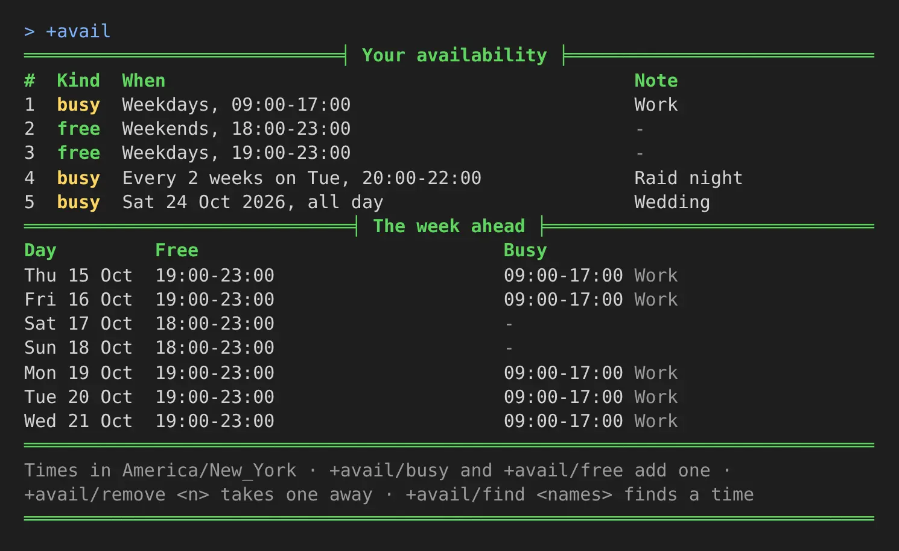
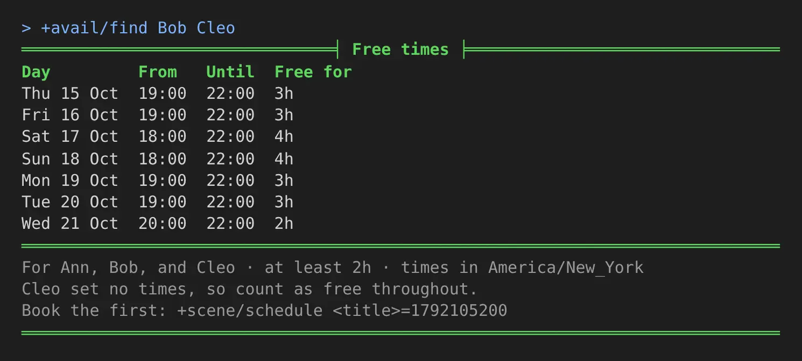
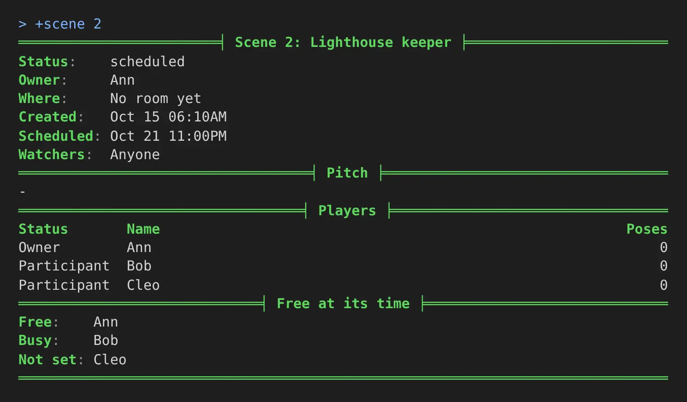

import { Aside } from '@astrojs/starlight/components';

Getting players together for a scene is often a scheduling problem. The **scene-availability**
package lets each player write down when they are busy and when they are free to play, the way an
office calendar keeps a meeting that repeats, and then answers two questions:

- When are all of us free? `+avail/find Bob Cleo` lists the times.
- Who can make this scene? A scheduled scene's card shows who of its cast is free at its time.

Times are kept in each player's own zone, the one the [time package](/guides/time) sets, and shown
to each reader in theirs.

| You are | You want to | Read |
|---|---|---|
| A player | say when you are busy or free | [Your times](#your-times) |
| A player | write a pattern that repeats | [Writing a time](#writing-a-time) |
| A player | see when someone else is free | [Another player's week](#another-players-week) |
| A player or a scene runner | find a time a group is all free | [Finding a time](#finding-a-time) |
| A scene runner | see who can make a scene | [Scene cards](#scene-cards) |
| Staff | install it and change its settings | [Running the package](#running-the-package) |
| A coder | ask whether someone is free from your own code | [For coders](#for-coders) |

In the game, `+help avail` and its subtopics have the same commands in short form.

## Your times

`+avail/busy <when>=<note>` adds a time you are busy, and `+avail/free <when>=<note>` a time you are
free to play. The note is optional. Ann, in New York, works on weekdays, plays in the evenings and at
weekends, raids every other Tuesday and has a wedding to go to:

```
> +avail/busy weekdays 9-5=Work
[AVAIL] Done: Added 1, busy: Weekdays, 09:00-17:00.
> +avail/free sat sun 18:00-23:00
[AVAIL] Done: Added 2, free: Weekends, 18:00-23:00.
> +avail/free weekdays 7pm-11pm
[AVAIL] Done: Added 3, free: Weekdays, 19:00-23:00.
> +avail/busy every 2 weeks tue 20:00-22:00=Raid night
[AVAIL] Done: Added 4, busy: Every 2 weeks on Tue, 20:00-22:00.
> +avail/busy 2026-10-24=Wedding
[AVAIL] Done: Added 5, busy: Sat 24 Oct 2026, all day.
```

`+avail` lists your entries, numbered, and your week ahead:

```
> +avail
=============================< Your availability >============================
#  Kind  When                                           Note
1  busy  Weekdays, 09:00-17:00                          Work
2  free  Weekends, 18:00-23:00                          -
3  free  Weekdays, 19:00-23:00                          -
4  busy  Every 2 weeks on Tue, 20:00-22:00              Raid night
5  busy  Sat 24 Oct 2026, all day                       Wedding
==============================< The week ahead >==============================
Day         Free                            Busy
Thu 15 Oct  19:00-23:00                     09:00-17:00 Work
Fri 16 Oct  19:00-23:00                     09:00-17:00 Work
Sat 17 Oct  18:00-23:00                     -
Sun 18 Oct  18:00-23:00                     -
Mon 19 Oct  19:00-23:00                     09:00-17:00 Work
Tue 20 Oct  19:00-23:00                     09:00-17:00 Work
Wed 21 Oct  19:00-23:00                     09:00-17:00 Work
==============================================================================
Times in America/New_York * +avail/busy and +avail/free add one *
+avail/remove <n> takes one away * +avail/find <names> finds a time
==============================================================================
```

A client that reads colour shows busy in yellow and free in green:



The raid does not show on Tuesday 20 October. A repeat every two weeks counts its weeks from the week
it starts in, which is this week unless you give a date with `from`, so its first Tuesday is the 27th.

### Free and busy

Until you add a free time, you count as free whenever you are not busy. Once you add one, only the
times your free entries cover count, less the times you are busy. Ann is free on weekday evenings
and at weekend evenings, and not at 10 in the morning on a Saturday, though nothing says she is busy
then.

Free time is counted in steps of 30 minutes. A step is free when a free entry covers all of it and no
busy entry touches it.

### Changing your entries

`+avail/remove <n>` takes an entry away. `+avail/clear` takes them all.

`+avail/skip <n>=<date>` leaves one date out of a repeating entry, a week you are away, and
`+avail/unskip <n>=<date>` puts it back:

```
> +avail/skip 2=2026-10-27
[AVAIL] Done: Entry 2 leaves out Tue 27 Oct 2026.
> +avail/unskip 2=2026-10-27
[AVAIL] Done: Entry 2 takes in Tue 27 Oct 2026 again.
> +avail/remove 9
[AVAIL] Warning: You have no entry 9. +avail lists yours.
```

A character keeps 30 entries at most, and a note is up to 60 characters. Your notes are yours: no one
else sees them.

## Writing a time

The `<when>` after `+avail/busy` and `+avail/free` is words in any order. Capitals and commas do
not matter.

| Words | Means |
|---|---|
| `mon`, `tuesday`, `thursdays`, `mon wed fri` | those days, every week |
| `weekdays`, `weekends`, `mon-thu` | a run of days, every week |
| `daily`, `every 3 days` | every day, or every few |
| `every 2 weeks tue`, `every other week thu`, `fortnightly fri` | every other week, counted from the week of the first date |
| `2nd tue`, `last fri`, `2nd and 4th thu` | those weekdays in those weeks of each month |
| `15th`, `1st 15th`, `monthly` | those days of each month; `monthly` is the first date's day |
| `2026-10-20`, `today`, `tomorrow` | one date, written year first |
| `2026-12-20 to 2026-12-28` | each of those days |
| `from 2026-11-02`, `until 2026-12-14` | the first and last day of a repeat |
| `19:00-22:00`, `7pm-10pm`, `9-5` | the time of day; `9-5` is read as 9:00 to 17:00 |
| `23:00-02:00` | a time that ends before it starts runs past midnight |

With no time, the entry is all day. Cleo's entries show more of these, from a player whose zone is
not set, so the game's (UTC here):

```
> +avail/free last fri 19:00-23:00
[AVAIL] Done: Added 1, free: The last Fri of each month, 19:00-23:00.
> +avail/busy 2nd tue 4th tue 18:00-21:00=Choir
[AVAIL] Done: Added 2, busy: The 2nd and 4th Tue of each month, 18:00-21:00.
> +avail/busy 15th=Payday shift
[AVAIL] Done: Added 3, busy: The 15th of each month, all day.
> +avail/busy 2026-12-20 to 2026-12-28=Holiday
[AVAIL] Done: Added 4, busy: Sun 20 Dec 2026 to Mon 28 Dec 2026.
> +avail/free sat until 2026-11-30
[AVAIL] Done: Added 5, free: Every Sat, all day, until Mon 30 Nov 2026.
```

Words it cannot read are named back to you:

```
> +avail/busy someday
[AVAIL] Warning: 'someday' is not a day, a date or a time I can read. +help avail when lists what a time can say.
> +avail/busy tue 9-5 every 99 weeks
[AVAIL] Warning: Every 99 is not a repeat I can keep. Give 1 to 52.
```

A yearly repeat, or two times of day in one entry, cannot be written. Add a second entry for those.

### Your zone

An entry keeps the time as you typed it, in your zone, with the zone beside it. A weekly 19:00 stays
19:00 for you when summer time starts or ends, and moves for players in zones that change on another
day. Set your zone with `+timezone`, from the [time package](/guides/time#setting-your-zone). An entry
you added before you set it keeps the zone it was written in.

A zone you hide with `+timezone/hide` still places your entries. Other players see your times only in
their own zone.

## Another player's week

`+avail <name>` shows another player's week ahead, in your zone, without their notes. Bob, in London,
looks at Ann's:

```
> +avail Ann
=============================< Availability: Ann >============================
Day         Free                                     Busy
Thu 15 Oct  -                                        14:00-22:00
Fri 16 Oct  00:00-04:00                              14:00-22:00
Sat 17 Oct  00:00-04:00, 23:00-24:00                 -
Sun 18 Oct  00:00-04:00, 23:00-24:00                 -
Mon 19 Oct  00:00-04:00                              14:00-22:00
Tue 20 Oct  00:00-04:00                              14:00-22:00
Wed 21 Oct  00:00-04:00                              14:00-22:00
==============================================================================
Times in Europe/London * +avail/find Ann finds a time you are both free
==============================================================================
```

Ann's weekday evening, 19:00 to 23:00 in New York, is midnight to 4 in the morning for Bob. Her
entries start on Thursday 15 October, the day she added them, so the Wednesday evening before them
does not count.

## Finding a time

`+avail/find <names>=<length>` lists the times in the coming week when you and every player named
are all free, for at least that length. Names are split by spaces or commas. The length is `2h`,
`90m`, `1h30m` or a number of hours, and two hours when left out.

Bob has added `+avail/free daily 23:00-03:00` and `+avail/busy wed 23:00-01:00=Five-a-side`, in
London. Ann asks for a time with Bob and Cleo, who had not set any times yet:

```
> +avail/find Bob Cleo
================================< Free times >================================
Day         From   Until  Free for
Thu 15 Oct  19:00  22:00  3h
Fri 16 Oct  19:00  22:00  3h
Sat 17 Oct  18:00  22:00  4h
Sun 18 Oct  18:00  22:00  4h
Mon 19 Oct  19:00  22:00  3h
Tue 20 Oct  19:00  22:00  3h
Wed 21 Oct  20:00  22:00  2h
==============================================================================
For Ann, Bob, and Cleo * at least 2h * times in America/New_York
Cleo set no times, so count as free throughout.
Book the first: +scene/schedule <title>=1792105200
==============================================================================
```



On Wednesday Bob's football runs to 20:00 in New York, so that evening starts later. A player who has
set no times counts as free throughout, and is named under the list.

The last line books the first time as a scene. `+scene/schedule` reads the time in seconds:

```
> +scene/schedule Lighthouse keeper=1792105200
[SCENE] Done: Scheduled scene 3 "Lighthouse keeper" for Thu Oct 15 23:00:00 2026.
```

`+avail/find Bob=3h` asks for three hours, and drops Wednesday.

`+avail/scene <id>=<length>` does the same for a scene's cast, its owner and everyone who joined it,
to move a scene to a time they can all make:

```
> +avail/scene 1
==========================< Free times for scene 1 >==========================
Day         From   Until  Free for
Thu 15 Oct  19:00  22:00  3h
...
```

## Scene cards

A scene scheduled for a time still to come shows, under its cast, who is free at its time, who is
busy, and who has set no times. Ann scheduled scene 2 for Wednesday at 19:00 in New York,
which is midnight in London, and Bob plays football until one:

```
> +scene 2
...
==============================< Players >=====================================
Status       Name                                                        Poses
Owner        Ann                                                             0
Participant  Bob                                                             0
Participant  Cleo                                                            0
============================< Free at its time >==============================
Free:    Ann
Busy:    Bob
Not set: Cleo
==============================================================================
```



A scene is taken to last two hours. *Busy* means not free for all of them: busy at some point, or
outside every free time the player gave.

## Running the package

### Installing

The package ships with the server but is not installed on a new game. It needs the **scene**,
**time**, **plus-help** and **plus-config** packages, and the Scene plugin that scene runs on. An administrator
installs it from the portal:

1. Open **Packages** in the admin area and choose **Browse**.
2. Install `scene-availability`. If `time` is not in yet, install it first.

It adds `+avail` for everyone, as a game command, so a softcode `+avail` your game already has stops
running once the package is in. Typed notes are kept as typed and never evaluated.

It makes two objects in the master room: **Availability**, which runs the command and holds the
settings, and **Availability Calendar**, inside it, which keeps every player's entries. It also
attaches the *Free at its time* section to the Scene Logger's card. `@find Availability` gives the
Availability object's number. It is `#27` in the examples below; the number on your game will differ.

### Settings

`+config avail` lists the settings, and `+config avail/<setting>=<value>` changes one. Changing them
takes the `config.admin` permission. Lengths take `2h`, `90m` or a number of seconds.
[Game Settings with +config](/guides/config) covers the command.

| Setting | What it is | Default |
|---|---|---|
| `slot` | Minutes in one step free time is counted in: 15, 20, 30 or 60. | `30` |
| `find-days` | How many days ahead `+avail/find` looks, 1 to 28. | `7` |
| `find-length` | The length `+avail/find` looks for when none is given. | two hours |
| `find-results` | How many times it lists at most. | `10` |
| `find-players` | How many players it takes at once, the one asking included. | `12` |
| `scene-length` | How long a scene is taken to last on its card. | two hours |
| `entries` | How many entries one character may keep. | `30` |
| `note-length` | How long a note may be. | `60` |

For example, to look two weeks ahead:

```
> +config avail/find-days=14
[CONFIG] Done: avail/find-days is now 14, was 7.
```

A longer look ahead, a shorter step or more players makes `+avail/find` slower: it lays every
player's steps over each other, one character per step.

<Aside>
Uninstalling the package removes the Availability Calendar, and every player's entries with it.
</Aside>

## For coders

Two functions on the Availability object answer for your own code. Both take their moments as
seconds since 1970, so code that calls them names its own time.

``FUN`FREE`AT(<player>, <start>, <end>)`` is `1` when the player is free for the whole span, `0` when
not, and empty when they have set no times:

```
> think [u(#27/FUN`FREE`AT,*Ann,1792623600,1792630800)] [u(#27/FUN`FREE`AT,*Cleo,1792623600,1792630800)]
1 0
```

``FUN`FIND`RUNS(<players>, <from>, <steps>, <least steps>)`` lists the runs, from `<from>` for
`<steps>` steps, in which every player (by object id) is free for at least `<least steps>` steps, each
as `<start>:<end>`:

```
> think u(#27/FUN`FIND`RUNS,[objid(*Ann)] [objid(*Bob)],1792540800,48,4)
1792540800:1792548000
```

With 30-minute steps, that is the 24 hours from midnight UTC on 21 October, at least two hours long:
Tuesday 20:00 to 22:00 in New York.

The Availability object is WIZARD, and the functions read the Availability Calendar, so call them
from an object your game trusts, as the Scene Logger does for its card.
