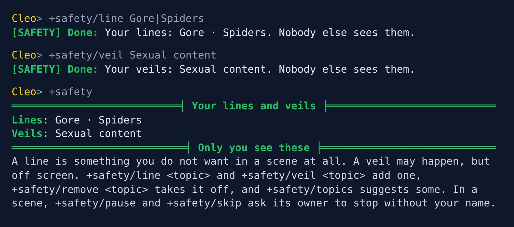
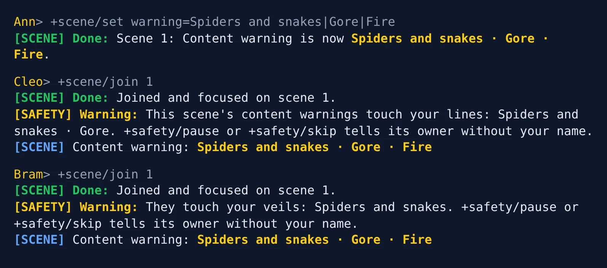
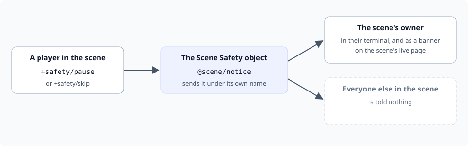
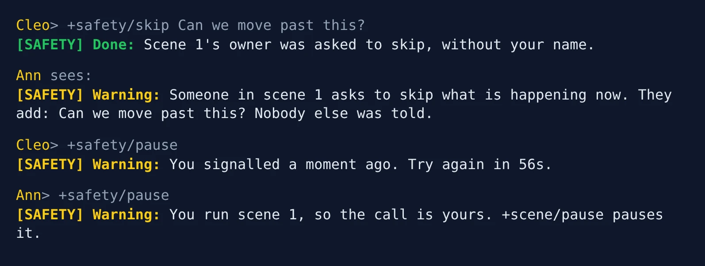
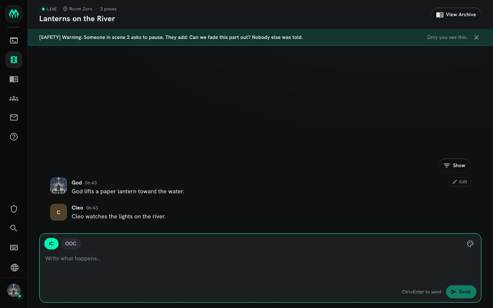
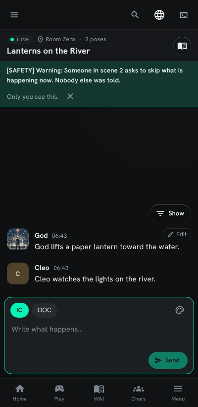
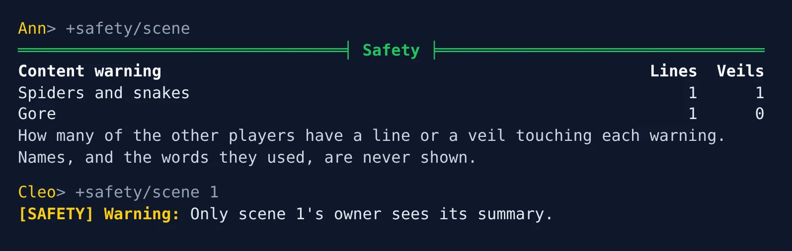

import { Aside } from '@astrojs/starlight/components';

**Scene Safety** gives players three tools from tabletop play:

- A **line** is something you do not want in a scene at all.
- A **veil** is something that may happen, but off screen.
- A **pause** or **skip** asks the scene's owner to stop or move on, without telling them who asked.

Your lines and veils are yours. Nobody else sees them, not even the owner of a scene you join. An
owner sees only how many players in their scene have a line or a veil touching each of its content
warnings.

| You are | You want to | Read |
|---|---|---|
| A player | say what you will not play | [Lines and veils](#lines-and-veils) |
| A player | know whether a scene is for you | [Joining a scene](#joining-a-scene) |
| A player | stop what is happening in a scene | [Pause and skip](#pause-and-skip) |
| A scene's owner | see what your players would rather avoid | [Running a scene](#running-a-scene) |
| Staff | install it, change the topics and limits | [Running Scene Safety](#running-scene-safety) |

In the game, `+help safety` has the same commands in short form.

## Lines and veils

`+safety/line <topic>` adds a line and `+safety/veil <topic>` adds a veil. `|` splits several.
`+safety` on its own shows yours:

```
> +safety/line Gore|Spiders
[SAFETY] Done: Your lines: Gore · Spiders. Nobody else sees them.
> +safety/veil Sexual content
[SAFETY] Done: Your veils: Sexual content. Nobody else sees them.
> +safety
═══════════════════════════╡ Your lines and veils ╞═══════════════════════════
Lines: Gore · Spiders
Veils: Sexual content
════════════════════════════╡ Only you see these ╞════════════════════════════
A line is something you do not want in a scene at all. A veil may happen, but off screen. +safety/line <topic> and +safety/veil <topic> add one, +safety/remove <topic> takes it off, and +safety/topics suggests some. In a scene, +safety/pause and +safety/skip ask its owner to stop without your name.
```



- `+safety/remove <topic>` takes a line or a veil off.
- `+safety/clear` takes them all off.
- `+safety/topics` lists the topics your game suggests. Any other words work too.

A topic can be a line or a veil, not both: making `Gore` a veil takes it off your lines.

Lines and veils belong to your account, so every character on it has the same ones. A character
with no account keeps its own.

## Joining a scene

When you join a scene whose content warnings touch your lines or veils, you are told, and nobody
else is:

```
> +scene/join 1
[SCENE] Done: Joined and focused on scene 1.
[SAFETY] Warning: This scene's content warnings touch your lines: Spiders and snakes · Gore. +safety/pause or +safety/skip tells its owner without your name.
[SCENE] Content warning: Spiders and snakes · Gore · Fire
```

A line or veil touches a warning when either contains the other as whole words. A line of
`Spiders` touches the warning `Spiders and snakes`; a line of `Spider` does not.



By default the warnings are the scene's `warning` detail, which the `scene-verse` package adds;
the `warning-detail` [setting](#settings) names another. See [Scene Details](/guides/scene-details).

## Pause and skip

While you are focused on a scene, `+safety/pause` asks its owner to stop what is happening, and
`+safety/skip` asks them to move past it. A short note after either is optional:

```
> +safety/skip Can we move past this?
[SAFETY] Done: Scene 1's owner was asked to skip, without your name.
```

The owner is told this, and nobody else in the scene is told anything:

```
[SAFETY] Warning: Someone in scene 1 asks to skip what is happening now. They add: Can we move past this? Nobody else was told.
```



The message comes from the Scene Safety object, so nothing in it names you. By default a player can
send one every minute; the `signal-wait` [setting](#settings) changes that:

```
> +safety/pause
[SAFETY] Warning: You signalled a moment ago. Try again in 56s.
```



<Aside type="caution" title="In a scene of two, they will know">
When the owner and you are the only players in a scene, the owner can tell the message came from
you. `+safety` says so when you send it:

```
[SAFETY] Done: Scene 1's owner was asked to pause, without your name. With only you and them in the scene, they will know it was you.
```

The same goes for the summary below: with one other player, the counts are theirs.
</Aside>

### In the portal

When the owner has the scene's live page open, the message also shows there, under the scene's
header, until they close it. Nobody else's page shows it.



On a phone the banner sits above the poses in the same way:



## Running a scene

`+safety/scene` shows the owner of the focused scene how many of the other players have a line or
a veil touching each content warning. `+safety/scene <id>` names a scene. Names, and the words
players used, are never shown:

```
> +safety/scene
══════════════════════════════════╡ Safety ╞══════════════════════════════════
Content warning                                                   Lines  Veils
Spiders and snakes                                                    1      1
Gore                                                                  1      0
How many of the other players have a line or a veil touching each warning. Names, and the words they used, are never shown.
```

The same table shows at the bottom of `+scene <id>`, for the owner only. Anyone else is refused:

```
> +safety/scene 1
[SAFETY] Warning: Only scene 1's owner sees its summary.
```



A warning no line or veil touches is left out. When none is touched, `+safety/scene` says so.

If you own the scene, a pause is your own call: `+safety/pause` points you to `+scene/pause`.

## Running Scene Safety

### Installing

Scene Safety ships with the server but is not installed on a new game. An administrator installs
it from the portal:

1. Open **Packages** in the admin area and choose **Browse**.
2. Install `scene-verse`, which gives scenes their content warnings.
3. Install `scene-safety`. It needs `scene`, which a new game already has. Its `+help` topics and `+config` settings come with it, through the `scene-safety-help` and `scene-safety-config` bridges, wherever `+help` and `+config` are installed.

It needs the Scene plugin, and is not offered while the plugin is not running. It adds the
command `+safety` for everyone, so a `+safety` your game already has in softcode stops running once
the package is in.

See [Softcode Packages](/guides/packages) for how installing, upgrading and rolling back work.

### Settings

`+config safety` lists the settings and `+config safety/<setting>=<value>` changes one, with the
`config.admin` permission. See [Game Settings with +config](/guides/config).

| Setting | What it changes | Default |
|---|---|---|
| `topics` | The topics `+safety/topics` suggests, split by `\|`. | Animal harm, Body horror, Child harm, Death, Drug use, Gore, Racism, Self-harm, Sexual content, Slavery, Spiders, Suicide, Torture, Violence |
| `warning-detail` | The scene detail that holds a scene's content warnings. | `warning` |
| `topic-length` | The longest line or veil, in characters, 1 to 200. | `40` |
| `note-length` | The longest note a pause or skip may carry, 0 to 1000. `0` allows none. | `200` |
| `signal-wait` | How long a player waits between one pause or skip and the next, up to `1h`. | `1m` |

For example, to suggest one more topic and let players signal every 30 seconds:

```
> +config/add safety/topics=Clowns
> +config safety/signal-wait=30s
```

### Where the data is

Lines and veils are kept on the Safety Store, inside the Scene Safety object in the master room.
Staff who can examine every object can read it, so tell your players who can.

### From your own code

The pause goes through `@scene/notice`, which any wizard object can use to tell one member of a
scene something, in their terminal and on the scene's live page, and nobody else:

```
@scene/notice <scene id>/<player>=<text>
```

The member hears it from the object that ran the command.
