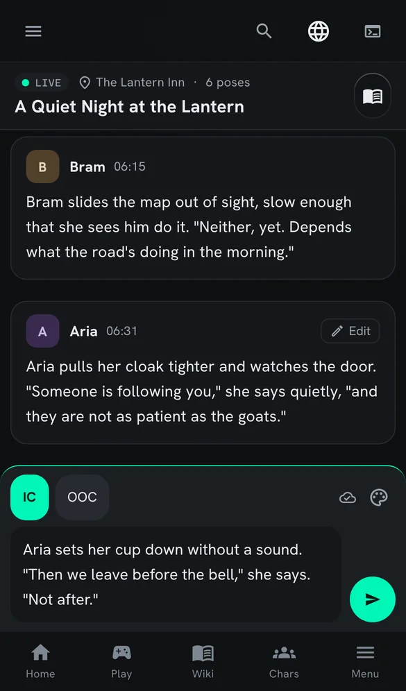
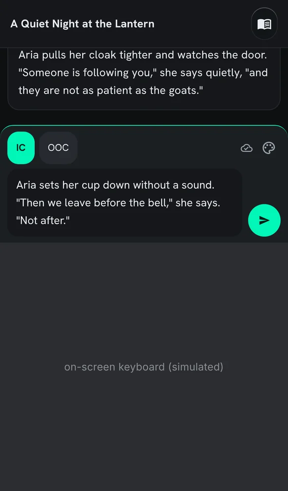
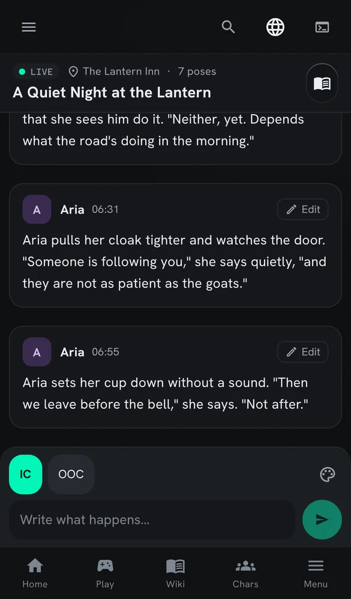
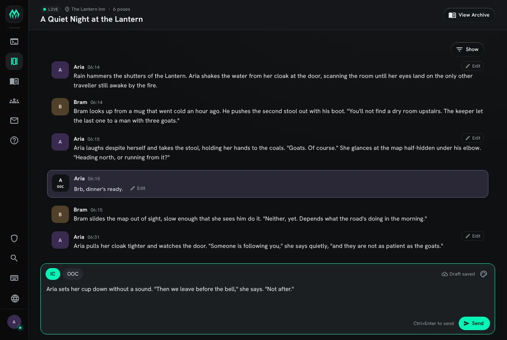

import { Aside } from '@astrojs/starlight/components';

The web portal's live scene page works on a phone as well as on a desktop. This page covers how a
live scene looks on a phone, and how an unsent pose follows you from one device to another. To put
the scene schedule in a calendar app, see [Scenes in your calendar](/guides/scenes/#scenes-in-your-calendar).

All of it comes with the Scene plugin. On a game without it, the portal shows no Scenes section at all.

## A live scene on a phone

Open a running scene from **Scenes**, then **Live now**. On a screen narrower than a tablet, each pose
is a card: the portrait, name and time sit above the text, so the text uses the whole width.
Out-of-character lines keep their own colour band.

The box you write in is a sheet at the bottom of the screen. The IC and OOC buttons and the format
menu sit in a row along its top, and the field sits beside a round Send button.

### Typing with the on-screen keyboard

When the keyboard opens, the page shrinks to the part of the screen the keyboard leaves. The
scene's name stays at the top, the poses scroll in the middle, and the compose sheet sits directly
on the keyboard. Nothing jumps when the keyboard opens or closes, so you do not lose your place in
the scene.

## Your draft follows you

What you type into a live scene is saved as you type, both in the browser and on the server. Open
the same scene on another device, as the same character, and the field holds the same text. You can
start a pose on your phone on the bus and finish it at your desk.

The icon beside the format menu shows where the draft is:

| Icon | Means |
| --- | --- |
| Cloud with a tick | Saved. Your other devices open this draft. |
| Cloud with an arrow | Saving. You typed in the last moment. |
| Cloud crossed out | Kept on this device only. The server could not be reached; the draft is sent when it can be. |

A screen reader announces the same words: "Draft saved", "Saving draft" and "Draft on this device
only".

When you send the pose, the draft empties on every device. A device that was open in the
background empties the next time you switch back to it.

Each character has its own draft for each scene. A guest, or a character who cannot see the scene,
keeps the draft in the browser only.

<Aside>
If two devices type at the same moment, the one that saved last wins. Switch back to a device and
it shows the newer draft.
</Aside>
