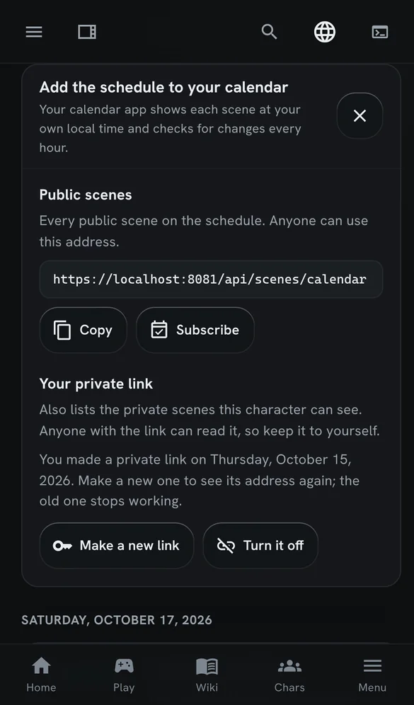
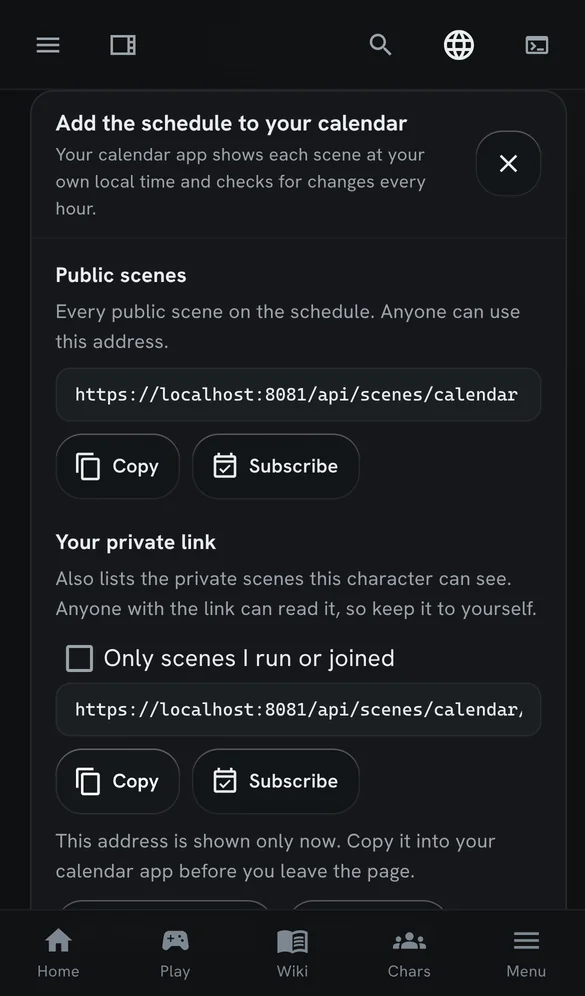
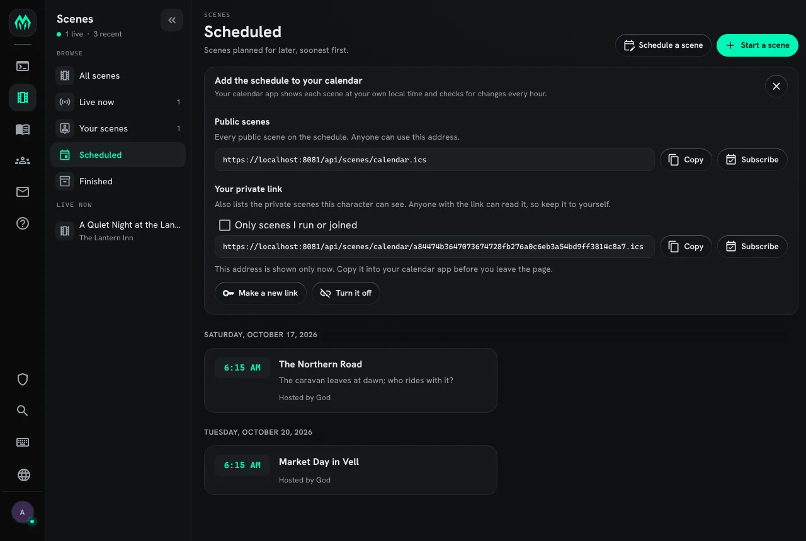

import SharpieIllustration from '../../../components/SharpieIllustration.astro';
import { Aside } from '@astrojs/starlight/components';

A **scene** is a shared, logged piece of roleplay. Everyone in it poses as usual, the game keeps
each pose, and the log can be read afterwards in the game and in the web portal.

<SharpieIllustration scene="scenes" />

| You want to | Read |
|---|---|
| find a scene and take part | [Joining a scene](#joining-a-scene) |
| pose, and fix a pose afterwards | [Posing](#posing) |
| read what happened | [Reading the log](#reading-the-log) |
| run a scene of your own | [Running a scene](#running-a-scene) |
| plan one for later | [Scheduling](#scheduling) |
| follow scenes in a calendar app | [Scenes in your calendar](#scenes-in-your-calendar) |
| install scenes, or add to them | [Setting up scenes](#setting-up-scenes) |

In the game, `+help scene` has the same commands in short form.

The examples follow Mira and Tobin in the Harbour Tavern.

## Joining a scene

`+scene` lists the scenes running now, `+scene/old` the finished ones, and `+scene/mine` the ones
you have been in. A long list comes in pages: `+scene/old/2` is the second page.

```
> +scene
══════════════════════════════╡ Scenes: active ╞══════════════════════════════
ID  Title                                         Where           Cast  Status
 1  Smugglers at the Harbour                      Harbour Tavern     1  active
══════════════════════════════════════════════════════════════════════════════
1 scene
```

`+scene <id>` shows one scene: who runs it, where it is, its pitch and who is in it. The scene's
title, or the start of it, works as well as its number.

```
> +scene 1
═════════════════════╡ Scene 1: Smugglers at the Harbour ╞════════════════════
Status:    active
Owner:     Mira
Where:     Harbour Tavern
Created:   Oct 15 11:54PM (game time)
Scheduled: -
Watchers:  Anyone
═══════════════════════════════════╡ Pitch ╞══════════════════════════════════
A crate goes missing from the night boat.
══════════════════════════════════╡ Players ╞═════════════════════════════════
Status  Name                                                             Poses
Owner   Mira                                                                 0
══════════════════════════════════════════════════════════════════════════════
```

`+scene/join <id>` puts you in the scene and makes it your **focus**, the scene your poses are
recorded into. Joining needs the `scene.join` permission; see [Who can take part](#who-can-take-part).

```
> +scene/join 1
[SCENE] Done: Joined and focused on scene 1.
```

- `+scene/leave` leaves your focused scene. If you never posed, you leave no trace.
- `+scene/deactivate` keeps you a member but stops recording you. `+scene/activate <id>` starts
  again.

## Posing

Once you have joined, `pose`, `say`, `semipose` and `@emit` in the scene's room are recorded as you
type them. There is nothing extra to type. Each recorded pose is shown under a line naming who posed
it and its number:

```
> pose sets a lantern on the bar and looks for the harbourmaster.
═╡ Mira · pose 1 ╞════════════════════════════════════════════════╡ Scene 1 ╞═
Mira sets a lantern on the bar and looks for the harbourmaster.
```

The `+scene/<mode> <id>=<text>` commands name the scene instead of taking it from the room. They are
what the portal's compose box sends:

- `+scene/pose`, `+scene/say`, `+scene/semipose` and `+scene/emit` work like the ordinary commands.
- `+scene/ooc` is out of character.
- `+scene/narrate` is the world speaking rather than a character: weather, a crowd, a storyteller's
  line.

An out-of-character line is one line of its own:

```
> +scene/ooc 1=Back in five, the kettle is on.
<OOC · 1> Tobin: Back in five, the kettle is on.
```

`+scene/as <name>` poses under another name from then on, and `+scene/as` on its own goes back to
your own. [Scene Pose Types](/guides/scene-pose-types/) covers the kinds of line, and how to hide the
ones you do not want to read.

### Whose turn it is

`+pot`, the pose tracker, lists the people in your focused scene with how long ago each last posed.
The one who posed longest ago is up next:

```
> +pot
══════════════════════════╡ Pose Tracker - Scene 1 ╞══════════════════════════
#  Name                                                       Last pose  Turn
1  Mira                                                          8s ago  <- up
2  Tobin                                                         2s ago
══════════════════════════════════════════════════════════════════════════════
2 in scene - oldest pose is up next
```

### Fixing a pose

These work on your own poses. A wizard can use them on anyone's. `<pose>` is the number on the
line above the pose.

- `+scene/edit <pose>=<old>^^^<new>` replaces one piece of text.
- `+scene/rewrite <pose>=<text>` replaces the whole pose.
- `+scene/undo <pose>` and `+scene/redo <pose>` step back and forward through its edits.
- `+scene/delete <pose>` takes it out of the log.

```
> +scene/edit 1=harbourmaster^^^harbour master
[SCENE] Done: Pose 1 edited.
```

The scene's owner can move a pose with `+scene/move <pose>=<after>`. `+scene/mark <pose>=<word>`
marks a pose, such as a `flashback`, and `+scene/unmark <pose>=<word>` removes the mark. The pose's
author or the scene's owner can mark it.

## Reading the log

- `+scene/recall <n>` shows the last `<n>` poses of your focused scene. On its own it shows two
  rounds, a round being one pose for each person in the scene. Staff change the number of rounds with
  `+config scene/recall-rounds=<n>`.
- `+scene/recall <id>=<n>` does the same for any scene you can see.
- `+scene/log [<id>]` shows the whole log.

```
> +scene/recall 3
═╡ Mira · pose 1 ╞════════════════════════════════════════════════╡ Scene 1 ╞═
Mira sets a lantern on the bar and looks for the harbour master.
═╡ Tobin · pose 2 ╞═══════════════════════════════════════════════╡ Scene 1 ╞═
Tobin says, "I saw the boat come in an hour ago."
<OOC · 1> Tobin: Back in five, the kettle is on.
```

In the web portal, **Scenes** lists the same scenes, and each scene has a page with its log.

## Running a scene

`+scene/create <title>` creates a scene in the room you are in and makes it your focus. You own it.
It records poses at once. When staff set `+config scene/default-status=new`, a new scene waits for
`+scene/start` instead.

```
> +scene/create Smugglers at the Harbour
[SCENE] Done: Scene 1 created and focused (status: active).
> +scene/pitch A crate goes missing from the night boat.
[SCENE] Done: Pitch set for scene 1.
```

- `+scene/title [<id>=]<text>` renames it.
- `+scene/pitch [<id>=]<text>` says what it is about, on its card and its page in the portal.
- `+scene/set [<id>/]<detail>=<value>` sets a detail such as its verse or a content warning. See
  [Scene Details](/guides/scene-details/).
- `+scene/pause` stops it for now. It leaves the live list for the schedule. `+scene/start` resumes
  it.
- `+scene/finish` closes it. A finished scene stays finished.

```
> +scene/finish
[SCENE] Done: Scene 1 finished.
```

Anyone holding the `scene.close` permission can finish a scene they do not own with
`+scene/finish <id>`. The scene package defines it; allow it on a role with
`@role/allow helper=scene.close`.

### Who can read it

A scene is public: it is listed in `+scene` and anyone holding `scene.view` can read its log. `+scene/private [<id>]`
hides it and its log from everyone but its members, and `+scene/public [<id>]` puts it back. Who may
pose is decided by who has joined, not by this setting.

```
> +scene/private 2
[SCENE] Done: Scene 2 is now private.
```

## Scheduling

`+scene/schedule <title>=<when>` announces a scene before it happens. `<when>` is a date and time,
such as `2026-12-31 20:00`, or a time from now: `+3d`, `+12h` or `+1w`.

```
> +scene/schedule Market day=+3d
[SCENE] Done: Scheduled scene 2 "Market day" for Sun Oct 18 23:55:34 2026 (game time).
```

`+scene/upcoming` (also `+scenes` and `+events`) lists the next 30 days. `+scene/upcoming <days>`
looks further, and `all` shows everything. The RSVP column counts the owner too.

```
> +scene/upcoming
═════════════════════════════╡ Scheduled Scenes ╞═════════════════════════════
Day         Time   ID  Title                                   Status     RSVP
Sun Oct 18  23:55   2  Market day                              scheduled     1
══════════════════════════════════════════════════════════════════════════════
1 in the next 30 days · game time
> +scene/tag 2
[SCENE] Done: RSVP'd to scene 2.
```

- `+scene/tag <id>` (or `+scene/rsvp`) RSVPs without joining. `+scene/untag <id>` (or
  `+scene/unrsvp`) withdraws it.
- `+scene/reschedule <id>=<when>` moves it, and `+scene/unschedule <id>` (or `+scene/cancel`)
  cancels it.
- `+scene/start [<id>]` starts a scheduled scene in the room you are in.

A scheduled or paused scene records nothing until its owner starts it. Times you type are read in
your own time zone, the one `+timezone` sets, and every list and message shows times in it. Without
one, times are the game's. [Time and Time Zones](/guides/time/) covers zones, and
[Scene Availability](/guides/scene-availability/) finds a time a group is free.

In the portal, **Scenes** has **Start a scene** and **Schedule a scene**. A scheduled scene has no
room until it starts: it runs wherever its host is when they start it.

## Scenes in your calendar

The **Scheduled** list under **Scenes** has an **Add to calendar** button. It opens a card with
calendar addresses. Paste an address into a calendar app (Google Calendar, Apple Calendar, Outlook
and Thunderbird all accept one), or press **Subscribe** to hand it to the calendar app on your
device.

Each scene appears at your own local time. The feed gives every start time in UTC, and the
calendar app converts it to the zone your device is set to, so two players in different countries
both see the right time. Scenes have no end time, so each event lasts two hours. The calendar app
checks for changes every hour.







### The public feed

The first address lists every public scene on the schedule. Anyone can use it, without signing in,
so a game can also put it on its website.

```text
https://<your game>/api/scenes/calendar.ics
```

It lists the scenes that were given a start time: those still to come, those running, and those that started in
the last 14 days. A scene started on the spot, with no time set, does not appear.

### Your private link

A private link adds the private scenes your character can see. Press **Make my private link**, then
copy the address before you leave the page: the server keeps only a fingerprint of it, so it cannot
show it to you again.

Tick **Only scenes I run or joined** before you copy it to leave out the scenes you have nothing to
do with. That adds `?scope=mine` to the address.

Anyone who has the address can read the feed, so keep it to yourself. If it gets out, press **Make
a new link**: the old address stops working at once. **Turn it off** removes the link without
making a new one.

The link belongs to the character you are playing in that browser tab. Switch characters to make a
link for another one.

### What an event holds

This is a scene from a test server's public feed, as a calendar app reads it:

```text
BEGIN:VEVENT
UID:scene-2@localhost
DTSTAMP:20261015T065628Z
LAST-MODIFIED:20261015T061529Z
DTSTART:20261017T061525Z
DTEND:20261017T081525Z
SUMMARY:The Northern Road
DESCRIPTION:The caravan leaves at dawn\; who rides with it?\n\nRun by God\n
 \nhttps://localhost:8081/scenes/2
URL:https://localhost:8081/scenes/2
STATUS:CONFIRMED
TRANSP:TRANSPARENT
END:VEVENT
```

The title is the scene's title. The description holds its pitch, who runs it, and a link to the
scene in the portal. A scene that has a room also gives the room's name as the event's location.
The event is marked as free time, so it does not block your calendar.

## Setting up scenes

Scenes are the `scene` package, which a new game installs. It runs on the Scene plugin that ships
with the server and needs no other package. Without the plugin running, the package does not install,
and turning the plugin off removes the package. The portal shows its **Scenes** pages only while the
package is installed.

Two bridge packages, also installed on a new game, join scenes to the rest of the game: `scene-help`
puts the scene topics in `+help`, and `scene-config` puts the scene settings in `+config`. Without
them, scenes still run, but `+help scene` and `+config scene` find nothing. See
[Bridge Packages](/guides/bridge-packages/).

### Who can take part

Four permissions, which the scene package defines, decide what a character may do with scenes:

| Permission | Lets a character | Given to |
|---|---|---|
| `scene.view` | Read scenes they are not in: `+scene`, `+scene/old`, `+scene/upcoming`, a scene's card and its log, in the game and on the website | everyone |
| `scene.join` | Join a scene, RSVP to one, and mark poses | the `approved` role, royalty, wizards |
| `scene.pose` | Have their poses recorded, pose from the website, and fix their own poses | the `approved` role, royalty, wizards |
| `scene.create` | Start and schedule scenes, and run the ones they own | the `approved` role, royalty, wizards |

A scene a character is in stays readable to them without `scene.view`. Change who holds a permission
as you would any other, with `@role/allow` and `@role/deny`, or on the **Roles** page of the admin
area. To let every character join and pose, approved or not:

```
> @role/allow player=scene.join scene.pose
```

To keep guests out of the scene logs:

```
> @role/deny guest=scene.view
```

A character without a permission is told which one it needs:

```
> +scene/join 1
[SCENE] Error: Permission denied. You need the scene.join permission.
```

### Other packages

Other packages add to scenes. Each has its own page:

| Package | Adds | Page |
|---|---|---|
| `scene-here` | The command palette's entries for the scene in your room | [The Command Palette](/guides/command-palette/) |
| `scene-verse` | A verse, a canon and a content warning on each scene | [Scene Details](/guides/scene-details/) |
| `scene-safety` | Lines, veils, pause and skip | [Scene Safety](/guides/scene-safety/) |
| `scene-availability` | When each character is free, and who can make a scene | [Scene Availability](/guides/scene-availability/) |
| `highlights` | Favourite poses, and a page of them | [Highlights](/guides/highlights/) |
| `summary` | A one-line summary of a long pose | [Pose Summaries](/guides/summary/) |
| `timeline` | An IC date on each scene | [IC Dates and Timelines](/guides/timeline/) |
| `discord-scenes` | Scheduled scenes as events on the Discord server | [Discord](/guides/discord/) |

A package of your own can change what `+scene` shows, with filters on the Scene Logger; `+help scene
filters` lists them.
