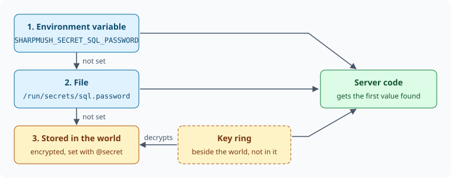

import { Aside } from '@astrojs/starlight/components';

A **secret** is a password, token or key the server uses for itself: the SQL password, a bot's
token, a webhook's signing key. SharpMUSH keeps each one under a name, such as `sql.password`, and
never shows a value again once it is set.

- The world stores a secret only encrypted. The key that decrypts it is in the server's key ring,
  which is kept beside the world, not in it. A copy of the world on its own opens no secret.
- `@secret` and the portal's **Secrets** page set and clear secrets. Neither can show a value.
- Softcode cannot read a secret. No function returns one.
- An operator can give a secret from outside the game instead, as an environment variable or a file.

This page covers:

- [Setting a secret in the game](#setting-a-secret-in-the-game)
- [Setting a secret in the portal](#setting-a-secret-in-the-portal)
- [Giving a secret from outside the game](#giving-a-secret-from-outside-the-game)
- [Secrets for web requests](#secrets-for-web-requests)
- [Importing from PennMUSH](#importing-from-pennmush)
- [Backups and the key ring](#backups-and-the-key-ring)
- [Secrets in plugins](#secrets-in-plugins)

## Setting a secret in the game

You need the `config.admin` permission.

```
> @secret sql.password=hunter2
sql.password is set. Its value is never shown again.
```

The command is not evaluated: what you type after `=` is stored as it is, brackets, `%` and further
`=` signs included.

`@secret` on its own lists the secrets the server reads, and any others that are stored:

```
> @secret
+-------------------------------< Secrets (1) >------------------------------+
| Secret        Value       Stored                   For                     |
| -------------------------------------------------------------------------- |
| sql.password  stored      2026-10-14 23:38 by      The password of         |
|                           God(#1)                  sql_username on the SQL |
|                                                    server.                 |
+----------------------------------------------------------------------------+
```

The **Stored** column gives the time in UTC. The **Value** column says where the value comes from: `stored`, an environment variable or file
that overrides it, `not set`, or `unreadable: set it again` (see
[Backups and the key ring](#backups-and-the-key-ring)).

`@secret/clear` removes the stored value:

```
> @secret/clear sql.password
sql.password is cleared.
```

A name is lower-case letters and digits, in parts joined by `.`.

<Aside type="caution">
Your MUSH client may keep a log of what you type, and that log would hold the value. Where that
matters, use the portal or give the secret from outside the game.
</Aside>

## Setting a secret in the portal

Open **Admin**, then **Configuration**, then **Secrets** under Security. The page lists the same
secrets as `@secret`, with where each value comes from and who stored it. Type a name and a value and
press **Save**. The value field never fills itself in: the server never sends a value back.

## Giving a secret from outside the game

An operator who keeps secrets in a deployment tool can hand them to the server directly. A value given
this way overrides the stored one, and the server looks in this order:



1. An environment variable named `SHARPMUSH_SECRET_` and the secret's name in upper case, with `.`
   written as `_`. `sql.password` is `SHARPMUSH_SECRET_SQL_PASSWORD`.
2. A file named for the secret in `/run/secrets`, the directory Docker Compose and Kubernetes mount
   secrets into. `SHARPMUSH_SECRETS_PATH` names another directory. A newline at the end of the file
   is not part of the value.
3. The value stored with `@secret` or the portal.

With Docker Compose:

```yaml
services:
  sharpmush-server:
    secrets:
      - sql.password

secrets:
  sql.password:
    file: ./sql-password.txt
```

The server reads the file each time it needs the secret, so replacing the file takes effect without a
restart. `@secret` shows which variable or file is in use. You can still store a value while an override
is there; it is used once the override is removed.

### Importing from PennMUSH

PennMUSH keeps the SQL password in `mush.cnf` as `sql_password`. When you import a `mush.cnf` in the portal,
on its own or with a PennMUSH database, that value is stored as the `sql.password` secret, set by your
account, and is not kept with the configuration. If a database import fails and the configuration is put
back, the secret is put back too.

## Secrets for web requests

Softcode cannot read a secret, but `@http` can send one in a request header, so a game can log in to
a web service without its password or token ever sitting in an attribute. Two things limit where it
goes:

- Only a secret whose name starts with `http.` can be sent.
- It goes only to the hosts named for it with `@secret/host`, and only over `https`.

```
> @secret http.github.token=ghp_example
http.github.token is set. Its value is never shown again.
> @secret/host http.github.token=api.github.com uploads.github.com
@http may send http.github.token to: api.github.com uploads.github.com
```

`*.example.com` covers every host under `example.com`. `@secret/host` with nothing after `=` takes
every host away. The hosts belong to the name, not the value: setting or clearing the value keeps
them, and they hold for a value given as an environment variable or a file. The listing shows them in
the **For** column.

[Calling Web Services](/guides/web-requests#logging-in-with-a-stored-secret) shows how softcode
names the secret in a request.

## Backups and the key ring

The key ring is the directory `lightning.dataprotection-keys` beside the world
(`SHARPMUSH_DATAPROTECTION_PATH` moves it). The web server signs its cookies and forms with the same
keys.

- A copy of the world made with `@backup` holds the secrets encrypted. Restored on a server without
  the key ring, the world keeps them but cannot read them: `@secret` lists each one as
  `unreadable: set it again`, and you set them again.
- Restored together with its key ring, the world's secrets work as before.
- The key ring replaces its key every 90 days and keeps the old ones. When the server reads a secret
  written with an older key, it stores it again with the current one, so a retired key can later be
  removed without losing the secret.

Back up the key ring, but keep its copies apart from the world's where you can: then neither copy on
its own opens a secret.

## Secrets in plugins

A plugin declares each secret it reads, so `@secret` and the portal list it with a description even
before it is set. It registers a `SecretDefinition` from its `IServiceRegistrar`, and reads the value
through `ISecretStore`:

```csharp
public void RegisterServices(IServiceCollection services)
{
	services.AddSingleton(new SecretDefinition(
		"discord.token", "The Discord bot's token.", ManagedBy: "discord.admin"));
}

// later, in the plugin's own service
if (await secrets.GetAsync("discord.token") is not string token)
{
	return; // not set, or unreadable on this server
}
```

`ManagedBy` names a permission that may set this secret besides `config.admin`. Someone holding
`discord.admin` sees and sets `discord.token` and nothing else.

`GetAsync` answers with the value, with "not found" when nothing sets it, or with an error when the
stored value cannot be decrypted on this server. Never write a value to the log, to an attribute or to
a player.
