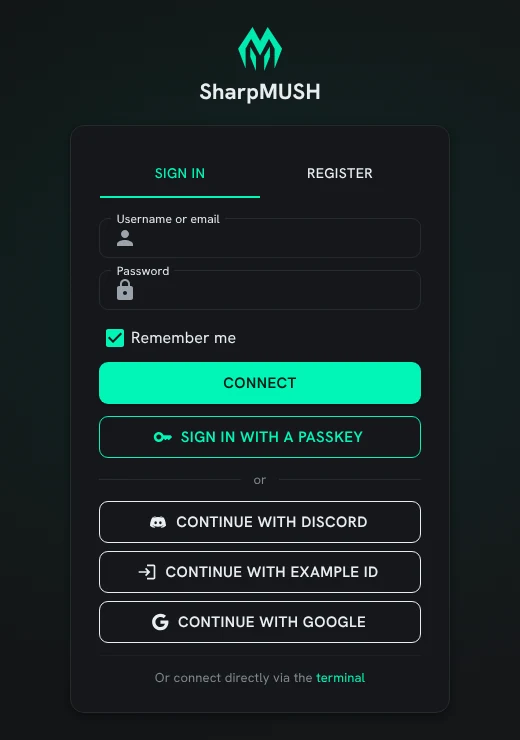
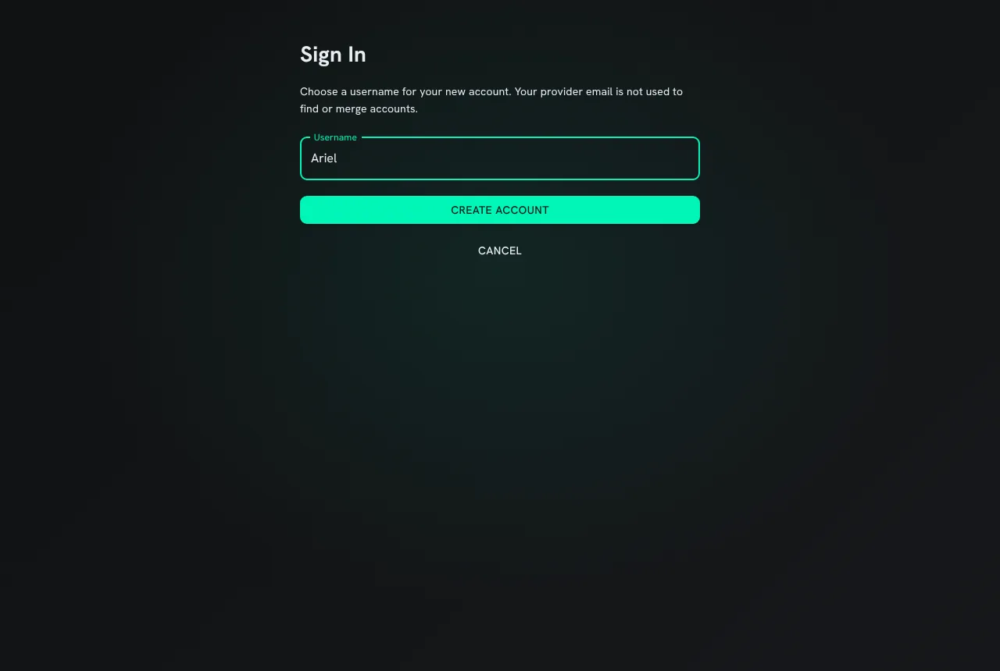
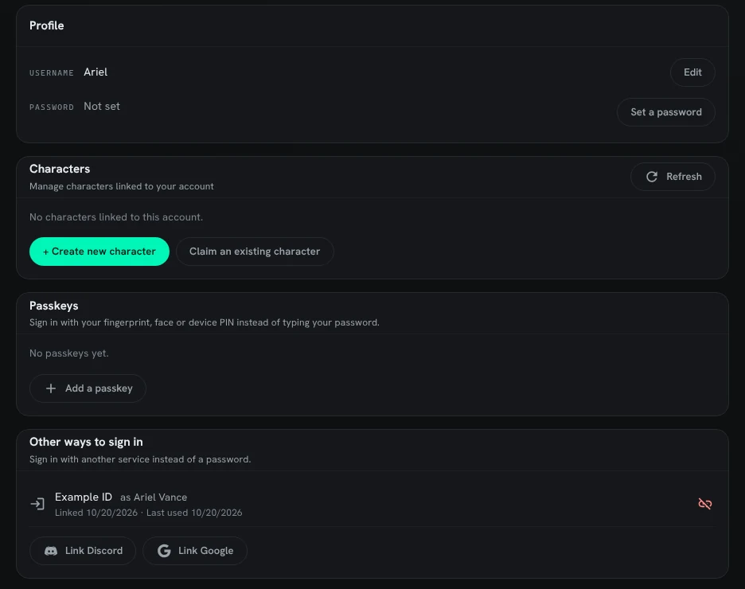
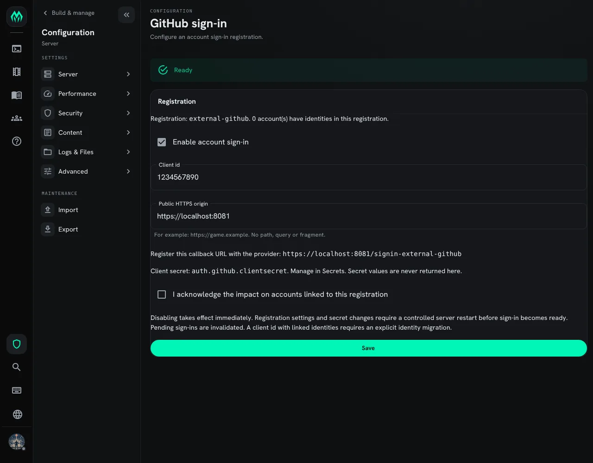

import { Aside } from '@astrojs/starlight/components';

Players can sign in to the web portal with an account they already have somewhere else: Discord,
Google, GitHub, Microsoft, or any other service that speaks OAuth 2.0. A new player presses
**Continue with Discord**, picks a username, and has an account with no password to set or forget.
A player with a password can link a service too, and then use either.

This page covers:

- [Signing in](#signing-in)
- [Linking a service to your account](#linking-a-service-to-your-account)
- [Accounts with no password](#accounts-with-no-password)
- [Setting up a service](#setting-up-a-service)
- [Worked example: Discord](#worked-example-discord)
- [Google, GitHub and Microsoft](#google-github-and-microsoft)
- [Other services](#other-services)
- [What the game keeps](#what-the-game-keeps)

## Signing in

Once staff have set a service up, the sign-in page shows a button for it under the password form.



The button sends you to the service, which asks you to allow the game to see who you are. When you
allow it, the service sends you back.

- If an account here already signs in with that service account, you are signed in to it.
- If none does, the portal asks for a username. The name and verified email the service gave are
  filled in; change either before you press **Create account**.



Sitelock, bans and the **player creation** setting apply exactly as they do to password sign-in.
When the game takes no new accounts, the page says so and creates none.

<Aside type="caution">
The portal never joins a service account to an existing account because their emails match. To use
a service with the account you already have, sign in to it first and link the service, as below.
</Aside>

Signing in with a service is for the portal. A MUD client still connects with a character's name and
its own password.

## Linking a service to your account

Your account page has an **Other ways to sign in** card. It lists the services linked to your
account, with the name each one gave and when you last signed in with it, and a **Link** button for
each service the game offers that you have not linked.



**Link** sends you to the service and back. A service account can sign in to one account here at
most: if it already signs in to another one, linking is refused.

The unlink button removes the link. A service that staff have since removed or turned off is still
listed, marked **unavailable**, so you can see it and remove it.

## Accounts with no password

An account made through a service has no password. Its account page shows **Password: Not set**
and a **Set a password** button that does not ask for a current password. Adding a passkey does not
ask for one either.

The portal will not take away the last way into an account. Unlinking the only service, or removing
the only passkey, of an account with no password is refused until you set a password or add another
way in.

## Setting up a service

You need the `config.admin` permission. Open **Admin**, then **Configuration**, and under
**Security** choose **Sign-in services**.



- **Service** is Discord, Google, GitHub, Microsoft, or **Other (OAuth 2.0)**. For the first four
  the game already knows the service's addresses.
- **Id** names the service in the game's addresses. It is lower-case letters and digits, and it
  cannot change once saved, because the service has the redirect address that holds it.
- **Name players see** is what the button says. It defaults to the service's own name.
- **Redirect address** is the address to give the service. It is built from the address you opened
  this page at, so open the page at the game's public address, the one players use.
- **Client id** and **Client secret** are what the service gives you when you register the game.
  The secret is stored as the [secret](/guides/secrets) `signin.<id>.secret` and never shown
  again. When you change a service later, leave the secret empty to keep the stored one.
- **Players can sign in with it** turns the button on or off without removing the service.

The list says which services are **Ready**. One without its secret says **No secret**: setting
`signin.<id>.secret` with `@secret`, or from an environment variable or file, makes it ready.

Removing a service removes its stored secret. The links players made are kept, so setting the
service up again under the same id brings them back.

## Worked example: Discord

1. Open the **Sign-in services** page at your game's public address, for example
   `https://mush.example.com/admin/config/signin`. With **Service** set to **Discord** and the id
   `discord`, copy the **Redirect address**:

   ```
   https://mush.example.com/api/auth/external/discord/callback
   ```

2. In the Discord Developer Portal, create an application, or open the one your game's bot already
   uses. Under **OAuth2**, add the redirect address under **Redirects** and save.

3. On the same **OAuth2** page, copy the **Client ID**. Press **Reset Secret** and copy the
   **Client Secret**.

4. Back on the **Sign-in services** page, paste both and press **Save**. Discord is listed as
   **Ready**.

5. Sign out and open the sign-in page. It has a **Continue with Discord** button.

The game asks Discord for `identify` and `email`. Discord's display name is offered as the
username, and the email only when Discord says it is verified.

<Aside>
Signing in with Discord is separate from the [Discord plugin](/guides/discord). The plugin links a
character to a Discord user for the bot; this links an account to a Discord user for signing in.
Neither needs the other.
</Aside>

## Google, GitHub and Microsoft

Each service is set up the same way: register the game with the service, give it the redirect
address, and paste the client id and secret into the portal.

| Service | Where to register | What the game reads |
|---|---|---|
| Google | Google Cloud console, **APIs & Services**, **Credentials**: an OAuth client ID of type **Web application**, with the redirect address under **Authorized redirect URIs** | Name, and the email when Google says it is verified |
| GitHub | GitHub **Settings**, **Developer settings**, **OAuth Apps**: the redirect address is the **Authorization callback URL** | Name or login. No email is offered |
| Microsoft | Microsoft Entra admin center, **App registrations**: choose accounts in any organizational directory and personal Microsoft accounts, and add the redirect address as a **Web** redirect URI. Make a client secret under **Certificates & secrets** | Name. No email is offered |

## Other services

**Other (OAuth 2.0)** works with any service that offers the authorization code flow and a profile
address that answers JSON. Give it:

| Field | What it is |
|---|---|
| Authorization address | The page players are sent to |
| Token address | Where the game trades the returned code for a token |
| Profile address | Where the game reads the player's profile with that token |
| Scopes | The scopes asked for, separated by spaces |
| Id field | The profile field holding the person's id, which must never change |
| Name fields | Profile fields tried in turn for a name, separated by spaces |
| Email field, Email verified field | Where the email is, and the field that is `true` when it is verified. Without a verified field, no email is offered |

The addresses must be `https`. Plain `http` is allowed only for `localhost` and `127.0.0.1`, for
trying a service on the server's own machine.

The game sends the client id and secret in the token request's form, and uses PKCE (`S256`) on
every sign-in.

## What the game keeps

For each link the game keeps the service's id for the person, the name it last gave, when the link
was made and when it was last used. It keeps no token from the service: the game reads the profile
once during sign-in and forgets the token.
