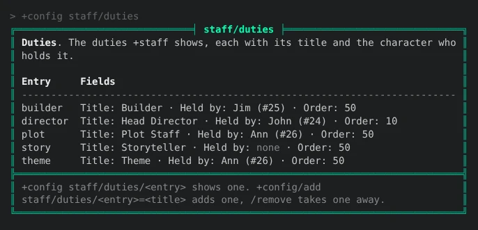

import { Aside } from '@astrojs/starlight/components';

The **staff** package adds `+staff`, and `+stafflist` for the same list. It shows who the
game's staff are and what each of them looks after: John is the Head Director, Jim is a
Builder.


- Everyone holding a staff role is listed on their own. Nobody keeps a list by hand.
- Duties are set with `+config`, and someone holding one is listed even without a staff role.
- Staff say whether they are on duty with `+staff/on` and `+staff/off`.
- God (#1) is not listed unless it holds a duty.

| You are | You want to | Read |
|---|---|---|
| A player | see who the staff are | [Reading the list](#reading-the-list) |
| Staff | say whether you are on duty | [On and off duty](#on-and-off-duty) |
| Staff | give someone a duty | [Setting duties](#setting-duties) |
| Staff | choose which roles count as staff | [Staff roles](#staff-roles) |
| Staff | install it | [Installing](#installing) |
| A coder | change the Status column | [Changing the Status column](#changing-the-status-column) |

In the game, `+help staff` has the same in short form.

## Reading the list

`+staff` shows one row for each staff member:

| Column | Shows |
|---|---|
| Name | The character's name |
| Duty | The duties they hold, such as `Plot Staff, Theme` when they hold two |
| Role | Their staff role, such as Wizard or Royalty. Empty for someone listed only for a duty |
| Status | `On duty` or `Off duty` while they are connected, and `Offline` when they are not |
| Idle | How long they have been idle, while they are connected |

Someone hidden from the who list is shown `Offline`, on duty or not, so a staff member who
is `DARK` is not given away.

Under the table, the footer counts who is listed and how many are connected, and names the
duties nobody holds yet, such as `Open: Storyteller`.

The list is in order of duty, then of role, then of name: someone holding a duty comes
before everyone holding none, and the duty's order says which comes first.

## On and off duty

Anyone on the list says whether they are on duty:

```
> +staff/on
[STAFF] Done: You are on duty.
> +staff/off
[STAFF] Done: You are off duty.
```

You stay on duty until you type `+staff/off`, through logging off and back on. While you
are not connected, `+staff` shows you `Offline` either way. Someone who is not on the list
is told so:

```
> +staff/on
[STAFF] Error: Only someone on the staff list can go on or off duty.
```

Where the [status](/guides/status) package is installed, `+staff` also shows each connected
staff member's `+status`, such as `On duty · LFRP`, once an administrator installs the
`staff-status` package as well.

## Setting duties

Duties are a [table](/guides/config#tables) in `+config staff/duties`. Changing it needs the `config.admin`
permission. Each duty has:

- a **name**, which is how you change it, such as `director`;
- a **title**, what `+staff` shows, such as `Head Director`;
- a **holder**, the player who holds it, or nobody while it is open;
- an **order**, from 0 to 999, lower first. A new duty has 50.

Add a duty with its title, then give it to a player:

```
> +config/add staff/duties/director=Head Director
[CONFIG] Done: Added staff/duties/director. +config staff/duties/director shows it.
> +config staff/duties/director/holder=*John
[CONFIG] Done: staff/duties/director/holder is now John (#24), was none.
> +config staff/duties/director/order=10
[CONFIG] Done: staff/duties/director/order is now 10, was 50.
```

`+config staff/duties` lists every duty with its fields:



- To open a duty again, set its holder to nothing: `+config staff/duties/builder/holder=`.
- To take a duty away, `+config/remove staff/duties/builder`.
- A player can hold several duties. `+staff` shows them all, in order.
- For two builders, add two duties with the same title, such as `builder` and `builder2`.

The holder is kept as the character itself, not their name, so renaming them keeps the duty.
A holder whose character is destroyed leaves the duty open.

## Staff roles

`+staff` lists everyone holding one of the roles in `+config staff/roles`. On a new game
that is SharpMUSH's and RhostMUSH's staff roles, highest first:

```
immortal wizard moderator councilor royalty architect guildmaster helper
```

A role the game does not have lists nobody, so the same setting works whichever staff roles
the game chose. The Role column shows the first role in the setting that each character
holds. To list builders too:

```
> +config staff/roles=wizard royalty builder
[CONFIG] Done: staff/roles is now wizard, royalty, builder, was immortal, wizard, moderator, councilor, royalty, architect, guildmaster, helper.
```

God (#1) and the Package Manager hold the wizard role to run the game, so they are left
out. Either is listed once it holds a duty.

<Aside type="caution">
A role given to an account reaches every character on that account, so each of them is
listed as staff. To list only a staff character, give the role to that character, not to
the account.
</Aside>

Give someone a role with `@role/assign`, such as `@role/assign *Ann=royalty`; `help @role` in the
game has the rest.

## Installing

The staff package ships with the server but is not installed on a new game. An
administrator installs it from the portal:

1. Open **Packages** in the admin area and choose **Browse**.
2. Install `staff`. Its `+help` topics and `+config` settings come with it, through the
   `staff-help` and `staff-config` bridges, wherever `+help` and `+config` are installed.

It adds `+staff` and `+stafflist` as `$`-commands on an object in the master room, **Staff
List**, which also holds the settings. The duties are kept on the **Staff Store** inside it.
A game that already has a `+staff` of its own should remove that first, or both answer.

See [Softcode Packages](/guides/packages) for how installing, upgrading and rolling back
work.

## Changing the Status column

Another package can change the Status column with a filter on the **Staff List**: an
attribute named ``FILTER`STAFF`STATUS`<name>``. For each row, `+staff` runs every filter in
name order with `chain()`. Each is given the status so far as `%0` (`On duty`, `Off duty` or
`Offline` to begin with), the character as `%1`, and `1` as `%2` when they are connected,
and returns the status to show. `staff-status` is one such filter.

A filter a package attaches to the Staff List goes away when that package is uninstalled.
