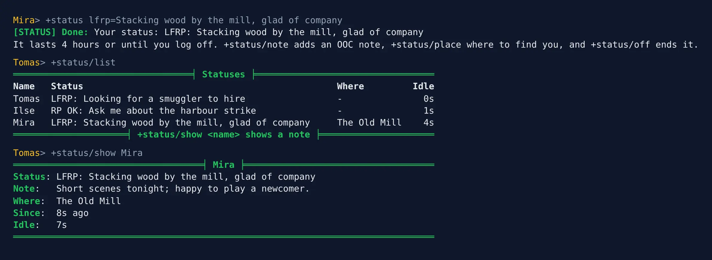
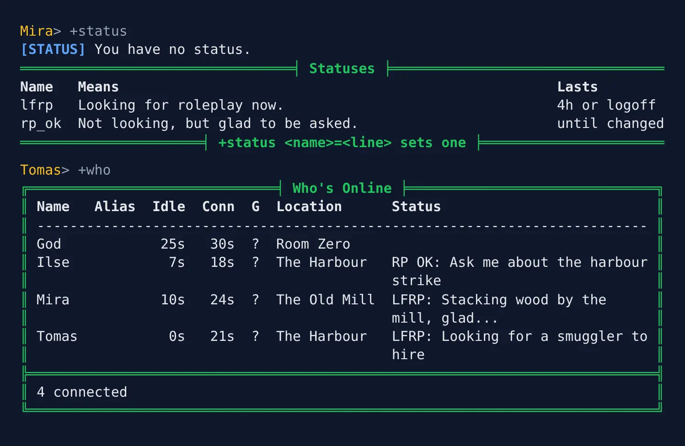
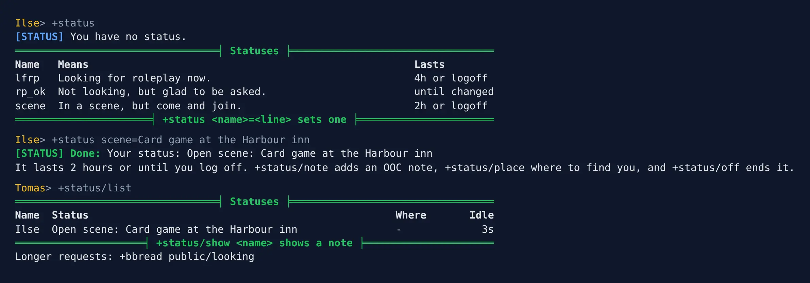

import { Aside } from '@astrojs/starlight/components';

**Status** lets players say whether they are up for roleplay. A new game offers two
statuses:

- `lfrp`: looking for roleplay now.
- `rp_ok`: not looking, but glad to be asked.

A status shows in the Status column of `+who` and in a list of everyone who has one. Staff
can change how long each lasts, add statuses of their own, or take them away, with
[`+status/options`](#changing-the-statuses).

| You are | You want to | Read |
|---|---|---|
| A player | say you are up for a scene | [Setting a status](#setting-a-status) |
| A player | find someone to play with | [Who has a status](#who-has-a-status) |
| A moderator | clear a status | [Moderating](#moderating) |
| Staff | install it, change how long a status lasts, add statuses | [Running Status](#running-status) |

In the game, `+help status` has the same commands in short form. To hear when the people you
play with connect, see the [watch list](/guides/watch).

What you type is kept exactly as you typed it. Brackets, percent signs and semicolons are
plain text, so `+status/note Short scenes; no combat [OOC]` stores just that.

## Setting a status

`+status` on its own shows your status, if you have one, and every status you can choose:

```
> +status
[STATUS] You have no status.
═════════════════════════════════╡ Statuses ╞═════════════════════════════════
Name   Means                                                     Lasts
lfrp   Looking for roleplay now.                                 4h or logoff
rp_ok  Not looking, but glad to be asked.                        until changed
══════════════════════╡ +status <name>=<line> sets one ╞══════════════════════
```

`+status <name>` chooses one. A line after `=` says more, in a sentence others can read at a
glance:

```
> +status lfrp=Stacking wood by the mill, glad of company
[STATUS] Done: Your status: LFRP: Stacking wood by the mill, glad of company
It lasts 4 hours or until you log off. +status/note adds an OOC note, +status/place where to find you, and +status/off ends it.
```

```
> +status rp_ok=Ask me about the harbour strike
[STATUS] Done: Your status: RP OK: Ask me about the harbour strike
It lasts until you change it. +status/note adds an OOC note, +status/place where to find you, and +status/off ends it.
```

The line is optional: `+status rp_ok` is enough. Two more things can go with a status:

- `+status/note <text>` adds an OOC note: what kind of scene, how long you have, what you
  would rather not play.
- `+status/place <text>` says where to find you. `+status/place here` shows the room you are
  standing in, and follows you as you move.

```
> +status/note Short scenes tonight; happy to play a newcomer.
[STATUS] Done: Your note: Short scenes tonight; happy to play a newcomer.
> +status/place here
[STATUS] Done: Others see where you are standing, wherever you go.
```

Leave the text out to clear either one: `+status/note` on its own clears the note. Choosing
another status clears both.

### How long it lasts

`lfrp` lasts four hours from the last time you changed it, and ends when you log off.
Changing your line, note or place starts the four hours again. `rp_ok` lasts until you change
it, even across logins. `+status/off` clears either one. These are a new game's defaults:
`+status` shows how long each lasts on yours.

## Who has a status

`+status/list` lists everyone connected who has a status, the least idle first.
`+status/list lfrp` lists only those looking for roleplay:

```
> +status/list
═════════════════════════════════╡ Statuses ╞═════════════════════════════════
Name   Status                                               Where         Idle
Tomas  LFRP: Looking for a smuggler to hire                 -               0s
Ilse   RP OK: Ask me about the harbour strike               -               1s
Mira   LFRP: Stacking wood by the mill, glad of company     The Old Mill    4s
═════════════════════╡ +status/show <name> shows a note ╞═════════════════════
```

`+status/show <name>` shows one status with its note. `+status/show` on its own shows yours.

```
> +status/show Mira
═══════════════════════════════════╡ Mira ╞═══════════════════════════════════
Status: LFRP: Stacking wood by the mill, glad of company
Note:   Short scenes tonight; happy to play a newcomer.
Where:  The Old Mill
Since:  8s ago
Idle:   7s
══════════════════════════════════════════════════════════════════════════════
```



The list shows only players you could see in `WHO`, so a hidden player's status stays
hidden from you. A long list comes in pages: `+status/list/2`, or `+status/list/2 lfrp`.

### In +who

Your status shows in the Status column of `+who`, cut to 40 characters:

```
> +who
╔══════════════════════════════╡ Who's Online ╞══════════════════════════════╗
║ Name   Alias  Idle  Conn  G  Location      Status                          ║
║ -------------------------------------------------------------------------- ║
║ God            25s   30s  ?  Room Zero                                     ║
║ Ilse            7s   18s  ?  The Harbour   RP OK: Ask me about the harbour ║
║                                            strike                          ║
║ Mira           10s   24s  ?  The Old Mill  LFRP: Stacking wood by the      ║
║                                            mill, glad...                   ║
║ Tomas           0s   21s  ?  The Harbour   LFRP: Looking for a smuggler to ║
║                                            hire                            ║
╠════════════════════════════════════════════════════════════════════════════╣
║ 4 connected                                                                ║
╚════════════════════════════════════════════════════════════════════════════╝
```



## Moderating

Players with the Status Moderator role look after statuses:

- `+status/off <name>` clears someone's status. The player is told who cleared it.

```
> +status/off Ilse
[STATUS] Done: Ilse's status is cleared.
```

Ilse hears:

```
[STATUS] Tomas cleared your status.
```

Anyone else who tries is refused with `Only a status moderator can clear someone else's
status.`

## Running Status

### Installing

Status ships with the server but is not installed on a new game. An administrator installs
it from the portal:

1. Open **Packages** in the admin area and choose **Browse**.
2. Install `who-where`, which gives `+who` and `+where`.
3. Install `status`. It needs `who-where` and `plus-help`; a new game already has
   `plus-help`.

It adds the command `+status` for everyone. It is a game command, which is matched before
softcode `$`-commands, so a `+status` your game already has in softcode stops running once
the package is in.

See [Softcode Packages](/guides/packages) for how installing, upgrading and rolling back
work.

### Roles

The package adds the **Status Moderator** role (`status-moderator`), in a category of its
own called Status. Give it with `@role/assign`:

```
> @role/assign *Tomas=status-moderator
Tomas now holds status-moderator.
```

To let one player moderate without the role, allow them the permission instead:
`@permission/allow *Tomas=softcode.status.moderate`.

### Changing the statuses

Staff who can change the game's configuration (the `config.admin` permission) choose the
statuses on offer with `+status` itself. `+status` shows them a line saying so under the
list.

| Type | To |
|---|---|
| `+status/options <name>/hours=<hours>` | set how long it lasts from when it is set; `0` lasts until it is changed |
| `+status/options <name>/logoff=on` | end it at logoff; `=off` keeps it |
| `+status/options <name>/tag=<text>` | set what `+who` and the list show, up to 20 characters |
| `+status/options <name>/means=<text>` | set what `+status` says it means |
| `+status/add <name>=<what it means>` | add a status, lasting until it is changed |
| `+status/remove <name>` | take a status away, and from everyone who has it |

A name is one word of up to 20 letters, digits and `_`, and a player types it in any case.

For example, to make `lfrp` last six hours, keep `rp_ok` only until logoff, and add a status
for a scene others may join that lasts two hours:

```
> +status/options lfrp/hours=6
[STATUS] Done: lfrp: It lasts 6 hours or until you log off. A status set before now keeps the time it had.
> +status/options rp_ok/logoff=on
[STATUS] Done: rp_ok: It lasts until you log off.
> +status/add scene=In a scene, but come and join.
[STATUS] Done: Added scene. It lasts until it is changed. +status/options scene/hours=<hours> changes that.
> +status/options scene/hours=2
[STATUS] Done: scene: It lasts 2 hours. A status set before now keeps the time it had.
> +status/options scene/tag=Open scene
[STATUS] Done: scene shows as Open scene.
> +status
[STATUS] You have no status.
═════════════════════════════════╡ Statuses ╞═════════════════════════════════
Name   Means                                                      Lasts
lfrp   Looking for roleplay now.                                  6h or logoff
rp_ok  Not looking, but glad to be asked.                         until logoff
scene  In a scene, but come and join.                             2h
══════════════════════╡ +status <name>=<line> sets one ╞══════════════════════
Staff: +status/options <name>/hours=<hours> changes how long one lasts. +help status staff has the rest.
```

A player then picks it like any other:

```
> +status scene=Card game at the Harbour inn
[STATUS] Done: Your status: Open scene: Card game at the Harbour inn
It lasts 2 hours. +status/note adds an OOC note, +status/place where to find you, and +status/off ends it.
```



Anyone else is refused with `Only staff who change the game's configuration can change the
statuses on offer.` Removing a status clears it from everyone who has it:

```
> +status/remove scene
[STATUS] Done: Removed scene, and cleared it from 1 player.
```

The statuses are kept on the **Status Store**, inside the Status object in the master room, as
``STATUS`<NAME>`` with `TAG`, `HOURS` and `LOGOFF` beneath it.

### Settings

Each setting is an attribute on the **Status** object. Find its number with `@find`:

```
> @find Status
Status(#18TW)
Status Store(#19Tn)
Status Help(#20T)
*** 3 objects found ***
```

The numbers on your game will differ.

| Attribute | What it is | Default |
|---|---|---|
| ``DATA`LENGTH`LINE`` | The longest line after `=`, in characters. | 100 |
| ``DATA`LENGTH`NOTE`` | The longest note. | 400 |
| ``DATA`LENGTH`PLACE`` | The longest place. | 60 |
| ``DATA`LIST`MORE`` | A line shown under `+status/list`. | unset |

If your game has the [bulletin boards](/guides/bboards), their Public board has a
**Looking for RP** board for longer requests. ``DATA`LIST`MORE`` sends players there:

```
> &DATA`LIST`MORE #18=Longer requests: +bbread public/looking
Status/DATA`LIST`MORE - Set.
> +status/list
═════════════════════════════════╡ Statuses ╞═════════════════════════════════
Name  Status                                                  Where       Idle
Ilse  Open scene: Card game at the Harbour inn                -             3s
═════════════════════╡ +status/show <name> shows a note ╞═════════════════════
Longer requests: +bbread public/looking
```


### Other statuses in +who

Any package can add to the Status column. It puts an attribute named
``FILTER`WHO`STATUS`<name>`` on the Who-Where Function Object. For each player, `+who`
runs every such filter in name order. Each gets the status so far as `%0`, empty to begin
with, and the player as `%1`, and returns the status to show. This package's own filter is
``FILTER`WHO`STATUS`STATUS``: it shows the player's status, or passes `%0` on.

For example, to show "Staff" for wizards who have no status, name the filter so it runs
before this one:

```
&FILTER`WHO`STATUS`AASTAFF <Who-Where Function Object>=if(hasrole(%1,wizard),Staff,%0)
```

`+help who filters` in the game says the same.

<Aside>
The statuses and everyone's status are kept on the Status Store, not on the players.
Nobody can set someone else's status, only a moderator can clear it, and uninstalling the
package removes them all.
</Aside>
