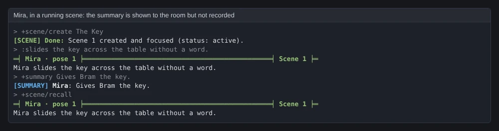

import { Aside } from '@astrojs/starlight/components';

The **summary** package adds `+summary`, one line that sums up your last pose for the people
in the room with you now. Use it after a long pose, so someone who arrives late or reads
quickly can follow.

```
> +summary Bars the door and will not let anyone leave.
[SUMMARY] Mira: Bars the door and will not let anyone leave.
```

- Only the room you are in hears it. Nobody elsewhere does.
- It is kept nowhere. A scene running in the room does not record it.
- What you type is shown as you typed it. Nothing in it is evaluated.

| You are | You want to | Read |
|---|---|---|
| A player | sum up a pose | [Summing up a pose](#summing-up-a-pose) |
| A player | know who sees it | [Who hears it](#who-hears-it) |
| Staff | install it, change the length limit | [Running the package](#running-the-package) |
| A coder | change the line the room sees | [Changing the line](#changing-the-line) |

In the game, `+help summary` has the same command in short form.

## Summing up a pose

`+summary <text>` tells everyone in your room, you included, one line with your name and the
text:

```
> :sets her glass down very slowly, glances at the door twice, then at Bram, and finally slides the key across the table without a word.
Mira sets her glass down very slowly, glances at the door twice, then at Bram, and finally slides the key across the table without a word.
> +summary Slides Bram the key, without a word.
[SUMMARY] Mira: Slides Bram the key, without a word.
```

The text is shown exactly as you typed it. Brackets, percent signs and semicolons are plain
text, so `+summary Pays [twice] the price; 50% up front` shows just that.

A summary is refused, and nobody hears it, when:

- it is empty;
- it is given a switch, such as `+summary/all`;
- it is longer than the limit, 200 characters on a new game;
- you are gagged, or the room's Speech lock does not let you speak.

```
> +summary
[SUMMARY] Warning: What happened? +summary <text> sums up your last pose in a line for the room.
> +summary/all Leaves.
[SUMMARY] Warning: +summary takes no switches. +summary <text> sums up your last pose.
```

One over the limit says how long it was:

```
[SUMMARY] Warning: Keep a summary to 200 characters. That one is 230.
```

A summary that is too long is refused, not cut short, so nothing you did not mean to send
reaches the room.

## Who hears it

Everyone in your location hears the summary, and nobody elsewhere does. Here Mira and Bram
are in the Salt Tavern, and Kit is in another room:


A summary is not part of the scene. A scene running in the room records your poses, says
and emits, but not a summary: it is not in `+scene/recall`, and not in the scene archive.



<Aside>
Nothing stores a summary, on you or anywhere else. Once the room has seen it, it is gone.
</Aside>

## Running the package

### Installing

The summary package ships with the server but is not installed on a new game. An
administrator installs it from the portal:

1. Open **Packages** in the admin area and choose **Browse**.
2. Install `summary`. It needs `plus-help` and `plus-config`, which a new game already has.

It adds the command `+summary` for everyone. It is a game command, which is matched before
softcode `$`-commands, so a `+summary` your game already has in softcode stops running once
the package is in.

It makes one object in the master room, **Summary**, which runs the command and holds the
setting, and puts its `+help` topics in an object inside it.

See [Softcode Packages](/guides/packages) for how installing, upgrading and rolling back
work.

### Settings

The one setting is set with `+config summary`:

| Setting | What it changes | Default |
|---|---|---|
| `max-length` | The longest summary, in characters, from 20 to 2000. A longer one is refused, not cut. | `200` |

```
> +config summary/max-length=300
[CONFIG] Done: summary/max-length is now 300, was 200.
```

## Changing the line

Another package can change the line the room is told with a filter on the **Summary** object:
an attribute named ``FILTER`SUMMARY`LINE`<name>``. Filters run in name order with `chain()`.
Each is given the line so far as `%0`, the player as `%1` and the summary as typed as `%2`,
and returns the line.

A filter a package attaches to the Summary object goes away when that package is uninstalled.
