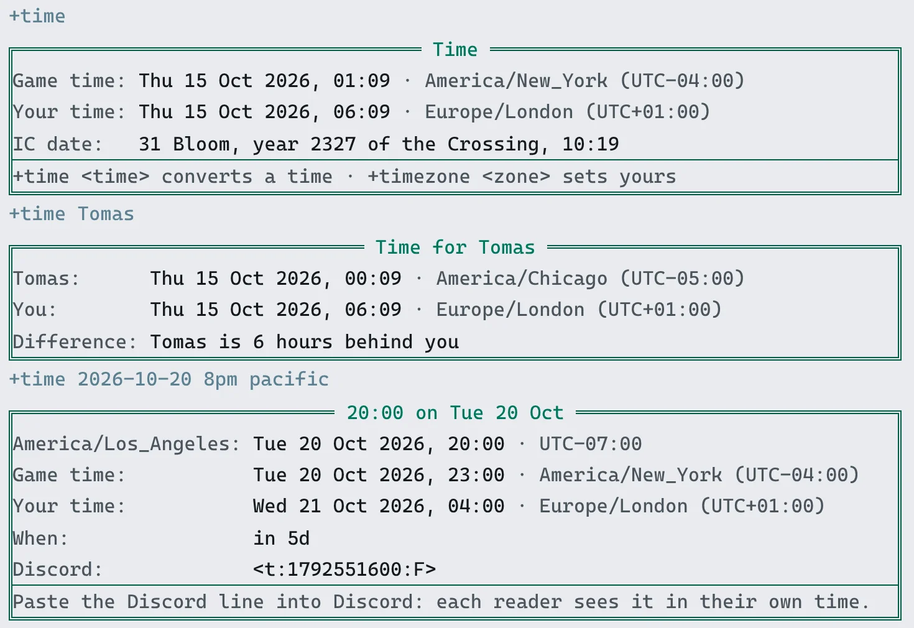
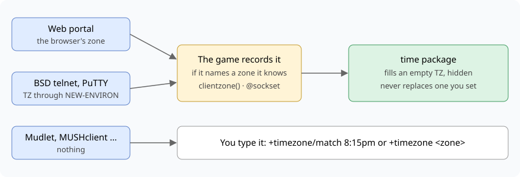
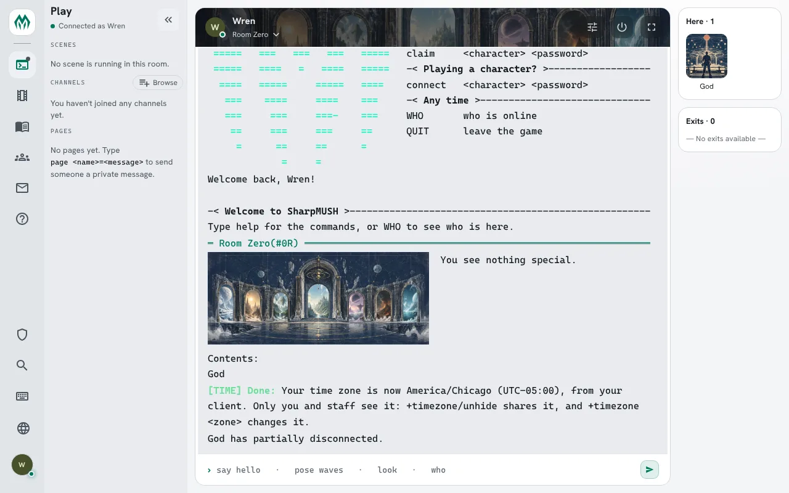
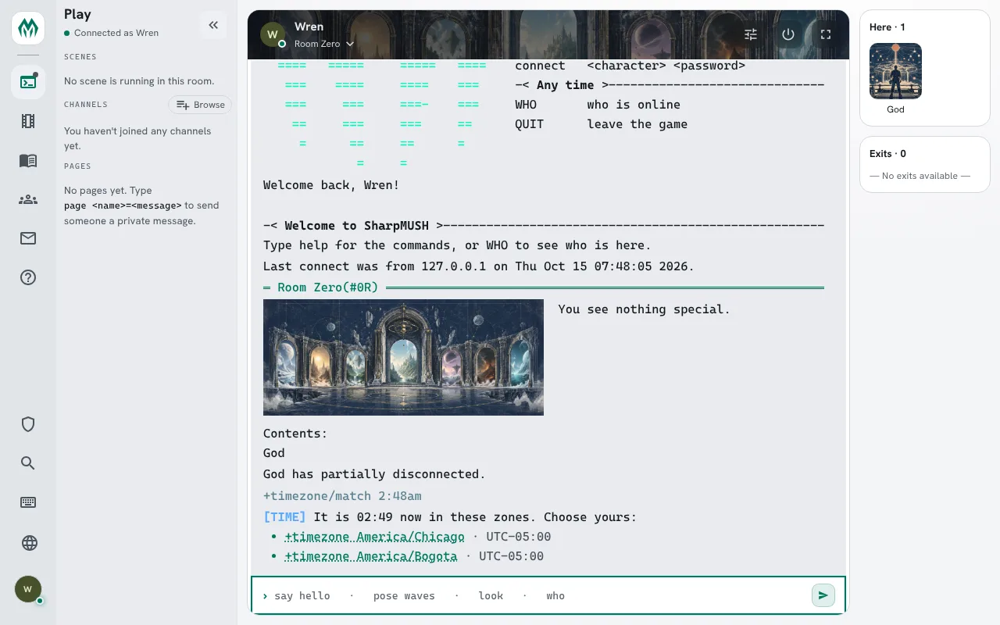
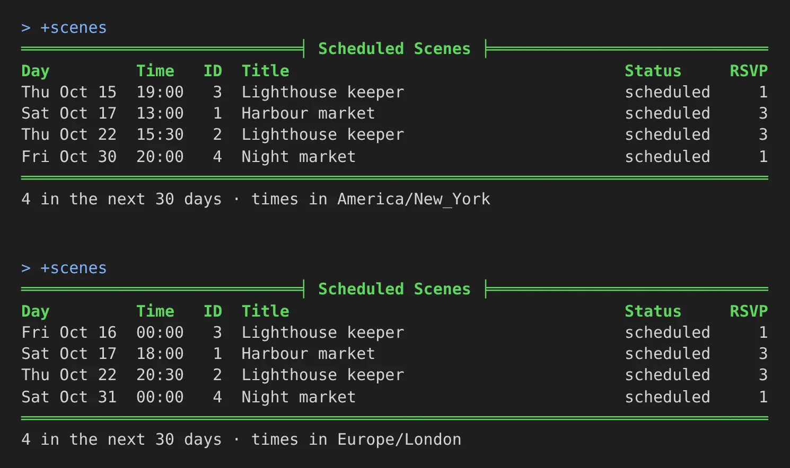

import { Aside } from '@astrojs/starlight/components';

The **time** package answers the question every game with players in several countries gets
asked: what time is that for me?

- `+time` shows the game's time, your own, and the IC date.
- `+time 8pm pacific` turns a time in one zone into the game's and yours, and gives a line you
  can paste into Discord so everyone there sees it in their own time.
- `+timezone` sets your zone.

The IC date is a clock the game sets: it can start on any day, run faster than the real one,
sit centuries away, and name its months and weekdays.

| You are | You want to | Read |
|---|---|---|
| A player | see the time | [The time now](#the-time-now) |
| A player | set your zone | [Setting your zone](#setting-your-zone) |
| A player | keep your zone to yourself | [Hiding your zone](#hiding-your-zone) |
| A player | let your client set your zone | [Your zone from your client](#your-zone-from-your-client) |
| A player | find your zone without knowing its name | [Finding your zone by the time](#finding-your-zone-by-the-time) |
| A player | plan a scene across zones | [Converting a time](#converting-a-time) |
| A player | read scene times in your zone | [Scenes in your time](#scenes-in-your-time) |
| Staff | set the game's zone | [Settings](#settings) |
| Staff | set the IC date | [The IC date](#the-ic-date) |
| A coder | read the time in your own code | [For coders](#for-coders) |

In the game, `+help time` and `+help timezone` have the same commands in short form.

## The time now

`+time` shows the game's time, yours, and the IC date:

```
> +time
===================================< Time >===================================
Game time: Thu 15 Oct 2026, 05:07 * UTC
Your time: Thu 15 Oct 2026, 06:07 * Europe/London (UTC+01:00)
IC date:   Thursday, 15 October 2026, 05:07
==============================================================================
+time <time> converts a time * +timezone <zone> sets yours
==============================================================================
```

Until you set your zone, *Your time* says `not set`.

`+time <name>` shows the time where another player is, and how far apart you are:

```
> +time Tomas
==============================< Time for Tomas >==============================
Tomas:      Thu 15 Oct 2026, 00:07 * America/Chicago (UTC-05:00)
You:        Thu 15 Oct 2026, 06:07 * Europe/London (UTC+01:00)
Difference: Tomas is 6 hours behind you
==============================================================================
```

A player who has not set a zone has no time to show:

```
> +time Ash
[TIME] Warning: Ash has not set a time zone.
```

The portal shows the same screens as cards:



## Setting your zone

`+timezone <zone>` sets your zone:

```
> +timezone uk
[TIME] Done: Your time zone is Europe/London (UTC+01:00). It is Thu 15 Oct 2026, 06:07 for you.
```

A zone is named the way the tz database names it: a region and a city, such as
`America/Chicago`, `Europe/Berlin` or `Australia/Perth`, or `UTC`. You need not type the capitals:
`america/new_york` works. Short names work too:

| Type | For |
|---|---|
| `eastern`, `est`, `edt` | America/New_York |
| `central`, `cst`, `cdt` | America/Chicago |
| `mountain`, `mst`, `mdt` | America/Denver |
| `arizona` | America/Phoenix |
| `pacific`, `pst`, `pdt` | America/Los_Angeles |
| `alaska` | America/Anchorage |
| `hawaii` | Pacific/Honolulu |
| `uk`, `gmt`, `bst` | Europe/London |
| `cet`, `cest` | Europe/Paris |
| `eet` | Europe/Athens |
| `jst` | Asia/Tokyo |
| `aest`, `aedt` | Australia/Sydney |
| `nzst`, `nzdt` | Pacific/Auckland |
| `z` | UTC |

`est` is New York's time, which moves to summer time and back. It is not a clock fixed five hours
behind UTC, which is what `EST` means to a computer.

A zone the server does not know is refused:

```
> +timezone Atlantis
[TIME] Warning: There is no time zone called 'Atlantis'. +help timezone says how they are named.
```

`+timezone` on its own shows yours, and `+timezone/clear` clears it:

```
> +timezone/clear
[TIME] Done: Your time zone is cleared. Times are shown in the game's.
```

### Hiding your zone

`+timezone/hide` keeps your zone to you and staff. Your own `+time` still uses it, but anyone
else who asks is told you keep it to yourself, and other packages read nothing:

```
> +timezone/hide
[TIME] Done: Only you and staff see your time zone now. +time <your name> tells others you keep it to yourself.
> +time Wren
[TIME] Warning: Wren keeps their time zone to themselves.
```

`+timezone/unhide` shows it again. A zone you hide stays hidden when you change it.

Your zone is your `TZ` attribute, the one PennMUSH keeps it in, so `time(*<name>)` reads it too.
Hiding it clears the attribute's `visual` flag, so `@set me/TZ=!visual` does the same.

### Your zone from your client

Some clients tell the game which zone they are in. When you have not set one, the game fills it
in from your client the moment you log in:



- **The web portal** always reports your browser's zone.
- **BSD telnet and inetutils telnet** report it when you tell them to, at the `telnet>` prompt,
  before you open the game:

  ```
  telnet> environ define TZ Europe/Paris
  telnet> environ export TZ
  telnet> open mygame.example.com 4201
  ```

  `environ export TZ` on its own sends the `TZ` your shell already has, if it holds a zone name.
- **PuTTY** reports it when you add `TZ`, with your zone as its value, under **Connection** →
  **Data** → **Environment variables**.
- **Mudlet, TinTin++, MUSHclient** and most other MUD clients report nothing. Use
  [`+timezone/match`](#finding-your-zone-by-the-time) or `+timezone <zone>`.

A zone set this way is hidden, since you never chose to share where you are:

```
connect Tess Tess-pass-1
Welcome back, Tess!
...
[TIME] Done: Your time zone is now Europe/Paris (UTC+02:00), from your client. Only you and staff see it: +timezone/unhide shares it, and +timezone <zone> changes it.
```



`+timezone/unhide` shares it, and `+timezone <zone>` changes it. A zone you set yourself is never
replaced, whatever your client says later. `+timezone/detect` sets the zone your client reported
whenever you ask:

```
> +timezone/detect
[TIME] Done: Your time zone is Asia/Tokyo (UTC+09:00), from your client. It is Thu 15 Oct 2026, 16:50 for you.
```

A game may only tell you what your client reported and leave setting it to you, or ignore it:
see `detect` under [Settings](#settings).

### Your zone from where you connect

A game can also look your zone up from where you connect from, when you have set none and your
client reports none. It is off unless the game turns it on, and when it is on, your address goes to
a zone service on the internet, such as ipinfo.io. The guess is often wrong behind a VPN or on a
mobile network. A zone found this way is hidden too:

```
connect Ida Ida-pass-1
...
[TIME] Done: Your time zone is now Europe/London (UTC+01:00), guessed from where you connect. Only you and staff see it: +timezone/unhide shares it, and +timezone <zone> changes it.
```

A game set to `offer` tells you instead, and `+timezone/detect` looks it up when you ask:

```
connect Ide Ide-pass-1
...
[TIME] Where you connect from suggests your time zone is Europe/London. +timezone/detect sets it.
> +timezone/detect
[TIME] Done: Your time zone is Europe/London (UTC+01:00), guessed from where you connect. It is Thu 15 Oct 2026, 16:32 for you.
```

### Finding your zone by the time

If your client reports nothing and you are not sure what your zone is called, type the time on
your clock. `+timezone/match` lists the zones where it is that time now, each a link that sets it:

```
> +timezone/match 4:44pm
[TIME] It is 16:45 now in these zones. Choose yours:
• +timezone Asia/Seoul · UTC+09:00
• +timezone Asia/Tokyo · UTC+09:00
```

Round the time as you like: the nearest zones within half an hour count. Zones with the same
offset come together, since the clock cannot tell them apart; pick the one you live in, as its
summer time may differ.



## Converting a time

`+time <time>` reads a time in your zone and shows it in the game's. Write it as `20:00`, `8pm`
or `8:30 am`:

```
> +time 8pm
============================< 20:00 on Thu 15 Oct >===========================
Europe/London: Thu 15 Oct 2026, 20:00 * UTC+01:00
Game time:     Thu 15 Oct 2026, 19:00 * UTC
When:          in 13h
Discord:       <t:1792090800:F>
==============================================================================
Paste the Discord line into Discord: each reader sees it in their own time.
==============================================================================
```

Put a zone after the time to read it there, and a date before it, year first, for another day:

```
> +time 2026-10-20 8pm pacific
============================< 20:00 on Tue 20 Oct >===========================
America/Los_Angeles: Tue 20 Oct 2026, 20:00 * UTC-07:00
Game time:           Wed 21 Oct 2026, 03:00 * UTC
Your time:           Wed 21 Oct 2026, 04:00 * Europe/London (UTC+01:00)
When:                in 5d
Discord:             <t:1792551600:F>
==============================================================================
Paste the Discord line into Discord: each reader sees it in their own time.
==============================================================================
```

A time on a date in summer gets summer time's offset, and one in winter gets winter's, whatever
the date is today.

The **Discord** line is a Discord timestamp. Paste it into a Discord message and Discord shows it
to each reader as a date and time in their own zone, so nobody has to work it out.

A time that cannot be read says why:

```
> +time 25:00
[TIME] Warning: '25:00' is not a time. Write 20:00, 8pm or 8:30 am.
> +time 8pm Atlantis
[TIME] Warning: There is no time zone called 'Atlantis'. +help timezone says how they are named.
```

## Scenes in your time

The scene package reads your zone too. A date and time you give `+scene/schedule`,
`+scene/reschedule` or `+scene/pause` is read in your zone, and `+scenes`, a scene's card and every
message about a time show it in your zone, with the zone named. Ann, in New York, moves a scene:

```
> +scene/reschedule 4=2026-10-30 20:00
[SCENE] Done: Rescheduled scene 4 for Fri Oct 30 20:00:00 2026 (America/New_York).
```

Ann and Bob, in London, read the same schedule:

```
> +scenes
=============================< Scheduled Scenes >=============================
Day         Time   ID  Title                                   Status     RSVP
Thu Oct 15  19:00   3  Lighthouse keeper                       scheduled     1
Sat Oct 17  13:00   1  Harbour market                          scheduled     3
Thu Oct 22  15:30   2  Lighthouse keeper                       scheduled     3
Fri Oct 30  20:00   4  Night market                            scheduled     1
==============================================================================
4 in the next 30 days * times in America/New_York
```

```
> +scenes
=============================< Scheduled Scenes >=============================
Day         Time   ID  Title                                   Status     RSVP
Fri Oct 16  00:00   3  Lighthouse keeper                       scheduled     1
Sat Oct 17  18:00   1  Harbour market                          scheduled     3
Thu Oct 22  20:30   2  Lighthouse keeper                       scheduled     3
Sat Oct 31  00:00   4  Night market                            scheduled     1
==============================================================================
4 in the next 30 days * times in Europe/London
```



Bob sees the scene's card at his time:

```
> +scene 4
===========================< Scene 4: Night market >==========================
Status:    scheduled
Owner:     Ann
Where:     No room yet
Created:   Oct 15 07:23AM
Scheduled: Oct 31 12:00AM (Europe/London)
Watchers:  Anyone
```

A player who has not set a zone sees the game's time, and the schedule says so:
`4 in the next 30 days * game time`. A time written in seconds, or from now such as `+3d`, is the
same for everyone.

Scenes use only your own zone, so a zone you keep hidden is never shown to anyone. The scene
package does not need this one: without it, `&TZ me=America/New_York` does the same.

## Running the package

### Installing

The time package ships with the server but is not installed on a new game. An administrator
installs it from the portal:

1. Open **Packages** in the admin area and choose **Browse**.
2. Install `time`. Its `+help` topics and `+config` settings come with it, through the `time-help` and `time-config` bridges, wherever `+help` and `+config` are installed. It
   adds two attributes to the event handler: ``PLAYER`CONNECT`TIME`` and
   ``SOCKET`TIMEZONE`TIME``, which hand it the zone a client reports.

It adds the commands `+time` and `+timezone` for everyone. They are game commands, which are
matched before softcode `$`-commands, so a `+time` your game already has in softcode stops running
once the package is in.

It makes two objects in the master room: **Time**, which runs the commands, and **Clock**, inside
it, which holds the settings and the short names for zones. Find the Clock's number with `@find`:

```
> @find Clock
Clock(#26TVn)
*** 1 objects found ***
```

The number on your game will differ.

### Settings

`+config time` lists the settings and `+config time/<setting>=<value>` changes one, with the
`config.admin` permission. See [Game Settings with +config](/guides/config).

| Setting | What it is | Default |
|---|---|---|
| `zone` | The game's zone, the one `+time` calls game time. | `UTC` |
| `format` | How a time is written, in [`timefmt()`](/reference/sharpmush-help/timefmt-function/)'s codes. | `$a $d $b $Y, $H:$M` |
| `detect` | What a zone a player's client reports does when they set none. `set` fills it in, hidden, and tells them; `offer` tells them at login, and `+timezone/detect` sets it; `off` does nothing. | `set` |
| `detect-ip` | What to do for a player who set no zone and whose client reports none. `set` and `offer` look the zone up from the player's address at login, through `ip-service`, then work as for `detect`; `off` sends nothing. | `off` |
| `ip-service` | The zone service: an https address with `<ip>` where the address goes, answering in JSON. | `https://ipinfo.io/<ip>/json` |
| `ip-field` | Where the zone is in the service's reply, as a JSON path. | `timezone` |
| `match-zones` | The zones `+timezone/match` offers, in the order it lists them. Each must be a zone the server knows. | about fifty, at least one for each offset most players live in |

To tell players what their client says without setting anything:

```
> +config time/detect=offer
[CONFIG] Done: time/detect is now offer, was set.
```

A player then sees this at login, until they set a zone:

```
[TIME] Your client says your time zone is Asia/Tokyo. +timezone/detect sets it.
```

The short names players may type for a zone are attributes on the Clock, ``ALIAS`<name>``, one
each, its value the zone. For example, to keep the game on New York time and let players type
`irish`:

```
> +config time/zone=America/New_York
[CONFIG] Done: time/zone is now America/New_York, was UTC.
> &ALIAS`IRISH #26=Europe/Dublin
Clock/ALIAS`IRISH - Set.
```

A short name wins over a zone of the same name, which is how `est` comes to mean New York.

#### Looking zones up by address

`detect-ip` sends the address of every player who logs in with no zone, and no zone from their
client, to the zone service. Say so in your game's privacy policy before you turn it on. An address
a service cannot place (loopback, a private network, link-local) is never sent, so a player on the
same network as the game gets nothing. `offer` suits it better than `set`, since an address is often
in the wrong place:

```
> +config time/detect-ip=offer
[CONFIG] Done: time/detect-ip is now offer, was off.
```

ipinfo.io, the default, needs no account, though it limits how many lookups it answers; check its
terms for a busy game. Any service that takes
the address in its URL and answers in JSON works; give the path to the zone in its reply too. For
ipwho.is:

```
> +config time/ip-service=https://ipwho.is/<ip>
[CONFIG] Done: time/ip-service is now https://ipwho.is/<ip>, was https://ipinfo.io/<ip>/json.
> +config time/ip-field=timezone.id
[CONFIG] Done: time/ip-field is now timezone.id, was timezone.
```

Only an https address is taken:

```
> +config time/ip-service=http://ip-api.com/json/<ip>
[CONFIG] Warning: time/ip-service: Give an https address with <ip> where the address goes, such as https://ipinfo.io/<ip>/json.
```

### The IC date

The IC date comes from these settings:

| Setting | What it is | Default |
|---|---|---|
| `ic-anchor` | A moment, in seconds since 1970, when the IC clock reads the same as the real one. | `1767225600`, 1 January 2026 at midnight UTC |
| `ic-ratio` | How many IC seconds pass each real second. `2` makes an IC day pass in twelve real hours. | `1` |
| `ic-days` | Days added to the IC date; below 0 goes back. | `0` |
| `ic-years` | Years added to the year shown. | `0` |
| `ic-months` | Twelve month names, January's first, split by `\|`. | the real ones |
| `ic-weekdays` | Seven weekday names, Sunday's first, split by `\|`. | the real ones |
| `ic-show` | `no` takes the IC date off `+time`. | `yes` |

How the date is written is ``FORMAT`IC`` on the Clock, which is code rather than a setting. Its
default is `%<weekday>, %<day> %<monthname> %<year>, %<hour>:%<minute>`, and it is evaluated with
`%<year>`, `%<month>` (1 to 12), `%<monthname>`, `%<day>`, `%<weekday>` (its name), `%<hour>`,
`%<minute>` and `%<second>`.

For example, a game set three hundred years on, whose IC days run twice as fast from 1 March
2026, with months of its own. `convtime()` turns the starting date into seconds:

```
> think convtime(2026-03-01T00:00:00Z)
1772323200
> +config time/ic-anchor=1772323200
[CONFIG] Done: time/ic-anchor is now 1772323200, was 1767225600.
> +config time/ic-ratio=2
[CONFIG] Done: time/ic-ratio is now 2, was 1.
> +config time/ic-years=300
[CONFIG] Done: time/ic-years is now 300, was 0.
> +config time/ic-months=Deepwinter|Thaw|Seedtime|Rains|Bloom|Highsun|Hay|Harvest|Leafall|Mist|Frost|Longnight
[CONFIG] Done: time/ic-months is now Deepwinter, Thaw, Seedtime, Rains, Bloom, Highsun, Hay, Harvest, Leafall, Mist, Frost, Longnight, was none.
> &FORMAT`IC #26=%<day> %<monthname>, year %<year> of the Crossing, %<hour>:%<minute>
Clock/FORMAT`IC - Set.
> +time
═══════════════════════════════════╡ Time ╞═══════════════════════════════════
Game time: Thu 15 Oct 2026, 03:00 · America/New_York (UTC-04:00)
Your time: Thu 15 Oct 2026, 08:00 · Europe/London (UTC+01:00)
IC date:   31 Bloom, year 2327 of the Crossing, 14:00
══════════════════════════════════════════════════════════════════════════════
+time <time> converts a time · +timezone <zone> sets yours
══════════════════════════════════════════════════════════════════════════════
```

Seven and a half real months at double speed is fifteen IC months, so the IC date is already
into the next year.

<Aside>
The IC calendar is the real one's: twelve months of the real lengths, so a month named Bloom
still has May's 31 days. A calendar of its own, with other month lengths, is a game's own code
in ``FORMAT`IC``, which is given the real calendar's parts to work from.
</Aside>

## For coders

Other code reads the time through functions on the Clock, with `u()`. The Clock is a plain
VISUAL object, so any object may call them, a player's included.

| Call | Gives |
|---|---|
| ``u(<Clock>/FUN`IC`DATE)`` | The IC date now, as ``FORMAT`IC`` writes it. Add a moment in seconds for another time. |
| ``u(<Clock>/FUN`IC`SECS,<seconds>)`` | The IC clock's moment, in seconds, before the years are added. |
| ``u(<Clock>/FUN`OOC`FOR,<seconds>,<player>)`` | That moment in the player's zone, or the game's when they set none. |
| ``u(<Clock>/FUN`OOC`SHOW,<seconds>,<zone>)`` | That moment in a zone; the game's when it is left empty. |
| ``u(<Clock>/FUN`ZONE`OF,<player>)`` | The player's zone, or nothing. |
| ``u(<Clock>/FUN`ZONE`GAME)`` | The game's zone. |
| ``u(<Clock>/FUN`ZONE`FIND,<text>)`` | The zone a player's text names, short names included, or nothing. |
| ``u(<Clock>/FUN`DATE`INSTANT,<date>,<hour>,<minute>,<zone>)`` | A date such as `2026-10-20` at that hour and minute in that zone, in seconds. |

Every function that takes a moment takes it as an argument, so code that shows a stored time,
such as when a scene is scheduled, shows it to each reader in their own zone:

```
> think u(#26/FUN`OOC`FOR,1792551600,*Tomas)
Tue 20 Oct 2026, 22:00
> think u(#26/FUN`IC`DATE,1772323200)
1 Seedtime, year 2326 of the Crossing, 00:00
```

### The zone a client reports

`clientzone(<player|descriptor>)` gives the zone a connection's client reported, such as
`Europe/Paris`, or nothing. It is only what the client said; the engine never changes `TZ` on its
own. The game drops anything that is not a zone it knows, so code can trust the name.

```
> think clientzone(me)
Europe/Paris
```

The ``socket`timezone`` event (*descriptor*, *zone*, *player*) fires once for each zone a
connection reports, usually before login, when *player* is empty. Code that acts at login reads
``clientzone(%<descriptor>)`` from ``player`connect`` instead, which is what the time package does.
See [Events](/guides/events) for adding to an event.

### Adding to +time

Another package adds lines to the `+time` screen with a filter on the **Time** object: an
attribute named ``FILTER`TIME`SCREEN`<name>``. Filters run in name order with `chain()`. Each is
given the screen so far as `%0`, the player reading as `%1` and the moment as `%2`, and returns
the screen with its own lines added:

```
> &FILTER`TIME`SCREEN`WEATHER #15=%0%r[fields(,Weather,Light rain)]
Time/FILTER`TIME`SCREEN`WEATHER - Set.
> +time
===================================< Time >===================================
Game time: Thu 15 Oct 2026, 01:11 * America/New_York (UTC-04:00)
Your time: Thu 15 Oct 2026, 06:11 * Europe/London (UTC+01:00)
IC date:   31 Bloom, year 2327 of the Crossing, 10:23
Weather: Light rain
==============================================================================
+time <time> converts a time * +timezone <zone> sets yours
==============================================================================
```

A filter a package attaches to the Time object goes away when that package is uninstalled.
